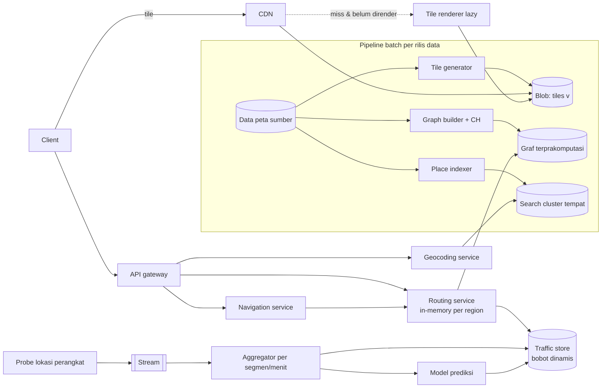
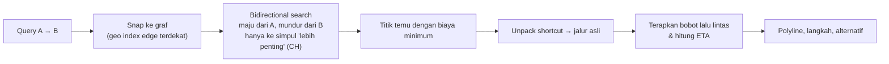

## 1. Requirements

Klarifikasi: fitur mana yang menjadi fokus: menampilkan peta, pencarian tempat, rute dan navigasi, atau ETA dengan lalu lintas? Platform (web/mobile)? Offline?

### Functional

- Menampilkan peta interaktif (pan, zoom) di seluruh dunia.
- Mencari tempat/alamat (geocoding) dan sebaliknya.
- Menghitung rute dari A ke B untuk mobil (jalan kaki/transit sebagai ekstensi) dengan ETA yang memperhitungkan lalu lintas.
- Navigasi turn-by-turn dengan re-routing saat menyimpang.
- Out of scope: Street View, ulasan tempat, iklan, editing peta.

### Non-functional

| NFR            | Target                                                             | Alasan                          |
| -------------- | ------------------------------------------------------------------ | ------------------------------- |
| Latency tile   | Tile terlihat &lt; 200 ms dari edge                                | Pan/zoom mulus                  |
| Latency rute   | &lt; 500 ms untuk rute antarkota                                   | Interaktif                      |
| Akurasi ETA    | Error median &lt; 10%                                              | Kepercayaan                     |
| Availability   | 99.99% peta dan rute                                               | Dipakai untuk navigasi berjalan |
| Kesegaran data | Jalan baru dalam hari; lalu lintas dalam menit                     | Peta dan ETA                    |
| Skala          | 1 miliar user bulanan; miliaran tile/hari; puluhan ribu rute/detik | Global                          |

## 2. Estimasi kapasitas

Asumsi: data jalan dunia ≈ ratusan juta segmen; tile raster 256 px ≈ 20 KB, 20 zoom level; 1 miliar MAU, 50 juta user bersamaan puncak; sesi melihat ~100 tile; 50.000 rute/detik puncak.

- **Tile**: jumlah tile zoom z = 4^z; zoom 0–20 total ≈ 1.5 × 10^12, tetapi mayoritas laut/kosong; tile unik bermakna ≈ 10^10–10^11 × 20 KB ≈ **PB** di blob store; sebagian besar dibuat lazy. Permintaan: 50M user × 100 tile / sesi 10 menit ≈ **8 juta tile/detik** puncak; hampir semua dari CDN/cache client (zoom rendah dan kota besar sangat populer).
- **Graf jalan**: ~500 juta simpul, 1 miliar edge × ~50 B ≈ 50 GB; dengan prapemrosesan (shortcut) ~2–3x → muat di memori beberapa server besar atau dipartisi per benua.
- **Rute**: 50.000/detik × ~5 ms CPU = 250 core; dengan replikasi per region, ratusan server routing.
- **Lalu lintas**: 100 juta perangkat × ping tiap 10 s ≈ 10 juta/s masuk; agregasi per segmen per menit → ~100 juta segmen × 1 nilai/menit, kecil setelah agregasi.
- **Geocoding**: ratusan juta tempat, index pencarian beberapa TB, puluhan ribu QPS.

Keputusan: tile di blob + CDN dengan pembuatan lazy, routing engine in-memory per region dengan graf terprakomputasi, lalu lintas sebagai lapisan bobot dinamis, geocoding sebagai cluster pencarian.

## 3. API design

```text
GET /tiles/{style}/{z}/{x}/{y}.{png|pbf}        via CDN; immutable per versi data (v=...)
GET /v1/geocode?q=Stasiun+Gambir&near=lat,lng    → [{ placeId, name, lat, lng, type }]
GET /v1/reverse?lat=&lng=                        → alamat terstruktur
GET /v1/route?from=lat,lng&to=lat,lng&mode=car&depart=now
     → { distance, duration, durationInTraffic, polyline, steps[], alternatives[] }
GET /v1/eta?from=&to=&depart=                    → ringan, untuk Uber-like matching (batch endpoint: matrix)
POST /v1/navigation/sessions  … stream posisi → re-route bila menyimpang
POST /v1/traffic/probes (internal/SDK)  { segmentId|lat,lng, speed, ts }  dibatch
```

Tile URL menyertakan versi data sehingga cache tidak perlu di-purge saat peta diperbarui.

## 4. Skema data

```text
-- Data peta (sumber): fitur geografis (jalan, bangunan, POI) dengan geometri; disimpan di DB geospasial + versi rilis
-- Graf jalan (turunan): nodes(id, lat, lng), edges(id, from, to, length, speed_limit, class, restrictions, geometry)
   dipartisi by region; file biner terprakomputasi (CH) per rilis, dimuat ke memori routing server
-- Tile (turunan): blob store key = {style}/{v}/{z}/{x}/{y}; metadata rendered_at
-- Lalu lintas: segment_speed(segment_id, minute_bucket) → avg_speed, sample_count (KV/time-series, TTL jam)
   + traffic_profile(segment_id, day_of_week, minute_of_day) → typical_speed (untuk prediksi)
-- Tempat: places(id, name, aliases, address, lat, lng, cell, category, popularity) → index pencarian + geo index
```

Semua turunan (graf CH, tile, index tempat) dibangun ulang per rilis data lewat pipeline batch; versi rilis mengikat semuanya agar konsisten.

## 5. High-level design



**Alur peta**: client menghitung tile yang dibutuhkan untuk viewport (z/x/y) → CDN; miss ke blob; blob miss ke renderer lazy (tile jarang diminta dirender saat pertama diminta, lalu disimpan).

**Alur rute**: client → routing service region asal → snap koordinat ke simpul/edge terdekat (geo index) → query CH bidirectional dengan bobot statis + lapisan lalu lintas → polyline + langkah → cache rute populer singkat.

**Alur lalu lintas**: probe → stream → agregasi per segmen per menit (kecepatan median, jumlah sampel) → store dengan TTL → dipakai routing; model prediksi memakai profil historis untuk waktu tiba di masa depan.

## 6. Detailed design

### 6.1 Tile

- Skema slippy map: zoom z membagi dunia menjadi 2^z × 2^z tile (proyeksi Web Mercator); client menghitung x,y dari lat/lng.
- **Raster** (PNG) sederhana; **vector tile** (PBF) lebih kecil, styling dan rotasi di client, satu set tile untuk banyak gaya. Pilih vector untuk mobile modern dengan fallback raster.
- Pembuatan: prarender zoom rendah (0–10, sedikit tile, sangat populer) untuk semua; zoom tinggi lazy dengan cache permanen; invalidasi lewat versi di URL saat rilis data baru.
- CDN hit ratio sangat tinggi karena distribusi permintaan sangat condong ke kota besar dan zoom sedang. Client juga meng-cache tile.

### 6.2 Routing



- **Contraction hierarchies**: offline, simpul "dikontraksi" berurutan; shortcut ditambahkan agar jarak terpendek tetap benar; query hanya naik ke simpul yang lebih penting dari kedua arah → menjelajahi ratusan simpul alih-alih jutaan.
- Bobot dinamis: CH klasik mengasumsikan bobot statis. Opsi: (a) customizable CH/multi-level partition (CRP) yang memisahkan topologi dari bobot sehingga bobot dapat diperbarui menit-an; (b) CH statis untuk rute, lalu ETA dihitung ulang dengan bobot lalu lintas di sepanjang rute dan beberapa alternatif. Sebutkan (a) sebagai yang dipakai produk serius.
- Partisi: graf per benua/region di memori server berbeda; rute lintas region lewat simpul perbatasan.
- Restriksi belok, jalan satu arah, jam larangan: dimodelkan sebagai edge berarah dan penalti.

### 6.3 ETA dan lalu lintas

- Bobot per segmen = f(kecepatan saat ini jika sampel cukup, profil historis untuk hari/jam, batas kecepatan sebagai fallback).
- Untuk perjalanan 40 menit, segmen di akhir rute memakai **prediksi** kecepatan pada waktu tiba, bukan kondisi sekarang.
- Privasi: probe dianonimkan, diagregasi, tidak disimpan per perangkat untuk lalu lintas.
- Kualitas: bandingkan ETA prediksi dengan aktual (dari sesi navigasi) sebagai metrik, latih model koreksi.

### 6.4 Geocoding

- Index pencarian teks (nama, alias, alamat terstruktur) dengan boosting popularitas dan **bias lokasi** (jarak ke user sebagai faktor skor); typeahead memakai prefix index (kasus typeahead).
- Reverse geocoding: geo index (S2/H3) tempat dan jalan → terdekat → alamat.

### 6.5 Navigasi

Sesi navigasi menyimpan rute aktif; client mengirim posisi; bila menyimpang &gt; ambang dari polyline, re-route dari posisi saat ini (query ringan karena titik awal baru); instruksi dihitung di server dan di-cache di client agar offline singkat tetap berjalan.

### 6.6 Rilis data

Pipeline batch mingguan/harian: validasi data sumber → bangun graf dan CH (jam CPU) → render tile zoom rendah → index tempat → publikasi versi baru secara atomik (routing server memuat graf baru di samping lama, lalu switch; tile URL versi baru; alias index). Rollback = kembali ke versi sebelumnya.

## 7. Evaluasi terhadap non-functional requirements

| NFR                 | Dipenuhi oleh                                                                                                             | Risiko tersisa                                               |
| ------------------- | ------------------------------------------------------------------------------------------------------------------------- | ------------------------------------------------------------ |
| Tile &lt; 200 ms    | CDN hit ratio tinggi, prarender populer, cache client                                                                     | Area terpencil zoom tinggi: render lazy pertama kali lambat  |
| Rute &lt; 500 ms    | CH in-memory, bidirectional, snap via geo index                                                                           | Rute lintas benua sangat panjang: unpack lebih lama; cache   |
| Akurasi ETA         | Bobot real-time + prediksi + koreksi dari aktual                                                                          | Daerah dengan sedikit probe: fallback profil/batas kecepatan |
| Availability 99.99% | Tile statis (tahan bahkan saat API mati), routing replikasi per region, degradasi ke bobot statis bila traffic store mati | Rilis graf buruk: blue-green dan rollback                    |
| Kesegaran           | Rilis data harian; lalu lintas menit                                                                                      | Jalan baru butuh siklus rilis                                |
| Skala               | Tile: CDN; rute: horizontal per region; lalu lintas: stream + agregasi                                                    | Biaya egress tile                                            |

Bottleneck 10x: egress CDN dan ingest probe (keduanya horizontal); SPOF: pipeline rilis (batch, bukan jalur online).

## 8. Pertanyaan lanjutan interviewer

- "Bagaimana rute yang menghindari tol atau untuk sepeda?" → Profil bobot berbeda per mode; graf/CH terpisah per profil atau bobot bertingkat.
- "Peta offline?" → Paket vector tile + graf wilayah terkompresi diunduh ke perangkat; routing lokal dengan CH versi kecil.
- "Alternatif rute?" → Cari rute dengan penalti pada edge rute utama, atau plateau method; batasi 2–3 alternatif.
- "Insiden (kecelakaan) menutup jalan?" → Laporan pengguna + verifikasi; bobot segmen = tak hingga sementara; propagasi ke routing dalam menit.
- "Transit umum?" → Graf waktu-bergantung (jadwal), algoritma RAPTOR/CSA; berbeda dari jalan.
- "Bagaimana mengukur kualitas peta?" → Laporan kesalahan, perbandingan rute aktual vs usulan, cakupan probe.
