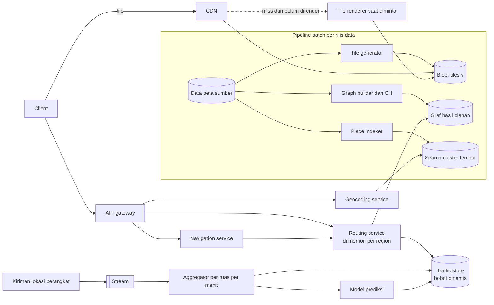
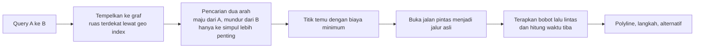

## 1. Requirements

Pertanyaan klarifikasi: fitur mana yang menjadi fokus? Menampilkan peta, mencari tempat, menghitung rute, atau memperkirakan waktu tiba dengan lalu lintas? Platform apa? Apakah perlu mode offline?

### Functional

- Menampilkan peta interaktif seluruh dunia yang bisa digeser dan diperbesar.
- Mencari tempat atau alamat, dan sebaliknya mengubah koordinat menjadi alamat.
- Menghitung rute mobil dari A ke B dengan perkiraan waktu tiba yang memperhitungkan lalu lintas.
- Navigasi belokan demi belokan, dengan rute ulang saat pengguna menyimpang.
- Di luar cakupan: Street View, ulasan tempat, iklan, dan penyuntingan peta.

### Non-functional

| Target             | Nilai                                                                          | Alasan                     |
| ------------------ | ------------------------------------------------------------------------------ | -------------------------- |
| Latency tile       | Tile tampil di bawah 200 ms dari edge                                          | Geser dan zoom harus mulus |
| Latency rute       | Di bawah 500 ms untuk rute antarkota                                           | Harus terasa interaktif    |
| Akurasi waktu tiba | Kesalahan median di bawah 10%                                                  | Kepercayaan pengguna       |
| Availability       | 99.99% untuk peta dan rute                                                     | Dipakai saat berkendara    |
| Kesegaran data     | Jalan baru muncul dalam hitungan hari, lalu lintas dalam hitungan menit        | Peta dan waktu tiba        |
| Skala              | 1 miliar pengguna bulanan, miliaran tile per hari, puluhan ribu rute per detik | Layanan global             |

## 2. Estimasi kapasitas

Asumsi: data jalan dunia berisi ratusan juta ruas, dan satu tile raster 256 piksel berukuran 20 KB dengan 20 level zoom. Ada 1 miliar pengguna bulanan dengan 50 juta bersamaan saat puncak. Satu sesi melihat sekitar 100 tile, dan ada 50 ribu rute per detik saat puncak.

- Jumlah tile: level zoom z punya 4 pangkat z tile. Totalnya triliunan, tetapi mayoritas adalah laut atau area kosong. Tile yang bermakna sekitar 10 sampai 100 miliar, dikali 20 KB berarti petabyte di blob store. Sebagian besar dibuat saat pertama diminta.
- Permintaan tile: 50 juta pengguna dikali 100 tile per sesi 10 menit berarti sekitar 8 juta tile per detik saat puncak. Hampir semua dilayani CDN dan cache client, karena zoom rendah dan kota besar sangat populer.
- Graf jalan: sekitar 500 juta simpul dan 1 miliar ruas dikali 50 byte berarti 50 GB. Dengan jalan pintas hasil pengolahan, ukurannya 2 sampai 3 kali lipat. Itu muat di memori beberapa server besar, atau dipartisi per benua.
- Rute: 50 ribu per detik dikali 5 ms CPU berarti 250 core. Dengan replikasi per region, ratusan server routing.
- Lalu lintas: 100 juta perangkat mengirim lokasi tiap 10 detik berarti 10 juta kiriman per detik. Setelah agregasi per ruas per menit, datanya kecil.
- Pencarian tempat: ratusan juta tempat dengan index beberapa TB dan puluhan ribu query per detik.

Keputusan dari angka ini: tile di blob store dan CDN dengan pembuatan saat diminta. Routing engine hidup di memori per region dengan graf yang sudah diolah. Lalu lintas menjadi lapisan bobot dinamis, dan geocoding menjadi cluster pencarian.

## 3. API design

```text
GET /tiles/{style}/{z}/{x}/{y}.{png|pbf}        via CDN; immutable per versi data (v=...)
GET /v1/geocode?q=Stasiun+Gambir&near=lat,lng    → [{ placeId, name, lat, lng, type }]
GET /v1/reverse?lat=&lng=                        → alamat terstruktur
GET /v1/route?from=lat,lng&to=lat,lng&mode=car&depart=now
     → { distance, duration, durationInTraffic, polyline, steps[], alternatives[] }
GET /v1/eta?from=&to=&depart=                    → ringan; ada versi matrix untuk matching ala Uber
POST /v1/navigation/sessions  … stream posisi → rute ulang bila menyimpang
POST /v1/traffic/probes (internal/SDK)  { segmentId|lat,lng, speed, ts }  dibatch
```

URL tile menyertakan versi data. Dengan itu, cache tidak perlu dibersihkan saat peta diperbarui.

## 4. Skema data

```text
-- Data peta sumber: fitur geografis (jalan, bangunan, tempat) dengan geometri, di DB geospasial, per versi rilis
-- Graf jalan (turunan): nodes(id, lat, lng), edges(id, from, to, length, speed_limit, class, restrictions, geometry)
   dipartisi per region; file biner hasil pengolahan per rilis dimuat ke memori routing server
-- Tile (turunan): blob store, key = {style}/{v}/{z}/{x}/{y}; metadata rendered_at
-- Lalu lintas: segment_speed(segment_id, minute_bucket) → avg_speed, sample_count (time-series, TTL jam)
   + traffic_profile(segment_id, day_of_week, minute_of_day) → typical_speed (untuk prediksi)
-- Tempat: places(id, name, aliases, address, lat, lng, cell, category, popularity) → index pencarian dan geo index
```

Semua data turunan dibangun ulang per rilis lewat pipeline batch. Nomor rilis mengikat graf, tile, dan index agar konsisten.

## 5. High-level design



Alur peta:

1. Client menghitung tile yang dibutuhkan viewport dari zoom, x, dan y.
2. Client meminta tile ke CDN.
3. Kalau CDN tidak punya, CDN meminta ke blob store.
4. Kalau blob store belum punya, renderer membuat tile itu, menyimpannya, lalu mengembalikannya.

Alur rute:

1. Client memanggil routing service di region asalnya.
2. Routing service menempelkan koordinat ke simpul atau ruas terdekat lewat geo index.
3. Routing service menjalankan pencarian dua arah di graf hasil olahan, dengan bobot statis ditambah lapisan lalu lintas.
4. Routing service mengembalikan polyline dan langkah belokan. Rute populer di-cache sebentar.

Alur lalu lintas:

1. Perangkat mengirim kiriman lokasi ke stream.
2. Aggregator menghitung kecepatan median dan jumlah sampel per ruas per menit.
3. Aggregator menulis hasilnya ke traffic store dengan TTL.
4. Model prediksi memakai profil historis untuk memperkirakan kecepatan pada waktu tiba nanti.

## 6. Detailed design

### 6.1 Tile

Skema slippy map membagi dunia pada zoom z menjadi 2 pangkat z kali 2 pangkat z tile dalam proyeksi Web Mercator. Client menghitung x dan y dari latitude dan longitude.

Tile raster berupa PNG dan sederhana. Tile vektor berupa PBF, lebih kecil, dan membiarkan client mengatur gaya serta memutar peta. Satu set tile vektor bisa dipakai untuk banyak gaya. Pilih vektor untuk ponsel modern dengan raster sebagai cadangan.

Zoom rendah, yaitu level 0 sampai 10, dirender lebih dulu untuk seluruh dunia karena jumlahnya sedikit dan sangat populer. Zoom tinggi dirender saat diminta dan disimpan permanen. Pembaruan peta dilakukan lewat nomor versi di URL. CDN mendapat hit ratio sangat tinggi karena permintaan menumpuk di kota besar dan zoom sedang. Client juga meng-cache tile.

### 6.2 Routing



Contraction hierarchies adalah teknik pengolahan graf offline. Simpul dikontraksi satu per satu, dan jalan pintas ditambahkan agar jarak terpendek tetap benar. Saat query, pencarian hanya naik ke simpul yang lebih penting dari kedua arah. Hasilnya, query menjelajahi ratusan simpul alih-alih jutaan.

Bobot dinamis butuh perlakuan khusus, karena contraction hierarchies klasik mengasumsikan bobot statis. Ada dua pilihan. Pertama, memakai varian yang memisahkan topologi dari bobot, seperti customizable contraction hierarchies, sehingga bobot bisa diperbarui tiap menit. Kedua, memakai graf statis untuk rute, lalu menghitung ulang waktu tiba dengan bobot lalu lintas di sepanjang rute dan beberapa alternatif. Produk serius memakai pilihan pertama.

Graf dipartisi per benua atau region di server berbeda. Rute lintas region lewat simpul perbatasan. Larangan belok, jalan satu arah, dan jam larangan dimodelkan sebagai ruas berarah dan penalti.

### 6.3 Waktu tiba dan lalu lintas

Bobot per ruas dihitung dari kecepatan saat ini bila sampelnya cukup, profil historis untuk hari dan jam itu, dan batas kecepatan sebagai cadangan. Untuk perjalanan 40 menit, ruas di akhir rute memakai prediksi kecepatan pada waktu tiba, bukan kondisi sekarang.

Kiriman lokasi dianonimkan dan diagregasi. Data per perangkat tidak disimpan untuk lalu lintas. Kualitas diukur dengan membandingkan waktu tiba prediksi dan aktual dari sesi navigasi, lalu model koreksi dilatih dari selisihnya.

### 6.4 Geocoding

Pencarian tempat memakai index teks atas nama, alias, dan alamat terstruktur. Skor dinaikkan oleh popularitas dan jarak ke pengguna. Fitur typeahead memakai index prefix seperti di kasus typeahead. Reverse geocoding memakai geo index tempat dan jalan untuk menemukan yang terdekat, lalu menyusun alamat.

### 6.5 Navigasi

Sesi navigasi menyimpan rute aktif. Client mengirim posisi secara berkala. Kalau posisi menyimpang dari polyline melewati ambang, server menghitung rute ulang dari posisi saat ini. Query ini ringan karena titik awalnya baru. Instruksi dihitung di server dan di-cache di client, sehingga offline sebentar tetap berjalan.

### 6.6 Rilis data

Pipeline batch berjalan harian atau mingguan dengan urutan ini:

1. Validasi data sumber.
2. Bangun graf dan contraction hierarchies, yang memakan jam CPU.
3. Render tile zoom rendah.
4. Bangun index tempat.
5. Publikasikan versi baru secara atomik. Routing server memuat graf baru di samping graf lama lalu beralih, URL tile memakai versi baru, dan alias index dipindah.

Rollback berarti kembali ke versi sebelumnya.

## 7. Evaluasi terhadap non-functional requirements

| Target               | Cara memenuhinya                                                                                                                | Risiko yang tersisa                                                            |
| -------------------- | ------------------------------------------------------------------------------------------------------------------------------- | ------------------------------------------------------------------------------ |
| Tile di bawah 200 ms | Hit ratio CDN tinggi, tile populer dirender lebih dulu, cache client                                                            | Area terpencil pada zoom tinggi dirender saat pertama diminta dan lebih lambat |
| Rute di bawah 500 ms | Graf hasil olahan di memori, pencarian dua arah, geo index untuk penempelan                                                     | Rute lintas benua sangat panjang. Pakai cache                                  |
| Akurasi waktu tiba   | Bobot real-time, prediksi, dan koreksi dari data aktual                                                                         | Daerah dengan sedikit kiriman memakai profil atau batas kecepatan              |
| Availability 99.99%  | Tile statis tetap tersaji walau API mati, routing direplikasi per region, bobot statis sebagai cadangan bila traffic store mati | Rilis graf yang buruk. Pakai blue-green dan rollback                           |
| Kesegaran            | Rilis data harian dan lalu lintas per menit                                                                                     | Jalan baru butuh satu siklus rilis                                             |
| Skala                | CDN untuk tile, routing horizontal per region, stream dan agregasi untuk lalu lintas                                            | Biaya egress tile                                                              |

Kalau beban naik 10 kali, yang pecah duluan adalah egress CDN dan penerimaan kiriman lokasi. Keduanya bisa ditambah horizontal. Pipeline rilis adalah proses batch, bukan jalur online, jadi bukan titik lemah saat melayani.

## 8. Pertanyaan lanjutan interviewer

- "Bagaimana rute yang menghindari tol, atau untuk sepeda?" Setiap mode punya profil bobot sendiri, dengan graf terpisah atau bobot bertingkat.
- "Bagaimana peta offline?" Paket tile vektor dan graf wilayah terkompresi diunduh ke perangkat. Routing lokal memakai versi kecil dari graf hasil olahan.
- "Bagaimana rute alternatif?" Cari rute dengan penalti pada ruas rute utama, dan batasi 2 sampai 3 alternatif.
- "Bagaimana kecelakaan yang menutup jalan?" Laporan pengguna diverifikasi, bobot ruas dibuat tak terhingga sementara, dan disebarkan ke routing dalam menit.
- "Bagaimana transportasi umum?" Graf bergantung waktu dari jadwal, dengan algoritma seperti RAPTOR. Ini berbeda dari graf jalan.
- "Bagaimana mengukur kualitas peta?" Laporan kesalahan, perbandingan rute aktual dan usulan, serta cakupan kiriman lokasi.
