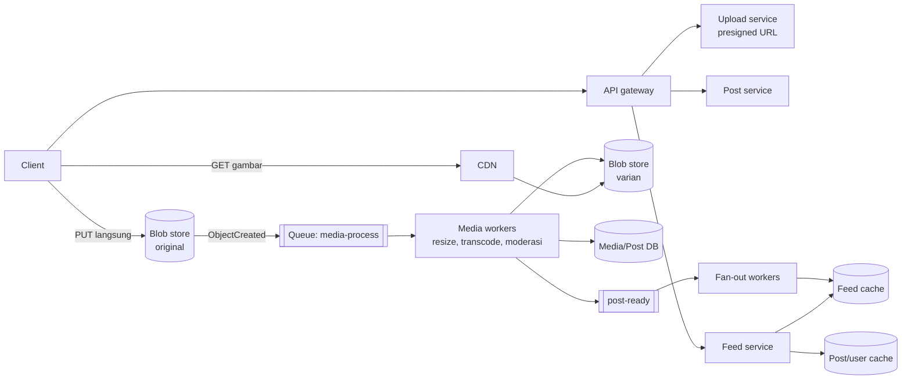
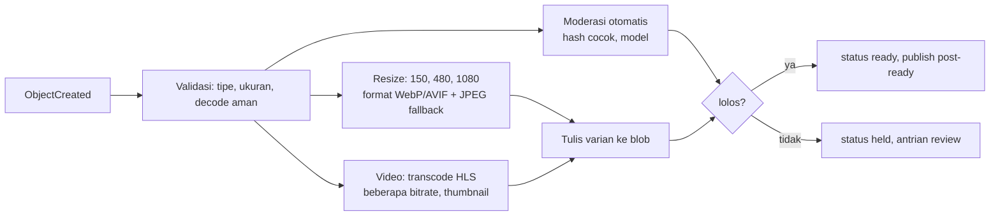

## 1. Requirements

Klarifikasi: foto saja atau video juga. Rasio unggah dan lihat. Feed kronologis atau ranking. Apakah Stories dan Reels termasuk. Apakah komentar dan like termasuk.

### Functional

- Unggah foto atau video pendek dengan caption. Media diproses menjadi beberapa ukuran.
- Follow. Home feed berisi post dari akun yang diikuti. Profil menampilkan post pengguna.
- Like dan komentar, berupa jumlah dan daftar.
- Di luar cakupan: pesan langsung, Stories, Reels dan rekomendasi, pencarian, iklan.

### Non-functional

| Target           | Nilai                                                                      | Alasan                               |
| ---------------- | -------------------------------------------------------------------------- | ------------------------------------ |
| Latency feed     | p99 di bawah 300 ms untuk metadata. Gambar pertama tampil di bawah 1 detik | Pengalaman scroll                    |
| Availability     | 99.99% untuk baca                                                          | Produk konsumen                      |
| Durability media | Tidak boleh hilang                                                         | Kenangan pengguna                    |
| Konsistensi      | Eventual untuk feed dan like. Read-your-writes untuk post sendiri          | Pengguna melihat post sendiri segera |
| Skala            | 500 juta pengguna aktif harian, baca jauh lebih banyak dari tulis          | Global, mobile                       |

## 2. Estimasi kapasitas

Asumsi: 500 juta pengguna aktif harian. Dua persen mengunggah satu post per hari, yaitu 10 juta post per hari. Tiap pengguna melihat 50 post per hari. Foto asli 3 MB, dan semua ukuran turunannya 1 MB.

- Unggah: 10 juta dibagi 100 ribu detik, sekitar 100 post per detik. Puncaknya 300. Bandwidth masuk 100 kali 3 MB, sekitar 300 MB per detik.
- Lihat: 500 juta kali 50 dibagi 100 ribu detik, sekitar 250.000 tampilan post per detik. Satu request feed berisi 20 post, jadi sekitar 12.500 QPS. Puncaknya 40.000.
- Bandwidth keluar: 250.000 kali sekitar 300 KB untuk ukuran sedang, sekitar 75 GB per detik. CDN mutlak. Origin hanya menerima cache miss.
- Storage media: 10 juta kali 4 MB untuk asli dan turunannya, sekitar 40 TB per hari. Lima tahun sekitar 70 PB. Blob store dengan tier dingin untuk berkas asli.
- Metadata post: 10 juta kali 1 KB, sekitar 10 GB per hari. Lima tahun sekitar 18 TB, jadi perlu partisi.
- Cache feed: seperti newsfeed, ratusan GB untuk pengguna aktif.

Keputusan: jalur data media sepenuhnya di blob store dan CDN. Pipeline pemrosesan asinkron berkapasitas ratusan job per detik. Feed memakai pendekatan hybrid.

## 3. API design

```text
POST /api/v1/media/uploads           { "type": "image/jpeg", "size": 3400000 }
   → 201 { uploadId, presignedUrl, expiresAt }            (multipart untuk video)
POST /api/v1/posts                   { "uploadId", "caption", Idempotency-Key }
   → 202 { postId, status: "processing" }
GET  /api/v1/feed?cursor=&limit=20   → { posts: [{ id, author, caption, media: [{ url, w, h, format }], likeCount, ... }], nextCursor }
GET  /api/v1/users/{id}/posts?cursor=
POST /api/v1/posts/{id}/like · DELETE …/like
POST /api/v1/posts/{id}/comments { text } · GET …/comments?cursor=
```

Respons feed menyertakan URL CDN untuk tiap ukuran. Client memilih sesuai layarnya. Status `processing` membuat aplikasi bisa menampilkan post sendiri dengan placeholder sebelum semua ukuran siap.

## 4. Skema data

```sql
users(id, handle, ..., follower_count, is_celebrity)
posts(id /* 64-bit: ts | shard | seq */, author_id, caption, media_id, created_at, status)
      -- shard by author_id (profil = 1 shard); id terurut waktu
media(id, owner_id, original_key, variants JSONB {size→key}, width, height, status)
follows(follower_id, followee_id) + indeks terbalik
likes(post_id, user_id, created_at)  PK(post_id, user_id)  -- sumber kebenaran; counter turunan
comments(id, post_id, user_id, text, created_at)  -- shard by post_id
```

Blob store menyimpan berkas asli di tier dingin setelah 30 hari, dan berkas turunan per ukuran di tier panas di belakang CDN. Jumlah like dan komentar memakai sharded counter, atau dihitung dari tabel like dan disimpan di cache.

## 5. High-level design



Alur unggah:

1. Client meminta izin unggah dan menerima presigned URL, yaitu tautan unggah berbatas waktu yang ditandatangani server.
2. Client mengunggah berkas langsung ke blob store.
3. Client mengonfirmasi post, dan post service mencatatnya dengan status `processing`.
4. Blob store menerbitkan event bahwa objek baru dibuat.
5. Media worker membuat beberapa ukuran, memeriksa moderasi, menulis metadata, dan menandai post `ready`.
6. Media worker menerbitkan event `post-ready`.
7. Fan-out worker mengisi cache feed follower.

Post sendiri tampil segera di profil penulis dengan placeholder, karena dibaca langsung dari database.

Alur feed:

1. Feed service mengambil daftar ID dari cache feed, lalu menggabungkan post selebriti.
2. Feed service mengambil metadata dari cache objek.
3. Feed service menyusun URL CDN untuk tiap ukuran.
4. Client mengambil gambar dari CDN dan prefetch beberapa post berikutnya.

## 6. Detailed design

### 6.1 Pipeline media



- Worker pool dipisah untuk foto dan video. Foto cepat dan butuh CPU. Video lama dan butuh GPU atau CPU berat. Queue dipisah agar video tidak menghambat foto.
- Pemrosesan aman diulang karena key keluaran ditentukan dari ID media dan ukuran.
- Kegagalan ditangani dengan pengulangan berjeda dan dead-letter queue, yaitu antrian khusus untuk pesan yang terus gagal. Status `failed` terlihat ke pengguna dengan opsi unggah ulang.
- Berkas asli disimpan di tier dingin untuk pemrosesan ulang, misalnya saat ada format baru.

### 6.2 Penyimpanan dan penyajian media

- Blob store memakai replikasi atau erasure coding lintas zona. Objek kecil seperti thumbnail digabung ke berkas besar ala Haystack bila kita mengelola storage sendiri.
- CDN memakai key per media dan ukuran. Objeknya immutable dengan TTL sangat panjang. Menghapus post berarti menghapus objek dan purge CDN, yang jarang terjadi.
- Pemilihan ukuran dilakukan server berdasarkan lebar layar dan kerapatan piksel yang dikirim client. Alternatifnya URL berparameter yang dinormalisasi CDN agar jumlah key terbatas.
- Konten viral diserap CDN. Origin shield, yaitu lapisan cache di depan blob store, menahan cache miss dari banyak edge sekaligus.

### 6.3 Feed

Sama dengan kasus newsfeed: push untuk akun biasa, pull untuk selebriti, cache ID per pengguna, dan pembangunan ulang dari database. Perbedaannya, fan-out dipicu event `post-ready` setelah semua ukuran siap, bukan saat unggah. Dengan begitu follower tidak melihat gambar rusak.

### 6.4 ID dan sharding

ID 64 bit dibuat di dalam shard: 41 bit timestamp, 13 bit nomor shard, dan 10 bit nomor urut. Tabel post dipartisi berdasarkan penulis lewat pemetaan shard logis ke database fisik. Ada ribuan shard logis di puluhan database, sehingga penyeimbangan ulang memindahkan shard logis utuh.

### 6.5 Like dan komentar

- Tabel like adalah sumber kebenaran dan aman diulang per pengguna. Jumlahnya disimpan di Redis, dengan sharded counter untuk post viral. Tampilan membaca jumlah dari cache.
- Komentar dipartisi berdasarkan post dan dibaca per halaman dengan cursor. Halaman pertama post viral dilayani dari cache.

## 7. Evaluasi terhadap non-functional requirements

| Target                       | Cara memenuhi                                                                              | Risiko tersisa                                                                                 |
| ---------------------------- | ------------------------------------------------------------------------------------------ | ---------------------------------------------------------------------------------------------- |
| Latency feed                 | Cache ID dan cache objek. Media dari edge CDN. Prefetch di client                          | Ukuran langka yang diubah saat diminta lebih lambat. Batasi daftar ukuran yang didukung        |
| Availability 99.99%          | Service tanpa state, cache terreplikasi, CDN. Saat fan-out tertunda, feed tampil agak lama | Pipeline media tertunda membuat post `processing` lebih lama. Terlihat, tetapi tidak mematikan |
| Durability media             | Blob store multi-zona, berkas asli di tier dingin, checksum                                | Penghapusan permanen sesuai regulasi butuh alur yang bisa diaudit                              |
| Read-your-writes             | Post sendiri dibaca dari database primary                                                  | Tidak ada                                                                                      |
| Skala 75 GB per detik keluar | Hit ratio CDN tinggi karena konten populer dibagi                                          | Profil lama yang jarang diakses dilayani origin, dan biaya egress naik                         |

Bottleneck saat trafik naik 10 kali: pipeline media, cache feed, dan egress CDN. Worker dan node bisa ditambah, sedangkan egress adalah soal biaya. Titik tunggal kegagalannya adalah queue media. Pakai cluster terreplikasi.

## 8. Pertanyaan lanjutan interviewer

- "Stories yang hilang setelah 24 jam?" Objek dengan masa berlaku, feed terpisah per pengguna, dan penghapusan lewat aturan siklus hidup storage, bukan job manual.
- "Bagaimana mencegah konten terlarang tayang?" Moderasi di pipeline sebelum status `ready`, dengan pencocokan hash dan model, lalu review manusia untuk kasus ambigu.
- "Video panjang atau Reels?" Transcoding HLS dengan beberapa bitrate dan player adaptif. Dibahas di kasus YouTube.
- "Hapus akun beserta semua medianya?" Tandai akun, hapus metadata, jalankan job penghapusan objek per media, purge CDN, dan simpan bukti selesai.
- "Multi-region?" Unggah ke region terdekat, replikasi blob antar region secara asinkron, CDN global, dan database metadata dengan primary per region.
- "Kenapa fan-out setelah semua ukuran siap?" Supaya feed follower tidak menampilkan placeholder rusak. Jeda beberapa detik dapat diterima.
