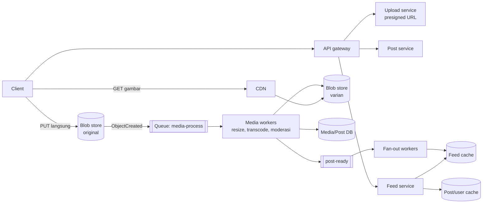
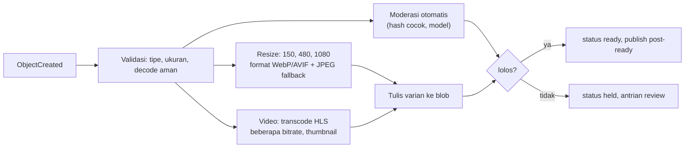

## 1. Requirements

Klarifikasi: foto saja atau video juga? Rasio upload vs lihat? Feed kronologis atau ranking? Stories/Reels (sementara, vertikal) termasuk? Komentar dan like?

### Functional

- Upload foto/video pendek dengan caption; media diproses menjadi beberapa varian.
- Follow; home feed berisi post dari yang diikuti; profil menampilkan post user.
- Like dan komentar (counter dan daftar).
- Out of scope: DM, Stories, Reels/rekomendasi, pencarian, iklan.

### Non-functional

| NFR              | Target                                                         | Alasan                           |
| ---------------- | -------------------------------------------------------------- | -------------------------------- |
| Latency feed     | p99 &lt; 300 ms untuk metadata; gambar pertama tampil &lt; 1 s | Pengalaman scroll                |
| Availability     | 99.99% baca                                                    | Produk konsumer                  |
| Durability media | Tidak boleh hilang                                             | Kenangan user                    |
| Konsistensi      | Eventual untuk feed/like; read-your-writes untuk post sendiri  | User melihat post sendiri segera |
| Skala            | 500 juta DAU, baca ≫ tulis                                     | Global, mobile                   |

## 2. Estimasi kapasitas

Asumsi: 500 juta DAU; 2% mengunggah 1 post/hari (10 juta post/hari); tiap user melihat 50 post/hari; foto asli 3 MB, varian total 1 MB.

- Upload: 10M / 10^5 ≈ **100 post/detik**, puncak 300; bandwidth masuk 100 × 3 MB ≈ 300 MB/s.
- Lihat: 500M × 50 / 10^5 ≈ **250.000 tampilan post/detik**; feed request (20 post per halaman) ≈ 12.500 QPS, puncak 40.000.
- Bandwidth keluar: 250.000 × ~300 KB (varian medium) ≈ **75 GB/s**. CDN mutlak; origin hanya menerima miss.
- Storage media: 10M × 4 MB (asli + varian) ≈ 40 TB/hari → 5 tahun ≈ **70 PB**. Blob store dengan tier dingin untuk asli.
- Metadata post: 10M × 1 KB ≈ 10 GB/hari → 5 tahun ≈ 18 TB; shard.
- Feed cache: seperti newsfeed, ratusan GB untuk user aktif.

Keputusan: data path media sepenuhnya di blob + CDN; pipeline pemrosesan async berkapasitas ratusan job/detik; feed hybrid.

## 3. API design

```text
POST /api/v1/media/uploads           { "type": "image/jpeg", "size": 3400000 }
   → 201 { uploadId, presignedUrl, expiresAt }            (multipart untuk video)
POST /api/v1/posts                   { "uploadId", "caption", Idempotency-Key }
   → 202 { postId, status: "processing" }
GET  /api/v1/feed?cursor=&limit=20   → { posts: [{ id, author, caption, media: [{ url, w, h, format }], likeCount, ... }], nextCursor }
GET  /api/v1/users/{id}/posts?cursor=
POST /api/v1/posts/{id}/like · DELETE …/like
POST /api/v1/posts/{id}/comments { text } · GET …/comments?cursor=
```

Respons feed menyertakan URL CDN per varian; client memilih sesuai layar. `status: processing` memungkinkan UI menampilkan post sendiri dengan placeholder sebelum varian siap.

## 4. Skema data

```sql
users(id, handle, ..., follower_count, is_celebrity)
posts(id /* 64-bit: ts | shard | seq */, author_id, caption, media_id, created_at, status)
      -- shard by author_id (profil = 1 shard); id terurut waktu
media(id, owner_id, original_key, variants JSONB {size→key}, width, height, status)
follows(follower_id, followee_id) + indeks terbalik
likes(post_id, user_id, created_at)  PK(post_id, user_id)  -- sumber kebenaran; counter turunan
comments(id, post_id, user_id, text, created_at)  -- shard by post_id
```

Blob store: `original/{media_id}` (tier dingin setelah 30 hari), `v/{media_id}/{size}.{webp|jpg}` (tier panas, di belakang CDN). Counter like/komentar: sharded counter atau agregasi dari tabel `likes` dengan cache.

## 5. High-level design



**Alur upload**: client minta izin → unggah langsung ke blob store → konfirmasi post (status processing) → worker membuat varian, memeriksa moderasi, menulis metadata, menandai `ready`, menerbitkan `post-ready` → fan-out mengisi feed cache follower. Post sendiri tampil segera di profil penulis dengan placeholder (read-your-writes dari DB).

**Alur feed**: feed service mengambil ID dari feed cache (+ merge selebriti), hydrate metadata dari cache objek, menyusun URL CDN per varian. Client mengambil gambar dari CDN dan prefetch beberapa post berikutnya.

## 6. Detailed design

### 6.1 Pipeline media



- Worker pool terpisah untuk foto (cepat, CPU) dan video (lama, GPU/CPU berat); queue terpisah agar video tidak menghambat foto.
- Idempotent: output key deterministik `v/{media_id}/{size}`; pemrosesan ulang aman.
- Kegagalan: retry dengan backoff, DLQ, status `failed` yang terlihat ke user dengan opsi unggah ulang.
- Asli disimpan untuk pemrosesan ulang (format baru di masa depan) di tier dingin.

### 6.2 Penyimpanan dan penyajian media

- Blob store dengan replikasi/erasure coding lintas zona; objek kecil (thumbnail) digabung ala Haystack bila mengelola sendiri.
- CDN dengan key `v/{media_id}/{size}`: immutable, TTL sangat panjang; hapus post = hapus objek + purge (jarang).
- Pemilihan varian: client mengirim DPR/lebar, server memilih; atau URL berparameter yang dinormalisasi oleh CDN agar cache key terbatas.
- Hot content (post viral): CDN menyerap; origin shield di depan blob store.

### 6.3 Feed

Sama dengan kasus newsfeed: hybrid push untuk akun biasa, pull untuk selebriti; cache ID per user; rekonstruksi dari DB. Perbedaan: fan-out dipicu `post-ready` (setelah varian siap), bukan saat upload, agar follower tidak melihat gambar rusak.

### 6.4 ID dan sharding

ID 64-bit dibuat di shard (timestamp 41 bit | shard id 13 bit | sequence 10 bit). `posts` shard by `author_id` lewat logical shard → physical DB mapping (ribuan logical shard di puluhan DB) agar rebalancing memindahkan logical shard utuh.

### 6.5 Like dan komentar

- Like: tabel `likes` sebagai sumber kebenaran (idempotent per user), counter di Redis dengan sharded counter untuk post viral; tampilan membaca counter cache.
- Komentar: shard by `post_id`, paginasi cursor, post viral dengan jutaan komentar dibaca dari cache halaman pertama.

## 7. Evaluasi terhadap non-functional requirements

| NFR                  | Dipenuhi oleh                                                                          | Risiko tersisa                                                                                           |
| -------------------- | -------------------------------------------------------------------------------------- | -------------------------------------------------------------------------------------------------------- |
| Latency feed         | Cache ID + cache objek; media dari CDN edge; prefetch client                           | Cache miss varian langka (resize on-the-fly) lebih lambat; batasi ukuran yang didukung                   |
| Availability 99.99%  | Stateless service, cache terreplikasi, CDN; degradasi: feed basi bila fan-out tertunda | Pipeline media tertunda = post "processing" lebih lama; itu degradasi yang terlihat tapi tidak mematikan |
| Durability media     | Blob store multi-zona, asli di tier dingin, checksum                                   | Hapus permanen sesuai regulasi perlu alur GC yang bisa diaudit                                           |
| Read-your-writes     | Post sendiri dibaca dari DB/primary untuk penulis                                      | —                                                                                                        |
| Skala 75 GB/s keluar | CDN hit ratio tinggi (konten populer dibagi)                                           | Long-tail dari profil lama: origin menanggung; biaya egress                                              |

Bottleneck 10x: pipeline media (worker horizontal), feed cache (node), egress CDN (biaya). SPOF: queue media; cluster terreplikasi.

## 8. Pertanyaan lanjutan interviewer

- "Stories yang hilang setelah 24 jam?" → Objek dengan TTL/lifecycle, feed terpisah (tray) per user, hapus lewat lifecycle bukan job manual.
- "Bagaimana mencegah konten terlarang tayang?" → Moderasi di pipeline sebelum `ready`; hash matching + model; review manusia untuk ambigu.
- "Video panjang/Reels?" → Transcoding HLS multi-bitrate, player adaptif; dibahas di kasus YouTube.
- "Hapus akun dan semua media?" → Tandai, hapus metadata, job GC objek per media_id, purge CDN, bukti selesai.
- "Multi-region?" → Upload ke region terdekat, replikasi blob lintas region async, CDN global, metadata DB dengan primary per region/user.
- "Kenapa fan-out setelah varian siap, bukan saat upload?" → Menghindari placeholder rusak di feed follower; latency beberapa detik dapat diterima.
