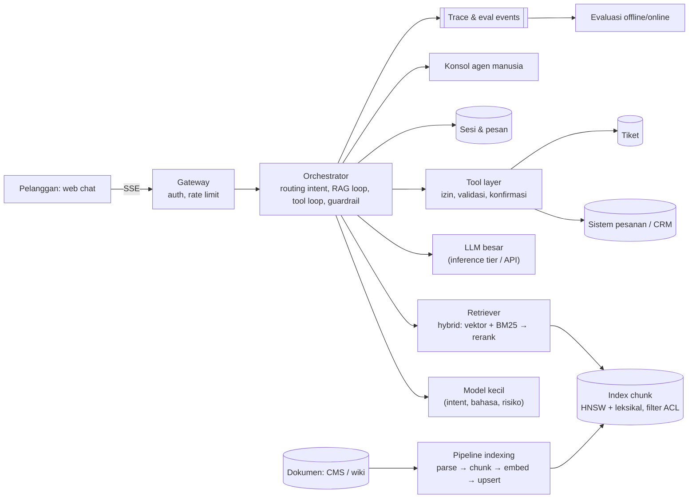
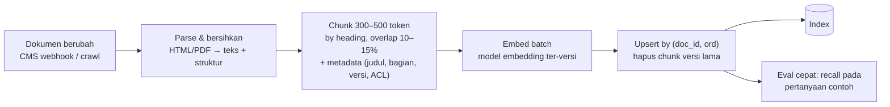

## 1. Requirements

Pertanyaan klarifikasi: kanalnya web chat, email, atau WhatsApp? Sumber pengetahuannya dokumentasi publik, kebijakan internal, atau data pelanggan seperti status pesanan? Tindakan apa yang boleh dilakukan bot? Bahasa apa saja? Apakah ada eskalasi ke agen manusia? Regulasi apa yang berlaku untuk data pelanggan?

Asumsi: e-commerce dengan web chat. Pengetahuan berasal dari pusat bantuan dan kebijakan internal. Alat yang tersedia adalah cek pesanan, buat tiket, dan usulkan refund dengan persetujuan. Eskalasi ke agen tersedia.

### Functional

- Menjawab pertanyaan dari basis pengetahuan dengan kutipan sumber. Bot mengatakan "tidak tahu" bila tidak ada sumber.
- Mengakses data pelanggan yang sudah login lewat alat dengan izin, misalnya status dan riwayat pesanan.
- Melakukan tindakan terbatas seperti membuat tiket dan mengusulkan refund dalam batas, dengan konfirmasi.
- Mengeskalasi ke agen manusia dengan ringkasan percakapan. Agen melihat konteks lengkap.
- Dokumen yang diperbarui tercermin di index dalam hitungan menit, dengan versi.
- Evaluasi kualitas dan umpan balik pengguna.
- Di luar cakupan: suara, dukungan multibahasa penuh, dan pelatihan model.

### Non-functional

| Target       | Nilai                                                                                   | Alasan                       |
| ------------ | --------------------------------------------------------------------------------------- | ---------------------------- |
| Grounding    | Jawaban tentang kebijakan dan fakta harus didukung sumber yang dikutip, tanpa mengarang | Risiko hukum dan kepercayaan |
| Keamanan     | Tidak membocorkan data pelanggan lain, tahan prompt injection, alat dengan hak minimum  | Data sensitif                |
| Latency      | Token pertama di bawah 2 detik termasuk retrieval, jawaban lengkap di bawah 10 detik    | Pengalaman chat              |
| Kesegaran    | Perubahan dokumen terlihat di bawah 10 menit                                            | Kebijakan berubah            |
| Availability | 99.9%, dengan cadangan ke FAQ statis atau agen bila LLM mati                            | Support tidak boleh hilang   |
| Skala        | 1 juta percakapan per hari, puncak 500 request per detik                                | Marketplace besar            |
| Biaya        | Model kecil untuk tugas sederhana, cache untuk pertanyaan berulang                      | Token mahal                  |

Grounding berarti jawaban terikat pada dokumen yang benar-benar diambil, bukan pada ingatan model.

## 2. Estimasi kapasitas

- Request: 1 juta percakapan dikali 5 giliran dibagi 100 ribu detik adalah sekitar 50 request per detik. Puncaknya 500 per detik.
- Retrieval per request: embedding query dengan model kecil sekitar 10 ms. Pencarian vektor dan BM25 masing-masing mengambil 50 kandidat, lalu reranker memilih 8 potongan. Totalnya di bawah 300 ms.
- Index: 20.000 halaman menghasilkan sekitar 200.000 potongan. Tiap potongan punya embedding 1.024 angka, sekitar 4 KB. Total sekitar 800 MB untuk vektor, ditambah teks. Muat di memori satu node dengan HNSW dan direplikasi.
- Token: satu prompt berisi instruksi, kebijakan, 8 potongan dikali 400 token, dan riwayat, totalnya sekitar 5.000 token masuk dan 300 token keluar. Lima puluh request per detik berarti 265.000 token masuk per detik. Biaya didominasi token masuk, jadi prefix caching dan pemangkasan penting.
- LLM: 500 request per detik dengan prompt 5.000 token adalah beban prefill yang besar. Jumlah potongan dibatasi, dan model kecil dipakai untuk klasifikasi dan routing.
- Log percakapan dan jejak retrieval: 5 juta giliran per hari dikali 10 KB adalah 50 GB per hari. Retensi dikendalikan.

Keputusan desain: pipeline RAG dengan retrieval hybrid dan reranker, orchestrator dengan lapisan alat yang berizin, model bertingkat, dan evaluasi offline serta online.

## 3. API design

```text
POST /v1/chat/sessions                      { channel, customerId? (setelah auth) } → { sessionId }
POST /v1/chat/sessions/{id}/messages        { text, Idempotency-Key } → SSE stream:
      event: retrieval  { sources: [{ docId, title, version, score }] }
      event: delta      { text }
      event: tool_call  { name, args, requiresConfirmation: bool }
      event: tool_result{ name, summary }
      event: done       { messageId, citations: [...], confidence, escalate: bool }
POST /v1/chat/sessions/{id}/confirm         { toolCallId, approve: bool }
POST /v1/chat/sessions/{id}/escalate        → { ticketId, summary }
POST /v1/feedback                           { messageId, rating, comment }
Internal:
POST /v1/kb/documents  (upload/ubah) → pipeline indexing;  GET /v1/kb/search?q= (debug retrieval)
POST /v1/eval/runs     { suite, promptVersion, modelVersion, indexVersion } → laporan
```

## 4. Skema data

```sql
documents(id, title, source_url, version, acl_scope: public|internal, updated_at, status)
chunks(id, doc_id, doc_version, ord, text, metadata JSONB, embedding VECTOR(1024), tsv TSVECTOR)
     -- index: HNSW pada embedding, GIN pada tsv; filter acl_scope saat query
sessions(id, customer_id, channel, status: bot|escalated|closed, created_at)
messages(id, session_id, role, text, citations JSONB, tool_calls JSONB, model, prompt_version, created_at)
tool_audit(id, session_id, tool, args, actor: bot|customer_confirmed|agent, result, ts)
tickets(id, session_id, summary, priority, assigned_agent, status)
feedback(message_id, rating, comment, ts)
eval_cases(id, question, reference_answer, expected_doc_ids, tags)
eval_runs(id, prompt_version, model_version, index_version, metrics JSONB, ts)
```

Dokumen punya versi, dan tiap potongan menyimpan versi dokumennya supaya kutipan merujuk versi yang dipakai saat menjawab. ACL per dokumen, yaitu aturan siapa boleh melihat apa, ditegakkan saat retrieval dan bukan oleh model.

## 5. High-level design



Alur satu giliran:

1. Guardrail memeriksa pesan masuk: menyamarkan data pribadi untuk log, mendeteksi pola injeksi, dan mengklasifikasi intent serta risiko dengan model kecil.
2. Bila intent adalah status pesanan, orchestrator memanggil alat `get_order` dengan identitas pelanggan dari sesi yang sudah login, bukan dari teks.
3. Bila intent adalah pertanyaan pengetahuan, retriever menulis ulang query berdasarkan konteks percakapan.
4. Retriever mencari secara hybrid dengan filter ACL, menjalankan reranker, dan mengambil 5 sampai 8 potongan.
5. Orchestrator menyusun prompt dari instruksi, kebijakan menjawab, potongan beserta id-nya, dan riwayat ringkas.
6. LLM menghasilkan jawaban dengan kutipan `[doc:ver]`, dan jawaban di-stream ke pelanggan.
7. Guardrail memeriksa output: kutipan ada dan relevan, tidak ada data pelanggan lain, dan nadanya sesuai.
8. Orchestrator menyimpan pesan dan jejak retrieval.
9. Bila keyakinan rendah atau pelanggan meminta manusia, orchestrator mengeskalasi dengan ringkasan.

## 6. Detailed design

### 6.1 Pipeline indexing



Pembaruan aman diulang karena kuncinya adalah gabungan id dokumen, versi, dan urutan potongan. Potongan versi lama dihapus setelah versi baru aktif, dengan pergantian atomik per dokumen.

Metadata seperti judul, breadcrumb, produk, dan tanggal disimpan bersama potongan dan diikutkan ke prompt. Dengan begitu model tahu konteks tiap potongan.

Pergantian model embedding berarti reindex penuh ke index baru, lalu alias dipindahkan. Dokumen internal diberi ACL. Pertanyaan pelanggan hanya mengambil dokumen publik dan kebijakan yang disetujui.

### 6.2 Retrieval hybrid dan rerank

Model kecil menulis ulang query. Contohnya "yang tadi itu bisa dibatalkan?" menjadi query mandiri berdasarkan riwayat.

Pencarian vektor dengan HNSW mengambil 50 kandidat dan menangkap parafrase. BM25 mengambil 50 kandidat dan menangkap istilah eksak seperti SKU dan kode error. Kedua daftar digabung dengan reciprocal rank fusion, lalu cross-encoder reranker memilih 5 sampai 8 potongan di atas ambang skor. Bila tidak ada yang melewati ambang, bot menjawab "tidak menemukan" dan menawarkan eskalasi.

Filter metadata seperti produk, negara, dan bahasa diterapkan sebelum pencarian. Hasil retrieval untuk query populer di-cache beberapa menit. Jawaban penuh untuk FAQ yang sangat umum juga di-cache dan dihapus saat dokumennya berubah.

### 6.3 Orchestrator, prompt, dan loop alat

Prompt disimpan ber-versi di repo. Perubahan prompt harus melewati evaluasi sebelum rilis. Bagian yang stabil ditaruh di awal supaya cache awalan efektif.

Loop alat berjalan begini:

1. Model mengeluarkan panggilan terstruktur berisi nama alat dan argumen.
2. Lapisan alat memvalidasi skema dan mengisi identitas dari sesi. Identitas pelanggan tidak pernah berasal dari argumen model.
3. Lapisan alat memeriksa kebijakan, misalnya refund maksimal Rp200.000 untuk pesanan di bawah 30 hari.
4. Alat yang berdampak meminta konfirmasi eksplisit dari pelanggan lewat event `tool_call`, dan untuk kasus tertentu juga persetujuan agen.
5. Hasil alat dikembalikan ke model, dan model menyusun jawaban.
6. Semua panggilan dicatat di `tool_audit`.

Loop dibatasi jumlah panggilan maksimum, timeout, dan jalur cadangan. Model bertingkat dipakai: model kecil untuk klasifikasi, penulisan ulang query, dan guardrail, sedangkan model besar untuk menyusun jawaban.

### 6.4 Guardrail dan keamanan

| Ancaman                                     | Mitigasi                                                                                                                                        |
| ------------------------------------------- | ----------------------------------------------------------------------------------------------------------------------------------------------- |
| Prompt injection dari pengguna atau dokumen | Instruksi sistem memisahkan data dari perintah. Alat berizin berada di luar model. Dokumen hanya dari sumber terkendali. Pola injeksi dideteksi |
| Kebocoran data pelanggan lain               | Identitas dari sesi. Alat hanya mengembalikan data pelanggan itu. Output diperiksa untuk data pribadi asing                                     |
| Halusinasi kebijakan                        | Jawaban hanya dari potongan. Kutipan wajib. Grounding diperiksa. Ambang retrieval diterapkan                                                    |
| Jawaban berbahaya atau nada buruk           | Klasifier output, kebijakan gaya, dan eskalasi untuk topik sensitif seperti hukum dan keluhan serius                                            |
| Penyalahgunaan seperti spam dan scraping    | Rate limit, kuota per sesi, dan deteksi bot                                                                                                     |
| Log berisi data pribadi                     | Penyamaran sebelum disimpan, retensi pendek, dan akses terbatas                                                                                 |

### 6.5 Eskalasi dan agen manusia

Eskalasi dipicu oleh keyakinan rendah, permintaan pelanggan, intent berisiko, sentimen negatif berulang, atau loop alat yang gagal. Bot membuat ringkasan berisi fakta, apa yang sudah dicoba, dan kutipan, lalu membuat tiket. Agen melihat transkrip dan bisa mengambil alih sesi yang sama. Jawaban agen menjadi data evaluasi dan masukan koreksi dokumen.

### 6.6 Evaluasi dan umpan balik

Evaluasi offline memakai suite dari tiket nyata yang dianonimkan, dengan jawaban referensi dan dokumen yang diharapkan. Metriknya meliputi recall retrieval, kesetiaan jawaban pada sumber, kebenaran jawaban yang dinilai LLM dan dikalibrasi manusia, keamanan lewat suite serangan injeksi, serta latency dan biaya. Suite ini berjalan di CI untuk setiap perubahan prompt, model, index, atau cara pemotongan dokumen.

Evaluasi online memantau rasio eskalasi, resolusi tanpa agen, kepuasan pelanggan, rasio "tidak tahu", dan pergeseran skor retrieval. Sampel diperiksa manusia tiap minggu, dan prompt atau model baru diluncurkan lewat canary.

Pertanyaan yang sering tidak terjawab diteruskan ke tim konten sebagai permintaan dokumen baru.

## 7. Evaluasi terhadap non-functional requirements

| Target                      | Dipenuhi oleh                                                                                                      | Risiko tersisa                                                                          |
| --------------------------- | ------------------------------------------------------------------------------------------------------------------ | --------------------------------------------------------------------------------------- |
| Grounding                   | RAG dengan kutipan ber-versi, ambang retrieval, pemeriksaan grounding, jawaban "tidak tahu"                        | Dokumen sumber salah atau kedaluwarsa. Mitigasi: versi dan umpan balik ke tim konten    |
| Keamanan                    | Identitas dari sesi, lapisan alat berizin dengan konfirmasi, ACL saat retrieval, guardrail input dan output, audit | Injeksi yang kreatif. Mitigasi: pertahanan berlapis dan suite serangan di CI            |
| Latency                     | Retrieval di bawah 300 ms, model kecil untuk tugas ringan, streaming, cache FAQ                                    | Prompt 5.000 token. Mitigasi: cache awalan dan lebih sedikit potongan saat beban tinggi |
| Kesegaran di bawah 10 menit | Webhook CMS, indexing inkremental, pergantian per dokumen                                                          | Sumber tanpa webhook harus di-crawl berkala                                             |
| Availability 99.9%          | Cadangan berupa FAQ statis dan eskalasi saat LLM atau retrieval mati, komponen stateless, index direplikasi        | LLM eksternal mati. Mitigasi: lebih dari satu penyedia atau model kecil lokal           |
| Biaya                       | Model bertingkat, cache, batas potongan dan token, kuota                                                           | Konteks per sesi bertambah panjang. Mitigasi: ringkasan                                 |

Bottleneck pertama saat beban 10 kali lipat adalah inference LLM dan reranker. Inference diatasi dengan kapasitas dan biaya, sedangkan reranker memakai GPU kecil dengan batching. Titik kegagalan tunggal ada di index dan orchestrator. Index direplikasi, dan orchestrator stateless sehingga bisa ditambah.

## 8. Pertanyaan lanjutan interviewer

- "Dokumen internal tidak boleh dilihat pelanggan tetapi perlu untuk menjawab?" Model boleh membaca potongan internal dengan ACL "boleh dipakai, tidak boleh dikutip apa adanya", ditambah pemeriksaan output. Atau buat versi publik dari kebijakan itu.
- "Bagaimana multibahasa?" Embedding multibahasa atau index per bahasa, deteksi bahasa, dan jawaban dalam bahasa pelanggan dengan sumber asli.
- "Bagaimana memastikan jawaban konsisten dengan agen manusia?" Sumber yang sama, evaluasi yang membandingkan keduanya, dan agen mengoreksi basis pengetahuan, bukan bot.
- "Latency naik karena prompt besar?" Ringkas riwayat, kurangi potongan dengan reranker yang lebih ketat, cache awalan, dan model kecil untuk pertanyaan sederhana.
- "Bot melakukan refund yang salah?" Lapisan alat dengan batas kebijakan, konfirmasi, audit, kill switch per alat, dan rekonsiliasi harian tindakan bot.
- "Bagaimana memulai tanpa data evaluasi?" Bangun suite dari 200 tiket nyata dengan label manusia, lalu tumbuhkan dari umpan balik dan eskalasi.
