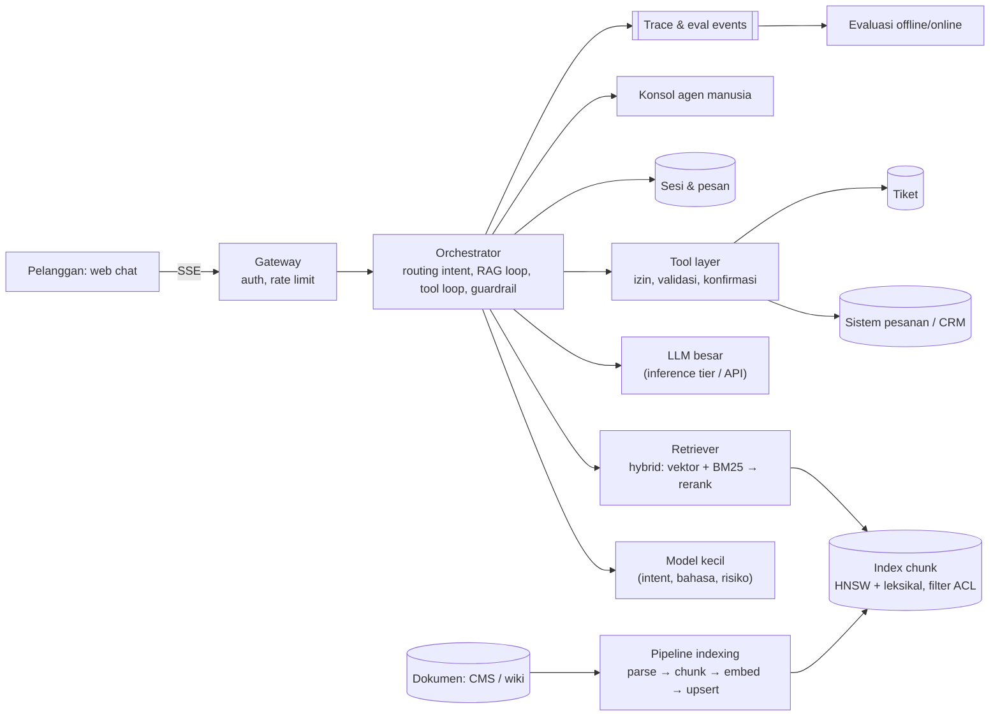
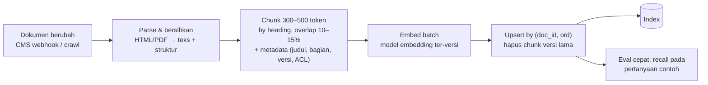

## 1. Requirements

Klarifikasi: kanal (web chat, email, WhatsApp)? Sumber pengetahuan (dokumentasi publik, kebijakan internal, data pelanggan seperti status pesanan)? Tindakan apa yang boleh dilakukan bot (cek status, reset password, refund)? Bahasa? Eskalasi ke agen manusia? Regulasi data pelanggan?

Asumsi: e-commerce dengan web chat; pengetahuan = pusat bantuan + kebijakan internal; tool = cek pesanan, buat tiket, usulkan refund (dengan persetujuan); eskalasi ke agen.

### Functional

- Menjawab pertanyaan dari basis pengetahuan dengan kutipan sumber; mengatakan "tidak tahu" bila tidak ada sumber.
- Mengakses data pelanggan yang terautentikasi (status pesanan, riwayat) lewat tool dengan izin.
- Melakukan tindakan terbatas (buat tiket, usulkan refund dalam batas) dengan konfirmasi.
- Eskalasi ke agen manusia dengan ringkasan percakapan; agen melihat konteks.
- Pengelolaan pengetahuan: dokumen diperbarui, index mengikuti dalam menit; versi.
- Evaluasi kualitas dan umpan balik.
- Out of scope: suara, multibahasa penuh (disebut), pelatihan model.

### Non-functional

| NFR          | Target                                                                              | Alasan                       |
| ------------ | ----------------------------------------------------------------------------------- | ---------------------------- |
| Grounding    | Jawaban kebijakan/fakta harus didukung sumber yang dikutip; tidak mengarang         | Risiko hukum dan kepercayaan |
| Keamanan     | Tidak membocorkan data pelanggan lain; tahan prompt injection; least privilege tool | Data sensitif                |
| Latency      | TTFT &lt; 2 s termasuk retrieval; jawaban lengkap &lt; 10 s                         | Chat                         |
| Kesegaran    | Perubahan dokumen terlihat &lt; 10 menit                                            | Kebijakan berubah            |
| Availability | 99.9%; fallback ke FAQ statis/agen bila LLM down                                    | Support tidak boleh hilang   |
| Skala        | 1 juta percakapan/hari, puncak 500 request/detik                                    | —                            |
| Biaya        | Model kecil untuk tugas sederhana; cache                                            | Token mahal                  |

## 2. Estimasi kapasitas

- Request: 10^6 percakapan × 5 giliran / 10^5 ≈ **50 request/detik** rata-rata, puncak 500/s.
- Retrieval per request: embedding query (model kecil, ~10 ms), ANN search top-50 + BM25 top-50, rerank 100 → 8 chunk; total &lt; 300 ms.
- Index: 20.000 halaman → ~200.000 chunk × embedding 1.024 float (4 KB) ≈ 800 MB vektor + teks; muat di memori satu node (HNSW), direplikasi; pgvector/Elasticsearch/OpenSearch atau vector DB.
- Token: prompt = system + kebijakan + 8 chunk × 400 + riwayat ≈ 5.000 token input, 300 output; 50 × 5.300 ≈ 265.000 token/s input; biaya didominasi input → prefix caching dan pemangkasan penting.
- GPU/LLM: lewat inference tier (kasus ChatGPT-like) atau API eksternal; 500 request/detik puncak dengan prompt 5.000 token = beban prefill besar; batasi chunk dan gunakan model kecil untuk klasifikasi/routing.
- Log percakapan + trace retrieval: 5 juta giliran/hari × 10 KB ≈ 50 GB/hari (dengan konten); retensi terkendali.

Keputusan: pipeline RAG dengan hybrid retrieval dan reranker, orchestrator dengan tool layer berizin, model bertingkat (kecil untuk routing/klasifikasi, besar untuk jawaban), evaluasi offline + online.

## 3. API design

```text
POST /v1/chat/sessions                      { channel, customerId? (setelah auth) } → { sessionId }
POST /v1/chat/sessions/{id}/messages        { text, Idempotency-Key } → SSE stream:
      event: retrieval  { sources: [{ docId, title, version, score }] }
      event: delta      { text }
      event: tool_call  { name, args, requiresConfirmation: bool }
      event: tool_result{ name, summary }
      event: done       { messageId, citations: [...], confidence, escalate: bool }
POST /v1/chat/sessions/{id}/confirm         { toolCallId, approve: bool }
POST /v1/chat/sessions/{id}/escalate        → { ticketId, summary }
POST /v1/feedback                           { messageId, rating, comment }
Internal:
POST /v1/kb/documents  (upload/ubah) → pipeline indexing;  GET /v1/kb/search?q= (debug retrieval)
POST /v1/eval/runs     { suite, promptVersion, modelVersion, indexVersion } → laporan
```

## 4. Skema data

```sql
documents(id, title, source_url, version, acl_scope: public|internal, updated_at, status)
chunks(id, doc_id, doc_version, ord, text, metadata JSONB, embedding VECTOR(1024), tsv TSVECTOR)
     -- index: HNSW pada embedding, GIN pada tsv; filter acl_scope saat query
sessions(id, customer_id, channel, status: bot|escalated|closed, created_at)
messages(id, session_id, role, text, citations JSONB, tool_calls JSONB, model, prompt_version, created_at)
tool_audit(id, session_id, tool, args, actor: bot|customer_confirmed|agent, result, ts)
tickets(id, session_id, summary, priority, assigned_agent, status)
feedback(message_id, rating, comment, ts)
eval_cases(id, question, reference_answer, expected_doc_ids, tags)
eval_runs(id, prompt_version, model_version, index_version, metrics JSONB, ts)
```

Dokumen diberi versi; chunk menyimpan `doc_version` agar kutipan merujuk versi yang dipakai saat menjawab. ACL per dokumen (internal vs publik) ditegakkan saat retrieval, bukan oleh model.

## 5. High-level design



**Alur satu giliran**: pesan masuk → guardrail input (PII masking untuk log, deteksi injeksi, klasifikasi intent/risiko dengan model kecil) → bila intent "status pesanan": tool `get_order` dengan `customerId` dari sesi terautentikasi (bukan dari teks) → bila intent pengetahuan: retriever mengubah query (rewrite dengan konteks percakapan), mencari hybrid dengan filter ACL, rerank, ambil 5–8 chunk → prompt tersusun: instruksi + kebijakan jawab + chunk dengan id + riwayat ringkas → LLM menghasilkan jawaban dengan kutipan `[doc:ver]` di-stream → guardrail output (grounding check: kutipan ada dan relevan; tidak ada data pelanggan lain; nada) → simpan, catat trace retrieval → bila confidence rendah atau pelanggan minta manusia: eskalasi dengan ringkasan.

## 6. Detailed design

### 6.1 Pipeline indexing



- Idempotent by `(doc_id, doc_version, ord)`; dokumen lama dihapus setelah versi baru aktif (swap atomik per dokumen).
- Metadata kaya (judul, breadcrumb, produk, tanggal) disimpan bersama chunk dan diikutkan ke prompt agar model tahu konteks potongan.
- Perubahan model embedding = reindex penuh ke index baru + alias switch.
- Dokumen internal dengan ACL; pertanyaan pelanggan hanya mengambil `public` + kebijakan yang disetujui.

### 6.2 Retrieval hybrid dan rerank

- Query rewriting: model kecil mengubah "yang tadi itu bisa dibatalkan?" menjadi query mandiri berdasarkan riwayat.
- Vektor (ANN/HNSW, top-50) menangkap parafrase; BM25 (top-50) menangkap istilah eksak (SKU, kode error); gabung (reciprocal rank fusion) → cross-encoder reranker → top 5–8 dengan ambang skor; bila di bawah ambang: jawab "tidak menemukan" dan tawarkan eskalasi, jangan mengarang.
- Filter metadata (produk, negara, bahasa) sebelum/selama pencarian.
- Cache hasil retrieval untuk query identik populer (TTL menit) dan cache jawaban penuh untuk FAQ yang sangat umum (dengan invalidasi saat dokumen berubah).

### 6.3 Orchestrator, prompt, dan tool loop

- Prompt ter-versi di repo; perubahan melewati eval sebelum rilis; prefix stabil untuk cache.
- Tool loop: model mengeluarkan panggilan terstruktur (nama, argumen) → **tool layer** memvalidasi skema, mengisi identitas dari sesi (customerId tidak pernah dari argumen model), memeriksa kebijakan (mis. refund ≤ Rp200.000 dan pesanan &lt; 30 hari) → tool berdampak membutuhkan konfirmasi eksplisit pelanggan (event `tool_call requiresConfirmation`) dan/atau persetujuan agen → hasil kembali ke model → jawaban. Semua dicatat di `tool_audit`.
- Batas loop (maks N panggilan), timeout, dan fallback.
- Model bertingkat: model kecil untuk klasifikasi/rewrite/guardrail (murah, cepat), model besar untuk sintesis jawaban; routing berdasarkan kompleksitas.

### 6.4 Guardrail dan keamanan

| Ancaman                                 | Mitigasi                                                                                                                         |
| --------------------------------------- | -------------------------------------------------------------------------------------------------------------------------------- |
| Prompt injection dari user atau dokumen | Instruksi sistem memisahkan data dari perintah; tool berizin di luar model; dokumen dari sumber terkendali; deteksi pola injeksi |
| Kebocoran data pelanggan lain           | Identitas dari sesi, tool mengembalikan hanya data pelanggan itu, output check untuk PII asing                                   |
| Halusinasi kebijakan                    | Hanya menjawab dari chunk; kutipan wajib; grounding check; ambang retrieval                                                      |
| Jawaban berbahaya/nada buruk            | Klasifier output, kebijakan gaya, eskalasi topik sensitif (hukum, keluhan serius)                                                |
| Penyalahgunaan (spam, scraping)         | Rate limit, kuota per sesi, deteksi bot                                                                                          |
| Log berisi PII                          | Masking sebelum simpan, retensi pendek, akses terbatas                                                                           |

### 6.5 Eskalasi dan agen manusia

Pemicu: confidence rendah, pelanggan meminta, intent berisiko, sentimen negatif berulang, atau loop tool gagal. Bot membuat ringkasan (fakta, apa yang sudah dicoba, kutipan) dan tiket; agen melihat transkrip dan dapat mengambil alih sesi yang sama; jawaban agen dapat menjadi data evaluasi/koreksi dokumen.

### 6.6 Evaluasi dan umpan balik

- **Offline**: suite dari tiket nyata (dianonimkan) dengan jawaban referensi dan dokumen yang diharapkan; metrik retrieval (recall@k, MRR), jawaban (faithfulness, correctness via LLM-judge dengan kalibrasi manusia), keamanan (suite serangan injeksi), latency dan biaya; dijalankan di CI untuk perubahan prompt/model/index/chunking.
- **Online**: rasio eskalasi, resolusi tanpa agen, CSAT/thumbs, rasio "tidak tahu", drift retrieval (skor rata-rata), sampling manusia mingguan; canary untuk prompt/model baru.
- Loop perbaikan: pertanyaan tanpa jawaban yang sering → permintaan dokumen baru ke tim konten.

## 7. Evaluasi terhadap non-functional requirements

| NFR                     | Dipenuhi oleh                                                                                         | Risiko tersisa                                                      |
| ----------------------- | ----------------------------------------------------------------------------------------------------- | ------------------------------------------------------------------- |
| Grounding               | RAG dengan kutipan ber-versi, ambang retrieval, grounding check, "tidak tahu"                         | Dokumen sumber salah/kedaluwarsa: versi + umpan balik ke tim konten |
| Keamanan                | Identitas dari sesi, tool layer berizin + konfirmasi, ACL di retrieval, guardrail input/output, audit | Injeksi kreatif: defense in depth, red-team suite di CI             |
| Latency                 | Retrieval &lt; 300 ms, model kecil untuk tugas ringan, streaming, cache FAQ                           | Prompt 5.000 token: prefix cache, chunk lebih sedikit saat tekanan  |
| Kesegaran &lt; 10 menit | Webhook CMS → indexing inkremental → swap per dokumen                                                 | Crawl sumber tanpa webhook: interval                                |
| Availability 99.9%      | Fallback: FAQ statis + eskalasi saat LLM/retrieval down; komponen stateless; index replika            | LLM eksternal down: multi-provider atau model kecil lokal           |
| Biaya                   | Model bertingkat, cache, batas chunk/token, kuota                                                     | Pertumbuhan konteks per sesi: ringkasan                             |

Bottleneck 10x: inference LLM (kapasitas/biaya) dan reranker (GPU kecil, batch); SPOF: index (replika) dan orchestrator (stateless, horizontal).

## 8. Pertanyaan lanjutan interviewer

- "Dokumen internal yang tidak boleh dilihat pelanggan tetapi perlu untuk menjawab?" → Model boleh membaca chunk internal dengan ACL "boleh dipakai, tidak boleh dikutip verbatim"; output check; atau buat versi publik dari kebijakan.
- "Multibahasa?" → Embedding multibahasa atau index per bahasa; deteksi bahasa; jawaban dalam bahasa pelanggan dengan sumber asli.
- "Bagaimana memastikan konsisten dengan jawaban agen manusia?" → Sumber yang sama (KB), evaluasi membandingkan, agen mengoreksi KB bukan bot.
- "Latency naik karena prompt besar?" → Ringkas riwayat, kurangi chunk dengan reranker ketat, prefix cache, model kecil untuk pertanyaan sederhana.
- "Bot melakukan refund yang salah?" → Tool layer dengan batas kebijakan, konfirmasi, audit, kill switch per tool, rekonsiliasi harian tindakan bot.
- "Bagaimana memulai tanpa data evaluasi?" → Bangun suite dari 200 tiket nyata, label manusia, lalu tumbuhkan dari umpan balik dan eskalasi.
