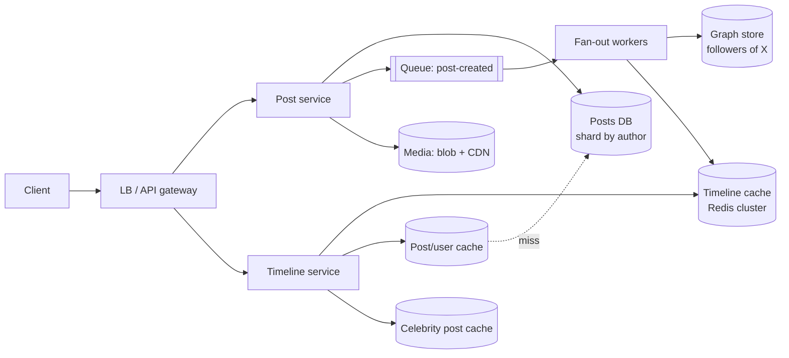
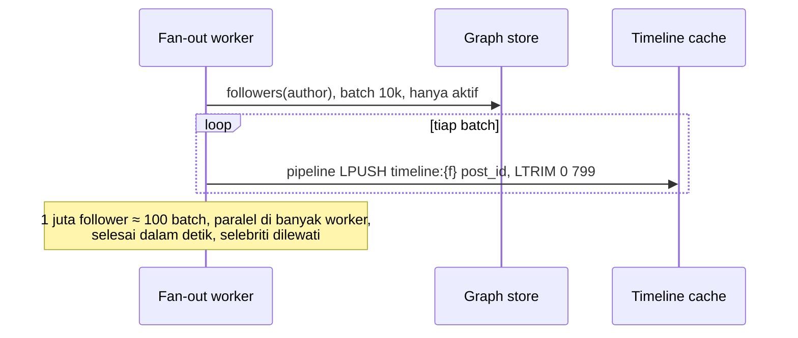

## 1. Requirements

Klarifikasi: timeline kronologis atau berperingkat? Berapa DAU? Rasio post vs baca? Apakah ada akun dengan puluhan juta follower? Media (gambar/video) disertakan?

### Functional

- User memposting teks (≤ 280 karakter) opsional dengan media.
- User mengikuti user lain.
- Home timeline: post dari akun yang diikuti, terbaru di atas (kronologis; ranking disebut sebagai ekstensi).
- User timeline: post milik satu user.
- Out of scope: pencarian, notifikasi, DM, iklan, ranking ML.

### Non-functional

| NFR              | Target                                                                | Alasan                                |
| ---------------- | --------------------------------------------------------------------- | ------------------------------------- |
| Latency timeline | p99 &lt; 200 ms                                                       | Dibuka berkali-kali sehari            |
| Availability     | 99.99% baca                                                           | Produk utama                          |
| Konsistensi      | Eventual: post boleh muncul di timeline follower dalam beberapa detik | Tidak ada yang menyadari jeda 2 detik |
| Skala            | 300 juta DAU, baca ≫ tulis                                            | Konsumer global                       |
| Durability       | Post tidak hilang                                                     | Sumber kebenaran                      |

## 2. Estimasi kapasitas

Asumsi: 300 juta DAU; tiap user membuka timeline 10x/hari dan memposting 0.2x/hari; rata-rata mengikuti 200 akun; post 300 B teks + metadata.

- Baca timeline: 300M × 10 / 10^5 ≈ **30.000 QPS**, puncak 100.000.
- Tulis post: 300M × 0.2 / 10^5 ≈ **600 post/detik**, puncak 2.000.
- Fan-out on write: 600 post/s × 200 follower rata-rata = **120.000 tulisan cache/detik** (median); dengan akun besar, puncak jauh lebih tinggi; itulah masalahnya.
- Storage post: 60M post/hari × 300 B ≈ 18 GB/hari → 5 tahun ≈ 33 TB (teks saja); media ke blob store, PB.
- Timeline cache: 300M user × 800 ID × 8 B ≈ 2 TB bila semua user di-cache; hanya user aktif (mis. 30 hari) → ratusan GB, muat di cluster Redis.

Keputusan: baca dilayani dari cache yang sudah dihitung (pre-computed), tulis jarang tetapi fan-out mahal, media di blob store + CDN.

## 3. API design

```text
POST /api/v1/posts                      { "text": "...", "mediaIds": [...] }  → 201 { postId }
  Idempotency-Key header wajib
GET  /api/v1/timeline/home?cursor=&limit=20 → { posts: [...], nextCursor }
GET  /api/v1/users/{id}/posts?cursor=&limit=20
POST /api/v1/users/{id}/follow  · DELETE /api/v1/users/{id}/follow
```

Cursor = post ID terakhir (terurut waktu), bukan offset: stabil saat ada post baru dan murah di cache.

## 4. Skema data

```sql
users(id PK, handle UNIQUE, name, ..., follower_count, is_celebrity)
posts(id PK /* Snowflake */, author_id, text, media_keys[], created_at)   -- shard by author_id atau post_id
follows(follower_id, followee_id, created_at)  PK(follower_id, followee_id)  -- shard by follower_id
   + index terbalik (followee_id → followers) untuk fan-out, shard by followee_id (tabel/materialized kedua)
```

- `posts` di-shard by `post_id` (merata, terurut waktu) atau by `author_id` (user timeline satu shard). Pilih `author_id` agar user timeline murah; post ID Snowflake tetap memberi urutan.
- Graf `follows` disimpan dua arah karena dua pola akses: "siapa yang saya ikuti" (membangun timeline) dan "siapa yang mengikuti saya" (fan-out). Di skala Facebook ini adalah TAO; di skala kita, dua tabel/KV terpartisi.
- Cache (Redis): `timeline:{user_id}` → list post_id (maks 800); `post:{id}` → objek post; `user:{id}` → profil ringkas.

## 5. High-level design



**Alur tulis**: client → post service memvalidasi, menulis post ke DB (satu tulisan), mengunggah media ke blob store via presigned URL (sudah terjadi sebelumnya), mempublikasikan `post-created` → fan-out worker mengambil daftar follower penulis dari graph store, dan untuk tiap follower **aktif** menambahkan `post_id` ke `timeline:{follower}` (LPUSH + LTRIM 800). Bila penulis selebriti, lewati fan-out dan tulis ke `celebrity_posts:{author}`.

**Alur baca**: timeline service mengambil `timeline:{user}` (ID), mengambil daftar selebriti yang diikuti user (cache), mengambil post terbaru mereka, menggabung dan mengurutkan by ID, memotong 20, lalu hydrate `post:{id}` dan `user:{id}` dari cache objek (multi-get); miss diisi dari DB.

## 6. Detailed design

### 6.1 Fan-out: write vs read vs hybrid

| Pendekatan              | Tulis                                                                             | Baca                                             | Masalah                                                                 |
| ----------------------- | --------------------------------------------------------------------------------- | ------------------------------------------------ | ----------------------------------------------------------------------- |
| Fan-out on write (push) | 1 post → N tulisan cache                                                          | O(1): baca satu list                             | Selebriti: jutaan tulisan per post; tulisan ke user tidak aktif sia-sia |
| Fan-out on read (pull)  | 1 tulisan                                                                         | Gabung post dari K akun yang diikuti setiap baca | Latency baca tinggi, beban DB saat 30.000 QPS                           |
| **Hybrid**              | Push untuk akun biasa; pull untuk selebriti (follower &gt; ambang, mis. 100 ribu) | Satu list + merge sedikit sumber                 | Ambang dan transisi akun yang tumbuh                                    |

Pilihan: hybrid. Tambahan: lewati push untuk user tidak aktif &gt; 30 hari (rekonstruksi saat login), dan prioritaskan fan-out ke follower yang sedang online.



### 6.2 Timeline cache

- Redis cluster, key `timeline:{user_id}` → list ID, maks 800; TTL untuk user tidak aktif.
- Memori: ~10 KB per user aktif; 100 juta user aktif ≈ 1 TB → cluster puluhan node dengan replica.
- Rekonstruksi saat miss: ambil akun yang diikuti, ambil N post terbaru masing-masing dari DB/cache penulis, gabung, isi cache. Mahal tetapi jarang.
- Hapus post: hapus dari `post:{id}` (timeline yang masih merujuk akan melewati ID yang tidak ada saat hydrate), dan secara async hapus dari timeline follower.

### 6.3 Penyimpanan post dan ID

- Post ID Snowflake (terurut waktu) membuat merge dan cursor sederhana.
- Shard by author: user timeline = satu shard, range scan by ID. Hot author (selebriti) tidak menjadi hot shard untuk tulis (mereka jarang memposting), tetapi menjadi hot untuk baca; itu diserap cache selebriti.
- Replika baca + cache objek `post:{id}` dengan TTL panjang (post immutable kecuali hapus).

### 6.4 Graf sosial

- Dua indeks (following, followers) terpartisi; followers list untuk akun besar dipaginasi dan dibaca batch.
- Follow/unfollow memengaruhi timeline: unfollow → hapus post followee dari timeline user (async, atau filter saat baca); follow → suntik beberapa post terbaru followee.

### 6.5 Media

Upload via presigned URL ke blob store, pemrosesan async (resize/transcode), URL CDN di post. Timeline service tidak menyentuh byte media.

### 6.6 Ranking (ekstensi)

Timeline kronologis cukup untuk kasus ini. Ranking: kandidat dari list yang sama (beberapa ratus), skor oleh model (engagement prediction) di timeline service, dengan cache hasil per user beberapa menit. Arsitektur dasarnya tidak berubah: kandidat dari cache, skor di jalur baca.

## 7. Evaluasi terhadap non-functional requirements

| NFR                      | Dipenuhi oleh                                                                                            | Risiko tersisa                                                                     |
| ------------------------ | -------------------------------------------------------------------------------------------------------- | ---------------------------------------------------------------------------------- |
| Latency p99 &lt; 200 ms  | Baca = 1 list + merge kecil + multi-get cache; semua di memori                                           | Cache miss (user tidak aktif): rekonstruksi lebih lambat; terima                   |
| Availability 99.99% baca | Cache cluster dengan replica; DB hanya untuk miss; degradasi: tampilkan cache basi bila fan-out tertunda | Kehilangan cluster cache = rekonstruksi massal; warm-up bertahap, rate limit ke DB |
| Eventual (detik)         | Fan-out async via queue; lag dipantau                                                                    | Selebriti: pull saat baca, jadi instan                                             |
| Skala 30.000 QPS baca    | Cache terpartisi, stateless timeline service                                                             | Hot user key (akun yang dibuka jutaan kali): replikasi key                         |
| Durability               | Post di DB terreplikasi; cache hanya turunan                                                             | —                                                                                  |

Bottleneck pertama saat 10x: memori timeline cache dan throughput fan-out; keduanya horizontal (lebih banyak node, lebih banyak worker). SPOF: queue; gunakan cluster terreplikasi.

## 8. Pertanyaan lanjutan interviewer

- "Ambang selebriti berapa, dan bagaimana akun yang melewatinya?" → Mis. 100 ribu follower; saat melewati, tandai flag, hentikan push, post lama tetap di timeline; sebaliknya saat turun.
- "Bagaimana notifikasi 'ada post baru' real-time?" → Pub-sub ke koneksi WebSocket per user online; timeline tetap pull saat user menekan refresh.
- "Bagaimana mencegah post yang sama muncul dua kali?" → ID unik; dedup saat merge; fan-out idempotent (LPUSH bisa duplikat saat retry → cek keberadaan atau pakai sorted set by ID).
- "Edit post?" → Objek `post:{id}` diperbarui; timeline merujuk ID sehingga otomatis.
- "Multi-region?" → Cache per region, fan-out ke region follower, DB dengan replikasi lintas region; tulis ke region asal.
- "Bagaimana mengukur bahwa sistem sehat?" → Lag fan-out, hit ratio cache timeline, p99 baca, rasio rekonstruksi.
