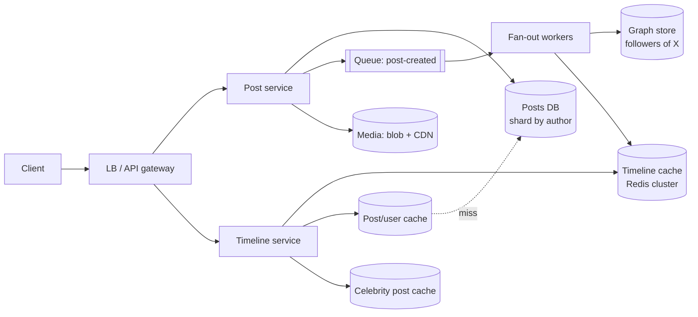
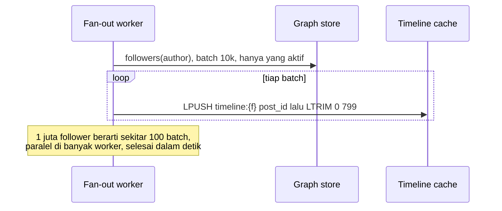

## 1. Requirements

Klarifikasi: timeline kronologis atau berperingkat. Berapa pengguna aktif harian. Rasio post dan baca. Apakah ada akun dengan puluhan juta follower. Apakah media disertakan.

### Functional

- Pengguna memposting teks sampai 280 karakter, dengan media opsional.
- Pengguna mengikuti pengguna lain.
- Home timeline menampilkan post dari akun yang diikuti, terbaru di atas. Ranking disebut sebagai perluasan.
- User timeline menampilkan post milik satu pengguna.
- Di luar cakupan: pencarian, notifikasi, pesan langsung, iklan, dan ranking dengan model.

### Non-functional

| Target           | Nilai                                                                 | Alasan                                |
| ---------------- | --------------------------------------------------------------------- | ------------------------------------- |
| Latency timeline | p99 di bawah 200 ms                                                   | Dibuka berkali-kali sehari            |
| Availability     | 99.99% untuk baca                                                     | Produk utama                          |
| Konsistensi      | Eventual. Post boleh muncul di timeline follower dalam beberapa detik | Tidak ada yang menyadari jeda 2 detik |
| Skala            | 300 juta pengguna aktif harian, baca jauh lebih banyak dari tulis     | Produk konsumen global                |
| Durability       | Post tidak boleh hilang                                               | Sumber kebenaran                      |

## 2. Estimasi kapasitas

Asumsi: 300 juta pengguna aktif harian. Tiap pengguna membuka timeline 10 kali sehari dan memposting 0.2 kali sehari. Rata-rata mengikuti 200 akun. Satu post sekitar 300 byte teks dan metadata.

- Baca timeline: 300 juta kali 10 dibagi 100 ribu detik, hasilnya sekitar 30.000 QPS. Puncaknya 100.000 QPS.
- Tulis post: 300 juta kali 0.2 dibagi 100 ribu detik, hasilnya sekitar 600 post per detik. Puncaknya 2.000.
- Fan-out on write: 600 post per detik kali 200 follower, hasilnya 120.000 tulisan cache per detik untuk akun biasa. Akun besar membuat puncaknya jauh lebih tinggi, dan itulah masalahnya.
- Storage post: 60 juta post per hari kali 300 byte, sekitar 18 GB per hari. Lima tahun sekitar 33 TB untuk teks. Media masuk blob store dalam skala PB.
- Cache timeline: 300 juta pengguna kali 800 ID kali 8 byte, sekitar 2 TB bila semua pengguna disimpan. Hanya pengguna aktif 30 hari yang disimpan, jadi ratusan GB, muat di cluster Redis.

Keputusan: baca dilayani dari cache yang sudah dihitung di muka. Tulis jarang, tetapi fan-out mahal. Media disimpan di blob store dan dilayani lewat CDN.

## 3. API design

```text
POST /api/v1/posts                      { "text": "...", "mediaIds": [...] }  → 201 { postId }
  Idempotency-Key header wajib
GET  /api/v1/timeline/home?cursor=&limit=20 → { posts: [...], nextCursor }
GET  /api/v1/users/{id}/posts?cursor=&limit=20
POST /api/v1/users/{id}/follow  · DELETE /api/v1/users/{id}/follow
```

Cursor berisi ID post terakhir, bukan nomor halaman. Karena ID terurut waktu, cursor tetap stabil saat ada post baru dan murah dicari di cache.

## 4. Skema data

```sql
users(id PK, handle UNIQUE, name, ..., follower_count, is_celebrity)
posts(id PK /* Snowflake */, author_id, text, media_keys[], created_at)   -- shard by author_id atau post_id
follows(follower_id, followee_id, created_at)  PK(follower_id, followee_id)  -- shard by follower_id
   + index terbalik (followee_id → followers) untuk fan-out, shard by followee_id (tabel/materialized kedua)
```

- Tabel post dipartisi berdasarkan penulis, sehingga user timeline berada di satu partisi. ID post memakai format Snowflake, yaitu gabungan timestamp, nomor mesin, dan nomor urut, sehingga tetap terurut waktu.
- Graf follow disimpan dua arah karena ada dua pola akses: "siapa yang saya ikuti" untuk membangun timeline, dan "siapa yang mengikuti saya" untuk fan-out. Di skala Facebook ini adalah TAO. Di skala kita, dua tabel atau key-value store terpartisi.
- Cache di Redis punya tiga jenis key. Key timeline per pengguna berisi daftar ID post, maksimal 800. Key post per ID berisi objek post. Key user per ID berisi profil ringkas.

## 5. High-level design



Alur tulis:

1. Client mengirim post ke post service. Media sudah diunggah sebelumnya ke blob store lewat presigned URL.
2. Post service memvalidasi isi dan menulis post ke database satu kali.
3. Post service menerbitkan event `post-created` ke queue.
4. Fan-out worker mengambil daftar follower penulis dari graph store.
5. Untuk tiap follower yang aktif, worker menambahkan ID post ke timeline cache follower itu dan memotong daftarnya ke 800.
6. Bila penulis adalah selebriti, worker melewati fan-out dan menulis ke cache post selebriti milik penulis itu.

Alur baca:

1. Timeline service mengambil daftar ID dari cache timeline pengguna.
2. Timeline service mengambil daftar selebriti yang diikuti pengguna dari cache.
3. Timeline service mengambil post terbaru para selebriti itu.
4. Timeline service menggabungkan keduanya, mengurutkan berdasarkan ID, dan memotong 20 teratas.
5. Timeline service mengambil isi post dan profil penulis dari cache objek dengan satu permintaan untuk banyak key. Yang tidak ada di cache diambil dari database.

## 6. Detailed design

### 6.1 Fan-out: saat tulis, saat baca, atau gabungan

| Pendekatan                  | Biaya tulis                                                                              | Biaya baca                                                  | Masalah                                                                            |
| --------------------------- | ---------------------------------------------------------------------------------------- | ----------------------------------------------------------- | ---------------------------------------------------------------------------------- |
| Fan-out on write, atau push | Satu post menjadi N tulisan cache                                                        | Konstan, cukup baca satu daftar                             | Selebriti memicu jutaan tulisan per post. Tulisan ke pengguna tidak aktif terbuang |
| Fan-out on read, atau pull  | Satu tulisan                                                                             | Menggabungkan post dari semua akun yang diikuti setiap baca | Latency baca tinggi, dan database terbebani 30.000 QPS                             |
| Hybrid                      | Push untuk akun biasa, pull untuk akun dengan follower di atas ambang, misalnya 100 ribu | Satu daftar ditambah penggabungan beberapa sumber           | Ambang dan transisi untuk akun yang tumbuh                                         |

Pilihan kita: hybrid. Tambahannya, lewati push untuk pengguna yang tidak aktif lebih dari 30 hari. Timeline mereka dibangun ulang saat login. Follower yang sedang online didahulukan saat fan-out.



### 6.2 Cache timeline

- Redis cluster menyimpan key timeline per pengguna berisi daftar ID, maksimal 800. Entri pengguna tidak aktif diberi TTL.
- Memori sekitar 10 KB per pengguna aktif. Seratus juta pengguna aktif berarti sekitar 1 TB, jadi cluster puluhan node dengan replica.
- Saat cache tidak ada, timeline dibangun ulang: ambil akun yang diikuti, ambil beberapa post terbaru masing-masing, gabungkan, lalu isi cache. Mahal, tetapi jarang.
- Saat post dihapus, objek post dihapus dari cache. Timeline yang masih merujuk ID itu akan melewatinya saat mengambil isi. Penghapusan dari daftar follower dilakukan secara asinkron.

### 6.3 Penyimpanan post dan ID

- ID Snowflake yang terurut waktu membuat penggabungan dan cursor menjadi sederhana.
- Partisi berdasarkan penulis membuat user timeline hanya butuh satu partisi. Selebriti tidak menjadi partisi panas untuk tulis, karena mereka jarang memposting. Beban baca mereka diserap cache selebriti.
- Replica baca dan cache objek post memakai TTL panjang, karena post tidak berubah kecuali dihapus.

### 6.4 Graf sosial

- Dua index, yaitu daftar yang diikuti dan daftar follower, disimpan terpartisi. Daftar follower akun besar dibaca per halaman.
- Berhenti mengikuti memengaruhi timeline. Post dari akun itu dihapus dari timeline secara asinkron, atau disaring saat baca.
- Mulai mengikuti menyuntikkan beberapa post terbaru akun itu ke timeline.

### 6.5 Media

Client mengunggah langsung ke blob store lewat presigned URL, yaitu tautan unggah berbatas waktu yang ditandatangani server. Pemrosesan seperti ubah ukuran berjalan asinkron. Post menyimpan URL CDN. Timeline service tidak pernah menyentuh byte media.

### 6.6 Ranking sebagai perluasan

Timeline kronologis cukup untuk kasus ini. Untuk ranking, kandidat diambil dari daftar yang sama, beberapa ratus post. Model memberi skor di timeline service, dan hasilnya di-cache per pengguna beberapa menit. Arsitektur dasarnya tidak berubah.

## 7. Evaluasi terhadap non-functional requirements

| Target                         | Cara memenuhi                                                                                              | Risiko tersisa                                                                                                 |
| ------------------------------ | ---------------------------------------------------------------------------------------------------------- | -------------------------------------------------------------------------------------------------------------- |
| Latency p99 di bawah 200 ms    | Baca hanya satu daftar, penggabungan kecil, dan pengambilan isi dari cache. Semua di memori                | Pengguna tidak aktif memicu pembangunan ulang yang lebih lambat. Terima                                        |
| Availability 99.99% untuk baca | Cache cluster dengan replica. Database hanya untuk cache miss. Saat fan-out tertunda, tampilkan cache lama | Kehilangan seluruh cluster cache memicu pembangunan ulang massal. Lakukan bertahap dan batasi laju ke database |
| Eventual dalam detik           | Fan-out asinkron lewat queue, dengan lag yang dipantau                                                     | Selebriti dibaca saat pull, jadi seketika                                                                      |
| Skala 30.000 QPS baca          | Cache terpartisi dan timeline service tanpa state                                                          | Akun yang dibuka jutaan kali menjadi key panas. Replikasi key itu                                              |
| Durability                     | Post di database terreplikasi. Cache hanya turunan                                                         | Tidak ada                                                                                                      |

Bottleneck pertama saat trafik naik 10 kali adalah memori cache timeline dan throughput fan-out. Keduanya bisa ditambah secara horizontal lewat node dan worker. Titik tunggal kegagalannya adalah queue. Pakai cluster terreplikasi.

## 8. Pertanyaan lanjutan interviewer

- "Ambang selebriti berapa, dan bagaimana akun yang melewatinya?" Misalnya 100 ribu follower. Saat melewati ambang, tandai akun, hentikan push, dan biarkan post lama tetap di timeline. Sebaliknya saat turun.
- "Bagaimana notifikasi ada post baru secara real-time?" Pub-sub ke koneksi WebSocket pengguna yang online. Timeline tetap diambil saat pengguna menekan refresh.
- "Bagaimana mencegah post yang sama muncul dua kali?" ID unik, deduplikasi saat penggabungan, dan fan-out yang aman diulang. Pengulangan LPUSH bisa menggandakan, jadi periksa keberadaan atau pakai sorted set.
- "Edit post?" Objek post diperbarui. Timeline hanya merujuk ID, jadi otomatis ikut.
- "Multi-region?" Cache per region. Fan-out ke region follower. Database dengan replikasi lintas region, dan tulis ke region asal.
- "Bagaimana mengukur sistem ini sehat?" Lag fan-out, hit ratio cache timeline, p99 baca, dan rasio pembangunan ulang.
