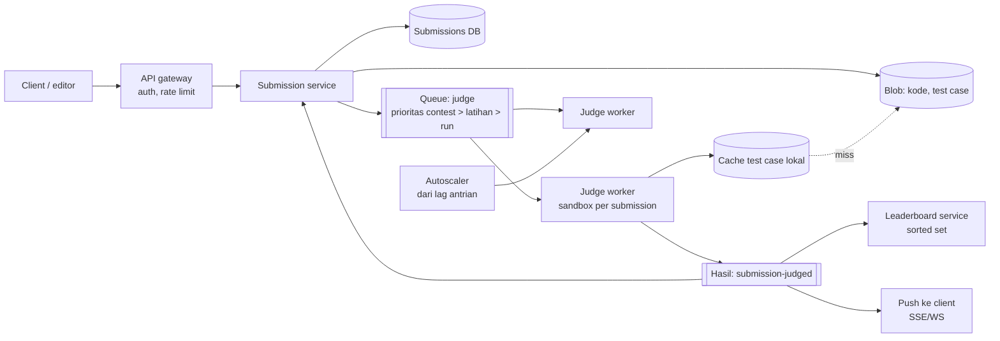
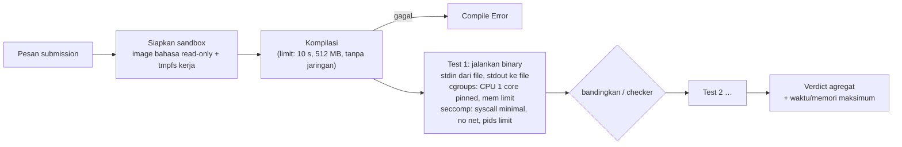

## 1. Requirements

Pertanyaan klarifikasi: bahasa apa saja yang didukung? Hanya latihan atau juga contest dengan leaderboard real-time? Apakah ada soal dengan checker khusus atau soal interaktif? Berapa batas waktu dan memori per soal? Apakah ada fitur "run" dengan input sendiri selain "submit"?

### Functional

- Pengguna melihat soal, menulis kode dalam beberapa bahasa, menjalankannya dengan input sendiri, dan mengirimnya untuk dinilai terhadap test case tersembunyi.
- Verdict yang dikembalikan: Accepted, Wrong Answer, Time Limit Exceeded, Memory Limit Exceeded, Runtime Error, atau Compile Error. Verdict disertai waktu dan memori yang terpakai.
- Contest punya durasi tetap, leaderboard, dan penalti. Submission contest diprioritaskan.
- Pembuat soal mengunggah test case, solusi referensi, dan checker bila perlu.
- Di luar cakupan: editor kolaboratif, deteksi plagiarisme, dan forum diskusi.

### Non-functional

| Target          | Nilai                                                                           | Alasan               |
| --------------- | ------------------------------------------------------------------------------- | -------------------- |
| Keamanan        | Kode pengguna tidak bisa mengakses host, jaringan, atau submission lain         | Kode tidak dipercaya |
| Keadilan        | Pengukuran waktu dan memori konsisten antar mesin dan antar waktu               | Verdict harus adil   |
| Latency verdict | Median di bawah 5 detik di luar puncak. Saat puncak, posisi antrian terlihat    | Umpan balik          |
| Availability    | 99.9%, dan contest tidak boleh terganggu                                        | Reputasi             |
| Skala           | 10 juta submission per bulan dan puncak 1.000 submission per detik saat contest | Lonjakan ekstrem     |
| Biaya           | Worker sandbox adalah biaya utama, jadi kapasitasnya harus bisa naik turun      | Efisiensi            |

## 2. Estimasi kapasitas

Asumsi: 10 juta submission per bulan. Tiap submission menjalankan sekitar 20 test case dengan 0.2 detik CPU per test, jadi sekitar 4 detik CPU ditambah 1 detik kompilasi. Puncak contest 1.000 submission per detik selama menit pertama.

- Rata-rata: 10 juta dibagi 2.6 juta detik per bulan adalah sekitar 4 submission per detik. Dikali 5 detik CPU berarti sekitar 20 core sibuk. Kecil.
- Puncak contest: 1.000 submission per detik dikali 5 detik CPU membutuhkan 5.000 core untuk verdict seketika. Itu tidak masuk akal secara biaya.
- Target realistis: 500 sampai 1.000 core yang dinaikkan sebelum contest. Antrian beberapa menit pada menit pertama diterima, dengan prioritas untuk soal mudah dan submission pertama.
- Storage kode: 10 juta dikali 5 KB adalah 50 GB per bulan. Test case per soal berukuran ratusan KB sampai puluhan MB. Lima ribu soal membutuhkan puluhan GB. Semua disimpan di blob store.
- Antrian: 60.000 pesan di menit pertama contest. Ini ringan untuk broker.
- Leaderboard: 50.000 peserta dengan puluhan pembaruan per menit. Sorted set di memori cukup.

Keputusan desain: API stateless, queue durable, pool worker sandbox yang seragam dan bisa naik turun, cache test case di tiap worker, hasil disimpan di database dan didorong ke client.

## 3. API design

```text
GET  /v1/problems/{id}                       → statement, limits, contoh
POST /v1/run      { problemId, lang, code, stdin }        → 202 { runId }       (uji cepat, tanpa penilaian, limit lebih ketat)
POST /v1/submissions { problemId, lang, code, contestId?, Idempotency-Key } → 202 { submissionId, status: queued, position }
GET  /v1/submissions/{id}                   → status, verdict, perTest: [{ verdict, timeMs, memKb }], compileOutput
WS/SSE /v1/submissions/{id}/events          → status berubah (queued → running → verdict)
GET  /v1/contests/{id}/leaderboard?cursor=  → peringkat
POST /v1/problems (author)  { statement, limits, tests[] (upload via presigned URL), checker?, referenceSolution }
```

Rate limit membatasi submission per pengguna per menit, misalnya 10, sedangkan "run" lebih longgar. Ukuran kode juga dibatasi.

## 4. Skema data

```sql
problems(id, title, statement_ref, time_limit_ms, memory_limit_kb, checker_ref, author_id, visibility)
problem_tests(problem_id, idx, input_key, expected_key, weight, is_sample)     -- file di blob
submissions(id, user_id, problem_id, contest_id, lang, code_key, status, verdict, time_ms, memory_kb,
            score, created_at, judged_at, worker_id)                          -- shard by id/time
submission_tests(submission_id, idx, verdict, time_ms, memory_kb, checker_msg)
contests(id, start_at, end_at, rules), contest_participants(contest_id, user_id)
leaderboard (Redis sorted set per contest): score|penalty → user_id, dimaterialisasi ke DB berkala
language_images(lang, image_digest, compile_cmd, run_cmd, limits_multiplier)
```

Kode dan test case disimpan di blob store. Database hanya menyimpan referensi dan hasil. Idempotency key mencegah submission ganda saat client mengulang request.

## 5. High-level design



Alur satu submission:

1. Client mengirim kode ke submission service lewat gateway yang memeriksa auth dan rate limit.
2. Submission service memvalidasi ukuran dan bahasa, menyimpan kode ke blob store, dan membuat record berstatus `queued`.
3. Submission service mengirim pesan ke queue dengan prioritas sesuai jenisnya.
4. Worker mengambil pesan dengan lease yang lebih panjang dari total batas waktu, lalu menandai status `running`.
5. Worker mengunduh kode dan test case. Test case di-cache lokal per soal.
6. Worker mengompilasi di sandbox, lalu menjalankan tiap test case di sandbox baru dengan batas waktu dan memori.
7. Worker membandingkan output, atau memanggil checker, dan menyusun verdict.
8. Worker menerbitkan hasil. Submission service memperbarui database, leaderboard diperbarui, dan client menerima push.

## 6. Detailed design

### 6.1 Sandbox eksekusi



Isolasi dibuat berlapis supaya satu lapisan yang jebol belum berarti bencana.

| Lapisan        | Mekanisme                                                                | Melindungi dari                                                                    |
| -------------- | ------------------------------------------------------------------------ | ---------------------------------------------------------------------------------- |
| Namespace      | PID, mount, network, user                                                | Melihat proses atau filesystem host. Jaringan dimatikan total                      |
| cgroups v2     | Batas CPU, memori tanpa swap, jumlah proses                              | Fork bomb, kehabisan memori host, dan CPU yang dikuasai. Sekaligus alat pengukuran |
| seccomp        | Daftar syscall yang diizinkan per bahasa                                 | Syscall berbahaya                                                                  |
| Filesystem     | Root hanya-baca, tmpfs kecil untuk kerja, tanpa setuid                   | Modifikasi dan pencurian data                                                      |
| Sandbox kernel | gVisor yang mencegat syscall, atau microVM Firecracker                   | Eksploit kernel host                                                               |
| Waktu          | Batas CPU time lewat rlimit dan cgroups, ditambah pengaman waktu dinding | Program yang tidur atau macet di I/O                                               |

Setiap test case berjalan di sandbox baru, atau sandbox yang direset, supaya test case tidak saling memengaruhi. Ukuran output dibatasi untuk mencegah output bomb. Input dan output lewat file, bukan pipe tanpa batas.

### 6.2 Keadilan pengukuran

Worker harus seragam, dengan tipe instance yang sama dan pengaturan frekuensi CPU yang dimatikan. Satu submission mendapat satu core lewat cpuset, dan dua submission tidak boleh berbagi pasangan hyperthread.

Yang diukur adalah CPU time, yaitu waktu user ditambah sys dari cgroups. Waktu dinding hanya pengaman dengan batas 2 sampai 3 kali.

Limit per bahasa memakai faktor pengali, misalnya Python 3 kali dan Java 2 kali ditambah memori JVM. Faktor dikalibrasi dengan solusi referensi saat soal dibuat. Verdict batas waktu diberi toleransi kecil di ambang.

Memori diukur dari puncak pemakaian menurut cgroups. JVM dan .NET membutuhkan pengaturan heap yang eksplisit.

### 6.3 Antrian, prioritas, dan skala

Queue punya beberapa tingkat prioritas. Contest aktif di atas latihan, dan latihan di atas "run". Di dalam contest, submission pertama per pasangan pengguna dan soal diproses lebih dulu agar umpan balik merata.

Visibility timeout, yaitu masa pesan disembunyikan selama diproses, diset lebih panjang dari total batas waktu. Worker mengirim heartbeat untuk submission panjang. Worker yang mati membuat pesan kembali ke antrian dan submission dijalankan ulang. Hasil lama ditimpa berdasarkan id submission.

Jumlah worker menyesuaikan lag antrian dan waktu eksekusi rata-rata. Kapasitas dinaikkan sebelum contest karena jadwalnya diketahui. Image bahasa dan test case di-cache di node.

Pengguna melihat posisi antrian dan perkiraan waktu. Batas submission per pengguna per menit menahan spam.

### 6.4 Penilaian: perbandingan output dan checker

Mode default membandingkan token dan mengabaikan whitespace di akhir. Mode presisi dipakai untuk bilangan pecahan dengan toleransi epsilon.

Checker khusus, misalnya bergaya testlib, adalah program dari pembuat soal yang juga berjalan di sandbox. Soal interaktif memakai interactor yang terhubung ke solusi lewat pipe di dalam sandbox dengan batas terpisah.

Verdict agregat berhenti di test pertama yang gagal untuk contest bergaya ICPC. Untuk skor parsial bergaya IOI, semua test dijalankan. Hasil per test disimpan, dan pesan checker dibatasi agar tidak membocorkan test case tersembunyi.

### 6.5 Contest dan leaderboard

Jam contest berasal dari server. Submission dihitung sebagai bagian contest hanya bila diterima sebelum waktu berakhir, dengan toleransi jaringan kecil yang diterapkan konsisten.

Leaderboard memakai sorted set. Skornya gabungan poin dan penalti, diperbarui saat verdict keluar, dan halamannya diambil dengan ZRANGE. Hasil akhir disimpan ke database. Leaderboard bisa dibekukan di menit-menit akhir.

Anti-cheat dasar meliputi deteksi kemiripan kode setelah contest, rate limit, dan satu sesi per pengguna.

### 6.6 Pengelolaan soal

Pembuat soal mengunggah test case lewat presigned URL, yaitu tautan unggah berbatas waktu langsung ke blob store. Solusi referensi dijalankan untuk menghasilkan output yang diharapkan dan mengkalibrasi batas. Validator memeriksa input terhadap batasan soal. Test case diberi versi supaya submission lama tetap bisa direproduksi.

## 7. Evaluasi terhadap non-functional requirements

| Target             | Dipenuhi oleh                                                                                                          | Risiko tersisa                                                                                                                   |
| ------------------ | ---------------------------------------------------------------------------------------------------------------------- | -------------------------------------------------------------------------------------------------------------------------------- |
| Keamanan           | Isolasi berlapis ditambah gVisor atau microVM, tanpa jaringan, root hanya-baca, batas proses dan memori                | Zero-day di kernel atau sandbox. Mitigasi: worker sekali pakai tanpa secret, jaringan keluar ditutup di level host               |
| Keadilan           | Worker seragam, cpuset, CPU time, kalibrasi per bahasa                                                                 | Variasi cache CPU sekitar 5%. Mitigasi: toleransi di ambang                                                                      |
| Latency verdict    | Worker tersedia dan test case di cache, dengan prioritas                                                               | Puncak contest membuat antrian beberapa menit. Mitigasi: posisi antrian terlihat dan kapasitas dinaikkan sebelumnya              |
| Availability 99.9% | API stateless, queue durable, worker sekali pakai. Contest tidak bergantung pada komponen sampingan seperti anti-cheat | Broker gagal. Mitigasi: cluster terreplikasi, dan submission tetap tersimpan di database sebagai `queued` untuk diantrikan ulang |
| Skala              | Worker horizontal, blob untuk artefak, database dibagi per waktu                                                       | Biaya worker. Mitigasi: batasi test case per soal dan berhenti di kegagalan pertama                                              |

Bottleneck pertama saat beban 10 kali lipat adalah kapasitas worker dan unduhan test case. Keduanya diatasi dengan autoscaling, cache lokal, dan image yang sudah ditarik. Titik kegagalan tunggal ada di queue dan store leaderboard. Keduanya direplikasi, dan leaderboard bisa dibangun ulang dari database.

## 8. Pertanyaan lanjutan interviewer

- "Bagaimana menjalankan sesi interaktif seperti REPL atau notebook?" Sandbox berumur panjang dengan batas total dan idle timeout. Jauh lebih mahal, jadi dibatasi per pengguna.
- "Bagaimana dengan bahasa yang butuh pemanasan JIT atau garbage collector?" Faktor limit per bahasa, ukuran heap eksplisit, dan pengukuran CPU time, bukan waktu dinding.
- "Soal dengan test case 1 GB?" Cache di node, streaming input, atau generator test di dalam sandbox dari seed.
- "Bagaimana mencegah kebocoran test case lewat output atau pesan error?" Batasi output, sembunyikan detail stderr, dan buat pesan checker generik.
- "Bagaimana menilai ulang semua submission bila test case diperbaiki?" Job batch berprioritas rendah, test case ber-versi, dan verdict lama disimpan untuk audit.
- "Bagaimana multi-region?" Queue dan worker per region, submission dirutekan ke region pengguna, dan test case direplikasi ke blob tiap region.
