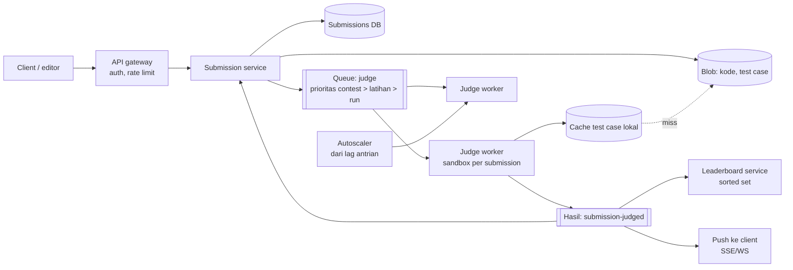
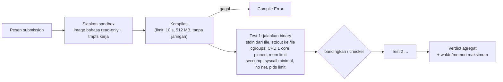

## 1. Requirements

Klarifikasi: bahasa yang didukung? Latihan saja atau contest dengan leaderboard real-time? Soal dengan checker khusus/interaktif? Batas waktu dan memori per soal? Apakah ada eksekusi "run" (uji dengan input sendiri) selain "submit"?

### Functional

- Pengguna melihat soal, menulis kode di beberapa bahasa, menjalankan dengan input kustom, dan submit untuk dinilai terhadap test case tersembunyi.
- Verdict: Accepted, Wrong Answer, Time Limit Exceeded, Memory Limit Exceeded, Runtime Error, Compile Error; dengan waktu dan memori terpakai.
- Contest: durasi tetap, leaderboard, penalti; submission contest diprioritaskan.
- Pembuat soal mengunggah test case, solusi referensi, checker opsional.
- Out of scope: editor kolaboratif, plagiarism detection (disebut), diskusi.

### Non-functional

| NFR             | Target                                                                            | Alasan               |
| --------------- | --------------------------------------------------------------------------------- | -------------------- |
| Keamanan        | Kode user tidak bisa mengakses host, jaringan, atau submission lain               | Kode tidak dipercaya |
| Keadilan        | Pengukuran waktu/memori konsisten antar mesin dan waktu                           | Verdict harus adil   |
| Latency verdict | p50 &lt; 5 s untuk soal biasa di luar puncak; posisi antrian terlihat saat puncak | Umpan balik          |
| Availability    | 99.9%; contest tidak boleh terganggu                                              | Reputasi             |
| Skala           | 10 juta submission/bulan; puncak contest 1.000 submission/detik                   | Lonjakan ekstrem     |
| Biaya           | Worker sandbox adalah biaya utama; autoscale                                      | —                    |

## 2. Estimasi kapasitas

Asumsi: 10 juta submission/bulan; rata-rata 20 test case × 0.2 s CPU = 4 s CPU per submission (plus kompilasi ~1 s); puncak contest 1.000 submission/detik selama menit pertama.

- Rata-rata: 10^7 / 2.6×10^6 s ≈ **4 submission/detik** × 5 s CPU ≈ 20 core sibuk; kecil.
- Puncak contest: 1.000/s × 5 s = **5.000 core** untuk verdict instan; tidak masuk akal secara biaya. Target realistis: 500–1.000 core (autoscale, pre-warm sebelum contest) dengan antrian beberapa menit di menit pertama, prioritas untuk soal mudah/submission pertama.
- Storage: kode 10^7 × 5 KB = 50 GB/bulan; test case per soal (ratusan KB–puluhan MB) × 5.000 soal ≈ puluhan GB; output/log verdict kecil. Blob store untuk test case dan kode.
- Antrian: 60.000 pesan di menit pertama contest; trivial untuk broker.
- Leaderboard: 50.000 peserta × puluhan update/menit → sorted set di memori.

Keputusan: API stateless + queue durable + pool worker sandbox homogen yang autoscale; test case di-cache lokal di worker; hasil ke DB + push ke client.

## 3. API design

```text
GET  /v1/problems/{id}                       → statement, limits, contoh
POST /v1/run      { problemId, lang, code, stdin }        → 202 { runId }       (uji cepat, tanpa penilaian, limit lebih ketat)
POST /v1/submissions { problemId, lang, code, contestId?, Idempotency-Key } → 202 { submissionId, status: queued, position }
GET  /v1/submissions/{id}                   → status, verdict, perTest: [{ verdict, timeMs, memKb }], compileOutput
WS/SSE /v1/submissions/{id}/events          → status berubah (queued → running → verdict)
GET  /v1/contests/{id}/leaderboard?cursor=  → peringkat
POST /v1/problems (author)  { statement, limits, tests[] (upload via presigned URL), checker?, referenceSolution }
```

Rate limit: submission per user per menit (mis. 10), run per menit lebih longgar; ukuran kode maksimum.

## 4. Skema data

```sql
problems(id, title, statement_ref, time_limit_ms, memory_limit_kb, checker_ref, author_id, visibility)
problem_tests(problem_id, idx, input_key, expected_key, weight, is_sample)     -- file di blob
submissions(id, user_id, problem_id, contest_id, lang, code_key, status, verdict, time_ms, memory_kb,
            score, created_at, judged_at, worker_id)                          -- shard by id/time
submission_tests(submission_id, idx, verdict, time_ms, memory_kb, checker_msg)
contests(id, start_at, end_at, rules), contest_participants(contest_id, user_id)
leaderboard (Redis sorted set per contest): score|penalty → user_id, dimaterialisasi ke DB berkala
language_images(lang, image_digest, compile_cmd, run_cmd, limits_multiplier)
```

Kode dan test case di blob store; DB hanya referensi dan hasil. Idempotency key mencegah submission ganda saat retry.

## 5. High-level design



**Alur submit**: client → submission service memvalidasi (ukuran, bahasa, rate limit), menyimpan kode ke blob, membuat record `queued`, mengirim pesan ke queue dengan prioritas → worker mengambil pesan (lease/visibility timeout lebih panjang dari total limit), menandai `running`, mengunduh kode dan test case (cache lokal per problem), kompilasi di sandbox, menjalankan tiap test case di sandbox baru dengan limit, membandingkan output (atau checker), menghasilkan verdict → publish hasil → service memperbarui DB, leaderboard, dan push ke client.

## 6. Detailed design

### 6.1 Sandbox eksekusi



Lapisan isolasi (defense in depth):

| Lapisan        | Mekanisme                                               | Melindungi dari                                          |
| -------------- | ------------------------------------------------------- | -------------------------------------------------------- |
| Namespace      | PID, mount, net, user                                   | Melihat proses/filesystem host; jaringan dimatikan total |
| cgroups v2     | cpu, memory (+ swap 0), pids                            | Fork bomb, OOM host, CPU hog; sekaligus pengukuran       |
| seccomp        | Allowlist syscall per bahasa                            | Syscall berbahaya                                        |
| Filesystem     | Root read-only, tmpfs kecil untuk kerja, no setuid      | Modifikasi, exfiltrasi                                   |
| Sandbox kernel | gVisor (syscall diinterposisi) atau microVM Firecracker | Eksploit kernel host                                     |
| Waktu          | CPU time limit via rlimit/cgroups + wall-clock guard    | Sleep/IO stall                                           |

Satu sandbox per test case (atau per submission dengan reset) agar test case tidak saling memengaruhi; output dibatasi ukurannya (mencegah output bomb); stdin/stdout lewat file, bukan pipe tanpa batas.

### 6.2 Keadilan pengukuran

- Worker homogen (tipe instance sama), CPU frequency scaling dimatikan, satu submission per core dengan `cpuset`, tidak ada tetangga berisik (jangan menjalankan dua submission di core hyperthread sepasang).
- Ukur **CPU time** (user+sys) dari cgroups; wall-clock sebagai pengaman 2–3×.
- Limit per bahasa: faktor pengali (Python 3×, Java 2× + memori JVM) dikalibrasi dengan solusi referensi saat soal dibuat; verdikt "TLE" dengan toleransi kecil di ambang.
- Memori: peak dari cgroups memory.peak; JVM/.NET memerlukan pengaturan heap eksplisit.

### 6.3 Antrian, prioritas, dan skala

- Queue dengan beberapa tingkat prioritas: contest aktif &gt; latihan &gt; run; dalam contest, submission pertama per (user, soal) lebih dulu agar umpan balik merata.
- Visibility timeout = total limit + margin; worker mengirim heartbeat untuk submission panjang; worker mati → pesan kembali → submission dijalankan ulang (idempotent: hasil lama ditimpa by submission id).
- Autoscale worker dari lag dan waktu eksekusi rata-rata; **pre-warm** kapasitas sebelum contest (jadwal diketahui); cache image bahasa dan test case di node.
- Posisi antrian dan ETA ditampilkan ke user; batas submission per user per menit menahan spam.

### 6.4 Penilaian: perbandingan output dan checker

- Default: bandingkan token (abaikan whitespace di akhir); mode presisi untuk floating point (epsilon).
- Checker khusus (testlib-style): program pembuat soal dijalankan di sandbox juga; interaktif: interactor dan solusi dihubungkan lewat pipe di dalam sandbox dengan limit terpisah.
- Verdict agregat: berhenti di test pertama yang gagal (hemat) untuk contest ICPC-style, atau jalankan semua untuk skor parsial (IOI-style) tergantung aturan.
- Hasil per test disimpan; pesan checker dibatasi untuk tidak membocorkan test case tersembunyi.

### 6.5 Contest dan leaderboard

- Jam contest dari server; submission ditandai contest hanya jika diterima sebelum `end_at` (dengan grace network kecil, diterapkan konsisten).
- Leaderboard di sorted set: skor gabungan (poin, penalti) sebagai score; update saat verdict; halaman diambil dengan ZRANGE; dimaterialisasi ke DB untuk hasil akhir; freeze leaderboard di menit akhir (opsional).
- Anti-cheat dasar: deteksi kemiripan kode async (MOSS-like) setelah contest; rate limit; satu sesi per user.

### 6.6 Pengelolaan soal

Pembuat mengunggah test via presigned URL; solusi referensi dijalankan untuk menghasilkan output yang diharapkan dan mengkalibrasi limit; validator input memeriksa batasan; versi test case agar submission lama tetap dapat direproduksi.

## 7. Evaluasi terhadap non-functional requirements

| NFR                | Dipenuhi oleh                                                                                                            | Risiko tersisa                                                                                                 |
| ------------------ | ------------------------------------------------------------------------------------------------------------------------ | -------------------------------------------------------------------------------------------------------------- |
| Keamanan           | Isolasi berlapis + gVisor/microVM, tanpa jaringan, read-only, pids/mem limit                                             | Zero-day kernel/sandbox: worker ephemeral, tanpa secret, jaringan egress ditutup di level host                 |
| Keadilan           | Worker homogen, cpuset, CPU time, kalibrasi per bahasa                                                                   | Variasi cache CPU ~5%: toleransi di ambang                                                                     |
| Latency verdict    | Worker tersedia + cache test case; prioritas                                                                             | Puncak contest: antrian menit; posisi antrian terlihat; pre-warm                                               |
| Availability 99.9% | API stateless, queue durable, worker ephemeral; contest tidak bergantung pada komponen non-kritis (anti-cheat, analitik) | Kegagalan broker: cluster terreplikasi; submission tetap tersimpan di DB sebagai "queued" dan dapat di-requeue |
| Skala              | Horizontal worker, blob untuk artefak, DB shard by waktu                                                                 | Biaya worker; batasi test case per soal dan early-exit                                                         |

Bottleneck 10x: kapasitas worker (biaya) dan unduh test case (cache lokal, image bahasa pre-pulled). SPOF: queue (replikasi) dan leaderboard store (replika + rebuild dari DB).

## 8. Pertanyaan lanjutan interviewer

- "Bagaimana menjalankan 'run' interaktif (REPL) atau notebook?" → Sesi sandbox berumur panjang dengan limit total dan idle timeout; jauh lebih mahal; batasi per user.
- "Bahasa yang butuh JIT warm-up atau GC (Java, Go)?" → Faktor limit per bahasa, ukuran heap eksplisit, dan pengukuran CPU time, bukan wall-clock.
- "Soal dengan test case 1 GB?" → Cache di node, streaming input, atau generator test di dalam sandbox dari seed.
- "Mencegah kebocoran test case tersembunyi lewat output/pesan error?" → Batasi output, sembunyikan stderr detail, checker message generik.
- "Menjalankan ulang semua submission bila test case diperbaiki (rejudge)?" → Job batch prioritas rendah, versi test case, verdict lama disimpan untuk audit.
- "Multi-region?" → Queue dan worker per region, submission dirutekan ke region user, test case direplikasi ke blob tiap region.
