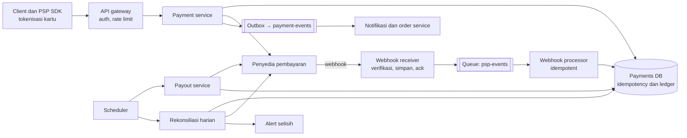
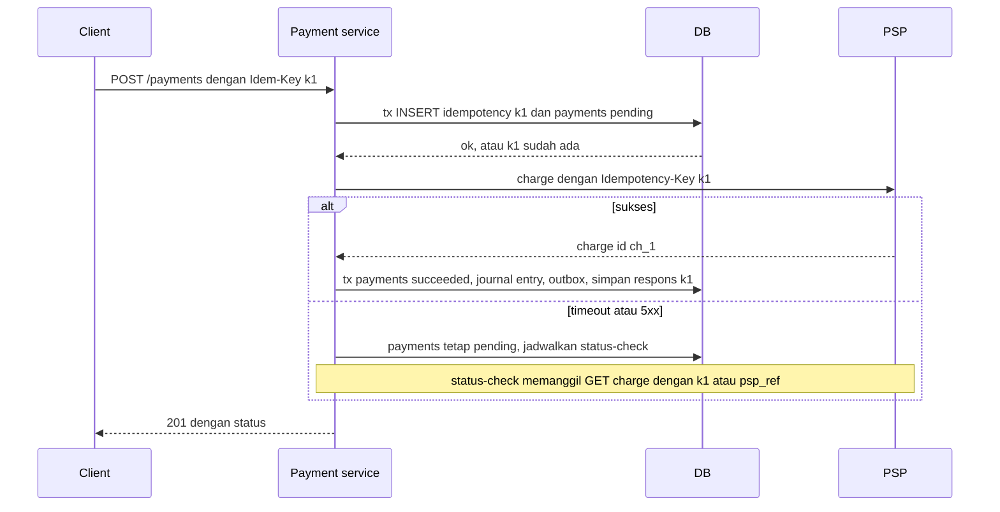

## 1. Requirements

Tanyakan dulu. Apakah kita pedagang yang menerima pembayaran untuk produk sendiri, atau platform yang juga membayar penjual seperti marketplace? Metode apa saja: kartu, e-wallet, transfer bank? Apakah kita memproses kartu sendiri atau lewat penyedia pembayaran? Satu mata uang atau banyak? Apakah refund dan sengketa termasuk?

Asumsi kasus ini: marketplace yang memakai penyedia pembayaran seperti Stripe untuk kartu dan e-wallet. Pembeli membayar, platform memotong fee, penjual dibayar terjadwal, dan hanya satu mata uang.

### Functional

- Pay-in: pembeli membayar pesanan lewat penyedia pembayaran, dan hasilnya sukses atau gagal.
- Ledger mencatat semua pergerakan uang: dari pembeli ke platform, ke penjual, fee, dan refund.
- Pay-out: transfer ke penjual sesuai jadwal.
- Refund penuh atau sebagian, dan rekonsiliasi harian dengan laporan penyedia.
- Di luar cakupan: memproses kartu sendiri, deteksi fraud mendalam, banyak mata uang, dan pajak.

### Non-functional

| Target       | Nilai                                                                                | Alasan                                      |
| ------------ | ------------------------------------------------------------------------------------ | ------------------------------------------- |
| Kebenaran    | Tidak ada tagihan ganda, tidak ada uang hilang atau tercipta, ledger selalu seimbang | Inti sistem                                 |
| Konsistensi  | Kuat untuk ledger dan status pembayaran, eventual untuk tampilan                     | Ini uang                                    |
| Reliability  | Setiap operasi aman diulang di semua batas, toleran terhadap penyedia yang lambat    | Integrasi eksternal rapuh                   |
| Availability | 99.99% untuk memulai pembayaran, dengan degradasi anggun saat penyedia mati          | Pendapatan                                  |
| Keamanan     | Data kartu tidak pernah menyentuh server kita, audit lengkap, akses terbatas         | Kepatuhan PCI DSS dan kepercayaan           |
| Skala        | 1 juta transaksi per hari, puncak 100 per detik                                      | Kebenaran lebih penting daripada throughput |

## 2. Estimasi kapasitas

- Transaksi: 1 juta per hari dibagi 100 ribu detik menghasilkan sekitar 10 per detik. Puncaknya 100 per detik. Angka ini kecil, jadi desain mengutamakan kebenaran, bukan sharding.
- Ledger: tiap pembayaran menghasilkan 4 sampai 8 baris. Sekitar 8 juta baris per hari kali 200 byte adalah 1.6 GB per hari. Lima tahun sekitar 3 TB, cukup untuk satu database relasional dengan partisi menurut waktu.
- Panggilan ke penyedia: 100 per detik pada puncak, dengan latency 300 ms sampai 2 detik. Timeout dan antrean pengulangan harus dirancang.
- Webhook masuk: 2 sampai 3 per transaksi, jadi ratusan per detik pada puncak.
- Rekonsiliasi: laporan harian jutaan baris diproses batch malam hari.

Keputusannya: database relasional transaksional sebagai inti, queue untuk pekerjaan asinkron seperti webhook dan payout, dan tanpa cache di jalur tulis.

## 3. API design

```text
POST /v1/payments                          Idempotency-Key: <uuid dari client>
     { orderId, amount, currency, method: { type: "card", token } }   // token dari PSP SDK, bukan nomor kartu
     → 201 { paymentId, status: "pending" | "succeeded" | "requires_action", nextAction? }
     → 200 (ulangan dengan key sama: respons tersimpan)  · 409 (key sama, payload beda)
GET  /v1/payments/{id}                     → status, amount, timeline
POST /v1/payments/{id}/refunds             Idempotency-Key  { amount, reason } → 202
POST /v1/payouts/run                       (internal, terjadwal)
POST /webhooks/psp                         (dari PSP; verifikasi tanda tangan; 200 cepat)
GET  /v1/ledger/accounts/{id}/balance      → saldo (materialisasi) + as_of
```

Semua endpoint tulis memakai idempotency key, dan responsnya disimpan 24 jam. Status `requires_action` dipakai untuk otentikasi tambahan seperti 3-D Secure. Client menyelesaikannya lewat SDK penyedia, dan hasil akhirnya datang lewat webhook.

## 4. Skema data

```sql
payments(id, order_id, payer_id, amount, currency, status, psp_ref, method_token_ref,
         idempotency_key UNIQUE, created_at, updated_at, version)
payment_events(id, payment_id, type, payload, created_at)         -- append-only, audit & timeline
idempotency_keys(key PK, request_hash, response_status, response_body, payment_id, expires_at)

-- Ledger double-entry (append-only, tidak pernah UPDATE/DELETE):
accounts(id, type: asset|liability|revenue|…, owner_id, currency)  -- mis. "psp_receivable", "seller:123", "platform_fee"
journal_entries(id, payment_id, kind, created_at)                  -- satu transaksi bisnis
journal_lines(entry_id, account_id, debit, credit)                 -- Σdebit = Σkredit per entry (CHECK/constraint aplikasi)
account_balances(account_id, balance, as_of_entry_id)              -- materialisasi, direkonsiliasi

refunds(id, payment_id, amount, status, psp_ref, idempotency_key UNIQUE)
payouts(id, seller_id, amount, status, psp_ref, period)
psp_events(event_id PK, type, payload, received_at, processed_at)  -- dedup webhook
reconciliation_runs(date, psp_total, ledger_total, diff, status)
```

Uang disimpan sebagai bilangan bulat dalam satuan terkecil, misalnya sen, bukan bilangan desimal. Kolom status mengikuti state machine. Setiap transisi divalidasi dan dicatat di tabel event.

## 5. High-level design



Alur pay-in:

1. Client meminta token metode pembayaran dari SDK penyedia. Data kartu tidak pernah lewat server kita.
2. Client memanggil endpoint pembayaran dengan idempotency key.
3. Payment service membuka satu transaksi database: memeriksa dan menyimpan key, membuat record pembayaran berstatus pending, dan mencatat event.
4. Payment service memanggil penyedia dengan key yang sama.
5. Bila penyedia sukses, status menjadi succeeded, baris ledger ditulis, dan event diterbitkan lewat outbox. Outbox adalah tabel event yang ditulis dalam transaksi yang sama lalu diteruskan ke queue.
6. Bila timeout atau hasilnya tidak diketahui, status tetap pending dan pemeriksaan status dijadwalkan. Webhook atau pemeriksaan itu menyelesaikannya.

Alur refund dan payout memakai pola yang sama: record, idempotency, panggilan ke penyedia, baris ledger, lalu penyelesaian lewat webhook atau polling.

## 6. Detailed design

### 6.1 Idempotency di semua batas



Prinsipnya ada empat:

- Key disimpan sebelum ada efek samping eksternal, dalam transaksi yang sama dengan record pembayaran. Permintaan ulang saat masih diproses mendapat respons 409 atau menunggu, bukan eksekusi kedua.
- Hash isi permintaan disimpan untuk menolak key yang dipakai ulang dengan isi berbeda.
- Key diteruskan ke penyedia, sehingga pengulangan dari kita juga aman di sisi mereka.
- Semua pemroses internal, yaitu webhook, payout, dan notifikasi, aman diulang berdasarkan id event atau record.

### 6.2 State machine pembayaran

Status bergerak dari created ke pending, lalu ke succeeded, failed, atau requires_action. Dari requires_action, status berakhir di succeeded atau failed. Dari succeeded, status bisa menjadi partially_refunded, refunded, atau disputed.

Setiap transisi divalidasi dengan kolom versi sebagai kunci optimistik. Event dari webhook yang datang tidak berurutan ditunda dan diantrekan ulang, atau diselesaikan dengan menarik status terbaru dari penyedia.

### 6.3 Ledger double-entry

Double-entry berarti setiap kejadian bisnis dicatat sebagai satu entri dengan minimal dua baris yang seimbang. Jumlah debit selalu sama dengan jumlah kredit.

| Kejadian                                 | Debit                                             | Kredit                                            |
| ---------------------------------------- | ------------------------------------------------- | ------------------------------------------------- |
| Pay-in Rp100.000 dengan fee platform 10% | psp_receivable 100.000                            | seller_payable 90.000 dan platform_revenue 10.000 |
| Penyedia menyetor ke rekening bank kita  | bank 100.000                                      | psp_receivable 100.000                            |
| Payout ke penjual                        | seller_payable 90.000                             | bank 90.000                                       |
| Refund penuh                             | seller_payable 90.000 dan platform_revenue 10.000 | psp_receivable 100.000                            |

Baris ledger tidak pernah diubah. Koreksi dilakukan dengan entri pembalik. Keseimbangan diperiksa di aplikasi dan oleh job audit. Saldo per akun disimpan sebagai turunan dan diverifikasi ulang dari ledger secara berkala.

Saldo penjual yang bisa ditarik hanya bagian yang sudah disetor penyedia ke bank kita, bukan sekadar pembayaran yang berstatus sukses. Aturan ini mencegah kita membayar sebelum uangnya benar-benar masuk.

### 6.4 Integrasi penyedia: timeout, pengulangan, webhook

Timeout dipasang 10 sampai 30 detik. Pengulangan hanya memakai idempotency key yang sama, dengan jeda yang membesar. Bila penyedia mengembalikan error server beruntun, circuit breaker menahan panggilan baru, status tetap pending, dan pengguna diberi tahu bahwa pembayaran sedang diproses.

Penanganan webhook:

1. Verifikasi tanda tangan HMAC dan stempel waktu untuk mencegah pemutaran ulang.
2. Simpan event dengan id unik sebagai dedup, lalu balas 200 segera.
3. Proses event dari queue secara asinkron.
4. Untuk status akhir, tarik objek pembayaran dari penyedia alih-alih mempercayai isi webhook.

Pemeriksaan status berjalan untuk pembayaran yang pending lebih dari beberapa menit. Rekonsiliasi menangkap yang lolos dari semua itu.

Banyak penyedia adalah perluasan: lapisan abstraksi provider, routing menurut metode atau negara, dan pengalihan untuk pay-in baru bila satu penyedia mati. Pembayaran yang sudah dimulai tetap di penyedia asalnya.

### 6.5 Rekonsiliasi

Setiap hari sistem mengunduh laporan penyelesaian dari penyedia. Laporan dibandingkan per transaksi dengan tabel pembayaran dan ledger: jumlah, fee, dan status. Selisih masuk antrean investigasi dengan alert. Kasus yang jelas, misalnya webhook yang hilang, diperbaiki otomatis dengan menarik status. Rekonsiliasi adalah pengaman terakhir, bukan pengganti idempotency.

### 6.6 Keamanan dan kepatuhan

- Tokenisasi: nomor kartu hanya menyentuh penyedia lewat iframe atau SDK. Kita menyimpan token saja, sehingga lingkup PCI DSS minimal.
- Enkripsi saat disimpan dan saat dikirim, akses ledger hanya baca kecuali untuk service tertentu, audit log untuk semua akses manual, dan secret di vault dengan rotasi.
- Fraud dasar: pembatasan laju per akun, kartu, dan IP, aturan sederhana, dan skor dari penyedia. Transaksi mencurigakan diblokir sebelum penyedia dipanggil.
- Jumlah uang selalu bilangan bulat satuan terkecil. Validasi mata uang dan pembulatan dilakukan di satu tempat.

## 7. Evaluasi terhadap non-functional requirements

| Target                    | Cara memenuhi                                                                                              | Risiko yang tersisa                                                                                                             |
| ------------------------- | ---------------------------------------------------------------------------------------------------------- | ------------------------------------------------------------------------------------------------------------------------------- |
| Tidak ada tagihan ganda   | Key disimpan sebelum efek samping, diteruskan ke penyedia, dan status tidak diketahui tidak dianggap gagal | Client membuat key baru untuk pesanan sama. Tautkan key ke id pesanan dan tolak pembayaran kedua untuk pesanan yang sudah aktif |
| Ledger seimbang           | Double-entry, hanya tambah, keseimbangan diperiksa, rekonsiliasi                                           | Salah memetakan akun terdeteksi oleh rekonsiliasi, bukan dicegah                                                                |
| Toleran terhadap penyedia | Timeout, pengulangan idempotent, circuit breaker, webhook ditambah polling dan rekonsiliasi                | Penyedia mati lama menunda pay-in. Banyak penyedia adalah mitigasinya                                                           |
| Availability 99.99%       | Database primary dengan replika sinkron dan failover, service tanpa state, queue permanen                  | Failover memakai replika sinkron agar tidak ada transaksi yang hilang                                                           |
| Keamanan                  | Tokenisasi, enkripsi, hak akses minimal, audit                                                             | Ancaman orang dalam ditahan dengan pemisahan tugas dan review                                                                   |
| Skala                     | 100 transaksi per detik ringan untuk satu database, ledger dipartisi menurut waktu                         | Pertumbuhan 100 kali memaksa shard menurut akun, dengan ledger per shard dan rekonsiliasi lintas shard                          |

Bottleneck sistem ini bukan throughput, melainkan latency penyedia dan beban operasional seperti sengketa dan rekonsiliasi. Titik lemah tunggalnya adalah database primary, yang ditangani failover sinkron, dan penyedia pembayaran, yang ditangani dengan banyak penyedia.

## 8. Pertanyaan lanjutan interviewer

- "Order dan payment adalah dua service. Bagaimana kalau pembayaran sukses tetapi stok habis?" Pakai saga dengan kompensasi berupa refund, atau pesan stok sebelum menagih. Status pesanan mengikuti event pembayaran dari outbox.
- "Bagaimana banyak mata uang?" Akun per mata uang, entri kurs dengan nilai tukar yang tercatat, dan tidak ada konversi tersirat di ledger.
- "Bagaimana memastikan ledger tidak dimanipulasi?" Hanya tambah dengan hak tulis terbatas, rantai hash per akun bila perlu, dan audit eksternal.
- "Pengguna menekan bayar dua kali di dua tab?" Satu pembayaran aktif per pesanan. Permintaan kedua menerima 409 dengan referensi ke pembayaran pertama.
- "Bagaimana menguji sistem ini?" Sandbox penyedia, injeksi kegagalan seperti timeout dan webhook ganda, uji sifat keseimbangan ledger, dan pemutaran ulang event produksi ke staging.
- "Skala 10.000 transaksi per detik?" Shard menurut akun pembayar, ledger per shard, agregasi global asinkron, penyimpanan idempotency terpartisi menurut key, dan penyedia dipanggil paralel.
