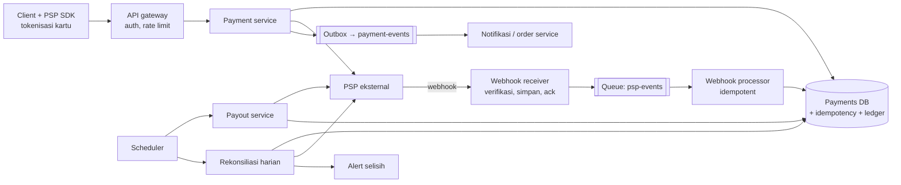
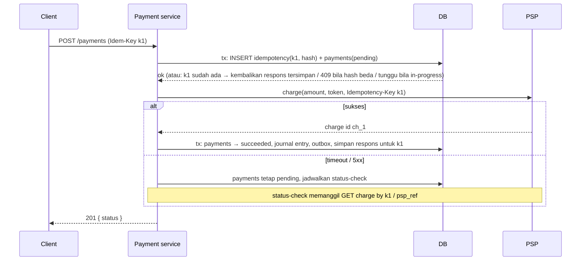

## 1. Requirements

Klarifikasi: kita pedagang (menerima pembayaran untuk produk sendiri) atau platform (menerima dan membayar ke penjual, seperti marketplace)? Metode: kartu, e-wallet, transfer bank? Apakah kita memproses kartu sendiri (PCI DSS penuh) atau lewat PSP? Mata uang? Refund dan sengketa?

Asumsi: platform marketplace yang memakai PSP (Stripe-like) untuk kartu/e-wallet, pay-in dari pembeli, pay-out ke penjual, satu mata uang.

### Functional

- Pay-in: pembeli membayar pesanan; hasil sukses/gagal; metode kartu dan e-wallet lewat PSP.
- Ledger: mencatat semua pergerakan uang (pembeli → platform → penjual, fee, refund).
- Pay-out: transfer ke penjual terjadwal.
- Refund penuh/sebagian; rekonsiliasi harian dengan laporan PSP.
- Out of scope: pemrosesan kartu sendiri, deteksi fraud mendalam (disebut), multi-mata uang, pajak.

### Non-functional

| NFR          | Target                                                                                    | Alasan                                                          |
| ------------ | ----------------------------------------------------------------------------------------- | --------------------------------------------------------------- |
| Correctness  | Tidak ada tagihan ganda, tidak ada uang hilang/tercipta; ledger seimbang                  | Inti                                                            |
| Konsistensi  | Kuat untuk ledger dan state pembayaran; eventual untuk tampilan                           | Uang                                                            |
| Reliability  | At-least-once + idempotent di semua batas; toleran PSP lambat/timeout                     | Integrasi eksternal rapuh                                       |
| Availability | 99.99% untuk memulai pembayaran; degradasi anggun saat PSP down                           | Pendapatan                                                      |
| Keamanan     | Data kartu tidak pernah menyentuh server kita (tokenisasi), audit lengkap, akses terbatas | PCI DSS, kepercayaan                                            |
| Skala        | 1 juta transaksi/hari, puncak 100/detik                                                   | Marketplace menengah; correctness lebih penting dari throughput |

## 2. Estimasi kapasitas

- Transaksi: 10^6 / 10^5 ≈ **10/detik** rata-rata, puncak 100/detik; sangat kecil dibanding sistem lain, sehingga desain mengutamakan correctness, bukan sharding.
- Ledger: tiap pembayaran ≈ 4–8 entri (pay-in, fee, pending payout, dsb.) → ~8 juta entri/hari × 200 B ≈ 1.6 GB/hari; 5 tahun ≈ 3 TB; satu DB relasional dengan partisi by waktu cukup.
- Panggilan PSP: 100/detik puncak, latency 300 ms–2 s; timeout dan antrian retry harus dirancang.
- Webhook masuk: ~2–3 per transaksi → ratusan/detik puncak.
- Rekonsiliasi: laporan harian jutaan baris, batch malam.

Keputusan: DB relasional transaksional (PostgreSQL) sebagai inti, queue untuk pekerjaan async (webhook, payout, notifikasi), tanpa cache di jalur tulis.

## 3. API design

```text
POST /v1/payments                          Idempotency-Key: <uuid dari client>
     { orderId, amount, currency, method: { type: "card", token } }   // token dari PSP SDK, bukan nomor kartu
     → 201 { paymentId, status: "pending" | "succeeded" | "requires_action", nextAction? }
     → 200 (ulangan dengan key sama: respons tersimpan)  · 409 (key sama, payload beda)
GET  /v1/payments/{id}                     → status, amount, timeline
POST /v1/payments/{id}/refunds             Idempotency-Key  { amount, reason } → 202
POST /v1/payouts/run                       (internal, terjadwal)
POST /webhooks/psp                         (dari PSP; verifikasi tanda tangan; 200 cepat)
GET  /v1/ledger/accounts/{id}/balance      → saldo (materialisasi) + as_of
```

Semua endpoint tulis memakai idempotency key; respons disimpan 24 jam. `requires_action` untuk 3-D Secure/otentikasi tambahan; client menyelesaikan lewat SDK PSP, hasil akhir datang lewat webhook.

## 4. Skema data

```sql
payments(id, order_id, payer_id, amount, currency, status, psp_ref, method_token_ref,
         idempotency_key UNIQUE, created_at, updated_at, version)
payment_events(id, payment_id, type, payload, created_at)         -- append-only, audit & timeline
idempotency_keys(key PK, request_hash, response_status, response_body, payment_id, expires_at)

-- Ledger double-entry (append-only, tidak pernah UPDATE/DELETE):
accounts(id, type: asset|liability|revenue|…, owner_id, currency)  -- mis. "psp_receivable", "seller:123", "platform_fee"
journal_entries(id, payment_id, kind, created_at)                  -- satu transaksi bisnis
journal_lines(entry_id, account_id, debit, credit)                 -- Σdebit = Σkredit per entry (CHECK/constraint aplikasi)
account_balances(account_id, balance, as_of_entry_id)              -- materialisasi, direkonsiliasi

refunds(id, payment_id, amount, status, psp_ref, idempotency_key UNIQUE)
payouts(id, seller_id, amount, status, psp_ref, period)
psp_events(event_id PK, type, payload, received_at, processed_at)  -- dedup webhook
reconciliation_runs(date, psp_total, ledger_total, diff, status)
```

Uang disimpan sebagai **integer minor unit** (sen), bukan float. Kolom `status` adalah state machine; transisi divalidasi dan dicatat di `payment_events`.

## 5. High-level design



**Alur pay-in**: client mendapat token metode dari PSP SDK (data kartu tidak lewat kita) → `POST /payments` dengan idempotency key → payment service dalam satu transaksi DB: cek/insert `idempotency_keys`, insert `payments(pending)`, event → commit → panggil PSP dengan key yang sama → sukses: transisi `succeeded`, tulis journal entry (debit psp_receivable, kredit seller_payable + platform_fee), outbox event → respons; timeout/unknown: tetap `pending`, job status-check dijadwalkan; webhook menyelesaikan.

**Alur refund dan payout** memakai pola yang sama: record + idempotency + panggilan PSP + journal entry + penyelesaian lewat webhook/polling.

## 6. Detailed design

### 6.1 Idempotency di semua batas



- Key disimpan **sebelum** efek samping eksternal, dalam transaksi yang sama dengan record pembayaran; request ulang saat masih in-progress mendapat 409/menunggu, bukan eksekusi kedua.
- Hash payload disimpan untuk menolak key yang dipakai ulang dengan isi berbeda.
- Key diteruskan ke PSP sehingga retry kita pun idempotent di sisi mereka.
- Semua consumer internal (webhook processor, payout, notifikasi) idempotent by id event/record.

### 6.2 State machine pembayaran

`created → pending → succeeded | failed | requires_action → (succeeded|failed)`; `succeeded → partially_refunded | refunded`; `disputed` dari succeeded. Transisi divalidasi dengan `version` (optimistic lock); event di luar urutan dari webhook ditunda (requeue dengan delay) atau diselesaikan dengan menarik status terbaru dari PSP.

### 6.3 Ledger double-entry

Setiap kejadian bisnis = satu journal entry dengan ≥ 2 baris yang seimbang:

| Kejadian                           | Debit                                          | Kredit                                             |
| ---------------------------------- | ---------------------------------------------- | -------------------------------------------------- |
| Pay-in Rp100.000, fee platform 10% | psp_receivable 100.000                         | seller_payable:123 90.000; platform_revenue 10.000 |
| PSP menyetor ke rekening bank kita | bank 100.000                                   | psp_receivable 100.000                             |
| Payout ke penjual                  | seller_payable:123 90.000                      | bank 90.000                                        |
| Refund penuh                       | seller_payable 90.000; platform_revenue 10.000 | psp_receivable 100.000                             |

- Baris ledger **tidak pernah diubah**; koreksi = entry pembalik.
- Invarian Σdebit = Σkredit diperiksa di aplikasi dan oleh job audit; saldo per akun dimaterialisasi (`account_balances`) dan diverifikasi ulang dari ledger secara berkala.
- Saldo penjual yang bisa ditarik = seller_payable yang sudah "settled" oleh PSP (ada entry bank), bukan sekadar succeeded; ini mencegah membayar sebelum uang benar-benar masuk.

### 6.4 Integrasi PSP: timeout, retry, webhook

- Timeout 10–30 s; retry hanya dengan idempotency key sama, backoff; circuit breaker bila PSP mengembalikan 5xx beruntun → status `pending`, user diberi tahu "sedang diproses".
- Webhook: verifikasi tanda tangan HMAC + timestamp (anti-replay), simpan `psp_events` dengan `event_id` unik (dedup), balas 200 segera, proses dari queue; untuk state final, **tarik** objek dari PSP (`GET /charges/{id}`) alih-alih mempercayai payload.
- Status-check job untuk pembayaran `pending` lebih dari N menit; rekonsiliasi untuk yang lolos semuanya.
- Multi-PSP (ekstensi): abstraksi provider, routing by metode/negara, failover untuk pay-in baru bila satu PSP down (pembayaran yang sudah dimulai tetap di PSP asal).

### 6.5 Rekonsiliasi

Harian: unduh settlement report PSP → bandingkan per transaksi dengan `payments` dan ledger (jumlah, fee, status) → selisih masuk antrian investigasi dengan alert; otomatis memperbaiki kasus yang jelas (webhook hilang → tarik status). Rekonsiliasi adalah pengaman terakhir, bukan pengganti idempotency.

### 6.6 Keamanan dan kepatuhan

- Tokenisasi: nomor kartu hanya menyentuh PSP (iframe/SDK); kita menyimpan token; scope PCI minimal (SAQ A).
- Enkripsi at-rest dan in-transit, akses ledger read-only kecuali service tertentu, audit log semua akses manual, secret di vault dengan rotasi.
- Fraud dasar: velocity check per akun/kartu/IP, rules, dan skor dari PSP; blokir sebelum memanggil PSP.
- Amount selalu integer minor unit; validasi mata uang dan pembulatan di satu tempat.

## 7. Evaluasi terhadap non-functional requirements

| NFR                     | Dipenuhi oleh                                                                                         | Risiko tersisa                                                                                                                               |
| ----------------------- | ----------------------------------------------------------------------------------------------------- | -------------------------------------------------------------------------------------------------------------------------------------------- |
| Tidak ada tagihan ganda | Idempotency key disimpan sebelum efek samping, diteruskan ke PSP, status unknown tidak dianggap gagal | Client yang membuat key baru untuk pesanan sama: tautkan key ke order_id dan tolak pembayaran kedua untuk order yang sudah pending/succeeded |
| Ledger seimbang         | Double-entry, append-only, invarian dicek, rekonsiliasi                                               | Bug mapping akun: terdeteksi oleh rekonsiliasi, bukan dicegah                                                                                |
| Toleran PSP             | Timeout, retry idempotent, circuit breaker, webhook + polling + rekonsiliasi                          | PSP down lama: pay-in tertunda; multi-PSP sebagai mitigasi                                                                                   |
| Availability 99.99%     | DB primary + sync replica + failover, service stateless, queue durable                                | Kehilangan primary: failover dengan sync replica agar tidak ada transaksi hilang                                                             |
| Keamanan                | Tokenisasi, enkripsi, least privilege, audit                                                          | Insider: pemisahan tugas dan review                                                                                                          |
| Skala                   | 100 tps trivial untuk satu DB; partisi ledger by waktu                                                | Pertumbuhan 100x: shard by account/payer dengan ledger per shard dan rekonsiliasi lintas shard                                               |

Bottleneck: tidak di throughput, melainkan di latency PSP dan operasional (sengketa, rekonsiliasi). SPOF: DB primary (failover sync) dan PSP (multi-provider).

## 8. Pertanyaan lanjutan interviewer

- "Dua service (order dan payment) harus konsisten: order dibayar tetapi stok habis?" → Saga dengan kompensasi (refund) atau reservasi stok sebelum tagih; status order mengikuti event pembayaran dari outbox.
- "Bagaimana multi-mata uang?" → Akun per mata uang, entry FX dengan kurs tercatat, jangan konversi di ledger secara implisit.
- "Bagaimana memastikan ledger tidak dimanipulasi?" → Append-only dengan hak tulis terbatas, hash chain per akun (opsional), audit eksternal.
- "User menekan bayar dua kali di dua tab?" → Idempotency per order: satu pembayaran aktif per order; kedua menerima 409 dengan referensi pembayaran pertama.
- "Bagaimana menguji sistem ini?" → Sandbox PSP, injeksi kegagalan (timeout, webhook duplikat/terbalik), property test invarian ledger, replay event produksi ke staging.
- "Skala 10.000 tps?" → Shard by payer/account, ledger per shard, agregasi global async; idempotency store terpartisi by key; PSP paralel.
