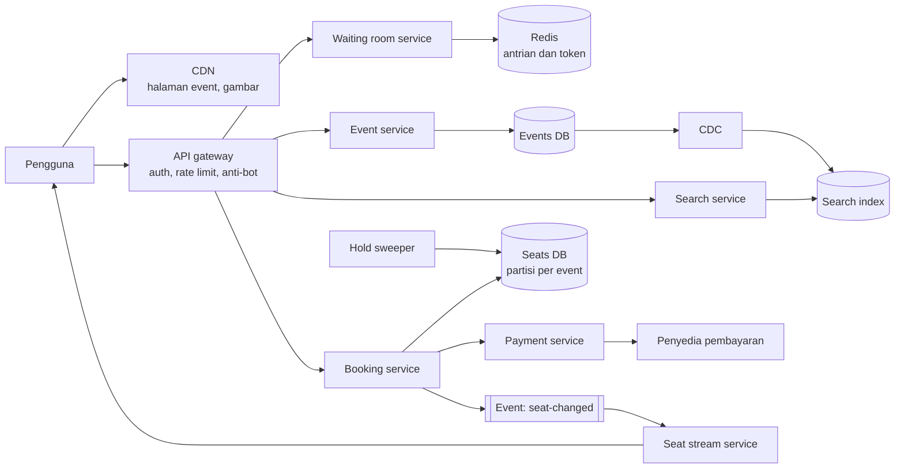
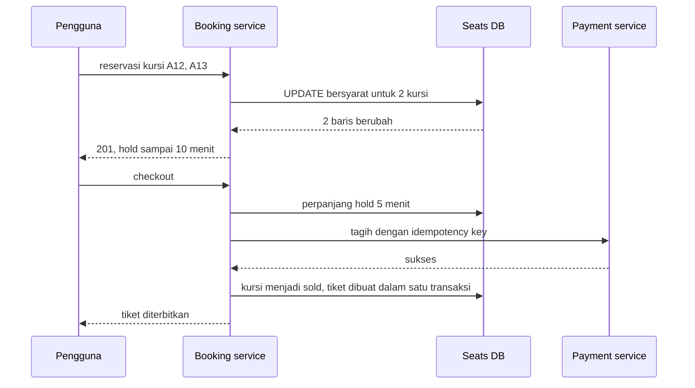

## 1. Requirements

Mulai dengan bertanya. Contoh pertanyaan klarifikasi: apakah kursi dipilih per nomor atau hanya per kategori? Berapa lama pembeli boleh menahan kursi? Apakah ada penjualan ulang antar pengguna? Seberapa besar lonjakan saat penjualan konser populer dibuka?

### Functional

- Pengguna mencari event berdasarkan nama, artis, kota, atau tanggal.
- Pengguna melihat detail event dan peta kursi beserta harganya.
- Pengguna memilih kursi, lalu kursi itu ditahan sementara selama beberapa menit.
- Pengguna membayar sebelum hold habis, lalu tiket diterbitkan.
- Di luar cakupan: penjualan ulang antar pengguna, harga dinamis, rekomendasi event, dan pemindaian tiket di pintu masuk.

### Non-functional

| Target                            | Nilai                                            | Alasan                                                    |
| --------------------------------- | ------------------------------------------------ | --------------------------------------------------------- |
| Satu kursi untuk satu pembeli     | Tidak boleh ada double booking sama sekali       | Dua orang dengan satu kursi adalah kegagalan paling buruk |
| Ketersediaan untuk lihat dan cari | 99.99%                                           | Halaman event dibuka jauh lebih sering daripada pembelian |
| Latency pencarian                 | p99 di bawah 500 ms                              | Pengguna mencoba beberapa kata kunci berturut-turut       |
| Tahan lonjakan                    | 100 kali trafik normal saat penjualan dibuka     | Konser populer habis dalam hitungan menit                 |
| Keadilan                          | Pengguna yang datang lebih dulu masuk lebih dulu | Pengalaman buruk bila bot atau refresh cepat yang menang  |

Perhatikan bahwa targetnya tidak seragam. Pemesanan kursi butuh konsistensi kuat. Halaman event dan pencarian boleh sedikit basi demi ketersediaan.

## 2. Estimasi kapasitas

Asumsi yang kita tulis di papan:

- Ada 100 juta pengguna terdaftar dan 10 ribu event aktif.
- Event biasa punya 5 ribu kursi. Event populer di stadion punya 50 ribu kursi.
- Saat penjualan event populer dibuka, 2 juta orang datang dalam menit pertama.

Hitungan baca:

- Hari biasa: halaman event dibuka sekitar 100 juta kali per hari, yaitu sekitar 1.000 QPS.
- Saat lonjakan: 2 juta orang memuat ulang halaman setiap 5 detik, yaitu sekitar 400 ribu QPS untuk satu event.
- Angka ini mustahil dilayani database. Halaman event harus disajikan dari CDN dan cache.

Hitungan tulis:

- Satu event populer hanya punya 50 ribu kursi untuk dijual.
- Kalau habis dalam 10 menit, laju reservasi suksesnya sekitar 80 per detik.
- Percobaan reservasi bisa 100 kali lebih banyak, karena banyak orang memilih kursi yang sama.

Hitungan storage:

- Sepuluh ribu event kali rata-rata 5 ribu kursi menghasilkan sekitar 50 juta baris kursi.
- Dengan 100 byte per baris, totalnya sekitar 5 GB. Datanya kecil.

Keputusan dari angka: masalah utama sistem ini bukan ukuran data, melainkan perebutan baris yang sama dan lonjakan baca. Satu database relasional yang dipartisi per event cukup untuk kursi. Lonjakan baca diserap CDN, cache, dan antrian virtual.

## 3. API design

```text
GET  /v1/events?q=coldplay&city=jakarta&cursor=     daftar event
GET  /v1/events/{eventId}                          detail event, bisa di-cache CDN
GET  /v1/events/{eventId}/seats                    peta kursi dan status, cache singkat
GET  /v1/events/{eventId}/seats/stream             SSE: perubahan status kursi

POST /v1/queue/{eventId}/join                      masuk antrian virtual, dapat token
GET  /v1/queue/{eventId}/status?token=             posisi dan perkiraan waktu tunggu

POST /v1/reservations                              Idempotency-Key wajib, header X-Queue-Token
     { "eventId": "...", "seatIds": ["A12", "A13"] }
     201 { "reservationId": "...", "expiresAt": "..." }
     409 kursi sudah diambil · 429 belum giliran di antrian

POST /v1/reservations/{id}/checkout                mulai bayar, hold diperpanjang
     { "paymentToken": "..." }  Idempotency-Key wajib
     200 { "ticketIds": [...] } · 402 pembayaran gagal · 410 hold kedaluwarsa

DELETE /v1/reservations/{id}                       batal, kursi dilepas
```

Dua catatan desain. Pertama, request reservasi dan checkout wajib membawa idempotency key, supaya tombol yang ditekan dua kali tidak membuat dua reservasi. Kedua, reservasi hanya diterima dari pengguna yang membawa token antrian yang sudah gilirannya.

## 4. Skema data

```sql
CREATE TABLE events (
  id          BIGINT PRIMARY KEY,
  venue_id    BIGINT NOT NULL,
  name        TEXT NOT NULL,
  starts_at   TIMESTAMPTZ NOT NULL,
  sale_opens_at TIMESTAMPTZ NOT NULL
);

CREATE TABLE seats (
  event_id        BIGINT NOT NULL,
  seat_id         TEXT   NOT NULL,
  section         TEXT   NOT NULL,
  price_cents     BIGINT NOT NULL,
  status          TEXT   NOT NULL DEFAULT 'available',
  reservation_id  BIGINT NULL,
  hold_expires_at TIMESTAMPTZ NULL,
  PRIMARY KEY (event_id, seat_id)
);

CREATE TABLE reservations (
  id          BIGINT PRIMARY KEY,
  event_id    BIGINT NOT NULL,
  user_id     BIGINT NOT NULL,
  status      TEXT   NOT NULL,
  expires_at  TIMESTAMPTZ NOT NULL,
  idempotency_key TEXT UNIQUE
);

CREATE TABLE tickets (
  id              BIGINT PRIMARY KEY,
  reservation_id  BIGINT NOT NULL,
  event_id        BIGINT NOT NULL,
  seat_id         TEXT   NOT NULL,
  UNIQUE (event_id, seat_id)
);
```

Beberapa hal penting dari skema ini:

- Kolom `status` pada kursi punya tiga nilai: `available`, `held`, dan `sold`.
- Kolom `hold_expires_at` membuat hold kedaluwarsa tanpa perlu job yang tepat waktu. Kursi yang ditahan tetapi waktunya lewat dianggap tersedia lagi.
- Unique constraint pada tiket untuk pasangan event dan kursi adalah pengaman terakhir. Bahkan bila ada bug di kode, database menolak dua tiket untuk kursi yang sama.
- Tabel kursi dipartisi berdasarkan `event_id`. Semua kursi satu event berada di satu partisi, sehingga reservasi beberapa kursi sekaligus cukup memakai satu transaksi lokal.
- Pencarian event tidak memakai tabel ini langsung. Data event dialirkan ke index pencarian lewat CDC, yaitu change data capture yang membaca log perubahan database.

## 5. High-level design



Alur mencari dan melihat event:

1. Pengguna mengetik kata kunci, lalu search service mencari di index.
2. Pengguna membuka halaman event, yang disajikan CDN.
3. Peta kursi diambil dari cache yang diperbarui setiap beberapa detik.
4. Perubahan status kursi didorong ke browser lewat SSE, yaitu koneksi satu arah dari server ke browser.

Alur memesan kursi:

1. Pengguna masuk antrian virtual dan menerima token antrian.
2. Saat gilirannya tiba, pengguna memilih kursi dan mengirim request reservasi.
3. Booking service mengubah status kursi dari tersedia menjadi ditahan dalam satu transaksi.
4. Bila semua kursi berhasil ditahan, booking service membuat reservasi dengan waktu habis 10 menit.
5. Bila satu kursi saja gagal, transaksi dibatalkan dan pengguna menerima 409.
6. Booking service menerbitkan event perubahan kursi, lalu peta kursi pengguna lain ikut diperbarui.

Alur membayar:

1. Pengguna menekan checkout, lalu booking service memperpanjang hold beberapa menit.
2. Payment service menagih lewat penyedia pembayaran dengan idempotency key.
3. Bila sukses, kursi berubah menjadi terjual dan tiket diterbitkan dalam satu transaksi.
4. Bila gagal, hold dilepas atau pengguna diberi kesempatan mencoba lagi sebelum waktunya habis.

## 6. Detailed design

### 6.1 Mencegah double booking

Ini inti soalnya. Ada empat pilihan yang biasa dibandingkan.

| Pendekatan                  | Cara kerja                                                               | Kelebihan                                | Kekurangan                                                                      |
| --------------------------- | ------------------------------------------------------------------------ | ---------------------------------------- | ------------------------------------------------------------------------------- |
| Cek lalu ubah di aplikasi   | Baca status, lalu ubah bila tersedia                                     | Mudah ditulis                            | Rawan balapan, dua request bisa sama-sama lolos                                 |
| Lock pesimis di database    | `SELECT ... FOR UPDATE` mengunci baris kursi selama transaksi            | Benar dan jelas                          | Request lain menunggu, sehingga antrian lock memanjang saat lonjakan            |
| UPDATE bersyarat atau versi | `UPDATE` hanya bila status masih tersedia, lalu cek jumlah baris berubah | Atomik, tanpa menunggu lama, gagal cepat | Pengguna yang kalah harus memilih kursi lain                                    |
| Lock terdistribusi di Redis | `SET key NX PX` per kursi sebagai penanda hold                           | Sangat cepat, mengurangi beban database  | Redis bisa kehilangan lock saat failover, jadi tetap butuh pengaman di database |

Pilihan kita adalah UPDATE bersyarat di database sebagai sumber kebenaran. Untuk beberapa kursi sekaligus, semuanya diubah dalam satu transaksi. Kalau jumlah baris yang berubah tidak sama dengan jumlah kursi yang diminta, transaksi dibatalkan.

```sql
UPDATE seats
SET status = 'held', reservation_id = $1, hold_expires_at = now() + interval '10 minutes'
WHERE event_id = $2
  AND seat_id = ANY($3)
  AND (status = 'available' OR (status = 'held' AND hold_expires_at < now()));
```

Redis boleh dipakai sebagai lapisan cepat di depan, misalnya untuk menolak kursi yang jelas sedang ditahan tanpa menyentuh database. Tetapi Redis bukan sumber kebenaran. Martin Kleppmann menjelaskan bahwa lock berwaktu di Redis bisa hilang saat failover atau saat proses berhenti sejenak. Karena itu keputusan akhir tetap di database, dan unique constraint pada tiket menjadi pengaman terakhir.

### 6.2 Hold berwaktu dan kedaluwarsa

Hold yang lupa dilepas akan mengunci kursi selamanya. Ada tiga lapis pengaman:

1. Kedaluwarsa malas: UPDATE bersyarat di atas sudah menganggap hold yang lewat waktu sebagai tersedia. Kursi bisa langsung diambil orang lain tanpa menunggu job.
2. Sweeper: job berkala mengubah hold yang lewat waktu kembali menjadi tersedia dan menerbitkan event, supaya peta kursi akurat.
3. Pelepasan eksplisit: saat pengguna membatalkan atau menutup halaman, kursi dilepas segera.



Kasus tepi yang sering ditanya: pembayaran sukses, tetapi hold sudah habis. Perpanjangan hold saat checkout dimulai membuat kasus ini jarang. Bila tetap terjadi, sistem mencoba mengambil kursi itu lagi secara atomik. Kalau kursinya sudah diambil orang lain, dana dikembalikan otomatis dan pengguna diberi tahu.

### 6.3 Lonjakan saat penjualan dibuka

Antrian virtual atau waiting room adalah halaman tunggu sebelum alur pembelian. Tugasnya membatasi berapa banyak orang yang boleh masuk ke booking service per detik.

1. Pengguna yang datang sebelum penjualan dibuka masuk ke halaman tunggu statis di CDN.
2. Saat penjualan dibuka, setiap pengguna mendapat nomor urut. Pengguna yang datang sebelum waktu buka bisa diacak agar adil.
3. Waiting room service menaikkan batas nomor yang boleh masuk sesuai kapasitas booking service.
4. Pengguna yang gilirannya tiba menerima token bertanda tangan dengan masa berlaku singkat.
5. Booking service menolak reservasi tanpa token yang sah.

Pengaman tambahan di sekitar antrian:

- Rate limit per pengguna dan per IP di gateway mencegah satu akun membanjiri sistem.
- Deteksi bot dan batas jumlah tiket per akun mengurangi pembelian massal untuk dijual ulang.
- Halaman event dan halaman tunggu disajikan CDN, sehingga 400 ribu QPS tidak pernah menyentuh server aplikasi.

### 6.4 Peta kursi yang hidup

Peta kursi tidak perlu sempurna setiap saat, karena keputusan akhir selalu diambil saat reservasi. Pendekatannya:

- Snapshot peta kursi per event disimpan di cache dan diperbarui setiap 1 sampai 2 detik.
- Perubahan kursi diterbitkan ke stream, lalu seat stream service mendorongnya ke browser lewat SSE.
- Untuk event raksasa, perubahan dikelompokkan per bagian tribun supaya jumlah pesan tetap wajar.
- Bila koneksi SSE terputus, browser kembali ke polling sederhana.

### 6.5 Pembayaran

Pembayaran mengikuti pola dari studi kasus payment system. Setiap checkout membawa idempotency key yang diteruskan ke penyedia pembayaran. Timeout dari penyedia dianggap "belum diketahui", bukan gagal, dan diselesaikan lewat webhook atau pengecekan status. Tiket hanya diterbitkan setelah pembayaran pasti sukses dan kursi masih atas nama reservasi itu.

### 6.6 Pencarian event

Pencarian memakai index teks terpisah yang diisi lewat CDC dari database event. Hasil untuk kata kunci populer di-cache beberapa menit. Data yang sering berubah, seperti jumlah kursi tersisa, tidak disimpan di index. Data itu diambil terpisah saat halaman event dibuka.

## 7. Evaluasi terhadap non-functional requirements

| Target                      | Cara memenuhinya                                                                                  | Risiko yang tersisa                                                                |
| --------------------------- | ------------------------------------------------------------------------------------------------- | ---------------------------------------------------------------------------------- |
| Tidak ada double booking    | UPDATE bersyarat dalam transaksi, unique constraint pada tiket, Redis hanya sebagai lapisan cepat | Bug di logika perpanjangan hold, mitigasinya pengujian kasus tepi dan audit harian |
| Ketersediaan lihat dan cari | CDN untuk halaman event, cache peta kursi, index pencarian terpisah dari database kursi           | Database kursi mati membuat pembelian berhenti, tetapi halaman tetap bisa dibuka   |
| Latency pencarian           | Index teks khusus dan cache untuk kata kunci populer                                              | Kata kunci langka tetap butuh query penuh                                          |
| Tahan lonjakan              | Waiting room membatasi laju masuk, rate limit, CDN menyerap baca                                  | Kapasitas booking service harus diuji beban sebelum penjualan besar                |
| Keadilan                    | Nomor urut, pengacakan untuk yang datang sebelum buka, deteksi bot                                | Bot canggih tetap mungkin lolos, jadi butuh batas tiket per akun                   |

Bottleneck pertama saat beban naik 10 kali adalah partisi database untuk satu event raksasa. Mitigasinya adalah memperkecil laju masuk dari waiting room, memecah kursi per bagian tribun ke beberapa partisi, atau menjual per kategori tanpa nomor kursi.

## 8. Pertanyaan lanjutan interviewer

- "Bagaimana kalau kursi tidak bernomor, hanya kategori?" Jawab dengan counter stok per kategori yang dikurangi secara atomik. Sharded counter membantu bila satu kategori sangat panas.
- "Bagaimana mencegah pengguna menahan banyak kursi lalu tidak membayar?" Batasi jumlah kursi per reservasi dan per akun, dan perpendek hold untuk event yang sangat diminati.
- "Bagaimana kalau Redis untuk antrian mati?" Waiting room berhenti menaikkan batas masuk. Pengguna tetap menunggu, tetapi tidak ada kursi yang terjual ganda karena database tetap sumber kebenaran.
- "Bagaimana mendukung penjualan ulang tiket?" Tiket menjadi entitas dengan pemilik yang bisa berpindah lewat transaksi atomik, dengan pembayaran sebagai saga.
- "Bagaimana menguji sistem ini sebelum penjualan besar?" Lakukan uji beban dengan pola trafik lonjakan, uji kasus tepi hold dan pembayaran, dan siapkan rencana degradasi.
- "Apa yang dipantau saat penjualan berlangsung?" Panjang antrian, laju reservasi sukses dan gagal, jumlah hold yang kedaluwarsa, error pembayaran, dan lag stream peta kursi.
