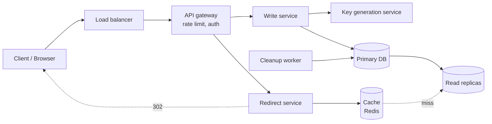
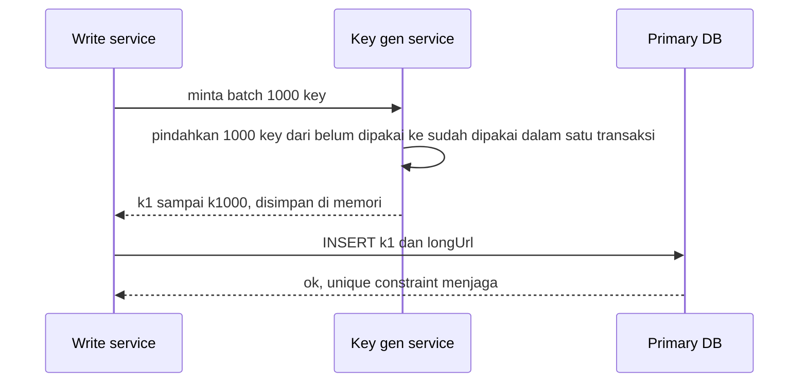

## 1. Requirements

Mulai dengan klarifikasi. Pertanyaan yang pantas kamu ajukan ke interviewer: apakah pengguna boleh memilih alias sendiri, apakah perlu analytics klik, berapa lama URL hidup, dan berapa URL baru per bulan.

### Functional

- Pengguna mengirim URL panjang dan mendapat URL pendek.
- Siapa pun yang membuka URL pendek diarahkan ke URL panjang.
- Opsional: alias kustom, masa berlaku, dan hapus URL.
- Di luar cakupan, dan sebutkan ini ke interviewer: analytics detail, akun pengguna, dashboard.

### Non-functional

| Target                  | Nilai                                        | Alasan                                                                                                      |
| ----------------------- | -------------------------------------------- | ----------------------------------------------------------------------------------------------------------- |
| Availability            | 99.99%                                       | Link tersebar di tempat yang tidak kita kontrol, seperti email dan cetakan. Link mati berarti reputasi mati |
| Latency redirect        | p99 di bawah 50 ms di luar waktu jaringan    | Redirect ada di jalur yang dirasakan pengguna                                                               |
| Konsistensi             | Eventual untuk baca, kuat untuk keunikan key | Dua URL tidak boleh berbagi key. URL baru boleh telat beberapa detik muncul di replica                      |
| Durability              | Mapping tidak boleh hilang                   | Mapping adalah satu-satunya data kita                                                                       |
| Key tidak mudah ditebak | Tidak berurutan                              | Mencegah orang menebak link secara massal                                                                   |

## 2. Estimasi kapasitas

Asumsi: 100 juta URL baru per bulan, rasio baca dan tulis 100 banding 1, URL panjang rata-rata 100 byte, data disimpan 5 tahun.

QPS, yaitu jumlah request per detik:

- Satu bulan sekitar 2.6 juta detik. Tulis 100 juta dibagi 2.6 juta hasilnya sekitar 40 QPS. Puncaknya sekitar 100 QPS.
- Baca 100 kali tulis, jadi sekitar 4.000 QPS. Puncaknya sekitar 10.000 QPS.

Storage untuk 5 tahun:

- Jumlah URL: 100 juta kali 12 bulan kali 5 tahun, hasilnya 6 miliar.
- Satu baris berisi key 7 byte, URL 100 byte, dan metadata sekitar 20 byte. Bulatkan menjadi 150 byte.
- Total sekitar 6 miliar kali 150 byte, yaitu 900 GB. Ini muat di satu database besar, tetapi partisi tetap disiapkan untuk pertumbuhan.

Bandwidth:

- Baca 4.000 QPS kali sekitar 500 byte per respons redirect, hasilnya 2 MB per detik. Kecil.

Cache:

- Aturan 80/20 mengatakan sebagian kecil URL menghasilkan sebagian besar klik.
- Realistisnya kita cache sekitar 10 juta entri terpanas, yaitu sekitar 1.5 GB. Itu muat di satu node Redis.

Keputusan dari angka ini: tulis 40 QPS berarti satu primary cukup. Baca 4.000 QPS berarti cache wajib, dan database hanya menerima cache miss. Storage sekitar 1 TB bisa dilayani SQL maupun key-value store, karena pola aksesnya hanya mencari berdasarkan key.

## 3. API design

REST sederhana. Semua endpoint berada di belakang API gateway yang membatasi laju request per API key atau per IP.

```text
POST /api/v1/urls
  body : { "longUrl": "https://…", "customAlias": "promo" (opsional), "expiresAt": ISO8601 (opsional) }
  resp : 201 { "shortUrl": "https://sho.rt/Ab3dE9f", "key": "Ab3dE9f", "expiresAt": … }
  error: 400 URL tidak valid · 409 alias sudah dipakai · 429 rate limit

GET /{key}
  resp : 302 Location: <longUrl>   (atau 301, lihat trade-off di bawah)
  error: 404 tidak ditemukan · 410 kedaluwarsa

DELETE /api/v1/urls/{key}      (butuh auth pemilik)
  resp : 204
```

Catatan desain:

- Request POST membawa header idempotency key. Idempotency key adalah penanda unik dari client supaya pengulangan request tidak membuat dua key untuk URL yang sama.
- Validasi menolak URL yang menunjuk ke domain kita sendiri agar tidak terjadi redirect berputar. Validasi juga menolak skema selain http dan https.
- Endpoint manajemen memakai versi di path. Endpoint GET tanpa versi, karena link-nya dicetak di luar.

## 4. Skema data

Pola aksesnya hanya dua: tulis satu baris, dan baca satu baris berdasarkan key. Tidak ada join. Ini kandidat sempurna untuk key-value store. Namun SQL dengan satu tabel juga cukup di skala ini. Kita mulai dengan PostgreSQL karena familiar dan unique constraint sudah tersedia, lalu siapkan jalur migrasi ke key-value store terpartisi.

```sql
CREATE TABLE urls (
  short_key   CHAR(7)      PRIMARY KEY,
  long_url    TEXT         NOT NULL,
  created_at  TIMESTAMPTZ  NOT NULL DEFAULT now(),
  expires_at  TIMESTAMPTZ  NULL,
  owner_id    BIGINT       NULL
);
CREATE INDEX urls_expires_idx ON urls (expires_at) WHERE expires_at IS NOT NULL;
```

- Kolom short key sebagai primary key memberi unique constraint sekaligus index untuk pencarian.
- Index parsial pada kolom kedaluwarsa dipakai oleh job pembersih.
- Bila pindah ke key-value store, key adalah short key dan value adalah JSON kecil. Partisi memakai consistent hashing.

## 5. High-level design



Dua alur yang harus bisa kamu jelaskan dari awal sampai akhir.

Alur tulis untuk request POST:

1. Gateway memvalidasi request dan memeriksa rate limit.
2. Write service meminta key dari key generation service, atau memakai alias kustom bila ada.
3. Write service menulis baris baru ke primary database.
4. Write service mengembalikan respons 201 ke client.

Cache sengaja tidak diisi saat tulis. Request baca pertama yang akan mengisinya, karena mayoritas URL baru tidak pernah populer.

Alur baca untuk request GET:

1. Redirect service memeriksa cache.
2. Bila ada, kirim respons 302 ke client.
3. Bila tidak ada, baca dari replica.
4. Bila ditemukan, isi cache lalu kirim 302.
5. Bila tidak ditemukan, kirim 404 dan simpan tanda "tidak ada" di cache selama 30 detik. Ini menahan serangan tebak key agar tidak menembus ke database.

## 6. Detailed design

### 6.1 Pembuatan key

Tiga pendekatan yang biasa dibandingkan.

| Pendekatan                                      | Cara kerja                                                                        | Kelebihan                                                               | Kekurangan                                                                            |
| ----------------------------------------------- | --------------------------------------------------------------------------------- | ----------------------------------------------------------------------- | ------------------------------------------------------------------------------------- |
| Hash URL dipotong 7 karakter                    | Hash MD5 atau SHA dari URL, ambil 7 karakter pertama                              | Tanpa state, URL sama menghasilkan key sama                             | Tabrakan setelah dipotong, jadi harus cek database dan hash ulang dengan salt         |
| Auto-increment lalu base62                      | Database memberi nomor urut, lalu di-encode ke base62                             | Tidak ada tabrakan, sederhana                                           | Key berurutan mudah ditebak, dan auto-increment sulit dipartisi                       |
| Key generation service yang membuat key di muka | Service terpisah membuat key acak unik lebih dulu, lalu membagikannya dalam batch | Tidak ada tabrakan, tidak tertebak, jalur tulis tidak menunggu database | Ada komponen tambahan. Batch yang hilang saat crash hanya memboroskan key, bukan data |

Pilihan kita: key generation service dengan dua tabel, satu untuk key yang belum dipakai dan satu untuk yang sudah dipakai. Setiap write service mengambil batch 1.000 key ke memori. Alternatif yang sama bagusnya adalah ID ala Snowflake, yaitu gabungan timestamp, nomor mesin, dan nomor urut, lalu di-encode base62 dengan pengacakan bit agar tidak monoton.

Kenapa 7 karakter base62 cukup: 62 pangkat 7 sekitar 3.5 triliun kombinasi. Pada 1.2 miliar URL per tahun, itu cukup untuk ribuan tahun.



### 6.2 Redirect: 301 atau 302?

| Kode                  | Perilaku browser                                     | Beban server  | Analytics                   | Pakai bila                                                          |
| --------------------- | ---------------------------------------------------- | ------------- | --------------------------- | ------------------------------------------------------------------- |
| 301 Moved Permanently | Disimpan browser. Klik berikutnya langsung ke tujuan | Turun drastis | Hilang setelah klik pertama | Tidak butuh analytics dan ingin hemat                               |
| 302 Found             | Tidak disimpan. Selalu lewat server                  | Penuh         | Setiap klik tercatat        | Produk mengandalkan analytics, yaitu hampir semua layanan komersial |

Kita memilih 302. Analytics biasanya menjadi alasan bisnis layanan ini ada, dan beban baca sudah ditangani cache.

### 6.3 Cache

- Pola cache-aside dengan Redis. Cache-aside berarti aplikasi memeriksa cache dulu dan mengisinya sendiri saat tidak ada. Key adalah short key, value adalah URL panjang beserta waktu kedaluwarsa.
- Kebijakan eviction LRU atau LFU, yaitu membuang entri yang paling lama tidak dipakai atau paling jarang dipakai. Alasannya, sebaran klik sangat condong ke sedikit URL viral.
- TTL entri adalah 24 jam atau sisa masa berlaku, mana yang lebih pendek.
- Tanda "tidak ada" disimpan untuk key yang tidak ditemukan selama 30 sampai 60 detik, supaya tebakan massal tidak menembus ke database.
- Ukuran: 10 juta entri kali sekitar 150 byte, yaitu 1.5 GB. Satu node dengan replica cukup. Cluster baru dibutuhkan bila trafik naik 10 kali.

### 6.4 Database: partisi dan replikasi

- Saat ini 900 GB untuk 5 tahun muat di satu primary dengan 2 read replica. Baca 4.000 QPS pun sebagian besar diserap cache.
- Jalur scaling adalah partisi berdasarkan hash short key, bukan rentang, agar tidak ada partisi panas. Key acak membuat sebarannya otomatis merata.
- Replikasi berjalan async. Baca dari replica boleh tertinggal beberapa detik. Pengguna yang baru membuat URL cukup menerima URL dari respons POST, sehingga tidak perlu membaca lagi.

### 6.5 Kedaluwarsa dan pembersihan

- Jangan hapus secara sinkron. Saat GET menemukan URL yang sudah kedaluwarsa, kirim 410 dan hapus dari cache.
- Cleanup worker berjalan tiap jam di luar jam sibuk. Ia menghapus baris kedaluwarsa dalam batch kecil.
- Mengembalikan key ke daftar belum dipakai bersifat opsional. Kebanyakan layanan tidak mendaur ulang key agar link lama tidak berubah arti.

### 6.6 Rate limiting dan penyalahgunaan

- Token bucket per API key dan per IP di gateway, dengan state di Redis.
- Validasi URL menolak skema berbahaya. Daftar hitam domain phishing berada di luar cakupan.
- Alias kustom hanya boleh huruf, angka, garis bawah, dan strip, dengan panjang 4 sampai 32. Alias tepat 7 karakter dilarang agar tidak bertabrakan dengan ruang key acak.

## 7. Evaluasi terhadap non-functional requirements

| Target                     | Cara memenuhi                                                                                                                                                                                                   | Risiko tersisa                                                                                                   |
| -------------------------- | --------------------------------------------------------------------------------------------------------------------------------------------------------------------------------------------------------------- | ---------------------------------------------------------------------------------------------------------------- |
| Availability 99.99%        | Load balancer dengan beberapa instance stateless. Database primary dengan failover otomatis. Cache dengan replica. Write service menyimpan batch key di memori, jadi key generation service boleh mati sebentar | Failover database masih punya jeda beberapa detik. Redirect service tetap melayani dari cache saat database mati |
| Latency p99 di bawah 50 ms | Cache hit sekitar 1 ms. Cache miss ke replica sekitar 5 ms. Semua di satu datacenter                                                                                                                            | Pengguna jauh dari datacenter. Tambahkan edge yang menyimpan redirect                                            |
| Keunikan key               | Unique constraint dan key generation service memastikan tidak ada dua URL untuk satu key                                                                                                                        | Alias kustom dipisahkan dari key acak lewat aturan panjang                                                       |
| Durability                 | Replikasi sinkron ke minimal satu replica, backup harian                                                                                                                                                        | Batch key yang hilang saat crash hanya memboroskan key                                                           |
| Tidak tertebak             | Key acak dari key generation service                                                                                                                                                                            | Menebak tetap mungkin, tetapi hampir selalu meleset. Tanda "tidak ada" di cache dan rate limit menahannya        |

Bottleneck pertama bila trafik naik 10 kali adalah cache, baik hit ratio maupun memorinya, lalu primary untuk tulis. Keduanya punya jalur scaling yang sudah disebut, yaitu cluster Redis dan partisi hash.

## 8. Pertanyaan lanjutan interviewer

- "Pengguna yang sama mengirim URL panjang yang sama dua kali. Haruskah dapat key yang sama?" Produk yang memutuskan. Bila ya, simpan index dari hash URL dan pemilik, lalu kembalikan key lama. Bila tidak, key baru lebih murah dan mendukung analytics per kampanye.
- "Bagaimana menambahkan analytics klik tanpa memperlambat redirect?" Redirect service menerbitkan event ke message queue tanpa menunggu balasan. Consumer mengagregasinya ke column store.
- "Apakah key generation service adalah titik tunggal kegagalan?" Jalankan dua instance dengan rentang key berbeda. Write service juga menyimpan batch di memori, jadi tahan service mati beberapa menit.
- "Kenapa tidak Cassandra dari awal?" Pola aksesnya cocok. Namun di skala 40 tulis per detik dan 1 TB, kerumitan operasionalnya belum terbayar. Titik pindahnya adalah saat tulis melewati kapasitas satu primary.
- "Bagaimana kalau multi-region?" Redirect memakai cache dan replica di tiap region. Tulis cukup di satu region primary, atau key diberi awalan region agar tiap region punya primary sendiri.
- "Bagaimana mencegah link phishing?" Validasi saat buat dengan daftar hitam dan Safe Browsing API, pemindaian asinkron setelahnya, dan kemampuan menonaktifkan key tanpa menghapusnya.
