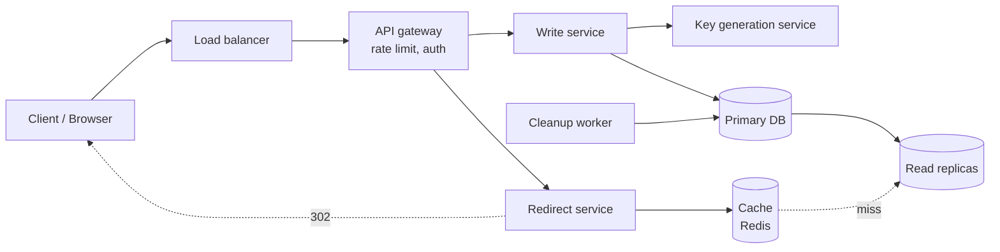
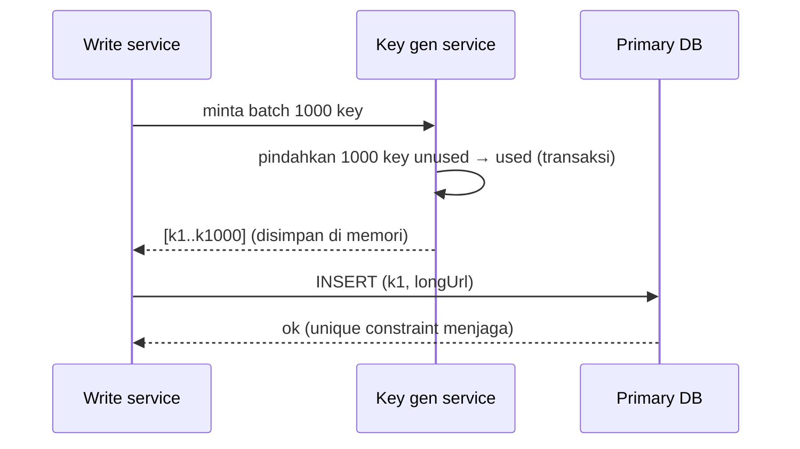

## 1. Requirements

Mulai dengan klarifikasi. Pertanyaan yang pantas diajukan ke interviewer: "Apakah user boleh memilih alias sendiri?", "Perlu analytics klik?", "Berapa lama URL hidup?", "Skala: berapa URL baru per bulan?".

### Functional

- `POST` URL panjang → dapat URL pendek.
- `GET` URL pendek → redirect ke URL panjang.
- Opsional: alias kustom, masa berlaku (expiry), hapus URL.
- Out of scope (sebutkan!): analytics detail, akun user, dashboard.

### Non-functional

| NFR                 | Target                                       | Alasan                                                                                         |
| ------------------- | -------------------------------------------- | ---------------------------------------------------------------------------------------------- |
| Availability        | 99.99%                                       | Link tersebar di tempat yang tidak kita kontrol (email, cetak); link mati = reputasi mati      |
| Latency redirect    | p99 &lt; 50 ms di luar network               | Redirect ada di jalur kritis user                                                              |
| Konsistensi         | Eventual untuk baca, kuat untuk unik-nya key | Dua URL berbeda tidak boleh berbagi key; URL baru boleh telat beberapa detik tampil di replica |
| Durability          | Tidak boleh kehilangan mapping               | Mapping adalah satu-satunya data                                                               |
| Prediktabilitas key | Tidak mudah ditebak berurutan                | Mencegah enumerasi massal                                                                      |

## 2. Estimasi kapasitas

Asumsi: **100 juta URL baru/bulan**, rasio baca:tulis **100:1**, URL panjang rata-rata 100 byte, data disimpan 5 tahun.

**QPS**

- Tulis: 100M / (30 × 86.400 s ≈ 2.6M s) ≈ **40 QPS**; peak ~100 QPS.
- Baca: 40 × 100 = **4.000 QPS**; peak ~10.000 QPS.

**Storage (5 tahun)**

- Jumlah URL: 100M × 12 × 5 = **6 miliar**.
- Per baris: short key 7 B + URL 100 B + metadata (timestamp, expiry, user id) ~20 B ≈ 130 B, bulatkan **150 B**.
- Total: 6 × 10^9 × 150 B ≈ **900 GB**. Muat di satu database besar, tapi partisi tetap disiapkan untuk pertumbuhan dan availability.

**Bandwidth**

- Baca: 4.000 QPS × ~500 B (header redirect) ≈ 2 MB/s. Kecil.

**Cache**

- Aturan 80/20: 20% URL yang dibaca hari ini ≈ 20% × (4.000 × 86.400 ≈ 350M request, tapi unik jauh lebih sedikit). Asumsikan 20% dari 6B × 150 B terlalu besar; realistis kita cache **~10 juta entri terpanas ≈ 1.5 GB**. Muat di satu node Redis.

Keputusan dari angka: write 40 QPS → satu primary cukup; read 4.000 QPS → **cache wajib**, DB hanya menerima cache miss; storage ~1 TB → SQL atau KV keduanya bisa, pilih berdasarkan pola akses (by key saja).

## 3. API design

REST sederhana. Semua endpoint di belakang API gateway yang menerapkan rate limit per API key / IP.

```text
POST /api/v1/urls
  body : { "longUrl": "https://…", "customAlias": "promo" (opsional), "expiresAt": ISO8601 (opsional) }
  resp : 201 { "shortUrl": "https://sho.rt/Ab3dE9f", "key": "Ab3dE9f", "expiresAt": … }
  error: 400 URL tidak valid · 409 alias sudah dipakai · 429 rate limit

GET /{key}
  resp : 302 Location: <longUrl>   (atau 301, lihat trade-off di bawah)
  error: 404 tidak ditemukan · 410 kedaluwarsa

DELETE /api/v1/urls/{key}      (butuh auth pemilik)
  resp : 204
```

Catatan desain:

- **Idempotency**: `POST` dengan `Idempotency-Key` header supaya retry client tidak membuat dua key untuk URL yang sama.
- **Validasi**: tolak URL yang menunjuk ke domain kita sendiri (loop redirect) dan skema selain `http(s)`.
- **Versi**: `/api/v1` untuk endpoint manajemen; `GET /{key}` tanpa versi karena dicetak di luar.

## 4. Skema data

Pola akses hanya dua: tulis satu baris, baca satu baris **by key**. Tidak ada join. Ini kandidat sempurna untuk key-value store, tapi SQL dengan satu tabel juga cukup di skala ini. Kita mulai dengan **PostgreSQL** (familiar, unique constraint gratis), dan siapkan jalur migrasi ke KV terpartisi.

```sql
CREATE TABLE urls (
  short_key   CHAR(7)      PRIMARY KEY,
  long_url    TEXT         NOT NULL,
  created_at  TIMESTAMPTZ  NOT NULL DEFAULT now(),
  expires_at  TIMESTAMPTZ  NULL,
  owner_id    BIGINT       NULL
);
CREATE INDEX urls_expires_idx ON urls (expires_at) WHERE expires_at IS NOT NULL;
```

- `short_key` sebagai primary key memberi **unique constraint** sekaligus index untuk lookup.
- Partial index pada `expires_at` untuk job pembersih (lihat detailed design).
- Bila pindah ke KV: key = `short_key`, value = JSON kecil; partisi dengan consistent hashing.

## 5. High-level design



Dua alur yang harus bisa dijelaskan end-to-end:

**Alur tulis (POST)**: gateway memvalidasi dan rate-limit → write service minta key dari _key generation service_ (atau memakai alias kustom) → `INSERT` ke primary → kembalikan 201. Cache **tidak** diisi di sini (write-around); biarkan request baca pertama yang mengisinya, karena mayoritas URL baru tidak pernah populer.

**Alur baca (GET)**: redirect service cek cache → hit: kirim 302 → miss: baca replica → bila ada, isi cache (cache-aside) lalu 302; bila tidak ada, 404 dan simpan _negative cache_ singkat (30 detik) untuk menahan serangan tebak key.

## 6. Detailed design

### 6.1 Key generation

Tiga pendekatan yang biasa dibandingkan:

| Pendekatan                                    | Cara kerja                                                                             | Kelebihan                                                         | Kekurangan                                                                                                   |
| --------------------------------------------- | -------------------------------------------------------------------------------------- | ----------------------------------------------------------------- | ------------------------------------------------------------------------------------------------------------ |
| Hash URL (MD5/SHA) dipotong 7 karakter        | hash(longUrl) → ambil 7 char pertama                                                   | Stateless, URL sama → key sama                                    | Collision setelah dipotong; harus cek DB dan re-hash dengan salt                                             |
| Auto-increment ID → base62                    | DB memberi ID 1, 2, 3… → encode                                                        | Tidak ada collision, sederhana                                    | Key berurutan mudah ditebak; auto-increment sulit di-shard                                                   |
| **Key Generation Service (KGS) pre-generate** | Service terpisah membuat key acak unik di muka, dibagikan dalam batch ke write service | Tidak ada collision, tidak tertebak, write path tidak menunggu DB | Komponen tambahan; batch yang sudah dibagikan tapi tidak terpakai (saat crash) hilang, dan itu tidak apa-apa |

Pilihan: **KGS pre-generate** dengan dua tabel (`unused_keys`, `used_keys`), tiap write service mengambil batch 1.000 key ke memori. Alternatif yang sama bagusnya: ID ala **Snowflake** (timestamp + machine id + sequence) di-encode base62, dengan bit-shuffle supaya tidak monoton.

Kenapa 7 karakter base62: 62^7 ≈ 3.5 × 10^12 kombinasi; pada 1.2 miliar URL/tahun cukup untuk ribuan tahun.



### 6.2 Redirect: 301 atau 302?

| Kode                  | Browser                                      | Beban server  | Analytics                   | Pakai bila                                                     |
| --------------------- | -------------------------------------------- | ------------- | --------------------------- | -------------------------------------------------------------- |
| 301 Moved Permanently | Di-cache; klik berikutnya langsung ke tujuan | Turun drastis | Hilang setelah klik pertama | Tidak butuh analytics, ingin hemat                             |
| 302 Found             | Tidak di-cache; selalu lewat server          | Penuh         | Setiap klik tercatat        | Produk mengandalkan analytics (hampir semua layanan komersial) |

Kita pilih **302** karena analytics biasanya menjadi alasan bisnis layanan ini ada, dan beban baca sudah ditangani cache.

### 6.3 Cache

- **Cache-aside** dengan Redis; key = `short_key`, value = `long_url` (+ `expires_at`).
- Eviction **LRU** (atau LFU) karena distribusi klik sangat _long-tail_: sedikit URL viral menghasilkan mayoritas trafik.
- TTL entri = min(24 jam, sisa `expires_at`).
- **Negative cache** untuk key yang tidak ada (TTL 30-60 s) supaya tebakan massal tidak menembus ke DB.
- Skala: 10 juta entri × ~150 B ≈ 1.5 GB; satu node + replica cukup, cluster bila trafik naik 10x.

### 6.4 Database: partisi dan replikasi

- Saat ini 900 GB / 5 tahun muat di satu primary + 2 read replica (baca 4.000 QPS pun sebagian besar diserap cache).
- Jalur scale: **hash partitioning** pada `short_key` (bukan range, agar tidak hot). Karena key acak, distribusi otomatis merata.
- Replikasi async; baca dari replica boleh _stale_ beberapa detik; tulis + baca-sendiri (read-your-write) ditangani dengan membaca primary selama ~5 detik setelah membuat URL, atau cukup kembalikan URL dari respons POST tanpa membaca lagi.

### 6.5 Expiry dan pembersihan

- Jangan hapus sinkron. **Lazy expiry**: saat `GET`, bila `expires_at` lewat → 410 dan hapus dari cache.
- **Cleanup worker** periodik (tiap jam, off-peak) menghapus baris kedaluwarsa dalam batch kecil dan mengembalikan key ke `unused_keys` (opsional; kebanyakan layanan tidak mendaur ulang key agar link lama tidak "berubah arti").

### 6.6 Rate limiting dan abuse

- Token bucket per API key dan per IP di gateway (state di Redis).
- Validasi URL: tolak skema berbahaya, daftar hitam domain phishing (integrasi Safe Browsing, out of scope).
- Alias kustom: hanya `[a-zA-Z0-9_-]`, panjang 4-32, dan tidak boleh bertabrakan dengan ruang key 7 karakter (cukup larang alias tepat 7 karakter, atau beri prefix).

## 7. Evaluasi terhadap non-functional requirements

| NFR                    | Bagaimana dipenuhi                                                                                                                                       | Risiko tersisa                                                                                                       |
| ---------------------- | -------------------------------------------------------------------------------------------------------------------------------------------------------- | -------------------------------------------------------------------------------------------------------------------- |
| Availability 99.99%    | LB + beberapa instance stateless; DB primary dengan failover otomatis; cache replica; KGS punya key batch di memori service jadi KGS boleh down sebentar | Failover DB masih ada jeda detik; mitigasi: redirect service terus melayani dari cache saat DB down (read-only mode) |
| Latency p99 &lt; 50 ms | Cache hit ~1 ms; miss → replica ~5 ms; semuanya satu datacenter                                                                                          | User jauh dari datacenter: tambahkan edge/PoP yang meng-cache redirect                                               |
| Keunikan key           | Unique constraint + KGS memastikan tidak ada dua URL satu key                                                                                            | Alias kustom dan key acak bertabrakan: dipisah oleh aturan panjang                                                   |
| Durability             | Replikasi sinkron ke minimal satu replica, backup harian                                                                                                 | Kehilangan batch key KGS saat crash hanya memboroskan key, bukan data                                                |
| Tidak tertebak         | Key acak dari KGS                                                                                                                                        | Enumerasi tetap mungkin dengan 3.5T kombinasi, tapi hit rate ~0: negative cache + rate limit                         |

Bottleneck pertama bila trafik naik 10x: **cache** (hit ratio dan memori) lalu **primary** untuk tulis. Keduanya punya jalur scale yang sudah disebut (cluster Redis, hash partitioning).

## 8. Pertanyaan lanjutan interviewer

- "Bagaimana kalau user yang sama mengirim URL panjang yang sama dua kali? Haruskah dapat key yang sama?" → Produk yang memutuskan. Bila ya, simpan index `hash(long_url, owner_id)` dan kembalikan key lama; bila tidak, key baru lebih murah dan mendukung analytics per kampanye.
- "Bagaimana menambahkan analytics klik tanpa memperlambat redirect?" → Redirect service menerbitkan event ke message queue (Kafka) secara _fire-and-forget_; consumer mengagregasi ke column store. Redirect tidak menunggu.
- "KGS adalah single point of failure?" → Jalankan dua instance dengan range key berbeda (ganjil/genap atau partisi tabel `unused_keys`), dan write service menyimpan batch di memori sehingga toleran KGS down beberapa menit.
- "Kenapa tidak Cassandra dari awal?" → Pola akses cocok, tapi di skala 40 write/s dan ~1 TB, kompleksitas operasional belum terbayar. Sebutkan titik pindah: saat write melewati kapasitas satu primary atau butuh multi-region aktif-aktif.
- "Bagaimana multi-region?" → Redirect: cache di tiap region + replica lokal. Tulis: satu region primary (latency tulis tidak kritis), atau partisi key per region (prefix) agar tiap region punya primary sendiri tanpa konflik.
- "Bagaimana mencegah link phishing?" → Validasi saat buat (daftar hitam, Safe Browsing API), pemindaian asinkron setelahnya, dan kemampuan menonaktifkan key (ubah menjadi halaman peringatan) tanpa menghapus.
