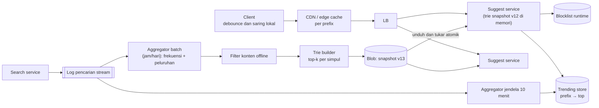
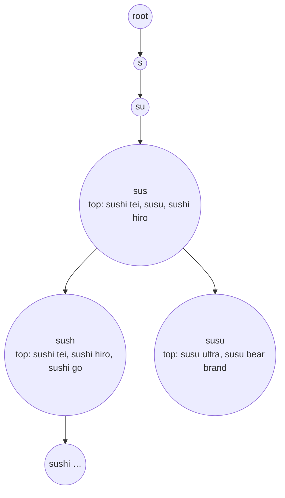

## 1. Requirements

Tanyakan dulu beberapa hal. Apakah saran berdasarkan query populer global saja, atau juga riwayat pribadi? Berapa jumlah saran yang ditampilkan? Bahasa dan alfabet apa saja? Seberapa segar saran harus mengikuti tren? Apakah prefix harus di awal frasa, atau boleh di tengah?

### Functional

- Saat pengguna mengetik, tampilkan 10 saran terpopuler yang diawali teks yang diketik, diurutkan menurut popularitas.
- Popularitas dihitung dari log pencarian dengan bobot yang memudar seiring waktu.
- Saran yang tidak pantas disaring. Operator punya alat untuk menghapus atau menambah saran.
- Di luar cakupan: personalisasi penuh, koreksi ejaan, dan hasil pencariannya sendiri.

### Non-functional

| Target       | Nilai                                                          | Alasan                                                         |
| ------------ | -------------------------------------------------------------- | -------------------------------------------------------------- |
| Latency      | p99 di bawah 50 ms di server, terasa instan di client          | Setiap ketukan menunggu jawaban                                |
| Throughput   | 100.000 query per detik pada puncak                            | Setiap ketukan adalah satu request                             |
| Availability | 99.99%                                                         | Fitur ini selalu terlihat, jadi kegagalannya langsung disadari |
| Kesegaran    | Popularitas umum dalam hitungan jam, tren dalam hitungan menit | Toleransi tinggi untuk saran umum                              |
| Memori       | Seluruh trie muat di memori tiap node                          | Latency hanya tercapai tanpa akses disk                        |

## 2. Estimasi kapasitas

Asumsi: 10 juta query unik yang layak disarankan setelah penyaringan frekuensi minimum, rata-rata 20 karakter, 100.000 query per detik pada puncak, dan 1 miliar pencarian per hari untuk log.

- Trie: 10 juta query kali 20 karakter adalah 200 juta karakter. Dengan berbagi prefix dan kompresi, ukurannya turun menjadi puluhan sampai ratusan MB.
- Daftar teratas: bila setiap simpul bermakna menyimpan 10 id, tambahannya sekitar 4 GB. Daftar hanya disimpan di simpul dangkal atau yang sering dilalui, sehingga totalnya sekitar 1 sampai 2 GB. Angka ini muat di memori satu node.
- Query: 100.000 per detik kali sekitar 0.1 ms CPU setara 10 core. Ratusan node dibutuhkan untuk kedekatan geografis dan redundansi, bukan untuk CPU.
- Log: 1 miliar pencarian kali 50 byte adalah 50 GB per hari. Agregasi dilakukan batch per jam atau per hari.
- Cache per prefix: sekitar 50.000 kombinasi prefix 1 sampai 3 karakter yang populer, masing-masing 1 KB, hanya 50 MB di edge. Rasio hit sangat tinggi.

Keputusannya: snapshot trie disalin utuh ke memori tiap node, pipeline batch untuk popularitas, cache edge per prefix, dan penyaringan di client.

## 3. API design

```text
GET /v1/suggest?q=sush&limit=10&lang=id&region=ID
    → { suggestions: [{ text: "sushi tei", score: 0.93 }, ...], ttl: 3600 }
    header Cache-Control: public, max-age=3600 (per prefix; TTL lebih pendek untuk prefix tren)
POST /v1/ops/block { pattern }       (operator; memuat ulang blocklist runtime)
```

Client menunda request 50 sampai 100 ms setelah ketukan terakhir dan membatalkan request yang usang. Client juga menyaring hasil lama. Hasil untuk "sus" dipakai lagi untuk "sush" bila daftar sebelumnya masih punya cukup entri yang cocok. Request baru hanya dikirim bila entri tidak cukup.

## 4. Skema data

```text
-- Log pencarian (stream → object storage per jam): {query_norm, ts, lang, region}
-- Agregat popularitas (batch, per hari/jam): query_norm → score (frekuensi dengan peluruhan eksponensial)
-- Snapshot trie (file biner per versi, per lang/region):
   node: children (radix edges), top_k: [(suggestion_id, score)]  -- hanya simpul yang perlu
   suggestions: id → text
-- Blocklist: pattern/regex, versi; dimuat di runtime
-- Trending (opsional, kecil): prefix → [(text, score)] dari jendela 10 menit, TTL pendek
```

Query dinormalkan sebelum disimpan: huruf kecil, spasi di tepi dibuang, tanda baca dihapus. Saran disimpan dalam bentuk tampilan yang paling populer di antara variannya.

## 5. High-level design



Alur query:

1. Pengguna mengetik satu karakter.
2. Client memeriksa cache lokalnya. Bila hasil lama masih cukup, client menyaringnya tanpa request.
3. Client mengirim request ke edge. Prefix populer dilayani dari cache edge.
4. Suggest service menelusuri trie sesuai prefix. Biayanya sebanding panjang prefix.
5. Suggest service membaca daftar teratas di simpul itu.
6. Suggest service menggabungkan hasil dengan tren bila ada, lalu menyaring dengan daftar blokir.
7. Suggest service mengembalikan respons dengan header cache.

Alur pembaruan:

1. Log pencarian mengalir ke penyimpanan.
2. Aggregator menghitung skor tiap query dengan frekuensi dan peluruhan.
3. Filter konten membuang saran yang tidak pantas.
4. Builder membangun trie dan mengisi daftar teratas tiap simpul dari bawah ke atas.
5. Builder menulis snapshot ke blob store.
6. Tiap node mengunduh snapshot baru, memuatnya di samping yang lama, lalu menukar pointer. Tidak ada downtime, tetapi memori sesaat dua kali lipat.

## 6. Detailed design

### 6.1 Struktur trie dan daftar teratas



Setiap simpul menyimpan daftar id saran beserta skornya. Daftar itu dihitung saat build dengan menggabungkan daftar anak-anaknya, jadi query tidak perlu menelusuri cabang di bawahnya.

Kompresi memakai radix tree, yaitu trie yang menggabungkan rantai simpul tunggal. Alternatifnya adalah FST, struktur yang lebih hemat memori. Daftar teratas hanya disimpan di simpul dengan kedalaman sampai 10 atau skor cabang di atas ambang, karena prefix panjang jarang diketik.

Untuk mencocokkan awal kata di tengah frasa, misalnya "tei" ke "sushi tei", masukkan juga potongan mulai tiap kata sebagai kunci. Memori naik 2 sampai 3 kali. Teks dinormalkan dengan cara yang sama saat build dan saat query.

### 6.2 Pipeline popularitas

Skor adalah jumlah frekuensi yang memudar, misalnya berkurang setengah setiap 7 hari, sehingga query lama perlahan hilang. Agregasi harian berjalan penuh, dan agregasi per jam berjalan bertahap. Query masuk daftar hanya bila melewati frekuensi dan panjang minimum.

Filter offline memakai daftar blokir, pengklasifikasi konten, dan kebijakan hukum per region. Hasilnya adalah snapshot terpisah per bahasa dan region. Count-min sketch, yaitu struktur yang menghitung frekuensi dengan memori tetap, bisa dipakai untuk menghitung di aliran data sebelum batch.

### 6.3 Distribusi dan pembaruan snapshot

Snapshot berukuran beberapa GB disalin utuh ke setiap node. Query dilayani lokal tanpa menggabungkan hasil dari banyak node. Bila snapshot melebihi memori, trie dipartisi menurut karakter pertama dengan router ringan. Prefix sangat populer mendapat partisi sendiri atau cache.

Pembaruan dilakukan bertahap per persentase node. Setiap node memuat snapshot baru, memvalidasinya dengan jumlah simpul dan sampel query, lalu menukar. Rollback berarti memuat kembali versi lama.

### 6.4 Cache berlapis

| Lapisan        | Kunci                      | Masa simpan                                  | Catatan                                                          |
| -------------- | -------------------------- | -------------------------------------------- | ---------------------------------------------------------------- |
| Client         | Prefix                     | Sepanjang sesi                               | Menyaring hasil lama dan membatalkan request yang usang          |
| Edge atau CDN  | Prefix, bahasa, dan region | 1 jam, atau beberapa menit untuk prefix tren | Rasio hit tinggi untuk prefix pendek                             |
| Memori service | Prefix                     | Sampai snapshot berganti                     | Hasil trie hampir gratis, cache hanya untuk gabungan dengan tren |

### 6.5 Tren dan personalisasi

Tren dihitung dari jendela 10 menit di aliran log. Hasilnya disimpan sebagai prefix dan beberapa saran teratas dengan masa simpan pendek. Suggest service menyisipkannya ke hasil dengan bobot tertentu.

Personalisasi ringan dilakukan di client. Client menyimpan riwayatnya sendiri dan menampilkannya di atas saran global. Server tetap tanpa state per pengguna, yang baik untuk privasi dan skala.

### 6.6 Keamanan dan kebijakan

Daftar blokir runtime berukuran kecil dan dimuat ulang tiap menit untuk penghapusan cepat. Setiap saran punya jejak asal query dan skornya, sehingga keputusan operator bisa ditelusuri. Rate limit per client mencegah pengambilan data massal.

## 7. Evaluasi terhadap non-functional requirements

| Target                  | Cara memenuhi                                                                 | Risiko yang tersisa                                               |
| ----------------------- | ----------------------------------------------------------------------------- | ----------------------------------------------------------------- |
| p99 di bawah 50 ms      | Trie di memori dengan daftar teratas, cache edge, tanpa database di jalur     | Node baru tidak boleh menerima trafik sebelum snapshot termuat    |
| 100.000 query per detik | Replika utuh tanpa state, dan cache edge menyerap prefix pendek               | Serangan dengan prefix acak menembus cache. Rate limit menahannya |
| Availability 99.99%     | Snapshot lokal tetap melayani meski pipeline mati, rollout bertahap, rollback | Snapshot rusak dicegah dengan validasi sebelum tukar              |
| Kesegaran               | Batch per jam atau hari, ditambah lapisan tren per menit                      | Tren butuh jalur terpisah yang juga harus disaring                |
| Memori                  | Kompresi, daftar teratas selektif, snapshot per bahasa dan region             | Katalog yang tumbuh memaksa partisi menurut prefix                |

Bottleneck pertama saat beban naik 10 kali adalah pipeline agregasi dan bandwidth edge. Pipeline diskalakan sebagai batch paralel. Pipeline build bukan titik lemah tunggal, karena snapshot lama tetap melayani bila build gagal.

## 8. Pertanyaan lanjutan interviewer

- "Bagaimana koreksi ejaan, misalnya sushy menjadi sushi?" Cari kandidat dengan jarak edit satu pada prefix bila hasil kosong. Cara ini mahal, jadi dibatasi.
- "Bagaimana saran per pengguna?" Riwayat disimpan di client. Server tetap global tanpa state, dan client menggabungkannya.
- "Bagaimana kalau trie tidak muat di memori?" Partisi menurut satu atau dua karakter pertama dengan router. Prefix panas dipisah, atau pakai FST.
- "Bagaimana mengukur kualitas saran?" Rasio klik saran, posisi yang diklik, dan rasio pencarian tanpa memakai saran. Uji A/B pada bobot skor.
- "Bagaimana dengan banyak bahasa?" Snapshot per bahasa dan region. Bahasa dideteksi dari pengaturan client.
- "Bagaimana kalau pembaruan harus dalam detik, misalnya berita?" Lapisan tren menanganinya. Trie utama tetap batch.
