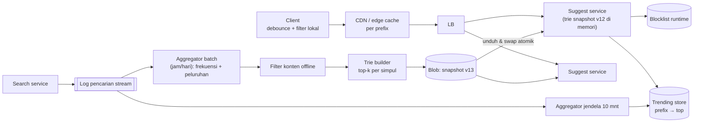
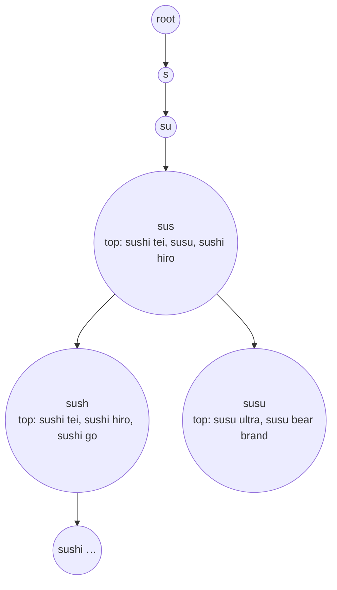

## 1. Requirements

Klarifikasi: saran berdasarkan query populer global atau juga personal? Berapa k saran? Bahasa/alfabet? Seberapa segar (tren)? Apakah prefix harus di awal kata atau boleh di tengah?

### Functional

- Saat user mengetik, tampilkan k = 10 saran yang diawali prefix yang diketik, diurutkan by popularitas.
- Popularitas dihitung dari log pencarian (frekuensi) dengan peluruhan waktu.
- Filter konten tidak pantas; alat operator untuk menghapus/menambah saran.
- Out of scope: personalisasi penuh, koreksi ejaan (disebut sebagai ekstensi), pencarian hasilnya sendiri.

### Non-functional

| NFR          | Target                                         | Alasan                                          |
| ------------ | ---------------------------------------------- | ----------------------------------------------- |
| Latency      | p99 &lt; 50 ms server; terasa instan di client | Setiap ketukan                                  |
| Throughput   | 100.000 QPS puncak                             | Setiap ketukan adalah request                   |
| Availability | 99.99%                                         | Fitur selalu terlihat; kegagalan terlihat jelas |
| Kesegaran    | Popularitas umum: jam; tren: menit             | Toleransi tinggi                                |
| Memori       | Trie muat di memori tiap node                  | Latency                                         |

## 2. Estimasi kapasitas

Asumsi: 10 juta query unik yang layak disarankan (setelah filter frekuensi minimum), rata-rata 20 karakter; 100.000 QPS puncak; 1 miliar pencarian/hari untuk log.

- Trie: 10M query × 20 karakter ≈ 200M karakter; dengan berbagi prefix dan kompresi (radix/FST) ≈ puluhan hingga ratusan MB. Top-10 per simpul menambah: simpul bermakna ~50M × 10 × 8 B (id) ≈ 4 GB bila disimpan di semua simpul; simpan hanya di simpul dengan kedalaman ≤ N atau yang dilalui query populer → ≈ 1–2 GB. **Muat di memori** satu node; replikasi untuk throughput.
- Query: 100.000 QPS × ~0.1 ms CPU (lookup prefix + baca daftar) = 10 core; ratusan node untuk latency geografis dan redundansi, bukan CPU.
- Log: 10^9 pencarian/hari × 50 B = 50 GB/hari; agregasi batch per jam/hari.
- Cache per prefix: prefix 1–3 karakter ≈ 50.000 kombinasi populer × 1 KB respons ≈ 50 MB di edge; hit ratio sangat tinggi.

Keputusan: snapshot trie di memori setiap node (replika penuh, bukan shard, selama muat), pipeline batch untuk popularitas, cache edge per prefix, client-side filtering.

## 3. API design

```text
GET /v1/suggest?q=sush&limit=10&lang=id&region=ID
    → { suggestions: [{ text: "sushi tei", score: 0.93 }, ...], ttl: 3600 }
    header Cache-Control: public, max-age=3600 (per prefix; TTL lebih pendek untuk prefix tren)
POST /v1/ops/block { pattern }       (operator; memuat ulang blocklist runtime)
```

Client: debounce 50–100 ms, batalkan request lama, dan **filter lokal**: hasil untuk "sus" dipakai untuk "sush" bila daftar sebelumnya punya ≥ k entri yang masih cocok; request baru hanya bila tidak cukup.

## 4. Skema data

```text
-- Log pencarian (stream → object storage per jam): {query_norm, ts, lang, region}
-- Agregat popularitas (batch, per hari/jam): query_norm → score (frekuensi dengan peluruhan eksponensial)
-- Snapshot trie (file biner per versi, per lang/region):
   node: children (radix edges), top_k: [(suggestion_id, score)]  -- hanya simpul yang perlu
   suggestions: id → text
-- Blocklist: pattern/regex, versi; dimuat di runtime
-- Trending (opsional, kecil): prefix → [(text, score)] dari jendela 10 menit, TTL pendek
```

Normalisasi query: lowercase, trim spasi, hapus tanda baca; saran disimpan dalam bentuk tampilan yang dipilih (varian terpopuler).

## 5. High-level design



**Alur query**: ketukan → client cek cache lokal → request ke edge (cache per prefix; hit untuk prefix populer) → suggest service: telusuri trie sesuai prefix (O(panjang)) → ambil top-k simpul → gabung dengan trending (bila ada) dan filter blocklist → respons dengan Cache-Control.

**Alur pembaruan**: log → agregasi batch → filter → builder membangun trie dengan top-k per simpul (traversal post-order: top-k simpul = gabungan top-k anak + dirinya) → snapshot ke blob → tiap node mengunduh, memuat di memori di samping yang lama, lalu swap pointer (tanpa downtime, memori 2x sesaat).

## 6. Detailed design

### 6.1 Struktur trie dan top-k terprakomputasi



- Simpul menyimpan daftar `top_k` (id, skor) yang dihitung bottom-up saat build; query tidak menelusuri subtree.
- Kompresi: radix tree (gabung rantai simpul tunggal) atau FST untuk memori lebih kecil; daftar top-k hanya di simpul dengan kedalaman ≤ 10 atau skor subtree ≥ ambang (prefix panjang jarang diketik dan hasilnya sedikit).
- Multi-kata: prefix dicocokkan di awal frasa; untuk mencocokkan awal kata di tengah frasa ("tei" → "sushi tei"), masukkan juga suffix mulai tiap kata sebagai kunci (memori naik ~2–3x) atau pakai completion suggester dengan input alternatif.
- Unicode: trie per unit karakter; normalisasi (NFC, lowercase) konsisten di build dan query.

### 6.2 Pipeline popularitas

- Skor = Σ frekuensi × peluruhan (mis. setengah tiap 7 hari) sehingga query lama memudar.
- Agregasi harian penuh + agregasi per jam inkremental; frekuensi minimum dan panjang minimum untuk masuk.
- Filter offline: blocklist, klasifier konten, kebijakan hukum per region; hasilnya snapshot per `lang/region`.
- Sketsa (count-min) dapat dipakai untuk menghitung frekuensi di stream dengan memori terbatas sebelum batch.

### 6.3 Distribusi dan pembaruan snapshot

- Snapshot &lt; beberapa GB → **replikasi penuh** di tiap node (tanpa shard): query lokal, tidak ada scatter-gather. Bila melebihi memori: shard by prefix pertama (hash) dengan router ringan; prefix sangat populer ("a") diberi partisi sendiri atau cache.
- Rollout: node memuat snapshot baru, validasi (jumlah simpul, sampel query), swap atomik; rollback dengan memuat versi lama. Rollout bertahap per persentase node.

### 6.4 Cache berlapis

| Lapisan        | Kunci           | TTL                             | Catatan                                                               |
| -------------- | --------------- | ------------------------------- | --------------------------------------------------------------------- |
| Client         | prefix          | sesi                            | Filter lokal subset; batalkan request usang                           |
| Edge/CDN       | `q+lang+region` | 1 jam (menit untuk prefix tren) | Hit ratio tinggi untuk prefix pendek; `Vary` minimal                  |
| Service memori | prefix          | sampai snapshot berganti        | Hasil top-k sudah hampir gratis; cache untuk gabungan dengan trending |

### 6.5 Trending dan personalisasi (ekstensi)

- Trending: agregasi jendela 10 menit dari stream, simpan prefix → top beberapa; suggest service menyisipkan ke hasil dengan bobot; TTL pendek; cache edge untuk prefix tersebut diberi TTL menit.
- Personalisasi ringan: client menyimpan riwayat sendiri dan menampilkannya di atas saran global; server tetap tanpa state per user (privasi dan skala).

### 6.6 Keamanan dan kebijakan

Blocklist runtime kecil yang dimuat ulang tiap menit untuk takedown cepat; semua saran diaudit (asal query, skor) agar keputusan operator dapat ditelusuri; rate limit per client untuk mencegah scraping.

## 7. Evaluasi terhadap non-functional requirements

| NFR                 | Dipenuhi oleh                                                                   | Risiko tersisa                                              |
| ------------------- | ------------------------------------------------------------------------------- | ----------------------------------------------------------- |
| p99 &lt; 50 ms      | Trie memori + top-k terprakomputasi, cache edge, tanpa DB di jalur              | Node baru memuat snapshot: jangan terima trafik sampai siap |
| 100.000 QPS         | Replika penuh stateless (tambah node), cache edge menyerap prefix pendek        | Serangan prefix acak menembus cache: rate limit             |
| Availability 99.99% | Snapshot lokal (tetap melayani meski pipeline mati), rollout bertahap, rollback | Snapshot rusak: validasi sebelum swap                       |
| Kesegaran           | Batch jam/hari + lapisan tren menit                                             | Tren memerlukan jalur terpisah yang juga harus difilter     |
| Memori              | Kompresi, top-k selektif, per lang/region                                       | Pertumbuhan katalog: shard by prefix bila melebihi          |

Bottleneck 10x: pipeline agregasi (batch horizontal) dan egress edge; SPOF: pipeline build (bukan jalur online; snapshot lama tetap melayani).

## 8. Pertanyaan lanjutan interviewer

- "Koreksi ejaan ('sushy' → 'sushi')?" → Kandidat dari edit distance 1 pada prefix (BK-tree/symspell) bila hasil kosong; mahal, batasi.
- "Saran per user (riwayat)?" → Riwayat di client; server global tanpa state; gabung di client.
- "Trie tidak muat memori?" → Shard by prefix (hash karakter pertama/dua) dengan router; prefix hot dipisah; atau FST.
- "Bagaimana mengukur kualitas saran?" → Rasio klik saran, posisi klik, rasio pencarian tanpa saran; A/B pada bobot skor.
- "Multi-bahasa?" → Snapshot per bahasa/region; deteksi bahasa dari pengaturan client.
- "Pembaruan harus dalam detik (mis. berita)?" → Lapisan trending menangani; trie utama tetap batch.
