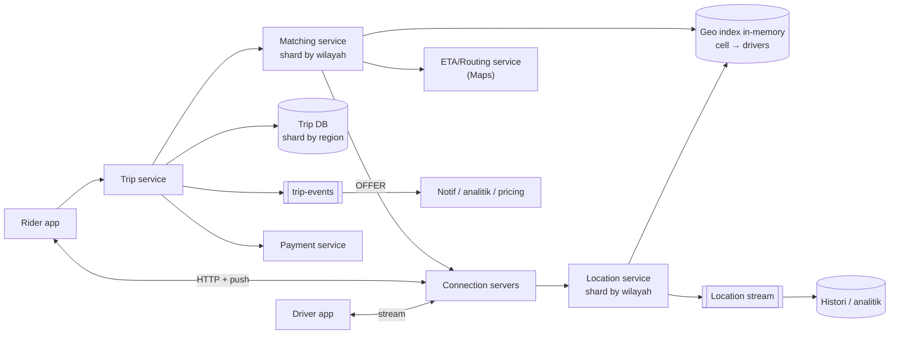
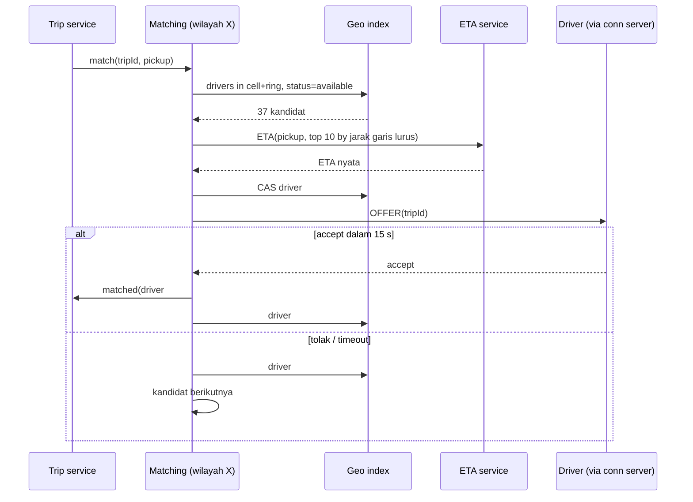

## 1. Requirements

Klarifikasi: hanya ride-hailing atau juga delivery? Berapa kota/pengemudi aktif? Apakah matching harus optimal (batch) atau greedy (terdekat)? Harga dinamis (surge)? Pembayaran termasuk?

### Functional

- Pengemudi: online/offline, kirim lokasi berkala, terima/tolak tawaran, jalankan trip.
- Penumpang: minta tumpangan dari A ke B, lihat estimasi harga dan ETA, lacak pengemudi real-time, bayar.
- Matching: cocokkan permintaan dengan pengemudi terdekat yang tersedia dalam detik.
- Trip lifecycle: requested → matched → en_route → in_trip → completed → paid; pembatalan.
- Out of scope: surge pricing detail, rating, dukungan, peta/routing (dipakai sebagai layanan; dibahas di kasus Google Maps).

### Non-functional

| NFR              | Target                                                          | Alasan                         |
| ---------------- | --------------------------------------------------------------- | ------------------------------ |
| Latency matching | &lt; 3 s dari permintaan sampai tawaran ke pengemudi            | Pengalaman inti                |
| Kesegaran lokasi | Posisi pengemudi ≤ 5 s tertinggal                               | Pelacakan dan matching akurat  |
| Konsistensi      | Kuat untuk state trip dan penugasan; eventual untuk lokasi/peta | Uang dan kewajiban vs tampilan |
| Availability     | 99.99% untuk permintaan dan trip aktif                          | Orang menunggu di jalan        |
| Skala            | 1 juta pengemudi aktif, 100.000 permintaan/menit puncak global  | Multi-kota                     |

## 2. Estimasi kapasitas

Asumsi: 1 juta pengemudi online bersamaan; ping lokasi tiap 4 detik (100 B); 10 juta trip/hari; penumpang aktif melacak 1 pengemudi dengan update tiap 2 s.

- Ping lokasi: 10^6 / 4 ≈ **250.000 tulisan/detik**, 25 MB/s. Semua ke KV/index memori terpartisi; ke stream untuk histori (2 TB/hari mentah).
- Permintaan: 10^7 / 10^5 ≈ 100/s rata-rata, puncak ~2.000/s; tiap permintaan = query geospasial + beberapa ETA + tawaran.
- Pelacakan: 1 juta penumpang aktif × 0.5 update/s ≈ 500.000 push/s ke client via koneksi persisten.
- Trip state: 10 juta trip × ~10 transisi = 10^8 tulisan transaksional/hari ≈ 1.200/s; DB relasional terpartisi by kota/wilayah sanggup.
- Index geospasial memori: 1 juta pengemudi × ~100 B ≈ 100 MB; trivial per kota, dipartisi by wilayah untuk lokalitas.

Keputusan: lokasi di memori terpartisi by wilayah, matching stateful per wilayah, trip di DB transaksional, push lewat lapisan koneksi persisten (seperti kasus WhatsApp).

## 3. API design

```text
Pengemudi (koneksi persisten / gRPC stream)
→ LOCATION { driverId, lat, lng, heading, ts }           tiap 4 s, best-effort
← OFFER    { tripId, pickup, dropoff, fare, expiresIn }
→ OFFER_RESPONSE { tripId, accept: bool }
→ TRIP_EVENT { tripId, type: arrived|started|completed }

Penumpang (HTTP + push)
POST /v1/estimates      { pickup, dropoff }           → { fare, eta }
POST /v1/trips          { pickup, dropoff, Idempotency-Key } → 202 { tripId, status: requested }
GET  /v1/trips/{id}     → status, driver, vehicle, eta, driverLocation
DELETE /v1/trips/{id}   → pembatalan (dengan aturan biaya)
← push TRIP_UPDATE { tripId, status, driverLocation }  tiap 2 s saat aktif
```

`Idempotency-Key` pada pembuatan trip mencegah dua permintaan dari retry client; semua `TRIP_EVENT` membawa `tripId` + urutan.

## 4. Skema data

```text
-- Lokasi terkini (KV in-memory terpartisi by wilayah/sel, TTL 30 s):
driver_loc: driver_id → {lat, lng, cell, heading, ts, status: available|offered|busy}
cell_index: cell_id → set(driver_id)       -- index geospasial, di memori partisi yang sama

-- Trip (DB relasional, shard by region_id; strong consistency):
trips(id, rider_id, driver_id, region_id, status, pickup, dropoff, fare_quote, fare_final,
      requested_at, matched_at, started_at, completed_at, version)
trip_events(trip_id, seq, type, payload, ts)        -- append-only, audit
offers(trip_id, driver_id, offered_at, expires_at, response)

-- Histori lokasi: stream → object storage (parquet per hari), untuk audit, ETA model, analitik
-- Pengemudi/penumpang/kendaraan: DB users (jarang berubah, di-cache)
```

Status pengemudi (`available|offered|busy`) hidup bersama lokasi di partisi memori, karena matching membaca dan mengubahnya atomik.

## 5. High-level design



**Alur lokasi**: driver app → connection server → location service partisi wilayah (dari sel) → update `driver_loc` dan `cell_index` di memori (hapus dari sel lama, tambah ke sel baru) → tulis ke stream.

**Alur permintaan**: rider → trip service membuat `trips(requested)` (durable) → matching service wilayah: ambil kandidat dari sel pickup + ring tetangga, filter `available`, hitung ETA nyata untuk ≤ 10 kandidat, urutkan, **CAS** state kandidat terbaik ke `offered`, kirim OFFER via connection server → pengemudi menerima → trip `matched`, driver `busy`; menolak/timeout → state kembali `available`, coba kandidat berikutnya → setelah beberapa putaran gagal, perluas radius atau beri tahu penumpang.

**Alur trip**: TRIP_EVENT dari pengemudi → trip service memvalidasi transisi (state machine, `version` untuk optimistic lock) → tulis trip + event → publish → penumpang menerima push; lokasi pengemudi aktif diteruskan ke penumpang tiap 2 s (subscribe ke driver_id).

## 6. Detailed design

### 6.1 Index geospasial

- Koordinat → sel dengan resolusi ~ratusan meter (H3 res 8–9, geohash 6–7, atau S2 level 13–14). Pencarian radius 2 km = sel pusat + 1–2 ring tetangga.
- Struktur: `cell → set(driver)` dan `driver → cell` di memori; update lokasi memindahkan pengemudi antar sel bila berubah.
- Partisi: wilayah geografis (kota/area) dipetakan ke node lewat consistent hashing (ala Ringpop); semua sel satu wilayah di satu node → query ring tidak lintas node, kecuali di batas wilayah (query dua node, gabung).
- Replikasi: state lokasi direplikasi ke node cadangan (async) agar kegagalan node hanya kehilangan beberapa detik data, yang akan terisi lagi oleh ping berikutnya. Data ini **self-healing**.

### 6.2 Matching



- **Greedy** per permintaan cukup untuk kasus ini; **batch matching** (kumpulkan permintaan 2–3 detik, selesaikan sebagai assignment problem) menaikkan efisiensi global di area padat; sebutkan sebagai ekstensi.
- Tawaran punya TTL; state `offered` dengan kedaluwarsa mencegah pengemudi "tergantung" bila matching service mati.
- Matching service **stateful per wilayah** (memegang permintaan aktif dan tawaran); kegagalan node → permintaan yang belum matched dibaca ulang dari trip DB (`status=requested`) oleh node pengganti.

### 6.3 Trip state machine

- Transisi valid didefinisikan eksplisit; event di luar urutan (completed sebelum started) ditolak; `version` untuk CAS; `trip_events` append-only untuk audit dan rekonstruksi.
- Idempotency: event membawa `seq` per trip; duplikat diabaikan.
- Pembayaran: saat `completed`, trip service menerbitkan event; payment service memproses asinkron dengan idempotency key = tripId; trip menjadi `paid` lewat event balik (saga sederhana; kegagalan bayar → status `payment_failed` + retry/penagihan ulang).

### 6.4 Pelacakan real-time ke penumpang

Penumpang berlangganan `driver_id` saat trip aktif; location service mempublikasikan posisi pengemudi yang sedang dalam trip ke topic per driver (hanya pengemudi dalam trip, bukan semua); connection server penumpang meneruskan tiap 2 s. Smoothing dan prediksi posisi dilakukan di client.

### 6.5 ETA dan harga

ETA memanggil routing service (graf jalan, kasus Google Maps) dengan cache untuk pasangan sel-ke-sel populer dan koreksi dari data trip historis. Harga = tarif dasar × jarak/waktu estimasi × faktor permintaan per sel (surge) yang dihitung dari rasio permintaan/pengemudi per sel per menit (stream processing).

### 6.6 Lapisan koneksi dan kegagalan

Seperti kasus WhatsApp: connection server stateful ringan, routing `driver_id → server` dengan lease, reconnect dengan jitter. Ping lokasi best-effort (hilang satu tidak masalah); OFFER dan TRIP_EVENT at-least-once dengan ack dan dedup.

## 7. Evaluasi terhadap non-functional requirements

| NFR                 | Dipenuhi oleh                                                                                                                         | Risiko tersisa                                                                          |
| ------------------- | ------------------------------------------------------------------------------------------------------------------------------------- | --------------------------------------------------------------------------------------- |
| Matching &lt; 3 s   | Index memori lokal wilayah, ETA hanya untuk top-10, CAS lokal                                                                         | ETA service lambat: fallback ke jarak garis lurus × faktor                              |
| Kesegaran ≤ 5 s     | Ping 4 s, update in-place memori, push langsung                                                                                       | Jaringan pengemudi buruk: tampilkan ts terakhir, prediksi di client                     |
| Konsistensi trip    | DB transaksional, state machine, CAS, event append-only                                                                               | Saga pembayaran: status sementara `payment_failed`                                      |
| Availability 99.99% | Wilayah independen (kegagalan satu kota tidak menjalar), state lokasi self-healing, trip DB terreplikasi, matching dipulihkan dari DB | Kehilangan node wilayah = jeda beberapa detik sampai ping mengisi ulang                 |
| Skala               | Partisi by wilayah untuk lokasi dan matching, DB shard by region                                                                      | Wilayah super padat: pecah wilayah menjadi sub-area; batas wilayah butuh query dua node |

Bottleneck 10x: throughput ping (tambah partisi wilayah) dan ETA service (cache, batch). SPOF: layanan penempatan wilayah → node (ring membership); gossip + replika.

## 8. Pertanyaan lanjutan interviewer

- "Bagaimana surge pricing dihitung?" → Stream permintaan dan supply per sel per menit, rasio → faktor, dipublikasikan ke estimates dengan TTL.
- "Pengemudi di perbatasan dua wilayah?" → Query dua partisi dan gabung; wilayah dibuat tumpang tindih sedikit (buffer).
- "Matching optimal vs greedy?" → Batch 2–3 s dengan Hungarian/greedy global per sel; trade-off latency vs efisiensi.
- "Pool/shared ride?" → Matching mempertimbangkan trip aktif dengan rute kompatibel; jauh lebih berat (routing), dibatasi per area.
- "Audit sengketa 'pengemudi tidak datang'?" → Histori lokasi dari stream + trip_events; dapat direkonstruksi.
- "Kegagalan datacenter?" → Wilayah dipetakan ke region cloud terdekat dengan failover ke region lain; state lokasi dibangun ulang dari ping dalam detik; trip DB replikasi lintas region.
