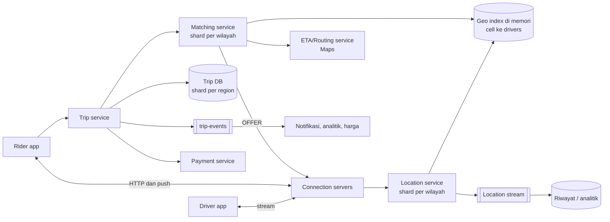
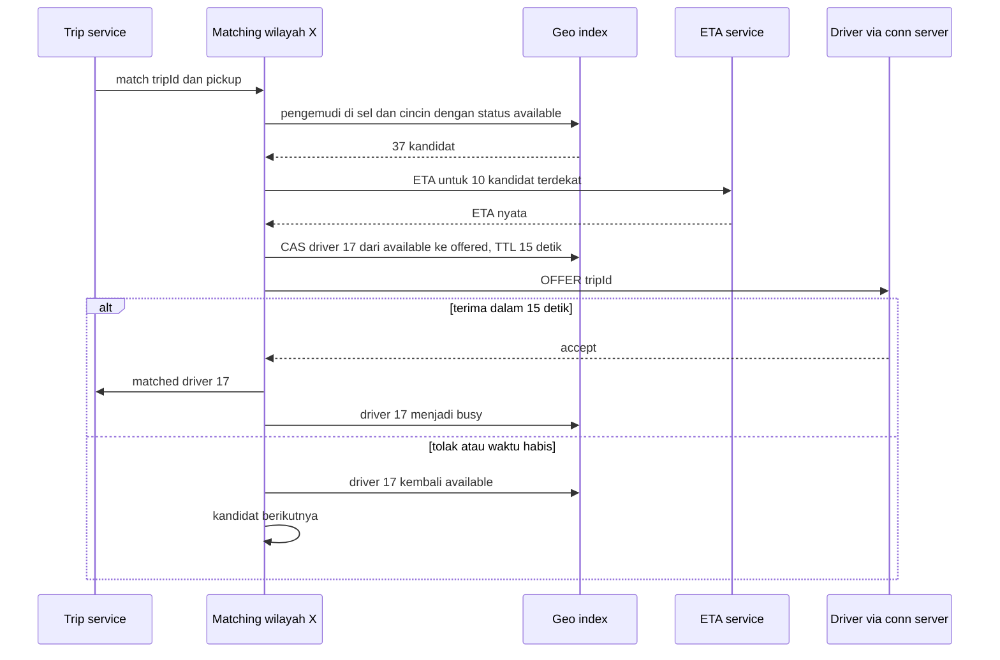

## 1. Requirements

Pertanyaan klarifikasi: hanya ride-hailing atau juga pengantaran? Berapa kota dan pengemudi aktif? Apakah pencocokan harus optimal secara kelompok, atau cukup memilih yang terdekat? Apakah ada harga dinamis? Apakah pembayaran termasuk?

### Functional

- Pengemudi bisa online dan offline, mengirim lokasi berkala, menerima atau menolak tawaran, dan menjalankan trip.
- Penumpang meminta tumpangan dari A ke B, melihat perkiraan harga dan waktu tiba, melacak pengemudi secara real-time, dan membayar.
- Matching mencocokkan permintaan dengan pengemudi terdekat yang tersedia dalam hitungan detik.
- Siklus trip: requested, matched, en_route, in_trip, completed, paid. Pembatalan juga ditangani.
- Di luar cakupan: detail harga dinamis, rating, dukungan pelanggan, dan peta. Peta dipakai sebagai layanan dan dibahas di kasus Google Maps.

### Non-functional

| Target           | Nilai                                                                        | Alasan                                   |
| ---------------- | ---------------------------------------------------------------------------- | ---------------------------------------- |
| Latency matching | Di bawah 3 detik dari permintaan sampai tawaran tiba di pengemudi            | Pengalaman inti                          |
| Kesegaran lokasi | Posisi pengemudi tertinggal paling lama 5 detik                              | Pelacakan dan matching harus akurat      |
| Konsistensi      | Kuat untuk state trip dan penugasan, eventual untuk lokasi dan tampilan peta | Uang dan kewajiban berbeda dari tampilan |
| Availability     | 99.99% untuk permintaan dan trip yang sedang berjalan                        | Orang menunggu di pinggir jalan          |
| Skala            | 1 juta pengemudi aktif dan 100 ribu permintaan per menit saat puncak global  | Banyak kota                              |

## 2. Estimasi kapasitas

Asumsi: 1 juta pengemudi online bersamaan dan satu kiriman lokasi tiap 4 detik sebesar 100 byte. Ada 10 juta trip per hari, dan penumpang aktif melacak satu pengemudi dengan pembaruan tiap 2 detik.

- Kiriman lokasi: 1 juta dibagi 4 berarti 250 ribu tulisan per detik, atau 25 MB per detik. Semua masuk ke index di memori yang terpartisi, dan salinannya ke stream untuk riwayat sebesar 2 TB per hari.
- Permintaan: 10 juta dibagi 100 ribu detik berarti 100 per detik rata-rata, dengan puncak sekitar 2.000 per detik. Setiap permintaan butuh satu query geospasial, beberapa perhitungan waktu tiba, dan satu tawaran.
- Pelacakan: 1 juta penumpang aktif dikali 0.5 pembaruan per detik berarti 500 ribu push per detik lewat koneksi persisten.
- State trip: 10 juta trip dikali sekitar 10 transisi berarti 100 juta tulisan transaksional per hari, atau 1.200 per detik. Database relasional yang dipartisi per wilayah sanggup.
- Index geospasial: 1 juta pengemudi dikali 100 byte berarti sekitar 100 MB. Itu kecil, dan dipartisi per wilayah agar pencarian lokal.

Keputusan dari angka ini: lokasi di memori terpartisi per wilayah, matching menyimpan state per wilayah, trip di database transaksional, dan push lewat lapisan koneksi persisten seperti kasus WhatsApp.

## 3. API design

```text
Pengemudi (koneksi persisten / gRPC stream)
→ LOCATION { driverId, lat, lng, heading, ts }           tiap 4 detik, best-effort
← OFFER    { tripId, pickup, dropoff, fare, expiresIn }
→ OFFER_RESPONSE { tripId, accept: bool }
→ TRIP_EVENT { tripId, type: arrived|started|completed }

Penumpang (HTTP + push)
POST /v1/estimates      { pickup, dropoff }           → { fare, eta }
POST /v1/trips          { pickup, dropoff, Idempotency-Key } → 202 { tripId, status: requested }
GET  /v1/trips/{id}     → status, driver, vehicle, eta, driverLocation
DELETE /v1/trips/{id}   → pembatalan (dengan aturan biaya)
← push TRIP_UPDATE { tripId, status, driverLocation }  tiap 2 detik saat aktif
```

Idempotency key pada pembuatan trip mencegah dua trip dari satu client yang mengulang request. Setiap `TRIP_EVENT` membawa `tripId` dan nomor urut.

## 4. Skema data

```text
-- Lokasi terkini (key-value di memori, terpartisi per wilayah, TTL 30 detik):
driver_loc: driver_id → {lat, lng, cell, heading, ts, status: available|offered|busy}
cell_index: cell_id → set(driver_id)       -- index geospasial, di partisi yang sama

-- Trip (database relasional, shard by region_id, konsistensi kuat):
trips(id, rider_id, driver_id, region_id, status, pickup, dropoff, fare_quote, fare_final,
      requested_at, matched_at, started_at, completed_at, version)
trip_events(trip_id, seq, type, payload, ts)        -- append-only, untuk audit
offers(trip_id, driver_id, offered_at, expires_at, response)

-- Riwayat lokasi: stream → object storage per hari, untuk audit, model waktu tiba, analitik
-- Pengemudi, penumpang, kendaraan: database users yang jarang berubah dan di-cache
```

Status pengemudi hidup bersama lokasinya di partisi memori yang sama. Matching membaca dan mengubahnya dalam satu operasi atomik.

## 5. High-level design



Alur lokasi:

1. Aplikasi pengemudi mengirim lokasi ke connection server.
2. Connection server meneruskan ke location service untuk wilayah yang sesuai dengan sel lokasi.
3. Location service memperbarui `driver_loc` dan memindahkan pengemudi dari sel lama ke sel baru di `cell_index`.
4. Location service menulis salinan ke stream.

Alur permintaan dan matching:

1. Trip service membuat `trips` dengan status requested secara durable.
2. Matching service wilayah mengambil kandidat dari sel penjemputan dan sel tetangganya, lalu menyaring yang berstatus available.
3. Matching service menghitung waktu tiba nyata untuk paling banyak 10 kandidat dan mengurutkannya.
4. Matching service mengubah state kandidat terbaik dari available ke offered dengan compare-and-set, lalu mengirim OFFER lewat connection server.
5. Kalau pengemudi menerima, trip menjadi matched dan pengemudi menjadi busy.
6. Kalau pengemudi menolak atau waktu habis, state kembali available dan kandidat berikutnya dicoba.
7. Setelah beberapa putaran gagal, radius diperluas atau penumpang diberi tahu.

Alur trip:

1. Pengemudi mengirim TRIP_EVENT.
2. Trip service memvalidasi transisi dengan state machine dan nomor versi.
3. Trip service menulis trip dan event, lalu menerbitkan ke pub-sub.
4. Penumpang menerima push. Lokasi pengemudi aktif diteruskan tiap 2 detik lewat langganan ke driver_id.

## 6. Detailed design

### 6.1 Index geospasial

Koordinat dipetakan ke sel dengan ukuran ratusan meter, misalnya H3 resolusi 8 sampai 9. H3 adalah sistem grid heksagonal dari Uber. Pencarian radius 2 km berarti membaca sel pusat ditambah satu atau dua cincin tetangga.

Strukturnya dua peta di memori: dari sel ke himpunan pengemudi, dan dari pengemudi ke selnya. Pembaruan lokasi memindahkan pengemudi antar sel bila selnya berubah.

Partisi mengikuti wilayah geografis, misalnya satu kota. Semua sel satu wilayah hidup di satu node lewat consistent hashing, sehingga pencarian cincin tidak lintas node. Di batas wilayah, dua node ditanya dan hasilnya digabung.

State lokasi direplikasi ke node cadangan secara asinkron. Kalau node mati, hanya beberapa detik data yang hilang, dan kiriman berikutnya mengisinya lagi. Data ini menyembuhkan dirinya sendiri.

### 6.2 Matching



Pencocokan serakah per permintaan cukup untuk kasus ini. Pencocokan kelompok mengumpulkan permintaan selama 2 sampai 3 detik dan menyelesaikannya bersama. Itu menaikkan efisiensi di area padat, dan layak disebut sebagai pengembangan.

Tawaran punya batas waktu. State offered yang kedaluwarsa sendiri mencegah pengemudi tergantung bila matching service mati.

Matching service menyimpan permintaan aktif dan tawaran per wilayah. Kalau node mati, node pengganti membaca ulang trip berstatus requested dari database.

### 6.3 Trip state machine

Transisi yang sah didefinisikan secara eksplisit. Event di luar urutan ditolak, misalnya completed sebelum started. Kolom `version` dipakai untuk compare-and-set. Tabel `trip_events` hanya ditambah, tidak pernah diubah, untuk audit dan rekonstruksi.

Setiap event membawa nomor urut per trip, sehingga duplikat diabaikan. Saat trip completed, trip service menerbitkan event. Payment service memprosesnya secara asinkron dengan idempotency key berupa tripId. Trip menjadi paid lewat event balik. Kalau pembayaran gagal, status menjadi `payment_failed` dan ditagih ulang.

### 6.4 Pelacakan real-time

Penumpang berlangganan ke driver_id saat trip aktif. Location service hanya mempublikasikan posisi pengemudi yang sedang dalam trip. Connection server penumpang meneruskannya tiap 2 detik. Penghalusan gerakan dilakukan di client.

### 6.5 Waktu tiba dan harga

Perhitungan waktu tiba memanggil routing service dengan cache untuk pasangan sel populer, ditambah koreksi dari data trip lama. Harga memakai tarif dasar dikali jarak dan waktu, dikali faktor permintaan per sel. Faktor itu dihitung dari rasio permintaan dan pengemudi per sel per menit lewat stream processing.

### 6.6 Lapisan koneksi dan kegagalan

Pola yang sama dengan kasus WhatsApp: connection server ringan, routing dari driver_id ke server dengan lease, dan sambung ulang dengan jeda acak. Kiriman lokasi boleh hilang sesekali. OFFER dan TRIP_EVENT dikirim minimal sekali dengan ack dan dedup.

## 7. Evaluasi terhadap non-functional requirements

| Target                    | Cara memenuhinya                                                                                       | Risiko yang tersisa                                                       |
| ------------------------- | ------------------------------------------------------------------------------------------------------ | ------------------------------------------------------------------------- |
| Matching di bawah 3 detik | Index di memori lokal wilayah, waktu tiba hanya untuk 10 kandidat, compare-and-set lokal               | ETA service lambat. Cadangan: jarak garis lurus dikali faktor             |
| Kesegaran 5 detik         | Kiriman tiap 4 detik, pembaruan langsung di memori, push langsung                                      | Jaringan pengemudi buruk. Tampilkan waktu terakhir dan prediksi di client |
| Konsistensi trip          | Database transaksional, state machine, compare-and-set, event append-only                              | Pembayaran gagal meninggalkan status sementara                            |
| Availability 99.99%       | Wilayah saling independen, lokasi menyembuhkan diri, trip DB terreplikasi, matching dipulihkan dari DB | Node wilayah mati memberi jeda beberapa detik                             |
| Skala                     | Partisi per wilayah untuk lokasi dan matching, trip DB per region                                      | Wilayah sangat padat harus dipecah. Batas wilayah butuh dua node          |

Kalau beban naik 10 kali, yang pecah duluan adalah laju kiriman lokasi dan ETA service. Keduanya diatasi dengan partisi tambahan dan cache. Layanan yang memetakan wilayah ke node adalah titik lemah tunggal, jadi memakai gossip dan replika.

## 8. Pertanyaan lanjutan interviewer

- "Bagaimana harga dinamis dihitung?" Stream permintaan dan pasokan per sel per menit menghasilkan rasio, lalu faktor dipublikasikan ke layanan estimasi dengan TTL.
- "Bagaimana pengemudi di perbatasan dua wilayah?" Dua partisi ditanya dan hasilnya digabung. Wilayah dibuat sedikit tumpang tindih.
- "Pencocokan optimal atau serakah?" Kelompokkan permintaan 2 sampai 3 detik dan selesaikan bersama. Ini menukar latency dengan efisiensi.
- "Bagaimana tumpangan bersama?" Matching mempertimbangkan trip aktif dengan rute yang cocok. Ini jauh lebih berat karena butuh routing, jadi dibatasi per area.
- "Bagaimana menyelesaikan sengketa pengemudi tidak datang?" Riwayat lokasi dari stream dan trip_events bisa direkonstruksi.
- "Bagaimana kalau satu datacenter mati?" Wilayah dipetakan ke region cloud terdekat dengan failover. Lokasi dibangun ulang dari kiriman dalam detik, dan trip DB direplikasi lintas region.
