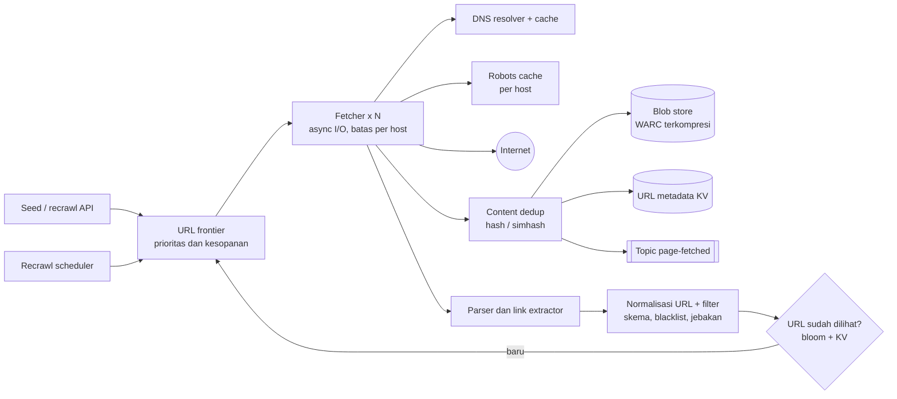
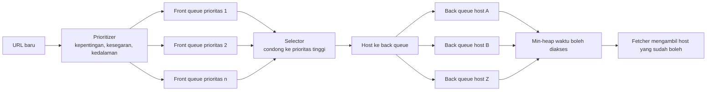

## 1. Requirements

Pertanyaan klarifikasi: untuk apa hasil crawl, misalnya index pencarian, arsip, atau riset. Hanya HTML atau juga gambar dan PDF. Berapa halaman per bulan. Seberapa sering halaman dikunjungi ulang. Satu region atau global.

### Functional

- Mulai dari daftar URL awal, unduh halaman, ambil link di dalamnya, lalu ulangi.
- Simpan konten mentah dan metadata agar bisa diproses ulang untuk indexing atau ekstraksi.
- Patuhi robots.txt dan batas laju per host. Robots.txt adalah berkas yang dipakai pemilik situs untuk menyatakan bagian mana yang boleh di-crawl.
- Kunjungi ulang halaman sesuai seberapa sering ia berubah dan seberapa penting.
- Di luar cakupan: ranking, menjalankan JavaScript, dan pencarian.

### Non-functional

| Target          | Nilai                                                                   | Alasan                                     |
| --------------- | ----------------------------------------------------------------------- | ------------------------------------------ |
| Skala           | 1 miliar halaman per bulan, data 5 tahun                                | Korpus untuk mesin pencari                 |
| Kesopanan       | Paling banyak 1 permintaan aktif per host, dengan jeda antar permintaan | Tidak menjatuhkan situs dan tidak diblokir |
| Ketahanan       | Tahan halaman jahat, jebakan, server lambat, dan konten raksasa         | Web tidak kooperatif                       |
| Mudah diperluas | Modul baru untuk PDF atau gambar tanpa mengubah inti                    | Kebutuhan berubah                          |
| Kesegaran       | Halaman populer dikunjungi ulang lebih sering                           | Nilai index                                |
| Deduplikasi     | Tidak menyimpan URL atau konten yang sama dua kali                      | Hemat storage dan kerja                    |

## 2. Estimasi kapasitas

Asumsi: 1 miliar halaman per bulan, rata-rata 500 KB per halaman, 50 link keluar per halaman, dan data disimpan 5 tahun.

- Laju: 1 miliar dibagi 2.6 juta detik hasilnya sekitar 400 halaman per detik. Puncaknya 1.000 per detik.
- Bandwidth masuk: 400 kali 500 KB, yaitu sekitar 200 MB per detik.
- Storage mentah: 500 TB per bulan. Dengan kompresi 5 kali, sekitar 100 TB per bulan. Lima tahun berarti sekitar 6 PB terkompresi. Blob store wajib.
- URL yang ditemukan: 400 kali 50, yaitu 20.000 URL per detik masuk ke antrian. Mayoritas sudah pernah dilihat.
- Daftar URL yang sudah dilihat untuk sekitar 10 miliar URL butuh sekitar 400 GB sebagai himpunan hash eksak. Sebagai bloom filter, hanya beberapa GB. Bloom filter adalah struktur probabilistik yang hemat memori dengan sedikit kemungkinan salah positif.
- DNS: 400 pencarian per detik tanpa cache. Dengan cache per host, jauh lebih kecil.

Keputusan: paralelisme ribuan koneksi karena pekerjaannya menunggu jaringan, bukan CPU. Antrian URL terpartisi. Blob store terkompresi. Daftar URL yang sudah dilihat terpartisi di memori atau key-value store.

## 3. API design

Crawler adalah sistem batch. API-nya untuk operator dan pipeline hilir.

```text
POST /api/v1/seeds           { "urls": [...], "priority": 1..10 }        → 202
POST /api/v1/recrawl         { "url": "...", "reason": "sitemap-updated" } → 202
GET  /api/v1/pages/{urlHash} → metadata: fetchedAt, status, contentHash, blobKey, links
GET  /api/v1/stats           → laju, ukuran frontier, error per host (untuk dashboard)
```

Pipeline hilir seperti indexer tidak memanggil API. Mereka berlangganan topic `page-fetched` yang berisi hash URL, key blob, hash konten, dan waktu unduh.

## 4. Skema data

Tiga penyimpanan dengan pola akses berbeda.

```sql
-- Metadata URL (KV terpartisi by url_hash; ditulis sering, dibaca by key)
url_meta: url_hash PK, url, host, last_fetched_at, next_fetch_at, status_code,
          content_hash, blob_key, change_rate, priority, depth

-- Host state (KV; satu baris per host, dibaca tiap fetch)
host_state: host PK, robots_rules, robots_fetched_at, crawl_delay_ms,
            next_allowed_at, ip_cache, error_count

-- Konten mentah: blob store, key = sha256(content), format WARC terkompresi
-- Sidik jari konten: KV content_hash → url_hash (dedup eksak); simhash index untuk near-dup
```

Antrian URL, yang disebut frontier, bukan tabel biasa. Ia adalah antrian berprioritas dan terpartisi dengan cadangan durable di log, supaya restart tidak kehilangan URL.

## 5. High-level design



Alur satu halaman:

1. Frontier mengeluarkan URL yang host-nya sudah boleh diakses.
2. Fetcher memeriksa robots.txt dan DNS dari cache.
3. Fetcher mengunduh halaman dengan timeout dan batas ukuran.
4. Dedup menghitung hash konten. Bila konten sudah ada, catat sebagai alias dan berhenti.
5. Simpan konten ke blob store, perbarui metadata, lalu terbitkan event.
6. Parser mengambil link dari halaman.
7. Normalisasi membersihkan URL dan menyaring yang tidak diinginkan.
8. URL yang belum pernah dilihat masuk ke frontier dengan prioritas.
9. Scheduler menjadwalkan kunjungan ulang berdasarkan laju perubahan halaman.

## 6. Detailed design

### 6.1 URL frontier: prioritas dan kesopanan

Dua tujuan ini bertabrakan. Kita ingin mengambil URL penting lebih dulu, tetapi tidak boleh mengakses satu host terlalu sering.



- Front queue dibuat per tingkat prioritas. Selector mengambil lebih sering dari prioritas tinggi.
- Back queue dibuat satu per host, atau per IP. Setiap host hanya punya satu permintaan aktif. Heap mengurutkan host berdasarkan waktu boleh diakses berikutnya.
- Skala: frontier dipartisi berdasarkan hash host ke banyak node. URL baru dikirim ke partisi host-nya, sehingga kesopanan per host dijaga di satu tempat.
- Durability: back queue hidup di memori dengan cadangan log dan checkpoint berkala. Miliaran URL tidak muat di memori, jadi hanya kepala tiap antrian yang dimuat.

### 6.2 Fetcher

- Memakai I/O asinkron dengan ribuan koneksi per node. Ada timeout koneksi dan baca, batas ukuran respons sekitar 10 MB, batas redirect, dan hanya tipe konten yang didukung.
- Identitasnya jelas lewat header User-Agent berisi URL kontak. Ia mematuhi robots.txt dari cache per host yang diperbarui harian, menghormati Crawl-delay, dan mundur saat menerima 429 atau 503.
- DNS memakai resolver lokal dengan cache, karena resolusi nama sering menjadi bottleneck.
- Fetcher tidak mem-parse halaman. Ia hanya meneruskan byte mentah, header, dan waktu ke tahap berikutnya.

### 6.3 Deduplikasi

- Untuk URL, lakukan normalisasi: huruf kecil untuk host, buang fragment, urutkan query, dan buang parameter pelacak. Lalu periksa ke daftar URL yang sudah dilihat. Bloom filter di memori menjadi saringan cepat, dan key-value store eksak terpartisi menjadi sumber kebenaran.
- Untuk konten, hash eksak menangkap duplikat persis. Simhash 64 bit dengan index per potongan bit menangkap dokumen yang hampir sama, yaitu yang jarak Hamming-nya 3 atau kurang. Duplikat tidak disimpan ulang dan link-nya tidak diproses lagi.

### 6.4 Penyimpanan dan pipeline hilir

- Blob store menyimpan berkas WARC terkompresi dengan key berupa hash konten. Metadata disimpan di key-value store.
- Event `page-fetched` dikirim ke topic. Indexer, ekstraktor entitas, dan pendeteksi perubahan berlangganan secara terpisah. Crawler tidak tahu siapa konsumennya.

### 6.5 Kunjungan ulang dan kesegaran

- Setiap URL punya laju perubahan yang diperbarui dari pengamatan: apakah konten berubah sejak kunjungan terakhir.
- Waktu kunjungan berikutnya dihitung dari laju perubahan dan prioritas. Halaman populer yang sering berubah dikunjungi lebih sering.
- Sitemap serta header Last-Modified dan ETag menghemat bandwidth lewat permintaan bersyarat.
- Scheduler, seperti di modul task scheduler, memasukkan URL yang jatuh tempo ke frontier.

### 6.6 Ketahanan dan jebakan

- Batasi kedalaman, batasi URL per host per hari, deteksi pola URL berulang, dan beri prioritas rendah untuk URL yang sangat panjang atau penuh parameter.
- Parser berjalan di sandbox dengan batas waktu, dan tipe konten tak dikenal diabaikan.
- Operator punya daftar hitam domain dan tombol untuk menghentikan satu host seketika.

### 6.7 Perluasan

Modul plug-in per tipe konten menangani PDF dan gambar. Rendering JavaScript dilakukan lewat pool browser headless hanya untuk halaman bernilai tinggi, karena biayanya 10 sampai 100 kali lipat.

## 7. Evaluasi terhadap non-functional requirements

| Target                                   | Cara memenuhi                                                             | Risiko tersisa                                                                |
| ---------------------------------------- | ------------------------------------------------------------------------- | ----------------------------------------------------------------------------- |
| Skala 400 sampai 1.000 halaman per detik | Fetcher asinkron terpartisi, frontier terpartisi per host, blob store     | Host raksasa membatasi laju per host. Terima dan prioritaskan                 |
| Kesopanan                                | Back queue per host dengan heap, cache robots, mundur saat 429 atau 503   | Banyak host berbagi satu IP. Batasi per IP juga                               |
| Ketahanan                                | Timeout, batas ukuran, parser di sandbox, heuristik jebakan               | Jebakan baru selalu muncul. Pantau jumlah URL per host                        |
| Mudah diperluas                          | Pipeline berbasis event, parser plug-in                                   | Tidak ada                                                                     |
| Kesegaran                                | Laju perubahan adaptif, sitemap, permintaan bersyarat                     | Taksiran laju perubahan butuh beberapa siklus                                 |
| Deduplikasi                              | Bloom filter dan key-value store untuk URL, hash dan simhash untuk konten | Salah positif bloom filter membuat sedikit URL terlewat. Angkanya bisa diatur |

Bottleneck pertama saat trafik naik 10 kali adalah key-value store untuk URL yang sudah dilihat, dengan 200.000 tulis per detik, lalu I/O frontier. Keduanya terpartisi horizontal. Titik tunggal kegagalannya adalah scheduler dan koordinator partisi. Jalankan keduanya redundan dengan lease, yaitu izin berbatas waktu yang harus diperpanjang.

## 8. Pertanyaan lanjutan interviewer

- "Bagaimana membagi crawler ke beberapa datacenter?" Partisi host berdasarkan geografi atau TLD. Tiap datacenter punya frontier sendiri, dan URL lintas partisi dikirim lewat queue.
- "Halaman yang butuh JavaScript?" Pakai pool browser headless untuk sebagian kecil halaman bernilai tinggi, dengan heuristik untuk mendeteksi kebutuhan render.
- "Bagaimana memprioritaskan halaman?" Jumlah link masuk ala PageRank, otoritas domain, kesegaran, dan permintaan dari pencarian.
- "Crawler diblokir situs?" Identitas jelas, patuhi robots, laju konservatif, dan sediakan kontak. Jangan menyamar.
- "Bagaimana memastikan tidak ada duplikat tersimpan?" Ukur rasio duplikat per hari dan lakukan sampling manual.
- "Node frontier hilang?" Cadangan log dan checkpoint. Node lain mengambil alih partisi dari log.
