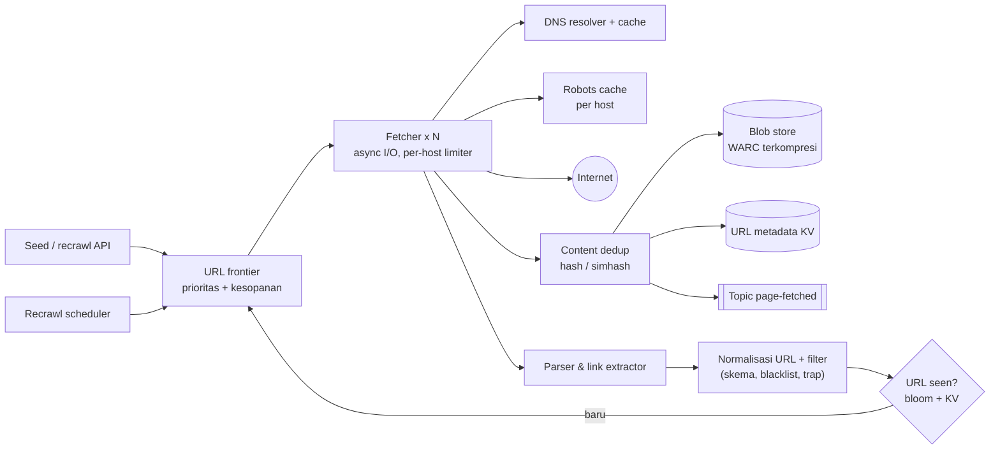
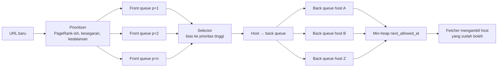

## 1. Requirements

Pertanyaan klarifikasi: untuk apa hasil crawl (index pencarian, arsip, riset)? Hanya HTML atau juga gambar/PDF? Berapa halaman per bulan? Seberapa segar (re-crawl)? Satu region atau global?

### Functional

- Mulai dari daftar seed URL, unduh halaman, ekstrak link, ulangi.
- Simpan konten mentah dan metadata agar bisa diproses ulang (indexing, ekstraksi).
- Patuhi `robots.txt` dan batas laju per host.
- Re-crawl halaman dengan frekuensi sesuai perubahan dan prioritas.
- Out of scope: ranking, rendering JavaScript (disebut sebagai ekstensi), pencarian.

### Non-functional

| NFR                    | Target                                                             | Alasan                                  |
| ---------------------- | ------------------------------------------------------------------ | --------------------------------------- |
| Skala                  | 1 miliar halaman/bulan, 5 tahun data                               | Korpus pencarian                        |
| Kesopanan (politeness) | ≤ 1 permintaan aktif per host, jeda sesuai `Crawl-delay`/heuristik | Tidak menjatuhkan situs, tidak diblokir |
| Robustness             | Tahan halaman jahat, trap, server lambat, konten raksasa           | Web tidak kooperatif                    |
| Extensibility          | Modul baru (PDF, gambar) tanpa mengubah inti                       | Kebutuhan berubah                       |
| Kesegaran              | Halaman populer di-crawl ulang lebih sering                        | Nilai index                             |
| Dedup                  | Tidak menyimpan URL/konten yang sama dua kali                      | Hemat storage dan kerja                 |

## 2. Estimasi kapasitas

Asumsi: 1 miliar halaman/bulan, rata-rata 500 KB per halaman (HTML + resource ringan), 50 link keluar per halaman, simpan 5 tahun.

- Laju: 10^9 / 2.6 × 10^6 s ≈ **400 halaman/detik**; puncak 1.000/s.
- Bandwidth masuk: 400 × 500 KB ≈ **200 MB/s**.
- Storage mentah: 500 TB/bulan; dengan kompresi 5x ≈ 100 TB/bulan → 5 tahun ≈ **6 PB** terkompresi. Blob store wajib.
- URL ditemukan: 400 × 50 = 20.000 URL/detik masuk frontier; mayoritas sudah pernah dilihat. URL-seen set untuk ~10^10 URL: 10^10 × ~40 byte ≈ 400 GB sebagai hash set eksak, atau beberapa GB sebagai bloom filter.
- DNS: 400 lookup/detik tanpa cache; dengan cache lokal per host, jauh lebih kecil.

Keputusan: paralelisme ribuan koneksi (I/O-bound, bukan CPU), frontier terpartisi, blob store terkompresi, URL-seen set terpartisi di memori/KV.

## 3. API design

Crawler adalah sistem batch/stream; API-nya untuk operator dan pipeline hilir.

```text
POST /api/v1/seeds           { "urls": [...], "priority": 1..10 }        → 202
POST /api/v1/recrawl         { "url": "...", "reason": "sitemap-updated" } → 202
GET  /api/v1/pages/{urlHash} → metadata: fetchedAt, status, contentHash, blobKey, links
GET  /api/v1/stats           → laju, ukuran frontier, error per host (untuk dashboard)
```

Pipeline hilir (indexer, ekstraktor) tidak memanggil API; mereka berlangganan topic `page-fetched` (pub-sub) yang berisi `urlHash, blobKey, contentHash, fetchedAt`.

## 4. Skema data

Tiga store dengan pola akses berbeda:

```sql
-- Metadata URL (KV terpartisi by url_hash; ditulis sering, dibaca by key)
url_meta: url_hash PK, url, host, last_fetched_at, next_fetch_at, status_code,
          content_hash, blob_key, change_rate, priority, depth

-- Host state (KV; satu baris per host, dibaca tiap fetch)
host_state: host PK, robots_rules, robots_fetched_at, crawl_delay_ms,
            next_allowed_at, ip_cache, error_count

-- Konten mentah: blob store, key = sha256(content), format WARC terkompresi
-- Sidik jari konten: KV content_hash → url_hash (dedup eksak); simhash index untuk near-dup
```

Frontier bukan tabel biasa: ia adalah antrian terprioritas dan terpartisi (lihat detailed design), dengan backing durable (queue/log) agar restart tidak kehilangan URL.

## 5. High-level design



**Alur satu halaman**: frontier mengeluarkan URL yang hostnya "boleh diakses" → fetcher cek robots (cache) dan DNS (cache) → unduh dengan timeout dan batas ukuran → hitung hash; bila konten sudah ada, catat alias dan berhenti → simpan ke blob store, perbarui metadata, publish event → parser mengekstrak link → normalisasi dan filter → URL yang belum pernah dilihat masuk frontier dengan prioritas → scheduler menjadwalkan re-crawl berdasarkan laju perubahan.

## 6. Detailed design

### 6.1 URL frontier: prioritas dan kesopanan

Dua tujuan yang bertabrakan: mengambil URL **penting** dulu, tetapi **tidak** mengakses satu host terlalu sering.



- **Front queue** per tingkat prioritas; selector mengambil lebih sering dari prioritas tinggi.
- **Back queue** satu per host (atau per IP) agar tiap host hanya punya satu permintaan aktif; heap mengurutkan host berdasarkan waktu boleh diakses berikutnya (`last_fetch + delay`).
- Skala: frontier dipartisi by host hash ke banyak node; URL baru dirutekan ke partisi hostnya sehingga kesopanan per host tetap terjaga di satu tempat.
- Durability: back queue di memori dengan backing log (Kafka/disk) dan checkpoint; miliaran URL tidak muat di memori, jadi hanya "kepala" tiap queue yang dimuat, sisanya di disk.

### 6.2 Fetcher

- Async I/O, ribuan koneksi per node; timeout koneksi/baca, batas ukuran respons (mis. 10 MB), batas redirect, hanya tipe konten yang didukung.
- Identitas jelas (`User-Agent` dengan URL kontak), mematuhi `robots.txt` (cache per host, refresh harian), `Crawl-delay`, dan HTTP 429/503 dengan backoff per host.
- DNS: resolver lokal dengan cache; resolusi adalah bottleneck umum.
- Hasil: byte mentah + header + timing ke tahap berikutnya; fetcher tidak mem-parse.

### 6.3 Dedup

- **URL**: normalisasi (lowercase host, hapus fragment, urutkan query, hapus parameter pelacak), lalu cek `url_seen`: bloom filter di memori (cepat, false positive kecil = sedikit URL terlewat) di depan KV eksak terpartisi.
- **Konten**: hash eksak untuk duplikat persis; **simhash** 64-bit dengan index per potongan bit untuk near-duplicate (jarak Hamming ≤ 3). Duplikat tidak disimpan ulang dan link-nya tidak diproses lagi.

### 6.4 Penyimpanan dan pipeline hilir

- Blob store menyimpan WARC terkompresi, key by content hash; metadata di KV.
- Event `page-fetched` ke topic; indexer, ekstraktor entitas, dan deteksi perubahan berlangganan terpisah; crawler tidak tahu konsumen.

### 6.5 Re-crawl dan kesegaran

- Tiap URL punya `change_rate` yang diperbarui dari pengamatan (konten berubah atau tidak sejak fetch terakhir); `next_fetch_at` dihitung dari laju perubahan dan prioritas (halaman populer yang sering berubah → sering).
- Sitemap dan `Last-Modified`/`ETag` (conditional GET) menghemat bandwidth.
- Scheduler (lihat modul task scheduler) memasukkan URL yang jatuh tempo ke frontier.

### 6.6 Robustness dan trap

- Batas kedalaman, batas URL per host per hari, deteksi pola URL berulang, prioritas rendah untuk URL panjang/berparameter.
- Konten berbahaya: parser di sandbox, batas waktu parse, abaikan tipe tak dikenal.
- Daftar hitam domain dan kemampuan menghentikan host tertentu segera (operator).

### 6.7 Ekstensi

Modul plug-in per tipe konten (PDF, gambar) dan rendering JavaScript lewat pool browser headless untuk subset halaman bernilai tinggi (mahal: CPU dan waktu 10–100x).

## 7. Evaluasi terhadap non-functional requirements

| NFR                       | Dipenuhi oleh                                                     | Risiko tersisa                                                         |
| ------------------------- | ----------------------------------------------------------------- | ---------------------------------------------------------------------- |
| Skala 400–1.000 halaman/s | Fetcher async terpartisi, frontier terpartisi by host, blob store | Host raksasa (wikipedia) membatasi laju per host; terima, prioritaskan |
| Kesopanan                 | Back queue per host + heap, robots cache, backoff 429/503         | Banyak host di satu IP (shared hosting): batasi per IP juga            |
| Robustness                | Timeout, batas ukuran, sandbox parser, trap heuristik             | Trap baru selalu muncul; pantau URL per host                           |
| Extensibility             | Pipeline event, parser plug-in                                    | —                                                                      |
| Kesegaran                 | change_rate adaptif, sitemap, conditional GET                     | Estimasi laju perubahan butuh beberapa siklus                          |
| Dedup                     | URL-seen (bloom + KV), content hash + simhash                     | Bloom false positive = URL terlewat (kecil, bisa diset)                |

Bottleneck pertama saat 10x: URL-seen KV (tulis 200.000/s) dan frontier I/O; keduanya terpartisi horizontal. SPOF: scheduler dan koordinator partisi; jalankan redundan dengan lease.

## 8. Pertanyaan lanjutan interviewer

- "Bagaimana mendistribusikan crawler ke beberapa datacenter?" → Partisi host by geografi/TLD; tiap DC punya frontier sendiri; URL lintas partisi dikirim via queue.
- "Halaman dinamis (JavaScript)?" → Pool browser headless untuk subset bernilai tinggi; deteksi kebutuhan render dari heuristik.
- "Bagaimana memprioritaskan halaman?" → PageRank/inlink count, domain authority, kesegaran, permintaan dari pencarian.
- "Crawler diblokir oleh situs?" → Identitas jelas, patuhi robots, laju konservatif, kontak; jangan menyamar.
- "Bagaimana memverifikasi crawler tidak menyimpan duplikat?" → Metrik rasio duplikat per hari; sampling manual.
- "Kehilangan node frontier?" → Backing log + checkpoint; partisi diambil alih node lain dari log.
