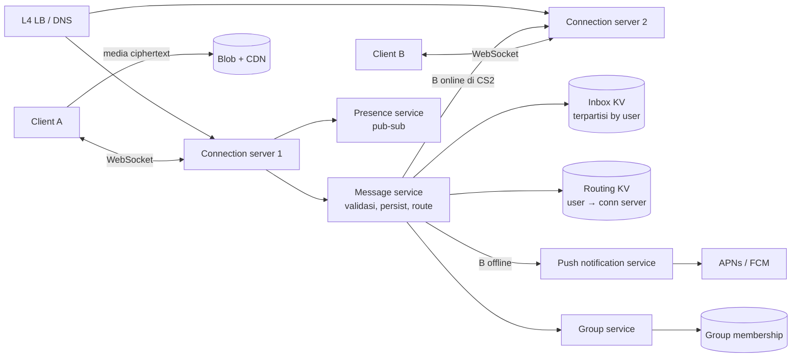
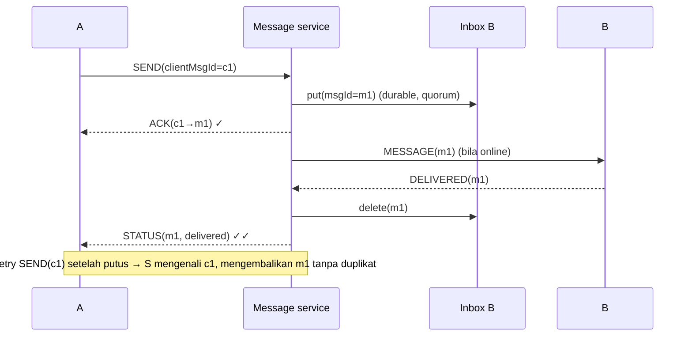

## 1. Requirements

Klarifikasi: 1:1 saja atau grup (berapa anggota maksimum)? Media? Status terkirim/dibaca? Multi-device? Apakah pesan disimpan di server setelah terkirim? E2EE?

### Functional

- Pesan teks 1:1 dan grup (≤ 1.024 anggota), media lewat blob store (referensi di pesan).
- Status: terkirim ke server, terkirim ke perangkat, dibaca; indikator online/mengetik (presence).
- Pesan untuk penerima offline disimpan sementara dan dikirim saat online; push notification.
- End-to-end encryption: server tidak bisa membaca isi.
- Out of scope: panggilan suara/video, Stories, backup cloud (disebut sebagai ekstensi).

### Non-functional

| NFR                | Target                                                                          | Alasan                      |
| ------------------ | ------------------------------------------------------------------------------- | --------------------------- |
| Latency pengiriman | &lt; 500 ms end-to-end saat keduanya online                                     | Percakapan terasa real-time |
| Reliability        | Pesan tidak hilang, tidak duplikat yang terlihat, urutan per percakapan terjaga | Inti produk                 |
| Availability       | 99.99%                                                                          | Komunikasi penting          |
| Skala              | 2 miliar user, 500 juta koneksi bersamaan, 100 miliar pesan/hari                | Global                      |
| Privasi            | E2EE; server menyimpan ciphertext seminimal mungkin                             | Kepercayaan                 |

## 2. Estimasi kapasitas

Asumsi: 100 miliar pesan/hari; 500 juta koneksi bersamaan; pesan rata-rata 100 B ciphertext + 100 B metadata; pesan disimpan di server paling lama 30 hari (untuk penerima offline), mayoritas terkirim dalam detik.

- Pesan: 10^11 / 10^5 ≈ **1 juta pesan/detik**, puncak 3 juta.
- Koneksi: 500 juta; satu server koneksi modern menangani ~1 juta koneksi idle (memori ~10 KB/koneksi = 10 GB) → ~500 server koneksi minimum, ~1.500 dengan headroom.
- Storage sementara: bila 10% pesan menunggu rata-rata 1 jam: 10^10 × 200 B ≈ 2 TB bergulir; untuk 30 hari penerima offline total, puluhan TB. KV terpartisi.
- Bandwidth: 1 juta × 200 B ≈ 200 MB/s untuk teks; media jauh lebih besar tetapi lewat blob + CDN.
- Presence: 500 juta × status change beberapa kali per jam → ratusan ribu update/detik; harus eventual dan dibatasi (hanya ke kontak yang membuka chat).

Keputusan: lapisan koneksi terpisah dari logika, routing user → server koneksi di KV, inbox per user di KV terpartisi, media di blob store.

## 3. API design

Dua jalur: HTTP untuk operasi "dingin" (login, kunci, media) dan **koneksi persisten** (WebSocket atau TCP kustom) untuk pesan dan status.

```text
HTTP
POST /v1/auth/verify            nomor → OTP → token perangkat
PUT  /v1/keys                   publish identity/prekeys (E2EE)
GET  /v1/keys/{userId}          ambil prekey bundle penerima
POST /v1/media/uploads          presigned URL (ciphertext media)

WebSocket frames (biner, mis. protobuf)
→ SEND    { clientMsgId, to (user|group), ciphertext, ts }
← ACK     { clientMsgId, serverMsgId, status: server }
← MESSAGE { serverMsgId, from, chat, ciphertext, ts }
→ DELIVERED { serverMsgId }     ← diteruskan ke pengirim sebagai status
→ READ      { chatId, uptoMsgId }
→/← PRESENCE, TYPING (best-effort, tanpa ack)
```

`clientMsgId` (UUID dari client) membuat SEND idempotent: retry setelah koneksi putus tidak menggandakan pesan.

## 4. Skema data

```text
-- Routing (KV, in-memory + replika): user_id → {conn_server, conn_id, last_seen}
-- Inbox (KV terpartisi by user_id, mis. Cassandra/ScyllaDB):
   inbox: (user_id, server_msg_id) → {from, chat_id, ciphertext, ts}   -- dihapus setelah ack perangkat
-- Grup (DB/KV): group_id → {members[], admins, version}
-- Group log (untuk grup besar): (group_id, server_msg_id) → payload; cursor per anggota
-- Pesan di perangkat: sumber kebenaran riwayat ada di client (SQLite); server tidak menyimpan riwayat setelah terkirim
-- Kunci: user_id → identity key, signed prekey, one-time prekeys (dikonsumsi)
-- Media: blob store, key acak + kunci simetris di dalam pesan terenkripsi
```

`server_msg_id` terurut waktu per partisi (Snowflake) memberi urutan per percakapan.

## 5. High-level design



**Alur 1:1 (B online)**: A SEND ke CS1 → message service menulis ke inbox B (durable) dan ACK ke A (satu centang) → lookup routing: B di CS2 → kirim ke CS2 → B menerima, DELIVERED → message service menghapus dari inbox B, meneruskan status ke A (dua centang) → B membaca, READ → status ke A.

**Alur 1:1 (B offline)**: sama sampai inbox; tidak ada entri routing → push notification tanpa isi; saat B terhubung, CS mengambil inbox B dan mengalirkan pesan berurutan; ack per pesan menghapusnya.

## 6. Detailed design

### 6.1 Lapisan koneksi

- Server koneksi **stateful ringan**: memegang socket dan user_id; tidak memegang logika bisnis. Bahasa/runtime yang hemat per koneksi (WhatsApp memakai Erlang; Go/Netty sebanding).
- L4 load balancer membagi koneksi baru; setelah terhubung, koneksi tetap di satu server. Routing KV diperbarui saat connect/disconnect dengan **lease** (TTL + heartbeat) agar server yang mati tidak menyisakan entri basi.
- Server mati: client reconnect (backoff + jitter) ke server lain; entri routing lama kedaluwarsa; pesan yang dikirim selama jeda tetap aman di inbox. Reconnect storm saat satu server mati 1 juta koneksi: jitter dan rate limit koneksi baru.
- Heartbeat/keepalive hemat baterai (interval menit, dinegosiasi dengan NAT timeout).

### 6.2 Reliability: store-and-forward dan ack



- **Tidak hilang**: ACK ke pengirim hanya setelah inbox durable (quorum tulis). Client mengirim ulang sampai ACK.
- **Tidak duplikat**: dedup `clientMsgId` di server (TTL beberapa jam) dan `server_msg_id` di client.
- **Urutan**: per percakapan, client mengurutkan by `server_msg_id`; pengiriman dari inbox berurutan; pesan yang datang "mundur" setelah reconnect ditangani client dengan sorting.
- **Multi-device**: tiap perangkat punya inbox dan kunci sendiri; pengirim mengenkripsi ke tiap perangkat penerima (fanout kecil); status delivered per perangkat, ditampilkan sebagai "terkirim" bila minimal satu.

### 6.3 Grup

- Keanggotaan di DB dengan versi; perubahan anggota adalah pesan sistem.
- Pengiriman: client mengenkripsi sekali (sender keys), mengirim ke server; group service mengambil anggota, menulis ke inbox tiap anggota (grup kecil) atau ke **group log** dengan cursor per anggota (grup besar), lalu mendorong ke yang online.
- Grup 1.024 anggota × 1 pesan = 1.024 tulisan inbox atau 1 tulisan log + 1.024 cursor read; log lebih hemat tulis tetapi menambah kompleksitas pembersihan (hapus entri setelah semua cursor melewati atau TTL).

### 6.4 Presence dan typing

- Best-effort, tanpa durability. Presence service menerima connect/disconnect/heartbeat, menyimpan `last_seen` di KV, dan mempublikasikan perubahan hanya ke user yang **sedang membuka chat** dengan orang itu (subscribe saat chat dibuka, unsubscribe saat ditutup) untuk membatasi fanout.
- Typing indicator: dikirim langsung antar server koneksi tanpa persist, dengan rate limit.

### 6.5 Push notification

Saat penerima offline: kirim push lewat APNs/FCM tanpa isi (atau isi terenkripsi yang didekripsi di perangkat). Push tidak dapat diandalkan sebagai jalur pengiriman; hanya pemicu untuk membuka koneksi.

### 6.6 Media

Client mengenkripsi file, mengunggah ciphertext ke blob store via presigned URL, mengirim pesan berisi URL + kunci + hash. Penerima mengunduh dari CDN dan mendekripsi. Server tidak bisa membaca media; dedup lintas pengirim tidak mungkin tanpa membocorkan isi (trade-off yang disadari).

### 6.7 E2EE sebagai batasan

Server menyimpan hanya ciphertext dan metadata routing; fitur yang butuh isi (pencarian, pratinjau link, moderasi) dilakukan di client. Key exchange (X3DH) lewat prekey bundle yang diambil dari server; ratchet per sesi di perangkat. Backup riwayat adalah fitur client (terenkripsi dengan kunci user).

## 7. Evaluasi terhadap non-functional requirements

| NFR                                    | Dipenuhi oleh                                                                                | Risiko tersisa                                                                         |
| -------------------------------------- | -------------------------------------------------------------------------------------------- | -------------------------------------------------------------------------------------- |
| Latency &lt; 500 ms                    | Koneksi persisten, routing KV in-memory, satu hop server-ke-server                           | Lintas region: tempatkan user di region terdekat; pesan lintas region menambah ~100 ms |
| Tidak hilang / tidak duplikat / urut   | Inbox durable sebelum ACK, clientMsgId dedup, server_msg_id terurut, ack bertingkat          | Inbox KV partition down: tulis ke partisi cadangan (hinted) dan sinkronkan             |
| Availability 99.99%                    | Server koneksi stateless-ish dan banyak, routing dengan lease, inbox terreplikasi            | Reconnect storm saat kegagalan besar; jitter + rate limit                              |
| Skala 1 juta pesan/s, 500 juta koneksi | ~1.500 server koneksi, inbox KV terpartisi (tulis ~1 juta/s tersebar), fanout grup di server | Grup raksasa dan user dengan ribuan grup: log per grup, batas ukuran grup              |
| Privasi                                | E2EE, inbox dihapus setelah delivered, metadata minimal                                      | Metadata tetap ada; retensi log dibatasi                                               |

Bottleneck 10x: inbox KV dan jumlah server koneksi, keduanya horizontal. SPOF: routing KV; replikasi dan fallback "coba semua region" bila miss.

## 8. Pertanyaan lanjutan interviewer

- "Bagaimana memastikan urutan pesan saat pengirim mengirim cepat dari dua perangkat?" → `server_msg_id` dari satu partisi per percakapan memberi urutan total; client menampilkan by ID.
- "Server koneksi mati dengan 1 juta koneksi?" → Client reconnect dengan jitter; routing lease kedaluwarsa; inbox menjamin tidak ada yang hilang.
- "Bagaimana 'dibaca' diteruskan tanpa membanjiri?" → READ membawa `uptoMsgId` (satu status untuk banyak pesan).
- "Pesan ke user di region lain?" → Routing KV global (atau lookup region asal user), relay antar region lewat koneksi server-ke-server persisten.
- "Bagaimana moderasi spam tanpa membaca isi?" → Sinyal metadata: laju kirim, rasio blokir/lapor, pola grup; batasan E2EE disebut jujur.
- "Backup riwayat?" → Client mengenkripsi dengan kunci user dan mengunggah ke blob; server tetap tidak bisa membaca.
