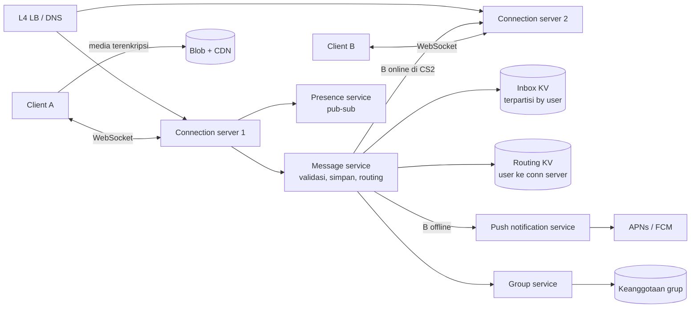
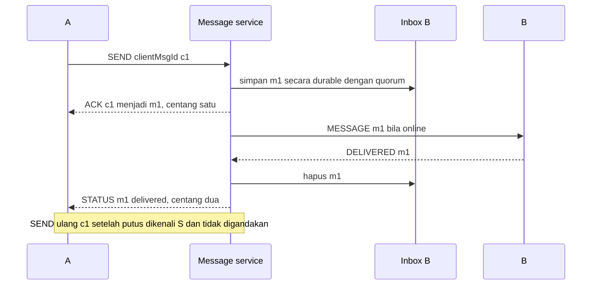

## 1. Requirements

Pertanyaan klarifikasi yang pantas kamu ajukan: hanya pesan pribadi atau juga grup? Berapa anggota maksimum per grup? Apakah ada media? Apakah perlu status terkirim dan dibaca? Apakah satu akun bisa dipakai di beberapa perangkat? Apakah server boleh menyimpan pesan setelah terkirim? Apakah isi pesan harus terenkripsi end-to-end?

### Functional

- Pesan teks pribadi dan grup sampai 1.024 anggota. Media dikirim lewat blob store dan hanya referensinya yang masuk pesan.
- Status pesan: terkirim ke server, terkirim ke perangkat, dan dibaca. Ada juga indikator online dan sedang mengetik.
- Pesan untuk penerima offline disimpan sementara dan dikirim saat ia online. Push notification memberi tahu penerima.
- End-to-end encryption, disingkat E2EE. Server tidak bisa membaca isi pesan.
- Di luar cakupan: panggilan suara dan video, Stories, dan backup ke cloud.

### Non-functional

| Target             | Nilai                                                                        | Alasan                                  |
| ------------------ | ---------------------------------------------------------------------------- | --------------------------------------- |
| Latency pengiriman | Di bawah 500 ms dari ujung ke ujung saat keduanya online                     | Percakapan harus terasa real-time       |
| Reliability        | Pesan tidak hilang, tidak tampil ganda, dan urutannya terjaga per percakapan | Ini inti produk                         |
| Availability       | 99.99%                                                                       | Komunikasi penting tidak boleh terputus |
| Skala              | 2 miliar pengguna, 500 juta koneksi bersamaan, 100 miliar pesan per hari     | Layanan global                          |
| Privasi            | E2EE, dan server menyimpan teks terenkripsi sesingkat mungkin                | Kepercayaan pengguna                    |

## 2. Estimasi kapasitas

Asumsi: 100 miliar pesan per hari, 500 juta koneksi bersamaan, dan setiap pesan sekitar 100 byte teks terenkripsi ditambah 100 byte metadata. Pesan disimpan di server paling lama 30 hari untuk penerima yang offline.

- Laju pesan: 100 miliar dibagi 100 ribu detik berarti sekitar 1 juta pesan per detik. Puncaknya sekitar 3 juta per detik.
- Koneksi: satu server modern bisa menangani sekitar 1 juta koneksi diam dengan memori 10 KB per koneksi. Jadi kita butuh minimal 500 server koneksi, atau sekitar 1.500 dengan cadangan.
- Penyimpanan sementara: kalau 10% pesan menunggu rata-rata satu jam, data yang bergulir sekitar 2 TB. Untuk penerima yang offline sampai 30 hari, totalnya puluhan TB di key-value store terpartisi.
- Bandwidth teks: 1 juta pesan dikali 200 byte berarti sekitar 200 MB per detik. Media jauh lebih besar, tetapi lewat blob store dan CDN.
- Presence, yaitu status online: 500 juta pengguna berganti status beberapa kali per jam. Itu ratusan ribu update per detik, jadi harus eventual dan hanya dikirim ke orang yang sedang membuka chat.

Keputusan dari angka ini: lapisan koneksi dipisah dari logika pesan. Routing pengguna ke server koneksi disimpan di key-value store. Inbox per pengguna hidup di key-value store terpartisi, dan media di blob store.

## 3. API design

Ada dua jalur. HTTP dipakai untuk operasi yang jarang, seperti login dan kunci enkripsi. Koneksi persisten lewat WebSocket dipakai untuk pesan dan status.

```text
HTTP
POST /v1/auth/verify            nomor → OTP → token perangkat
PUT  /v1/keys                   publish identity key dan prekey (E2EE)
GET  /v1/keys/{userId}          ambil prekey bundle penerima
POST /v1/media/uploads          presigned URL untuk media terenkripsi

WebSocket frames (biner, mis. protobuf)
→ SEND      { clientMsgId, to (user|group), ciphertext, ts }
← ACK       { clientMsgId, serverMsgId, status: server }
← MESSAGE   { serverMsgId, from, chat, ciphertext, ts }
→ DELIVERED { serverMsgId }     diteruskan ke pengirim sebagai status
→ READ      { chatId, uptoMsgId }
→/← PRESENCE, TYPING           best-effort, tanpa ack
```

Client membuat `clientMsgId` sendiri. Dengan itu, pengiriman ulang setelah koneksi putus tidak menggandakan pesan.

## 4. Skema data

```text
-- Routing (key-value di memori, direplikasi): user_id → {conn_server, conn_id, last_seen}
-- Inbox (key-value terpartisi by user_id, mis. Cassandra/ScyllaDB):
   inbox: (user_id, server_msg_id) → {from, chat_id, ciphertext, ts}   -- dihapus setelah ack perangkat
-- Grup: group_id → {members[], admins, version}
-- Log grup besar: (group_id, server_msg_id) → payload, dengan cursor per anggota
-- Riwayat pesan: sumber kebenaran ada di perangkat (SQLite); server tidak menyimpan riwayat setelah terkirim
-- Kunci: user_id → identity key, signed prekey, one-time prekeys
-- Media: blob store, key acak; kunci simetris dikirim di dalam pesan terenkripsi
```

`server_msg_id` dibuat terurut waktu per partisi, misalnya dengan Snowflake. Itu memberi urutan per percakapan.

## 5. High-level design



Alur pesan pribadi saat B online:

1. Client A mengirim SEND ke connection server CS1.
2. Message service menulis pesan ke inbox B secara durable, lalu mengirim ACK ke A. Ini centang satu.
3. Message service mencari B di routing store dan menemukannya di CS2.
4. CS2 mendorong pesan ke B. B membalas DELIVERED.
5. Message service menghapus pesan dari inbox B dan meneruskan status ke A. Ini centang dua.
6. B membaca pesan dan mengirim READ. Statusnya diteruskan ke A.

Alur saat B offline:

1. Langkah 1 dan 2 sama. Pesan tersimpan di inbox B.
2. Routing store tidak punya entri untuk B, jadi message service mengirim push notification tanpa isi pesan.
3. Saat B tersambung, connection server membaca inbox B dan mengalirkan pesan secara berurutan.
4. Setiap ack dari B menghapus satu pesan dari inbox.

## 6. Detailed design

### 6.1 Lapisan koneksi

Connection server memegang socket dan user_id, tetapi tidak memegang logika bisnis. Ia stateful, tetapi ringan. WhatsApp memakai Erlang untuk lapisan ini. Go atau Netty memberi hasil sebanding.

Load balancer L4 membagi koneksi baru. Setelah tersambung, koneksi tetap di satu server. Entri routing diperbarui saat connect dan disconnect dengan lease. Lease adalah izin berbatas waktu yang harus diperpanjang lewat heartbeat, sehingga server yang mati tidak meninggalkan entri basi.

Kalau satu server koneksi mati, client menyambung ulang ke server lain dengan jeda acak. Entri routing lama kedaluwarsa sendiri. Pesan yang dikirim selama jeda tetap aman di inbox. Satu server yang mati bisa memicu satu juta koneksi menyambung ulang sekaligus. Jeda acak dan rate limit koneksi baru meredam badai itu.

Heartbeat dibuat hemat baterai, dengan interval menit yang disesuaikan dengan batas waktu NAT.

### 6.2 Reliability: store-and-forward dan ack



Tiga jaminan yang harus kamu sebut:

- Tidak hilang. ACK ke pengirim hanya dikirim setelah inbox menulis dengan quorum. Client mengirim ulang sampai menerima ACK.
- Tidak ganda. Server menyimpan `clientMsgId` beberapa jam untuk mengenali duplikat. Client menyimpan `server_msg_id` untuk hal yang sama.
- Berurutan. Client mengurutkan pesan per percakapan berdasarkan `server_msg_id`. Pesan yang datang terlambat setelah sambung ulang ditata ulang oleh client.

Untuk beberapa perangkat per akun, setiap perangkat punya inbox dan kunci sendiri. Pengirim mengenkripsi ke setiap perangkat penerima. Status terkirim dihitung per perangkat dan ditampilkan sebagai terkirim bila minimal satu perangkat menerima.

### 6.3 Grup

Keanggotaan grup disimpan dengan nomor versi. Perubahan anggota dikirim sebagai pesan sistem. Client mengenkripsi pesan grup sekali dengan sender key, lalu mengirimnya ke server. Group service mengambil daftar anggota dan menyalin ke inbox tiap anggota untuk grup kecil. Untuk grup besar, group service menulis satu kali ke log grup dan tiap anggota memegang cursor. Cursor adalah penunjuk posisi terakhir yang sudah dibaca.

Grup 1.024 anggota berarti 1.024 tulisan inbox per pesan, atau satu tulisan log ditambah 1.024 pembacaan cursor. Log lebih hemat tulis, tetapi pembersihannya lebih rumit.

### 6.4 Presence dan typing

Presence bersifat best-effort tanpa durability. Presence service menerima connect, disconnect, dan heartbeat, lalu menyimpan `last_seen`. Perubahan hanya dipublikasikan ke pengguna yang sedang membuka chat dengan orang itu. Client berlangganan saat membuka chat dan berhenti saat menutupnya. Indikator mengetik dikirim langsung antar connection server tanpa disimpan, dengan rate limit.

### 6.5 Push notification

Saat penerima offline, server mengirim push lewat APNs atau FCM tanpa isi pesan. Push tidak bisa diandalkan sebagai jalur pengiriman. Ia hanya pemicu agar aplikasi membuka koneksi.

### 6.6 Media

Client mengenkripsi file, mengunggah hasilnya ke blob store lewat presigned URL, lalu mengirim pesan berisi URL, kunci, dan hash. Presigned URL adalah tautan bertanda tangan yang berlaku sementara. Penerima mengunduh dari CDN dan mendekripsi. Server tidak bisa membaca media, sehingga dedup lintas pengirim tidak mungkin tanpa membocorkan isi.

### 6.7 E2EE sebagai batasan

Server hanya menyimpan teks terenkripsi dan metadata routing. Fitur yang butuh isi, seperti pencarian, pratinjau tautan, dan moderasi, dilakukan di client. Pertukaran kunci memakai prekey bundle yang diambil dari server. Backup riwayat adalah fitur client yang dienkripsi dengan kunci pengguna.

## 7. Evaluasi terhadap non-functional requirements

| Target                               | Cara memenuhinya                                                                    | Risiko yang tersisa                                                              |
| ------------------------------------ | ----------------------------------------------------------------------------------- | -------------------------------------------------------------------------------- |
| Latency di bawah 500 ms              | Koneksi persisten, routing di memori, dan satu hop antar server                     | Lintas region menambah sekitar 100 ms. Tempatkan pengguna di region terdekat     |
| Tidak hilang, tidak ganda, berurutan | Inbox durable sebelum ACK, dedup clientMsgId, server_msg_id terurut, ack bertingkat | Partisi inbox mati. Tulis ke partisi cadangan lalu sinkronkan                    |
| Availability 99.99%                  | Banyak server koneksi ringan, routing dengan lease, inbox terreplikasi              | Badai sambung ulang saat kegagalan besar. Jeda acak dan rate limit               |
| Skala 1 juta pesan per detik         | Sekitar 1.500 server koneksi dan inbox terpartisi                                   | Grup raksasa dan pengguna dengan ribuan grup. Log per grup dan batas ukuran grup |
| Privasi                              | E2EE, inbox dihapus setelah terkirim, metadata minimal                              | Metadata tetap ada. Batasi retensi log                                           |

Kalau beban naik 10 kali, yang pecah duluan adalah inbox dan jumlah server koneksi. Keduanya bisa ditambah secara horizontal. Routing store adalah titik lemah tunggal, jadi ia direplikasi.

## 8. Pertanyaan lanjutan interviewer

- "Bagaimana urutan pesan dijaga saat pengirim memakai dua perangkat?" `server_msg_id` dari satu partisi per percakapan memberi urutan total. Client menampilkan berdasarkan ID itu.
- "Server koneksi dengan satu juta koneksi mati, lalu apa?" Client menyambung ulang dengan jeda acak. Lease routing kedaluwarsa. Inbox menjamin tidak ada pesan hilang.
- "Bagaimana status dibaca diteruskan tanpa membanjiri?" READ membawa `uptoMsgId`, jadi satu status mencakup banyak pesan.
- "Bagaimana pesan ke pengguna di region lain?" Routing global mencari region asal pengguna. Server antar region berkomunikasi lewat koneksi persisten.
- "Bagaimana mendeteksi spam tanpa membaca isi?" Pakai sinyal metadata: laju kirim, rasio blokir dan laporan, serta pola grup. Sebutkan batasan E2EE dengan jujur.
- "Bagaimana backup riwayat?" Client mengenkripsi dengan kunci pengguna dan mengunggah ke blob store. Server tetap tidak bisa membaca.
