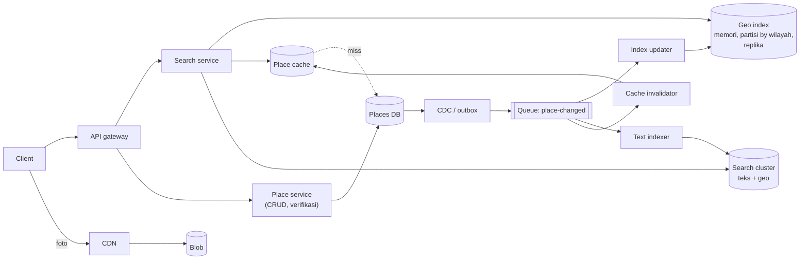
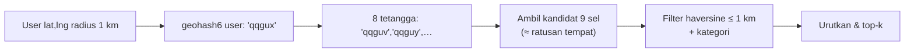

## 1. Requirements

Klarifikasi: radius maksimum? Hasil diurutkan by jarak, rating, atau relevansi? Seberapa sering bisnis berubah? Apakah perlu pencarian teks ("sushi") digabung lokasi? Ulasan termasuk?

### Functional

- Cari tempat dalam radius r dari (lat, lng), dengan filter kategori dan teks opsional, diurutkan by jarak atau skor.
- Lihat detail tempat (jam, foto, rating, ulasan ringkas).
- Pemilik menambah/mengubah tempat; perubahan terlihat dalam menit.
- Out of scope: menulis ulasan (dibahas ringkas), rekomendasi, iklan, reservasi.

### Non-functional

| NFR               | Target                                                                  | Alasan                       |
| ----------------- | ----------------------------------------------------------------------- | ---------------------------- |
| Latency pencarian | p99 &lt; 200 ms                                                         | Interaktif saat peta digeser |
| Availability      | 99.99% baca                                                             | Produk inti                  |
| Konsistensi       | Eventual (menit) untuk perubahan tempat; detail yang dilihat harus utuh | Read-heavy                   |
| Skala             | 200 juta tempat, 100 juta DAU, 10.000+ QPS pencarian                    | Global                       |
| Kelengkapan       | Tidak melewatkan tempat di dalam radius                                 | Kepercayaan                  |

## 2. Estimasi kapasitas

Asumsi: 200 juta tempat; 100 juta DAU dengan 5 pencarian/hari; detail tempat 2 KB + foto di blob; perubahan 1% tempat/hari.

- Pencarian: 100M × 5 / 10^5 ≈ **5.000 QPS**, puncak 15.000.
- Index geospasial: 200M × (id 8 B + lat/lng 16 B + cell 8 B + flag 8 B ≈ 40 B) ≈ **8 GB**; muat di memori, dipartisi by wilayah dan direplikasi.
- Detail: 200M × 2 KB ≈ 400 GB di DB; cache objek untuk tempat populer (20% × 400 GB = 80 GB).
- Tulis: 2 juta perubahan/hari ≈ 25/s; trivial; index diperbarui via stream.
- Hasil per query: ambil ≤ 100 kandidat dari index, hydrate 20 untuk halaman pertama = 20 multi-get cache per query → 100.000–300.000 cache get/s.

Keputusan: index ringkas di memori, detail di DB + cache, sinkronisasi async; tidak ada sharding DB untuk tulis (25/s), tetapi partisi index untuk lokalitas dan replikasi untuk throughput.

## 3. API design

```text
GET /v1/search?lat=&lng=&radius=1000&category=restaurant&q=sushi&sort=distance|score&cursor=
    → { results: [{ placeId, name, distanceM, rating, category, thumbUrl }], nextCursor }
GET /v1/places/{id}      → detail lengkap
POST /v1/places          (pemilik; auth)  → 202, menunggu verifikasi
PATCH /v1/places/{id}    (pemilik)        → 202
```

Radius dibatasi (mis. 50 km) dan hasil dipotong (k-nearest 100) agar biaya terikat. Cursor berisi posisi dalam daftar yang sudah diurutkan dan hash parameter.

## 4. Skema data

```sql
places(id, name, category, lat, lng, geohash6 /* atau cell */, address, phone, hours JSONB,
       rating, review_count, status, updated_at)          -- sumber kebenaran, index pada geohash6
photos(place_id, blob_key, order)
reviews(id, place_id, user_id, rating, text, created_at)  -- shard by place_id

-- Index geospasial (memori/KV, turunan):
cell_index: cell_id → [ {place_id, lat, lng, category_bits, rating_bucket} ]   -- diurutkan/di-bucket
place_cell: place_id → cell_id  (untuk update: hapus dari sel lama)

-- Cache objek: place:{id} → detail ringkas (TTL jam, dihapus saat update)
-- Search cluster (opsional): index teks tempat dengan geo_point untuk q + lokasi
```

Pilihan sel: geohash presisi 6 (±1 km) atau H3 res 8; presisi dipilih dari radius umum. Satu tempat hanya di satu sel.

## 5. High-level design



**Alur pencarian**: client → search service → hitung sel user + ring tetangga sesuai radius → ambil kandidat dari partisi index (satu atau dua partisi di batas wilayah) → filter kategori/radius nyata (haversine) → urutkan (jarak atau skor gabungan jarak+rating) → ambil top-k → hydrate 20 dari cache objek → respons. Bila ada `q` teks: query search cluster dengan filter geo_distance, lalu hydrate.

**Alur perubahan**: pemilik → place service → DB → CDC → queue → index updater memindahkan tempat antar sel (jika lokasi berubah) atau memperbarui atribut ringkas; cache objek dihapus; text indexer memperbarui dokumen. Terlihat dalam detik–menit.

## 6. Detailed design

### 6.1 Memilih index geospasial

| Pendekatan              | Cara                                  | Kelebihan                                                                          | Kekurangan                                                                                | Cocok                           |
| ----------------------- | ------------------------------------- | ---------------------------------------------------------------------------------- | ----------------------------------------------------------------------------------------- | ------------------------------- |
| Geohash (string prefix) | 2D → string base32; sel = prefix      | Sederhana, bisa di DB/KV apa pun (index B-tree pada string), range query by prefix | Sel seragam (padat vs kosong), bentuk persegi panjang, batas sel; tetangga perlu dihitung | Default untuk penyimpanan       |
| S2 / H3 (cell id)       | Kurva Hilbert / heksagon hirarkis     | Sel lebih seragam secara luas; H3 ring tetangga mudah; hirarki resolusi            | Butuh library; id 64-bit                                                                  | Index memori, analitik          |
| Quadtree                | Pohon; sel dipecah saat &gt; N tempat | Adaptif terhadap kepadatan; k-nearest efisien (telusuri sel terdekat)              | Struktur memori yang harus dibangun, dipartisi, direplikasi; update menyeimbangkan pohon  | Query nearest di memori         |
| R-tree / GiST (PostGIS) | Pohon bounding box                    | Query spasial lengkap di SQL                                                       | Throughput terbatas DB tunggal                                                            | Skala kecil-menengah, prototipe |

Pilihan: **geohash/H3 di penyimpanan dan index memori** (partisi, replikasi mudah), dengan **quadtree opsional** di memori tiap partisi untuk k-nearest yang cepat pada area padat. Jelaskan batas sel dan ring tetangga dalam setiap pilihan.



### 6.2 Partisi dan replikasi index

- Partisi by wilayah (kumpulan sel) ke node; wilayah dipilih agar beban merata (kota besar = wilayah sendiri). Query di batas wilayah menyentuh 2 node.
- Replikasi: index adalah turunan, dibangun ulang dari DB; tiap partisi punya beberapa replika read-only; update dari queue diterapkan ke semua replika (idempotent, versi per tempat).
- Rebuild: snapshot periodik dari DB untuk node baru, lalu catch-up dari queue (offset).

### 6.3 Ranking

Skor = w1 × f(jarak) + w2 × rating × log(review_count) + w3 × kecocokan teks + w4 × buka sekarang. Hitung di search service untuk ≤ 100 kandidat; murah. Personalisasi (riwayat) sebagai ekstensi di tahap kedua.

### 6.4 Detail dan ulasan

- Detail dari cache objek (cache-aside, hapus saat update); foto via CDN.
- Ulasan: shard by place_id, halaman pertama di-cache; rating agregat dihitung ulang asinkron saat ulasan baru (counter + rata-rata; sharded counter untuk tempat viral).

### 6.5 Konsistensi dan pembaruan

- Tempat baru menunggu verifikasi (status `pending`) sebelum masuk index.
- Perubahan lokasi: index updater menghapus dari sel lama dan menambah ke sel baru; antara dua langkah, tempat bisa muncul dua kali atau tidak sama sekali sesaat; versi per tempat membuat pembaca mengabaikan entri basi.
- Lag index dipantau; SLA "terlihat dalam 5 menit".

## 7. Evaluasi terhadap non-functional requirements

| NFR                 | Dipenuhi oleh                                                       | Risiko tersisa                                                               |
| ------------------- | ------------------------------------------------------------------- | ---------------------------------------------------------------------------- |
| p99 &lt; 200 ms     | Index memori lokal, ≤ 9 sel, hydrate dari cache                     | Area sangat padat: ribuan kandidat per sel; quadtree/sel lebih kecil adaptif |
| Availability 99.99% | Index replika, stateless search service, cache; DB hanya untuk miss | Kehilangan semua replika partisi: rebuild dari snapshot (menit)              |
| Eventual (menit)    | CDC → queue → index/ cache invalidasi                               | Lag saat backlog; prioritas perubahan lokasi                                 |
| Kelengkapan         | Ring tetangga + filter jarak nyata                                  | Radius besar (50 km) → turunkan presisi, bukan ring 1.000 sel                |
| Skala               | Index 8 GB terpartisi/replika; tulis kecil                          | Hot wilayah (pusat kota saat makan siang): replika tambahan                  |

Bottleneck 10x: cache objek (hydrate) dan partisi index wilayah populer; keduanya horizontal via replika. SPOF: queue perubahan; cluster terreplikasi; index tetap melayani data lama bila queue mati.

## 8. Pertanyaan lanjutan interviewer

- "Pencarian teks + lokasi ('sushi dekat saya')?" → Search cluster dengan filter geo_distance dan skor gabungan, atau filter teks di kandidat sel bila kecil.
- "Objek yang bergerak (pengemudi)?" → Update tinggi; lihat kasus Uber: index memori dengan TTL, tanpa DB per ping.
- "Polygon ('dalam wilayah Menteng') bukan radius?" → Pecah polygon menjadi himpunan sel (S2 covering), query sel, filter point-in-polygon.
- "Pagination stabil saat data berubah?" → Cursor berisi skor+id terakhir; hasil baru di antara dua halaman diterima.
- "Multi-region?" → Index per region geografis secara alami lokal; DB primary per region atau global dengan replika baca.
- "Mengukur kualitas pencarian?" → CTR hasil, rasio hasil kosong, latency per partisi.
