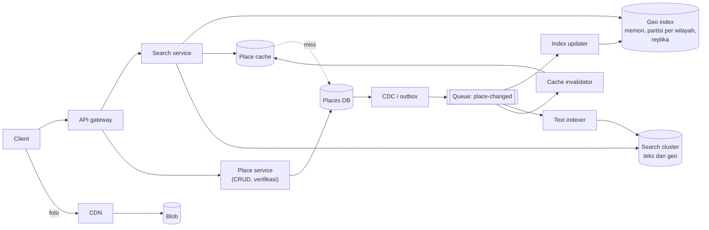
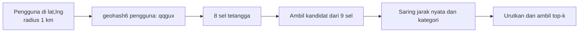

## 1. Requirements

Mulailah dengan bertanya. Berapa radius maksimum yang didukung? Hasil diurutkan menurut jarak, rating, atau gabungan keduanya? Seberapa sering data bisnis berubah? Apakah pencarian teks seperti "sushi" perlu digabung dengan lokasi? Apakah ulasan termasuk?

### Functional

- Pengguna mencari tempat dalam radius tertentu dari koordinatnya. Hasil bisa disaring menurut kategori dan teks, lalu diurutkan menurut jarak atau skor.
- Pengguna membuka detail tempat: jam buka, foto, rating, dan ringkasan ulasan.
- Pemilik menambah atau mengubah data tempat. Perubahan terlihat dalam hitungan menit.
- Di luar cakupan: menulis ulasan, rekomendasi, iklan, dan reservasi.

### Non-functional

| Target            | Nilai                                                                              | Alasan                                                  |
| ----------------- | ---------------------------------------------------------------------------------- | ------------------------------------------------------- |
| Latency pencarian | p99 di bawah 200 ms                                                                | Pengguna menggeser peta dan mengharapkan hasil langsung |
| Availability      | 99.99% untuk pembacaan                                                             | Pencarian adalah fitur inti produk                      |
| Konsistensi       | Eventual dalam hitungan menit untuk perubahan tempat                               | Beban didominasi pembacaan                              |
| Skala             | 200 juta tempat, 100 juta pengguna aktif harian, lebih dari 10.000 query per detik | Layanan global                                          |
| Kelengkapan       | Tidak ada tempat di dalam radius yang terlewat                                     | Kepercayaan pengguna                                    |

## 2. Estimasi kapasitas

Asumsi: 200 juta tempat, 100 juta pengguna aktif harian dengan 5 pencarian per hari, detail tempat 2 KB, foto di blob store, dan 1% tempat berubah per hari.

- Pencarian: 100 juta kali 5 dibagi 100 ribu detik menghasilkan sekitar 5.000 query per detik. Puncaknya sekitar 15.000.
- Index lokasi: setiap tempat butuh sekitar 40 byte untuk id, koordinat, sel, dan penanda kategori. Totalnya sekitar 8 GB. Angka ini muat di memori, lalu dipartisi per wilayah dan direplikasi.
- Detail: 200 juta kali 2 KB menghasilkan sekitar 400 GB di database. Cache objek untuk 20% tempat populer butuh sekitar 80 GB.
- Penulisan: 2 juta perubahan per hari, atau sekitar 25 per detik. Angka ini kecil. Index diperbarui lewat aliran event.
- Hasil per query: index mengembalikan paling banyak 100 kandidat, lalu 20 di antaranya diambil detailnya dari cache. Artinya 100 ribu sampai 300 ribu pembacaan cache per detik.

Keputusannya: index ringkas di memori, detail di database dengan cache, sinkronisasi asinkron. Database tidak perlu di-shard untuk 25 penulisan per detik. Index dipartisi untuk lokalitas dan direplikasi untuk throughput.

## 3. API design

```text
GET /v1/search?lat=&lng=&radius=1000&category=restaurant&q=sushi&sort=distance|score&cursor=
    → { results: [{ placeId, name, distanceM, rating, category, thumbUrl }], nextCursor }
GET /v1/places/{id}      → detail lengkap
POST /v1/places          (pemilik; auth)  → 202, menunggu verifikasi
PATCH /v1/places/{id}    (pemilik)        → 202
```

Radius dibatasi, misalnya 50 km, dan hasil dipotong pada 100 tempat terdekat agar biaya query terikat. Cursor berisi posisi dalam daftar yang sudah diurutkan beserta hash parameter pencarian.

## 4. Skema data

```sql
places(id, name, category, lat, lng, geohash6 /* atau cell */, address, phone, hours JSONB,
       rating, review_count, status, updated_at)          -- sumber kebenaran, index pada geohash6
photos(place_id, blob_key, order)
reviews(id, place_id, user_id, rating, text, created_at)  -- shard by place_id

-- Index geospasial (memori/KV, turunan):
cell_index: cell_id → [ {place_id, lat, lng, category_bits, rating_bucket} ]
place_cell: place_id → cell_id  (untuk update: hapus dari sel lama)

-- Cache objek: place:{id} → detail ringkas (TTL jam, dihapus saat update)
-- Search cluster (opsional): index teks tempat dengan geo_point untuk q + lokasi
```

Sel dipilih dengan geohash presisi 6, yaitu kotak sekitar 1 km, atau H3 resolusi 8. Presisi mengikuti radius yang paling sering dicari. Satu tempat hanya tercatat di satu sel.

## 5. High-level design



Alur pencarian:

1. Client mengirim koordinat, radius, dan filter ke search service.
2. Search service menghitung sel pengguna dan sel tetangga sesuai radius.
3. Search service mengambil kandidat dari partisi index. Di batas wilayah, dua partisi ditanya.
4. Search service menyaring kandidat menurut kategori dan jarak nyata dengan rumus haversine.
5. Search service mengurutkan hasil menurut jarak atau skor gabungan, lalu mengambil 20 teratas.
6. Search service mengambil detail 20 tempat itu dari cache objek dan mengembalikan respons.

Bila ada kata kunci teks, search service bertanya ke search cluster dengan filter jarak, lalu mengambil detailnya dengan cara yang sama.

Alur perubahan:

1. Pemilik mengirim perubahan ke place service.
2. Place service menulis ke database. CDC, yaitu mekanisme yang membaca perubahan database sebagai aliran event, mengirimkannya ke queue.
3. Index updater memindahkan tempat ke sel baru bila lokasinya berubah, atau memperbarui atribut ringkasnya.
4. Cache invalidator menghapus entri cache tempat itu.
5. Text indexer memperbarui dokumen di search cluster. Perubahan terlihat dalam detik sampai menit.

## 6. Detailed design

### 6.1 Memilih index geospasial

| Pendekatan       | Cara kerja                                                        | Kelebihan                                                               | Kekurangan                                                              | Cocok untuk                      |
| ---------------- | ----------------------------------------------------------------- | ----------------------------------------------------------------------- | ----------------------------------------------------------------------- | -------------------------------- |
| Geohash          | Koordinat diubah menjadi string, dan sel adalah awalan string itu | Sederhana dan bisa disimpan di database apa pun lewat index pada string | Sel seragam, bentuk persegi panjang, dan tetangga harus dihitung        | Penyimpanan default              |
| S2 atau H3       | Kurva Hilbert atau heksagon berjenjang                            | Luas sel lebih seragam dan tetangga mudah dicari                        | Butuh pustaka khusus dan id 64 bit                                      | Index di memori dan analitik     |
| Quadtree         | Pohon yang memecah sel saat isinya melewati batas                 | Menyesuaikan kepadatan dan cepat untuk pencarian terdekat               | Struktur memori yang harus dibangun, dipartisi, dan direplikasi sendiri | Pencarian terdekat di area padat |
| R-tree atau GiST | Pohon kotak pembatas di PostGIS                                   | Query spasial lengkap di SQL                                            | Throughput dibatasi satu database                                       | Skala kecil sampai menengah      |

Pilihannya adalah geohash atau H3 untuk penyimpanan dan index memori, karena partisi dan replikasinya mudah. Quadtree bisa ditambahkan di memori tiap partisi untuk pencarian terdekat di area padat. Apa pun pilihannya, jelaskan masalah batas sel dan cara mengatasinya dengan sel tetangga.



### 6.2 Partisi dan replikasi index

Index dipartisi per wilayah, yaitu kumpulan sel yang ditempatkan di satu node. Kota besar mendapat wilayah sendiri agar beban merata. Query di batas wilayah menyentuh dua node.

Index adalah data turunan yang bisa dibangun ulang dari database. Tiap partisi punya beberapa replika yang hanya melayani pembacaan. Pembaruan dari queue diterapkan ke semua replika dengan nomor versi per tempat, sehingga pembaruan yang sama aman diterapkan dua kali.

Node baru dibangun dari snapshot database berkala, lalu mengejar sisa perubahan dari queue mulai offset tertentu.

### 6.3 Pemeringkatan

Skor adalah gabungan beberapa faktor: jarak, rating dikalikan logaritma jumlah ulasan, kecocokan teks, dan status buka saat ini. Perhitungan dilakukan di search service untuk paling banyak 100 kandidat, jadi murah. Personalisasi dari riwayat pengguna bisa ditambahkan belakangan sebagai tahap kedua.

### 6.4 Detail dan ulasan

Detail diambil dari cache objek dengan pola cache-aside. Entri dihapus saat ada perubahan. Foto disajikan lewat CDN.

Ulasan di-shard menurut id tempat, dan halaman pertamanya di-cache. Rating agregat dihitung ulang secara asinkron saat ulasan baru masuk. Tempat yang viral memakai sharded counter agar satu baris tidak menjadi titik panas.

### 6.5 Konsistensi dan pembaruan

- Tempat baru berstatus menunggu verifikasi sebelum masuk index.
- Perubahan lokasi membuat index updater menghapus tempat dari sel lama lalu menambahkannya ke sel baru. Di antara dua langkah itu, tempat bisa muncul dua kali atau tidak sama sekali sesaat. Nomor versi membuat pembaca mengabaikan entri yang basi.
- Keterlambatan index dipantau. Targetnya terlihat dalam 5 menit.

## 7. Evaluasi terhadap non-functional requirements

| Target               | Cara memenuhi                                                                     | Risiko yang tersisa                                                                                |
| -------------------- | --------------------------------------------------------------------------------- | -------------------------------------------------------------------------------------------------- |
| p99 di bawah 200 ms  | Index memori lokal, paling banyak 9 sel, detail dari cache                        | Area sangat padat bisa punya ribuan kandidat per sel. Quadtree atau sel adaptif menjadi jawabannya |
| Availability 99.99%  | Replika index, search service tanpa state, cache. Database hanya untuk cache miss | Kehilangan semua replika partisi memaksa pembangunan ulang dari snapshot dalam hitungan menit      |
| Eventual dalam menit | CDC ke queue, lalu ke index dan invalidasi cache                                  | Antrean menumpuk saat lonjakan. Perubahan lokasi diprioritaskan                                    |
| Kelengkapan          | Sel tetangga ditambah saringan jarak nyata                                        | Radius besar membutuhkan presisi sel yang lebih rendah, bukan ribuan sel                           |
| Skala                | Index 8 GB terpartisi dan direplikasi, penulisan kecil                            | Wilayah pusat kota saat jam makan siang butuh replika tambahan                                     |

Bottleneck pertama saat beban naik 10 kali adalah cache objek dan partisi index wilayah populer. Keduanya diatasi dengan menambah replika. Titik lemah tunggalnya adalah queue perubahan. Queue dijalankan sebagai cluster, dan index tetap melayani data lama bila queue mati.

## 8. Pertanyaan lanjutan interviewer

- "Bagaimana pencarian teks digabung lokasi, misalnya sushi dekat saya?" Pakai search cluster dengan filter jarak dan skor gabungan. Bila kandidat sedikit, saring teks di hasil sel.
- "Bagaimana kalau objeknya bergerak, seperti pengemudi?" Pembaruannya sangat sering. Lihat kasus Uber: index memori dengan masa kedaluwarsa, tanpa menulis ke database tiap ping.
- "Bagaimana mencari dalam polygon, bukan radius?" Pecah polygon menjadi himpunan sel, query sel-sel itu, lalu saring titik yang benar-benar di dalam polygon.
- "Bagaimana paginasi tetap stabil saat data berubah?" Cursor menyimpan skor dan id terakhir. Hasil baru yang muncul di antara dua halaman diterima.
- "Bagaimana dengan banyak region?" Index per wilayah geografis secara alami lokal. Database memakai primary per region atau primary global dengan replika baca.
- "Bagaimana mengukur kualitas pencarian?" Rasio klik hasil, rasio hasil kosong, dan latency per partisi.
