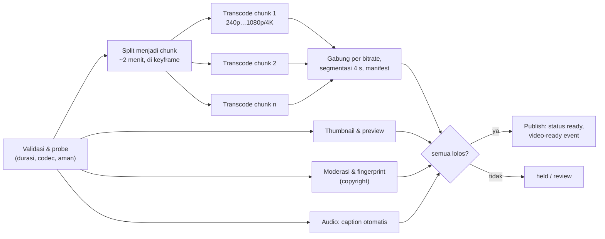

## 1. Requirements

Klarifikasi: video on demand saja atau live juga? Panjang maksimum? Resolusi sampai 4K? Rekomendasi termasuk? Monetisasi? Target perangkat (web, mobile, TV)?

### Functional

- Upload video (sampai beberapa GB) dengan judul/deskripsi; pemrosesan menjadi beberapa kualitas.
- Menonton dengan adaptive bitrate; mulai cepat; seek.
- Metadata: judul, channel, thumbnail, view count, like, komentar (dasar).
- Pencarian dan rekomendasi: out of scope (disebut sebagai integrasi).
- Out of scope: live streaming, DRM detail, monetisasi.

### Non-functional

| NFR              | Target                                                           | Alasan            |
| ---------------- | ---------------------------------------------------------------- | ----------------- |
| Startup playback | &lt; 1–2 s sampai frame pertama                                  | Penentu retensi   |
| Kelancaran       | Rebuffer &lt; 0.5% waktu tonton                                  | Adaptive bitrate  |
| Availability     | 99.99% playback                                                  | Produk inti       |
| Durability       | Video asli dan hasil tidak hilang                                | Konten kreator    |
| Skala            | 1 miliar jam tonton/hari, 500 jam upload/menit                   | Global            |
| Biaya            | Egress dan storage adalah biaya dominan; desain harus menekannya | Skala PB dan Tbps |

## 2. Estimasi kapasitas

Asumsi: 1 miliar jam tonton/hari; bitrate rata-rata 3 Mbps (campuran 480p–1080p); upload 500 jam/menit; asli 1080p ≈ 5 GB/jam; hasil transcode semua kualitas ≈ 2x asli.

- Tonton: 10^9 jam/hari = 3.6 × 10^12 detik tonton/hari; rata-rata 42 juta stream bersamaan; bandwidth keluar ≈ 42M × 3 Mbps ≈ **125 Tbps**. Tidak ada origin yang sanggup; CDN di ISP adalah keharusan.
- Upload: 500 jam/menit = 720.000 jam/hari × 5 GB ≈ 3.6 PB/hari asli; + 2x hasil ≈ **10 PB/hari**, ~4 EB/tahun. Tier penyimpanan (panas/dingin) dan kebijakan retensi kualitas tinggi untuk video sepi tontonan.
- Transcoding: 720.000 jam video/hari; bila 1 jam video butuh ~2 jam CPU-core untuk semua bitrate, ≈ 1.5 juta jam-core/hari ≈ 60.000 core terus-menerus. Paralel per chunk, antrian prioritas.
- Metadata: miliaran video × 1 KB ≈ TB; QPS metadata ≈ jutaan (setiap play + daftar); cache.
- View event: puluhan ribu/detik rata-rata, jutaan/detik puncak untuk video viral: stream + agregasi.

Keputusan: pipeline transcoding sebagai DAG terdistribusi, penyimpanan segmen di blob store dengan tier, CDN tingkat ISP, metadata di DB + cache, counter via stream.

## 3. API design

```text
POST /v1/videos/uploads       { title, size, mime }  → { videoId, multipart presigned URLs }
POST /v1/videos/{id}/complete → 202 { status: "processing" }
GET  /v1/videos/{id}          → { title, channel, duration, status, manifestUrl, thumbnails, stats }
GET  /v1/videos/{id}/manifest.m3u8  (via CDN; berisi daftar bitrate → playlist segmen)
GET  /cdn/{id}/{bitrate}/seg_{n}.ts (via CDN; segmen 4 detik)
POST /v1/videos/{id}/views    { sessionId, position }  → 202 (event, batched oleh client)
POST /v1/videos/{id}/like · GET /v1/videos/{id}/comments?cursor=
```

Playback adalah HTTP statis murni: manifest + segmen. Token tanda tangan di URL untuk kontrol akses (kedaluwarsa, geo) tanpa menyentuh server aplikasi per segmen.

## 4. Skema data

```sql
videos(id, channel_id, title, description, duration, status, created_at, visibility)   -- shard by id
video_renditions(video_id, bitrate, codec, resolution, manifest_key, segment_count, status)
video_stats(video_id, views, likes, comments)      -- counter teragregasi, diperbarui batch
channels(id, owner_id, name, subscriber_count)
comments(id, video_id, user_id, text, created_at)  -- shard by video_id
watch_events: stream (video_id, user/session, ts, position, bitrate, rebuffer)  -- analitik, rekomendasi, counter
```

Blob store: `orig/{video_id}` (tier dingin setelah transcode), `hls/{video_id}/{bitrate}/seg_{n}.ts`, `hls/{video_id}/master.m3u8`, `thumb/{video_id}/{n}.jpg`.

## 5. High-level design


**Alur upload**: multipart langsung ke blob → complete → job transcode dengan prioritas (channel besar, panjang video) → DAG menghasilkan rendition, segmen, manifest, thumbnail → status `ready`, event ke subscriber (notifikasi, index pencarian).

**Alur tonton**: client ambil metadata (cache) → manifest dari CDN → segmen bitrate rendah dulu untuk startup cepat → player mengukur throughput dan menaikkan bitrate → event tontonan dibatch ke stream.

## 6. Detailed design

### 6.1 Pipeline transcoding (DAG)



- **Paralel per chunk** memotong waktu dinding; bitrate rendah dipublikasikan lebih dulu (progresif) agar video bisa ditonton dalam menit, 4K menyusul.
- **Prioritas**: antrian berbeda untuk kreator besar, video pendek, dan backlog; worker pool dengan GPU untuk codec berat.
- **Idempotent**: output key deterministik; retry per tahap; DAG scheduler (lihat modul task scheduler) menyimpan status.
- **Per-title encoding**: pilih ladder bitrate per video berdasarkan kompleksitas (animasi vs olahraga) untuk menghemat byte dengan kualitas sama.
- Biaya: transcoding adalah biaya CPU terbesar; batch di luar jam sibuk untuk backlog, spot instance.

### 6.2 Penyajian: adaptive bitrate dan CDN

- HLS/DASH: master manifest → playlist per bitrate → segmen 2–6 detik. Player memulai dari bitrate rendah (startup cepat), mengukur throughput dan buffer, lalu beralih.
- CDN: segmen immutable dengan TTL panjang; video populer tersebar di semua edge; long-tail dari origin shield. Penyedia besar menaruh appliance cache **di dalam ISP** dan mengisinya di luar jam sibuk (pre-positioning) berdasarkan prediksi popularitas.
- Startup: manifest dan segmen pertama di-prefetch saat thumbnail terlihat (hover/scroll); segmen pertama lebih pendek.
- Kontrol akses: URL bertanda tangan dengan kedaluwarsa; DRM untuk konten berlisensi di luar scope.

### 6.3 Penyimpanan dan tier

- Hasil transcode video populer: tier panas; video dengan tontonan &lt; N/bulan: tier dingin, bitrate tinggi bisa dihapus dan dibuat ulang dari asli bila diminta (lazy re-transcode).
- Asli: tier arsip setelah transcode selesai.
- Erasure coding untuk semua tier besar; replikasi untuk manifest/thumbnail kecil yang panas.

### 6.4 Metadata dan view count

- Metadata di DB terpartisi by video_id, cache objek dengan TTL; halaman tontonan = beberapa multi-get.
- View count: client mengirim event tontonan (dibatch, dengan sesi) ke stream; aggregator menghitung per video per jendela setelah dedup/anti-fraud (satu sesi, durasi minimum), menulis delta ke `video_stats`; tampilan membaca cache yang diperbarui tiap beberapa detik. Untuk video viral, sharded counter di cache sebelum flush.
- Like/komentar seperti Instagram: tabel sumber kebenaran + counter turunan.

### 6.5 Notifikasi dan integrasi

`video-ready` ke pub-sub: notifikasi subscriber channel (fan-out seperti newsfeed), index pencarian via CDC, pipeline rekomendasi dari watch events.

## 7. Evaluasi terhadap non-functional requirements

| NFR                 | Dipenuhi oleh                                                                                                             | Risiko tersisa                                                                              |
| ------------------- | ------------------------------------------------------------------------------------------------------------------------- | ------------------------------------------------------------------------------------------- |
| Startup &lt; 2 s    | Bitrate rendah dulu, segmen pertama pendek, prefetch manifest, CDN edge dekat                                             | Video long-tail dari origin: startup lebih lambat; terima atau pre-warm untuk kreator besar |
| Rebuffer rendah     | Adaptive bitrate per segmen, ladder per-title                                                                             | Jaringan seluler buruk: bitrate terendah harus cukup rendah                                 |
| Availability 99.99% | CDN multi-edge, origin shield + blob multi-zona, metadata cache; degradasi: tetap bisa menonton meski stats/komentar mati | Kegagalan pipeline transcode menunda publish, bukan tontonan                                |
| Durability          | Blob erasure coded, asli diarsipkan, checksum                                                                             | Penghapusan sesuai kebijakan harus bisa diaudit                                             |
| Skala 125 Tbps      | CDN di ISP, pre-positioning                                                                                               | Biaya egress untuk long-tail                                                                |
| Biaya               | Tier storage, lazy re-transcode, per-title encoding, batch backlog                                                        | Keseimbangan kualitas vs byte butuh pengukuran terus                                        |

Bottleneck 10x: kapasitas transcoding (worker, GPU) dan egress CDN (kapasitas fisik di ISP); metadata horizontal. SPOF: DAG scheduler; jalankan redundan dengan lease.

## 8. Pertanyaan lanjutan interviewer

- "Live streaming?" → Ingest RTMP/SRT → transcoder real-time → segmen pendek (1–2 s) ke CDN dengan latency 5–15 s; low-latency HLS untuk lebih cepat; tidak ada DAG batch.
- "Bagaimana mencegah unggahan berhak cipta?" → Fingerprint audio/video di pipeline, cocokkan ke basis referensi, tahan/klaim.
- "Seek ke menit 40 pada video 2 jam?" → Manifest memberi segmen by waktu; player meminta segmen itu langsung; keyframe di batas segmen.
- "Pengguna dengan koneksi 200 kbps?" → Rendition audio-only / 144p; player turun otomatis.
- "Bagaimana memilih video mana yang di-pre-position ke ISP?" → Prediksi popularitas dari watch events (tren, upload kreator besar), diisi malam hari.
- "Metrik kesehatan playback?" → Startup time, rebuffer ratio, bitrate rata-rata, error rate per edge/ISP; alert per region.
