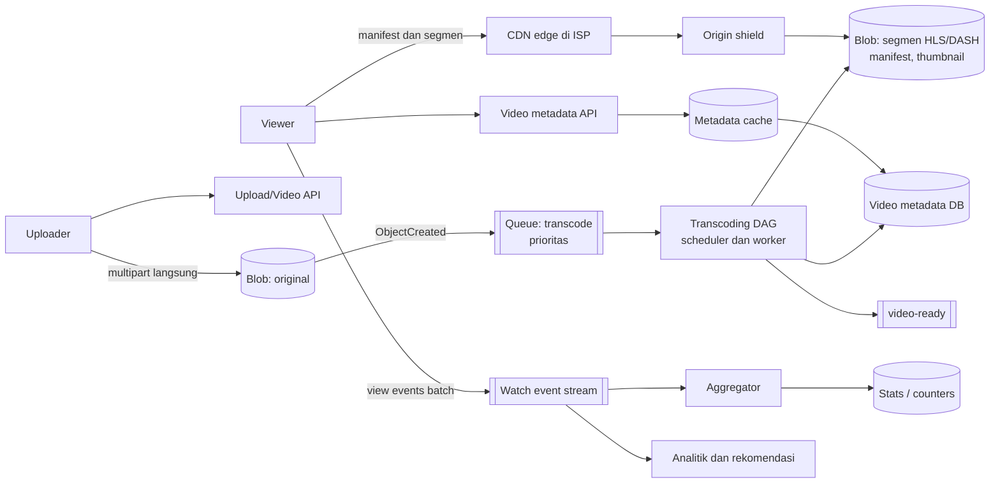
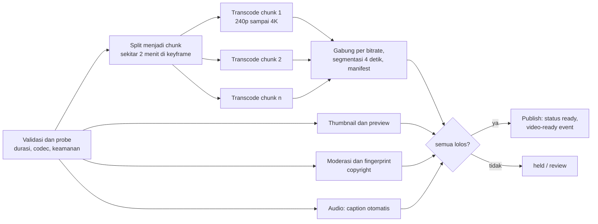

## 1. Requirements

Pertanyaan klarifikasi: video on demand saja atau juga siaran langsung? Berapa durasi maksimum? Resolusi sampai 4K? Apakah rekomendasi termasuk? Apakah ada monetisasi? Perangkat apa saja yang harus didukung?

### Functional

- Kreator mengunggah video sampai beberapa GB dengan judul dan deskripsi. Sistem memproses video menjadi beberapa kualitas.
- Penonton memutar video dengan kualitas yang menyesuaikan jaringan, mulai cepat, dan bisa melompat ke menit tertentu.
- Metadata: judul, channel, thumbnail, jumlah tayangan, like, dan komentar dasar.
- Di luar cakupan: pencarian dan rekomendasi hanya disebut sebagai integrasi. Siaran langsung, detail DRM, dan monetisasi tidak dibahas.

### Non-functional

| Target                | Nilai                                                       | Alasan                               |
| --------------------- | ----------------------------------------------------------- | ------------------------------------ |
| Waktu mulai pemutaran | Di bawah 1 sampai 2 detik sampai frame pertama              | Penentu apakah penonton bertahan     |
| Kelancaran            | Buffering di bawah 0.5% dari waktu tonton                   | Kualitas harus menyesuaikan jaringan |
| Availability          | 99.99% untuk pemutaran                                      | Produk inti                          |
| Durability            | Video asli dan hasil olahan tidak hilang                    | Konten milik kreator                 |
| Skala                 | 1 miliar jam tontonan per hari dan 500 jam upload per menit | Layanan global                       |
| Biaya                 | Egress dan storage adalah biaya dominan                     | Skala petabyte dan terabit per detik |

## 2. Estimasi kapasitas

Asumsi: 1 miliar jam tontonan per hari, bitrate rata-rata 3 Mbps, upload 500 jam per menit, dan video asli 1080p sekitar 5 GB per jam. Hasil transcode semua kualitas sekitar dua kali ukuran asli.

- Tontonan: 1 miliar jam per hari setara 3.6 triliun detik tontonan. Rata-rata ada 42 juta stream bersamaan.
- Bandwidth keluar: 42 juta dikali 3 Mbps berarti sekitar 125 Tbps. Tidak ada origin yang sanggup. CDN di dalam ISP adalah keharusan.
- Upload: 500 jam per menit berarti 720 ribu jam video per hari. Dikali 5 GB, itu 3.6 PB per hari untuk file asli. Dengan hasil transcode, totalnya sekitar 10 PB per hari atau 4 EB per tahun.
- Transcoding: satu jam video butuh sekitar dua jam waktu satu core untuk semua bitrate. Untuk 720 ribu jam video per hari, dibutuhkan sekitar 60 ribu core yang bekerja terus-menerus.
- Metadata: miliaran video dikali 1 KB berarti terabyte. Setiap pemutaran dan daftar membaca metadata, jadi cache wajib.
- Event tontonan: puluhan ribu per detik rata-rata, dan jutaan per detik saat ada video viral.

Keputusan dari angka ini: pipeline transcoding sebagai DAG terdistribusi, segmen disimpan di blob store dengan tingkatan harga, CDN sampai ke ISP, metadata di database dengan cache, dan counter lewat stream.

## 3. API design

```text
POST /v1/videos/uploads       { title, size, mime }  → { videoId, multipart presigned URLs }
POST /v1/videos/{id}/complete → 202 { status: "processing" }
GET  /v1/videos/{id}          → { title, channel, duration, status, manifestUrl, thumbnails, stats }
GET  /v1/videos/{id}/manifest.m3u8  (via CDN; daftar bitrate → playlist segmen)
GET  /cdn/{id}/{bitrate}/seg_{n}.ts (via CDN; segmen 4 detik)
POST /v1/videos/{id}/views    { sessionId, position }  → 202 (event, dibatch oleh client)
POST /v1/videos/{id}/like · GET /v1/videos/{id}/comments?cursor=
```

Pemutaran adalah HTTP statis murni: manifest dan segmen. Token bertanda tangan di URL mengatur akses tanpa menyentuh server aplikasi per segmen.

## 4. Skema data

```sql
videos(id, channel_id, title, description, duration, status, created_at, visibility)   -- shard by id
video_renditions(video_id, bitrate, codec, resolution, manifest_key, segment_count, status)
video_stats(video_id, views, likes, comments)      -- counter teragregasi, diperbarui batch
channels(id, owner_id, name, subscriber_count)
comments(id, video_id, user_id, text, created_at)  -- shard by video_id
watch_events: stream (video_id, user/session, ts, position, bitrate, rebuffer)  -- analitik, rekomendasi, counter
```

Tata letak blob store: `orig/{video_id}` untuk file asli yang dipindah ke tingkatan dingin setelah transcode, `hls/{video_id}/{bitrate}/seg_{n}.ts` untuk segmen, `hls/{video_id}/master.m3u8` untuk manifest, dan `thumb/{video_id}/{n}.jpg` untuk thumbnail.

## 5. High-level design



Alur upload:

1. Client mengunggah file langsung ke blob store dengan multipart presigned URL.
2. Client memanggil complete, dan API membuat job transcode dengan prioritas.
3. DAG menghasilkan rendition, segmen, manifest, dan thumbnail.
4. API menandai video `ready` dan menerbitkan event ke subscriber, seperti notifikasi dan index pencarian.

Alur tonton:

1. Client mengambil metadata dari cache.
2. Client mengambil manifest dari CDN.
3. Player memulai dari segmen bitrate rendah supaya cepat tampil.
4. Player mengukur throughput dan menaikkan bitrate per segmen.
5. Client mengirim event tontonan secara batch ke stream.

## 6. Detailed design

### 6.1 Pipeline transcoding sebagai DAG

DAG adalah rangkaian tugas dengan ketergantungan, di mana satu tugas baru jalan setelah tugas sebelumnya selesai.



- Paralel per potongan memangkas waktu tunggu. Bitrate rendah dipublikasikan lebih dulu, sehingga video bisa ditonton dalam menit dan 4K menyusul.
- Antrian prioritas dipisah untuk kreator besar, video pendek, dan tumpukan lama. Worker dengan GPU menangani codec berat.
- Setiap tahap idempotent, artinya aman diulang. Nama file hasil ditentukan dari awal, jadi pemrosesan ulang menimpa hasil yang sama.
- Kegagalan ditangani dengan pengulangan per tahap dan status `failed` yang terlihat kreator.
- Per-title encoding memilih daftar bitrate per video berdasarkan kompleksitas gambar. Animasi butuh byte lebih sedikit daripada olahraga.
- Transcoding adalah biaya CPU terbesar. Tumpukan lama dikerjakan di luar jam sibuk dengan instance murah.

### 6.2 Penyajian: adaptive bitrate dan CDN

HLS dan DASH adalah dua standar streaming lewat HTTP. Keduanya memakai manifest utama, playlist per bitrate, dan segmen 2 sampai 6 detik. Player memulai dari bitrate rendah agar cepat tampil, lalu mengukur throughput dan buffer sebelum beralih.

CDN menyimpan segmen sebagai file immutable dengan TTL panjang. Video populer tersebar di semua edge, sedangkan video sepi diambil dari origin shield. Origin shield adalah lapisan cache di depan blob store yang melindungi origin dari banyak miss sekaligus. Penyedia besar menaruh server cache di dalam ISP dan mengisinya di luar jam sibuk berdasarkan prediksi popularitas.

Untuk mempercepat mulai, client mengambil manifest dan segmen pertama saat thumbnail terlihat. Segmen pertama dibuat lebih pendek. Akses dikendalikan dengan URL bertanda tangan yang kedaluwarsa.

### 6.3 Penyimpanan dan tingkatan

- Hasil transcode video populer disimpan di tingkatan panas. Video dengan sedikit tontonan dipindah ke tingkatan dingin.
- Bitrate tinggi untuk video sepi bisa dihapus dan dibuat ulang dari file asli saat diminta.
- File asli diarsipkan setelah transcode selesai.
- Erasure coding dipakai untuk semua tingkatan besar. Erasure coding adalah cara menyimpan data dengan potongan paritas, sehingga hemat ruang dibanding salinan penuh. Manifest dan thumbnail yang kecil disalin biasa.

### 6.4 Metadata dan view count

Metadata disimpan di database yang dipartisi berdasarkan video_id, dengan cache objek ber-TTL. Satu halaman tontonan hanya butuh beberapa pembacaan cache.

View count memakai alur ini:

1. Client mengirim event tontonan secara batch dengan sesi.
2. Aggregator membuang duplikat dan tontonan curang, misalnya sesi yang terlalu singkat.
3. Aggregator menghitung per video per jendela waktu, lalu menulis delta ke `video_stats`.
4. Tampilan membaca cache yang diperbarui tiap beberapa detik.

Untuk video viral, cache memakai sharded counter sebelum ditulis ke database. Like dan komentar mengikuti pola Instagram: tabel sebagai sumber kebenaran, counter sebagai turunan.

### 6.5 Notifikasi dan integrasi

Event `video-ready` dikirim lewat pub-sub. Subscriber channel mendapat notifikasi dengan pola fan-out seperti newsfeed. Index pencarian diperbarui lewat CDC, yaitu aliran perubahan dari database. Pipeline rekomendasi memakai event tontonan.

## 7. Evaluasi terhadap non-functional requirements

| Target                 | Cara memenuhinya                                                                                         | Risiko yang tersisa                                                                 |
| ---------------------- | -------------------------------------------------------------------------------------------------------- | ----------------------------------------------------------------------------------- |
| Mulai di bawah 2 detik | Bitrate rendah dulu, segmen pertama pendek, manifest diambil lebih awal, CDN dekat penonton              | Video sepi diambil dari origin dan mulai lebih lambat. Pre-warm untuk kreator besar |
| Buffering rendah       | Bitrate menyesuaikan per segmen dan daftar bitrate per video                                             | Jaringan seluler buruk. Bitrate terendah harus cukup rendah                         |
| Availability 99.99%    | Banyak edge CDN, origin shield, blob multi-zona, cache metadata. Menonton tetap bisa walau komentar mati | Pipeline transcode yang gagal menunda publikasi, bukan tontonan                     |
| Durability             | Blob dengan erasure coding, asli diarsipkan, checksum                                                    | Penghapusan sesuai kebijakan harus bisa diaudit                                     |
| Skala 125 Tbps         | CDN di dalam ISP dan pengisian di luar jam sibuk                                                         | Biaya egress untuk video sepi                                                       |
| Biaya                  | Tingkatan storage, transcode ulang saat diminta, per-title encoding, tumpukan di luar jam sibuk          | Keseimbangan kualitas dan byte butuh pengukuran terus                               |

Kalau beban naik 10 kali, yang pecah duluan adalah kapasitas transcoding dan kapasitas fisik CDN di ISP. Metadata bisa ditambah horizontal. Scheduler DAG adalah titik lemah tunggal, jadi dijalankan redundan dengan lease.

## 8. Pertanyaan lanjutan interviewer

- "Bagaimana siaran langsung?" Ingest lewat RTMP atau SRT, transcoder real-time, dan segmen 1 sampai 2 detik ke CDN. Latency 5 sampai 15 detik, tanpa DAG batch.
- "Bagaimana mencegah unggahan berhak cipta?" Fingerprint audio dan video di pipeline, dicocokkan ke basis referensi, lalu ditahan atau diklaim.
- "Bagaimana melompat ke menit 40 pada video 2 jam?" Manifest memetakan waktu ke segmen. Player meminta segmen itu langsung, karena keyframe ada di batas segmen.
- "Bagaimana pengguna dengan koneksi 200 kbps?" Sediakan rendition audio saja atau 144p. Player turun otomatis.
- "Bagaimana memilih video yang ditaruh lebih awal di ISP?" Prediksi popularitas dari event tontonan, tren, dan unggahan kreator besar. Pengisian dilakukan malam hari.
- "Metrik apa yang dipantau untuk pemutaran?" Waktu mulai, rasio buffering, bitrate rata-rata, dan tingkat error per edge dan ISP. Alert per region.
