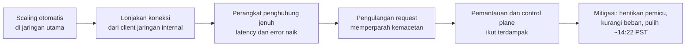

## Tujuan belajar

Setelah pelajaran ini kamu bisa:

- Menjelaskan bagaimana badai pengulangan request dan dependensi internal mengubah gangguan kecil menjadi outage berjam-jam.
- Mengenali tiga pola dari tiga laporan AWS: pemantauan yang ikut sakit, alat operasional tanpa pengaman, dan batas tersembunyi pada arsitektur semua-ke-semua.
- Memakai pola itu untuk menjawab "bagaimana sistemmu bertahan saat dependency internal sakit?".

Catatan: ringkasan ditulis ulang dari laporan resmi AWS. Baca laporan asli untuk kronologi menit demi menit.

## Konteks sistem

Region us-east-1 adalah region AWS terbesar dan tertua. Di dalamnya ada dua jaringan. Jaringan utama menampung layanan pelanggan seperti EC2. Jaringan internal menampung layanan fondasi: pemantauan, DNS internal, otorisasi, control plane, dan bagian dari layanan seperti Kinesis.

Keduanya dihubungkan perangkat jaringan dengan kapasitas tertentu. Banyak layanan AWS bergantung secara tidak langsung pada jaringan internal itu.

## Kronologi 7 Desember 2021

1. Sekitar pukul 07:30 PST, aktivitas scaling otomatis untuk satu layanan berjalan di jaringan utama.
2. Banyak client di jaringan internal berperilaku tak terduga dan membuka koneksi dalam jumlah besar.
3. Perangkat penghubung antara jaringan internal dan utama menjadi jenuh. Latency dan error naik.
4. Client melakukan pengulangan request, yang memperparah kemacetan.
5. Pemantauan internal, DNS internal, control plane, dan sejumlah layanan pelanggan ikut terdampak.
6. Tim kehilangan dashboard dan harus mendiagnosis lewat log manual. Halaman status lambat diperbarui.
7. Tim menonaktifkan aktivitas scaling pemicu dan mengurangi beban. Trafik pulih sekitar pukul 14:22 PST.
8. Backlog diproses dan layanan pulih bertahap.

Istilah yang perlu kamu pegang. Congestive collapse adalah keadaan ketika pengulangan request justru membuat jaringan makin macet. Control plane adalah bagian yang mengatur dan mengonfigurasi, bukan yang melayani trafik pelanggan.

## Akar masalah

| Lapisan                | Apa yang terjadi                                                                 | Pelajaran                                                                                                   |
| ---------------------- | -------------------------------------------------------------------------------- | ----------------------------------------------------------------------------------------------------------- |
| Umpan balik positif    | Latency memicu timeout, timeout memicu pengulangan, pengulangan menambah koneksi | Pengulangan harus memakai jeda yang membesar dengan unsur acak, punya jatah, dan berhenti saat sistem sakit |
| Kapasitas penghubung   | Perangkat antara dua jaringan menjadi bottleneck tunggal                         | Kapasitas dan isolasi antar jaringan harus diuji untuk skenario lonjakan koneksi                            |
| Dependensi tersembunyi | Layanan pelanggan bergantung tidak langsung pada jaringan internal               | Peta dependensi harus ada, dan jalur kritis mengurangi hop ke jaringan internal                             |
| Pemantauan ikut sakit  | Dashboard dan alat deploy berada di jaringan yang sakit                          | Pemantauan dan alat pemulihan butuh jalur terpisah                                                          |
| Komunikasi             | Halaman status bergantung pada alat yang terdampak                               | Kanal komunikasi insiden harus independen                                                                   |

## Dua insiden pembanding

S3, 28 Februari 2017. Saat men-debug sistem billing, operator menjalankan perintah untuk menghapus sejumlah kecil server. Input yang salah menghapus lebih banyak, termasuk server subsistem index dan placement S3 di region itu. Keduanya harus di-restart penuh. Restart seperti itu belum pernah dilakukan selama bertahun-tahun di skala yang jauh lebih besar, sehingga pemulihan memakan jam. Dashboard status AWS sendiri bergantung pada S3 dan tidak bisa menampilkan status dengan benar. Perbaikannya: alat yang membatasi laju dan kapasitas minimum, subsistem dipecah menjadi sel kecil agar restart lebih cepat, dan dependensi halaman status dipisahkan.

Kinesis, 25 November 2020. Penambahan kapasitas kecil ke armada front-end Kinesis membuat jumlah thread per server melewati batas sistem operasi. Setiap server membuka satu thread ke setiap server lain untuk berbagi informasi shard. Server gagal membangun peta cluster, request gagal, dan layanan yang bergantung seperti Cognito, CloudWatch, dan Lambda terdampak selama belasan jam. Pemulihan memerlukan restart bertahap yang lambat. Perbaikannya: batas dinaikkan, thread per server dikurangi, server dikelompokkan ke sel yang lebih kecil, dan fungsi pembangunan peta cluster dipindah keluar dari front-end.

## Pola yang bisa dipetik

1. Pengulangan request adalah bahan bakar outage. Setiap client memakai jeda yang membesar dengan unsur acak, membatasi jumlah pengulangan, dan berhenti saat sistem jelas sakit.
2. Pemantauan dan alat pemulihan tidak boleh ikut sakit bersama sistem yang diamati. Sediakan jalur terpisah untuk dashboard, deploy, dan komunikasi.
3. Batas tersembunyi ada di mana-mana: thread, file descriptor, tabel koneksi. Ketahui, uji, dan rancang agar beban per node tidak tumbuh sebanding ukuran armada.
4. Alat operasional butuh pengaman: kapasitas minimum, batas laju perubahan, dan konfirmasi untuk tindakan destruktif. Salah ketik pasti terjadi.
5. Latih pemulihan di skala nyata. Restart penuh subsistem besar dan failover region harus pernah dicoba.
6. Kelompokkan layanan ke sel independen agar kegagalan dan pemulihan dibatasi.
7. Komunikasi insiden adalah bagian dari sistem. Halaman status harus hidup saat produk mati.

## Hubungannya dengan building block

| Building block               | Pelajaran dari insiden                                                                        |
| ---------------------------- | --------------------------------------------------------------------------------------------- |
| Abstraksi distributed system | Timeout dan pengulangan yang benar. Node yang lambat lebih berbahaya daripada node yang mati  |
| Monitoring                   | Pemantauan untuk pemantauan, dashboard di jalur terpisah, dan alert saat data berhenti datang |
| Key-value store dan cluster  | Komunikasi semua-ke-semua tidak skalabel. Pakai gossip terbatas dan sel                       |
| Deployment dan operasi       | Pengaman pada alat, scaling bertahap, dan pengujian batas                                     |

## Pertanyaan yang sering ditanya interviewer

- "Dependency kamu mulai lambat, bukan mati. Apa yang terjadi?" Jawab dengan timeout singkat, circuit breaker, penolakan sebagian beban, dan pengulangan yang berjatah.
- "Bagaimana kamu memantau sistem bila jaringan internal sakit?" Jawab dengan pemantauan di jalur terpisah, agregasi di region lain, dan sinyal dari luar.
- "Apa batas tersembunyi di desainmu?" Sebut koneksi per node, ukuran tabel routing, kuota API penyedia, dan cara mengujinya.
- "Bagaimana melindungi dari kesalahan operator?" Jawab dengan pengaman pada alat, dry-run, persetujuan dua orang, dan rollback cepat.

## Ringkasan

1. Pada Desember 2021, badai koneksi dan pengulangan request menjenuhkan penghubung jaringan internal us-east-1. Pemantauan ikut mati, sehingga pemulihan memakan jam.
2. S3 2017 dan Kinesis 2020 menambahkan pelajaran tentang pengaman alat operasional, restart yang dilatih, dan batas tersembunyi pada arsitektur semua-ke-semua.
3. Polanya: pengulangan yang disiplin, pemantauan di jalur terpisah, batas yang diketahui, sel yang independen, dan latihan pemulihan di skala nyata.
