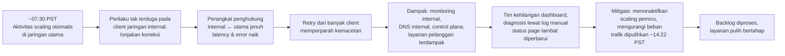

## Tujuan belajar

Setelah pelajaran ini kamu bisa:

- Menjelaskan bagaimana retry storm dan dependensi internal mengubah gangguan kecil menjadi outage region selama berjam-jam.
- Mengenali tiga pola dari tiga laporan AWS: observability yang berbagi nasib (2021), guardrail alat operasional dan restart yang tidak pernah dilatih (2017), batas tersembunyi pada arsitektur fan-out penuh (2020).
- Memakai pola itu untuk menjawab "bagaimana sistemmu bertahan saat dependency internal sakit?".

Catatan: ringkasan ditulis ulang dari laporan resmi AWS; baca laporan asli untuk kronologi menit demi menit.

## Konteks sistem

Region us-east-1 adalah region AWS terbesar dan tertua. Di dalamnya ada **jaringan utama** (tempat layanan pelanggan seperti EC2 berjalan) dan **jaringan internal** yang menampung layanan fondasi: pemantauan, DNS internal, otorisasi, control plane, dan bagian dari layanan seperti Kinesis. Keduanya dihubungkan perangkat jaringan dengan kapasitas tertentu. Banyak layanan AWS (dan pelanggan) bergantung secara transitif pada jaringan internal itu.

## Kronologi (7 Desember 2021, ringkas)

- Pemicu: aktivitas scaling otomatis untuk satu layanan di jaringan utama membuat banyak client di jaringan internal berperilaku tak terduga dan membuka koneksi dalam jumlah besar.
- Perangkat jaringan penghubung kewalahan; latency dan packet loss meningkat; client melakukan **retry**, menambah beban: congestive collapse.
- Karena pemantauan dan alat internal ikut berjalan di jaringan internal, tim **kehilangan visibilitas** dan kesulitan menerapkan perbaikan; komunikasi ke pelanggan (status page) tertunda karena alatnya pun terdampak.
- Pemulihan dengan menghentikan sumber beban dan membiarkan jaringan pulih, lalu backlog diproses.

## Akar masalah

| Lapisan                     | Apa yang terjadi                                              | Pelajaran                                                                                                       |
| --------------------------- | ------------------------------------------------------------- | --------------------------------------------------------------------------------------------------------------- |
| Umpan balik positif         | Latency → timeout → retry → koneksi bertambah                 | Backoff eksponensial + jitter, retry budget, circuit breaker; retry harus menurun saat sistem sakit, bukan naik |
| Kapasitas penghubung        | Perangkat antara dua jaringan menjadi bottleneck tunggal      | Kapasitas dan isolasi antar jaringan; pengujian beban skenario lonjakan koneksi                                 |
| Dependensi tersembunyi      | Layanan pelanggan bergantung transitif pada jaringan internal | Peta dependensi; mengurangi hop ke jaringan internal di jalur kritis                                            |
| Observability berbagi nasib | Dashboard/alat deploy di jaringan yang sakit                  | Pemantauan dan alat pemulihan di jalur terpisah (out-of-band)                                                   |
| Komunikasi                  | Status page bergantung pada alat yang terdampak               | Jalur komunikasi insiden yang independen                                                                        |

## Dua insiden pembanding

**S3, 28 Februari 2017.** Saat men-debug sistem billing, operator menjalankan perintah untuk menghapus sejumlah kecil server; input yang salah menghapus lebih banyak, termasuk server subsistem index dan placement S3 di region itu. Keduanya harus di-restart penuh, sesuatu yang belum pernah dilakukan selama bertahun-tahun di skala yang jauh lebih besar, sehingga pemulihan memakan jam. Dashboard status AWS sendiri bergantung pada S3 sehingga tidak bisa menampilkan status dengan benar. Perbaikan: alat yang membatasi laju dan minimum kapasitas, memecah subsistem menjadi sel lebih kecil agar restart lebih cepat, dan memisahkan dependensi status page.

**Kinesis, 25 November 2020.** Penambahan kapasitas kecil ke armada front-end Kinesis membuat jumlah thread per server (satu per server lain, untuk berbagi informasi shard) melewati batas sistem operasi. Server gagal membangun peta cluster, request gagal, dan layanan yang bergantung (Cognito, CloudWatch, Lambda, dan lainnya) terdampak selama belasan jam karena pemulihan memerlukan restart bertahap yang lambat. Perbaikan: menaikkan batas, mengurangi thread per server, cellularization (membatasi jumlah server yang saling berkomunikasi), dan memindahkan fungsi pembangunan peta cluster keluar dari front-end.

## Pola yang bisa dipetik

1. **Retry adalah bahan bakar outage.** Setiap client harus memakai backoff + jitter, membatasi retry (budget), dan berhenti saat sistem jelas sakit; server harus bisa load-shed.
2. **Pemantauan dan alat pemulihan tidak boleh berbagi nasib dengan sistem yang diamati.** Jalur out-of-band untuk dashboard, deploy, dan komunikasi.
3. **Batas tersembunyi ada di mana-mana** (thread, file descriptor, tabel koneksi). Ketahui, uji, dan rancang agar skala per node tidak O(N) terhadap ukuran armada.
4. **Alat operasional butuh guardrail.** Minimum kapasitas, laju perubahan, konfirmasi untuk tindakan destruktif; salah ketik akan terjadi.
5. **Latih pemulihan di skala nyata.** Restart penuh subsistem besar, failover region, dan game day; waktu pemulihan yang belum pernah diukur adalah risiko.
6. **Cellularization dan isolasi.** Pecah layanan menjadi sel independen agar kegagalan dan pemulihan dibatasi; kurangi dependensi transitif pada layanan fondasi di jalur kritis.
7. **Komunikasi insiden adalah bagian sistem.** Status page dan kanal pelanggan harus hidup saat produk mati.

## Hubungannya dengan building block

| Building block               | Pelajaran dari insiden                                                                               |
| ---------------------------- | ---------------------------------------------------------------------------------------------------- |
| Abstraksi distributed system | Timeout dan retry yang benar; kegagalan abu-abu (latency tinggi) lebih berbahaya daripada mati total |
| Monitoring                   | Meta-monitoring dan dashboard di jalur terpisah; alert "no data"                                     |
| Key-value store / cluster    | Komunikasi semua-ke-semua tidak skalabel; gossip terbatas, sel                                       |
| Deployment / operasi         | Guardrail alat, scaling bertahap, pengujian batas                                                    |

## Pertanyaan yang sering ditanya interviewer

- "Dependency kamu mulai lambat, bukan mati. Apa yang terjadi di sistemmu?" → Timeout singkat, circuit breaker, load shedding, fallback terbatas; retry dengan budget.
- "Bagaimana kamu memantau sistem bila jaringan internal sakit?" → Pemantauan out-of-band, agregasi di region lain, sinyal sintetis dari luar.
- "Apa batas tersembunyi di desainmu?" → Sebut koneksi/thread per node, ukuran tabel routing, kuota API penyedia, dan cara mengujinya.
- "Bagaimana melindungi dari kesalahan operator?" → Guardrail alat, dry-run, two-person rule untuk tindakan destruktif, rollback cepat.

## Ringkasan

1. Desember 2021: badai koneksi dan retry menjenuhkan penghubung jaringan internal us-east-1; pemantauan dan alat pemulihan ikut mati sehingga pemulihan memakan jam.
2. S3 2017 dan Kinesis 2020 menambahkan guardrail alat operasional, restart yang dilatih, dan batas tersembunyi pada arsitektur fan-out penuh.
3. Pola: retry yang disiplin, observability dan komunikasi out-of-band, batas yang diketahui dan diuji, cellularization, serta latihan pemulihan di skala nyata.
