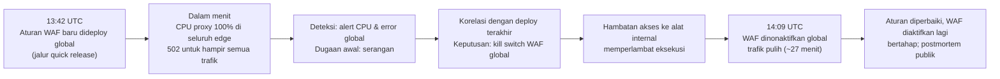

## Tujuan belajar

Setelah pelajaran ini kamu bisa:

- Menceritakan kronologi insiden 2 Juli 2019 dan mengidentifikasi dua faktor yang saling memperkuat (cacat + mekanisme distribusi).
- Menjelaskan kenapa konfigurasi harus diperlakukan sebagai kode, dan apa itu catastrophic backtracking.
- Menyebut pola yang berulang di tiga insiden Cloudflare (2019, 2022, 2023) dan memakainya sebagai jawaban "apa yang bisa salah?" di interview.

Catatan: ringkasan di bawah ditulis ulang dari postmortem resmi Cloudflare yang tercantum di sumber. Untuk detail waktu dan angka, baca laporan aslinya.

## Konteks sistem

Cloudflare adalah reverse proxy global: request pengguna ke jutaan situs melewati edge Cloudflare di ratusan kota. Di setiap edge, proxy HTTP menjalankan Web Application Firewall (WAF) yang mencocokkan request terhadap ribuan aturan, banyak di antaranya berbasis regex. Aturan WAF adalah konfigurasi yang sering diperbarui untuk merespons ancaman baru, sehingga ada jalur deploy cepat ke seluruh dunia.

## Kronologi (2 Juli 2019, ringkas)

- Aturan baru berisi regex yang, pada input tertentu, melakukan **catastrophic backtracking**: mesin regex mencoba kombinasi eksponensial sebelum menyerah. Pada mesin regex yang backtracking, pola seperti `(.*.*=.*)` dapat memakan waktu super-linear terhadap panjang input.
- Karena WAF berjalan pada setiap request di setiap mesin, dan aturan disebarkan global dalam detik, seluruh armada kehabisan CPU hampir bersamaan.
- Pemulihan dilakukan dengan mematikan WAF secara global, lalu memperbaiki aturan dan menyalakan kembali.

## Akar masalah

| Lapisan              | Apa yang terjadi                             | Kenapa bisa                                                                            |
| -------------------- | -------------------------------------------- | -------------------------------------------------------------------------------------- |
| Cacat                | Regex dengan backtracking eksponensial       | Tidak ada uji kinerja/waktu eksekusi untuk aturan; mesin regex tanpa batas langkah     |
| Distribusi           | Deploy global seketika                       | Jalur "quick release" untuk aturan darurat melewati rollout bertahap yang dipakai kode |
| Perlindungan runtime | Proxy tidak membatasi CPU per aturan/request | Tidak ada pengaman sumber daya per komponen                                            |
| Pemulihan            | Kill switch lambat dicapai                   | Alat internal/akses terdampak; prosedur darurat tidak cukup dilatih                    |

Catatan dari laporan: beberapa tahun sebelumnya ada lapisan proteksi CPU yang sudah dihapus karena dianggap tidak diperlukan lagi; hilangnya pengaman lama adalah faktor yang sering tidak terlihat sampai dibutuhkan.

## Dua insiden pembanding

**21 Juni 2022.** Perubahan konfigurasi BGP untuk kebijakan prefix dideploy ke 19 datacenter dengan arsitektur jaringan baru yang kebetulan melayani sebagian besar trafik. Urutan perubahan membuat prefix ditarik sebelum diiklankan kembali, sehingga datacenter itu "menghilang" dari internet sekitar 1.5 jam sampai perubahan dibatalkan. Pelajaran: perubahan jaringan pun perlu rollout bertahap dan dry-run; datacenter "kecil" lebih dulu, bukan yang tersibuk.

**2 November 2023.** Kegagalan daya di satu datacenter core (dioperasikan pihak ketiga) menjatuhkan control plane, dashboard, API, dan analitik selama hampir dua hari, meskipun data plane (edge) terus melayani trafik. Control plane dirancang high-availability lintas tiga datacenter, tetapi sejumlah layanan dan dependensinya ternyata hanya hidup di satu lokasi, dan proses disaster recovery belum pernah diuji dengan skenario kehilangan satu lokasi penuh. Pelajaran: dependensi tersembunyi dan DR yang tidak dilatih.

## Pola yang bisa dipetik

1. **Konfigurasi adalah kode.** Aturan, regex, kebijakan BGP, flag: semuanya mengubah perilaku produksi dan butuh uji, canary, dan rollback.
2. **Blast radius dibatasi oleh mekanisme, bukan niat.** Rollout bertahap (persentase, datacenter kecil dulu) harus menjadi satu-satunya jalur, termasuk untuk perubahan "darurat"; jalur cepat tetap melewati canary singkat.
3. **Batasi sumber daya per komponen.** Timeout/langkah maksimum untuk regex, CPU budget per modul, sehingga satu cacat mendegradasi satu fitur, bukan seluruh proses.
4. **Rem darurat harus independen dan dilatih.** Kill switch, akses out-of-band, kredensial break-glass, diuji berkala saat tidak ada insiden.
5. **Pengaman lama jangan dihapus tanpa pengganti.** Lapisan proteksi yang "tidak pernah terpakai" mungkin justru sedang bekerja.
6. **Asumsi ketersediaan harus diuji dengan mematikan sesuatu.** Game day: matikan satu datacenter/lokasi dan lihat apa yang ikut mati.

## Hubungannya dengan building block

| Building block                | Pelajaran dari insiden                                                             |
| ----------------------------- | ---------------------------------------------------------------------------------- |
| Deployment system             | Canary dengan analisis otomatis (CPU, error) untuk konfigurasi, bukan hanya binary |
| Load balancer / edge          | Health check yang mendeteksi "hidup tapi sakit" (CPU jenuh) dan mengeluarkan node  |
| Monitoring                    | Korelasi alert dengan deploy terakhir; dashboard yang tetap hidup saat produk mati |
| Rate limiter / resource limit | Batas eksekusi per aturan sebagai rate limiter sumber daya                         |

## Pertanyaan yang sering ditanya interviewer

- "Bagaimana kamu mencegah satu perubahan konfigurasi menjatuhkan semuanya?" → Rollout bertahap wajib, canary, batas sumber daya per komponen.
- "Bagaimana mendeteksi bahwa deploy yang menyebabkan masalah?" → Korelasi otomatis event deploy dengan metrik; rollback otomatis saat gate gagal.
- "Alat pemulihanmu bergantung pada apa?" → Petakan dependensi; sediakan jalur out-of-band.
- "Apa yang akan kamu lakukan dalam 5 menit pertama outage global?" → Hentikan perubahan terbaru (rollback dulu, tanya kemudian), komunikasi, lalu diagnosis.

## Ringkasan

1. Insiden 2019: regex backtracking memakan 100% CPU dan deploy global seketika membuat seluruh edge jatuh dalam menit; pemulihan 27 menit lewat kill switch yang sulit dicapai.
2. Akar masalahnya bukan satu bug, melainkan bug + distribusi tanpa tahap + tanpa batas sumber daya + rem darurat yang tidak independen.
3. Pola lintas tiga insiden Cloudflare: konfigurasi adalah kode, blast radius dibatasi mekanisme, dependensi dan DR harus diuji dengan mematikan sesuatu.
