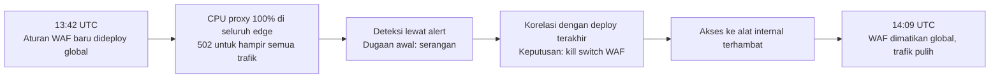

## Tujuan belajar

Setelah pelajaran ini kamu bisa:

- Menceritakan kronologi insiden 2 Juli 2019 dan menunjuk dua faktor yang saling memperkuat.
- Menjelaskan kenapa konfigurasi harus diperlakukan sebagai kode, dan apa itu catastrophic backtracking.
- Menyebut pola yang berulang di tiga insiden Cloudflare dan memakainya untuk menjawab "apa yang bisa salah?".

Catatan: ringkasan di bawah ditulis ulang dari postmortem resmi Cloudflare yang tercantum di sumber. Untuk detail waktu dan angka, baca laporan aslinya.

## Konteks sistem

Cloudflare adalah reverse proxy global. Request pengguna ke jutaan situs melewati edge Cloudflare di ratusan kota. Edge adalah server yang paling dekat dengan pengguna.

Di setiap edge, proxy HTTP menjalankan Web Application Firewall, disingkat WAF. WAF mencocokkan request terhadap ribuan aturan, dan banyak aturan itu berbasis regex. Aturan WAF sering diperbarui untuk merespons ancaman baru, sehingga ada jalur deploy cepat ke seluruh dunia.

## Kronologi 2 Juli 2019

1. Pukul 13:42 UTC, tim mendeploy aturan WAF baru ke seluruh edge lewat jalur rilis cepat.
2. Dalam hitungan menit, CPU proxy mencapai 100% di seluruh edge. Hampir semua trafik mendapat error 502.
3. Alert CPU dan error global menyala. Dugaan awal tim adalah serangan.
4. Tim mengaitkan gejala dengan deploy terakhir dan memutuskan mematikan WAF secara global.
5. Akses ke alat internal untuk menerapkan kill switch terhambat, sehingga eksekusi tertunda.
6. Pukul 14:09 UTC, WAF dinonaktifkan global dan trafik pulih. Total gangguan sekitar 27 menit.
7. Aturan diperbaiki, WAF dinyalakan kembali bertahap, dan postmortem dipublikasikan.

Apa yang terjadi di dalam regex? Aturan baru berisi pola yang memicu catastrophic backtracking. Mesin regex mencoba kombinasi yang jumlahnya tumbuh eksponensial sebelum menyerah. Pola seperti dua titik-bintang berurutan bisa memakan waktu yang meledak terhadap panjang input.

WAF berjalan pada setiap request di setiap mesin. Aturan disebarkan ke seluruh dunia dalam detik. Akibatnya seluruh armada kehabisan CPU hampir bersamaan.

## Akar masalah

| Lapisan                    | Apa yang terjadi                       | Kenapa bisa terjadi                                                                      |
| -------------------------- | -------------------------------------- | ---------------------------------------------------------------------------------------- |
| Cacat                      | Regex dengan backtracking eksponensial | Tidak ada uji waktu eksekusi untuk aturan, dan mesin regex tidak punya batas langkah     |
| Distribusi                 | Deploy global seketika                 | Jalur rilis cepat untuk aturan darurat melewati rollout bertahap yang dipakai untuk kode |
| Perlindungan saat berjalan | Proxy tidak membatasi CPU per aturan   | Tidak ada pengaman sumber daya per komponen                                              |
| Pemulihan                  | Kill switch lambat dicapai             | Alat internal ikut terdampak dan prosedur darurat kurang dilatih                         |

Satu catatan dari laporan resmi. Beberapa tahun sebelumnya ada lapisan proteksi CPU yang dihapus karena dianggap tidak diperlukan lagi. Hilangnya pengaman lama sering tidak terasa sampai hari ia dibutuhkan.

## Dua insiden pembanding

Insiden 21 Juni 2022. Tim mendeploy perubahan konfigurasi BGP untuk kebijakan prefix ke 19 datacenter dengan arsitektur jaringan baru. BGP adalah protokol yang mengumumkan alamat IP sebuah jaringan ke seluruh internet. Kebetulan 19 datacenter itu melayani sebagian besar trafik. Urutan perubahan membuat prefix ditarik sebelum diumumkan kembali, sehingga datacenter itu menghilang dari internet selama sekitar 1.5 jam. Pelajarannya: perubahan jaringan juga perlu rollout bertahap, dan datacenter kecil harus lebih dulu daripada yang tersibuk.

Insiden 2 November 2023. Kegagalan daya di satu datacenter inti yang dioperasikan pihak ketiga menjatuhkan control plane, dashboard, API, dan analitik selama hampir dua hari. Control plane adalah bagian yang mengatur konfigurasi, sedangkan data plane adalah bagian yang melayani trafik. Data plane di edge terus berjalan. Control plane dirancang tersedia tinggi lintas tiga datacenter, tetapi sejumlah layanan ternyata hanya hidup di satu lokasi. Proses pemulihan bencana belum pernah diuji dengan skenario kehilangan satu lokasi penuh. Pelajarannya: dependensi tersembunyi dan latihan pemulihan yang tidak pernah dijalankan.

## Pola yang bisa dipetik

1. Konfigurasi adalah kode. Aturan, regex, kebijakan BGP, dan flag mengubah perilaku produksi. Semuanya butuh uji, canary, dan rollback.
2. Dampak dibatasi oleh mekanisme, bukan oleh niat. Rollout bertahap harus menjadi satu-satunya jalur, termasuk untuk perubahan darurat.
3. Batasi sumber daya per komponen. Beri batas langkah untuk regex dan jatah CPU per modul, supaya satu cacat hanya melumpuhkan satu fitur.
4. Rem darurat harus independen dan dilatih. Kill switch, akses cadangan, dan kredensial darurat diuji berkala saat tidak ada insiden.
5. Jangan menghapus pengaman lama tanpa pengganti. Lapisan proteksi yang tidak pernah terpakai mungkin justru sedang bekerja.
6. Uji asumsi ketersediaan dengan mematikan sesuatu. Matikan satu datacenter saat latihan dan lihat apa yang ikut mati.

## Hubungannya dengan building block

| Building block         | Pelajaran dari insiden                                                             |
| ---------------------- | ---------------------------------------------------------------------------------- |
| Deployment system      | Canary dengan analisis otomatis berlaku untuk konfigurasi, bukan hanya binary      |
| Load balancer dan edge | Health check harus mendeteksi node yang hidup tetapi sakit, lalu mengeluarkannya   |
| Monitoring             | Alert dikaitkan dengan deploy terakhir, dan dashboard tetap hidup saat produk mati |
| Rate limiter           | Batas eksekusi per aturan adalah rate limiter untuk sumber daya                    |

## Pertanyaan yang sering ditanya interviewer

- "Bagaimana kamu mencegah satu perubahan konfigurasi menjatuhkan semuanya?" Jawab dengan rollout bertahap yang wajib, canary, dan batas sumber daya per komponen.
- "Bagaimana kamu tahu deploy yang menyebabkan masalah?" Jawab dengan korelasi otomatis antara event deploy dan metrik, lalu rollback otomatis saat gate gagal.
- "Alat pemulihanmu bergantung pada apa?" Petakan dependensinya dan sediakan jalur cadangan yang terpisah.
- "Apa yang kamu lakukan dalam lima menit pertama outage global?" Hentikan perubahan terbaru dulu, lalu komunikasi, baru diagnosis.

## Ringkasan

1. Pada 2019, regex yang boros CPU dan deploy global seketika menjatuhkan seluruh edge dalam menit. Pemulihan memakan 27 menit karena kill switch sulit dicapai.
2. Akar masalahnya berlapis: cacat, distribusi tanpa tahap, tanpa batas sumber daya, dan rem darurat yang tidak independen.
3. Tiga insiden Cloudflare mengajarkan hal yang sama. Konfigurasi adalah kode, dampak dibatasi mekanisme, dan dependensi harus diuji dengan mematikan sesuatu.
