## Tujuan belajar

Setelah pelajaran ini kamu bisa:

- Menjelaskan rantai kejadian 4 Oktober 2021: perintah backbone → BGP ditarik → DNS menarik diri → akses pemulihan hilang → pemulihan bertahap.
- Mengkritisi desain health check "menarik diri bila tidak sehat" dan menyebut kapan ia menjadi bencana.
- Menjelaskan kenapa akses out-of-band dan rencana cold start adalah requirement, bukan opsi.

Catatan: ringkasan ditulis ulang dari postmortem resmi Meta dan analisis publik Cloudflare; baca sumber untuk detailnya.

## Konteks sistem

Datacenter Facebook di seluruh dunia terhubung lewat **backbone** jaringan global milik sendiri. Ke dunia luar, Facebook mengiklankan prefix IP-nya lewat **BGP** dari titik-titik peering. Server **DNS authoritative** Facebook tersebar di banyak lokasi kecil (PoP) dan berada di prefix yang diiklankan lewat BGP juga. Untuk menjaga agar pengguna tidak diarahkan ke PoP yang tidak sehat, server DNS memantau konektivitasnya ke datacenter dan **menarik iklan BGP** prefix-nya bila konektivitas itu hilang.

## Kronologi (4 Oktober 2021, ringkas)

```mermaid
flowchart LR
  A["Pemeliharaan rutin backbone\nperintah menilai kapasitas global"] --> B["Perintah secara tak sengaja\nmemutus semua koneksi backbone\n(alat audit gagal menangkap)"]
  B --> C["Datacenter terputus satu sama lain\ndan dari internet"]
  C --> D["Server DNS tidak bisa mencapai\ndatacenter → menarik prefix BGP\n(by design)"]
  D --> E["facebook.com, instagram.com,\nwhatsapp.com tidak bisa di-resolve\ndi seluruh dunia"]
  E --> F["Alat akses jarak jauh ke perangkat\njaringan ikut hilang → tim harus\nhadir fisik di datacenter"]
  F --> G["Konfigurasi dipulihkan bertahap\nmenghindari lonjakan daya & trafik"]
  G --> H["~6 jam: layanan kembali,\npostmortem publik"]
```

- Perintah yang dimaksud untuk menilai kapasitas backbone malah menjatuhkan semua koneksi backbone; alat audit yang seharusnya mencegah perintah berbahaya mengandung bug.
- Dengan backbone putus, server DNS di PoP kehilangan konektivitas ke datacenter dan, sesuai rancangan, menarik iklan BGP prefix DNS. Dalam hitungan menit, domain Facebook lenyap dari DNS global.
- Resolver di seluruh dunia mencoba lagi berulang kali (lonjakan query), aplikasi pihak ketiga yang memakai SDK/login Facebook terganggu.
- Insinyur tidak bisa mengakses perangkat jaringan dari jarak jauh karena alat akses bergantung pada jaringan yang sama; perlu kehadiran fisik, dengan prosedur keamanan fisik yang memperlambat.
- Pemulihan dilakukan bertahap untuk menghindari kegagalan baru dari lonjakan daya saat perangkat menyala dan lonjakan trafik saat pengguna kembali.

## Akar masalah

| Lapisan                 | Apa yang terjadi                                        | Kenapa bisa                                                                                                         |
| ----------------------- | ------------------------------------------------------- | ------------------------------------------------------------------------------------------------------------------- |
| Blast radius perintah   | Satu perintah memengaruhi seluruh backbone global       | Tidak ada pembatasan lokasi/tahap untuk perubahan jaringan; satu lapisan audit                                      |
| Pengaman                | Bug di alat audit                                       | Pengaman tunggal tanpa lapisan lain (simulasi, konfirmasi, rollback otomatis)                                       |
| Desain health check DNS | Semua server DNS menarik diri serentak                  | Mekanisme untuk kegagalan parsial tidak mempertimbangkan kegagalan total; tidak ada "jangan tarik bila semua gagal" |
| Akses pemulihan         | Alat akses jarak jauh bergantung pada jaringan produksi | Jalur out-of-band tidak benar-benar independen                                                                      |
| Cold start              | Menyalakan kembali berisiko lonjakan daya/trafik        | Rencana pemulihan bertahap ada, tetapi lambat; latihan jarang                                                       |

## Desain health check: kapan "menarik diri" menjadi bencana

Pola "node yang tidak sehat keluar dari rotasi" benar untuk kegagalan sebagian: satu PoP DNS yang terputus tidak boleh menjawab dengan alamat yang tidak bisa dicapai. Masalahnya muncul saat **semua** node melihat kondisi yang sama. Beberapa pengaman yang lazim:

- **Fail-static / fail-open pada kegagalan mayoritas**: bila lebih dari X% node ingin menarik diri bersamaan, hentikan penarikan dan pertahankan keadaan terakhir yang diketahui baik (lebih baik menjawab DNS dengan alamat yang mungkin tidak bisa dicapai daripada menghilang total; setidaknya pesan error jelas dan resolver tidak membanjiri).
- **Jendela waktu dan histeresis**: jangan bereaksi seketika; kegagalan global biasanya berawal dari satu perubahan yang bisa dibatalkan dalam menit.
- **Pisahkan health check dari jalur yang sama dengan kegagalan**: cek lebih dari satu sinyal.

Ini sama dengan prinsip "static stability" di modul karakteristik non-fungsional: sistem harus tetap pada keadaan baik terakhir saat control plane atau sinyal kesehatannya hilang.

## Pola yang bisa dipetik

1. **Perubahan jaringan global butuh rollout bertahap dan dry-run**, sama seperti kode dan konfigurasi: satu lokasi dulu, verifikasi konektivitas, baru lanjut; rollback otomatis bila konektivitas ke "luar" hilang.
2. **Defense in depth untuk tindakan destruktif.** Audit + simulasi + konfirmasi + batas lokasi; asumsikan satu pengaman akan gagal.
3. **Health check harus aman terhadap kegagalan total.** Mekanisme "keluar dari rotasi" perlu batas mayoritas dan fail-static.
4. **Akses out-of-band yang benar-benar independen.** Jalur manajemen terpisah (jaringan, kredensial, DNS, otentikasi) yang diuji dengan mematikan jaringan produksi.
5. **Rencana dan latihan cold start.** Menyalakan kembali sistem besar adalah operasi berisiko (daya, cache dingin, retry storm); urutan dan laju harus direncanakan.
6. **Dependensi ekosistem.** Pihak ketiga yang bergantung pada login/SDK penyedia besar perlu fallback; penyedia besar perlu menyadari bahwa kegagalannya menjalar.

## Hubungannya dengan building block

| Building block          | Pelajaran dari insiden                                                                                               |
| ----------------------- | -------------------------------------------------------------------------------------------------------------------- |
| DNS                     | TTL dan cache tidak menolong bila authoritative menarik diri; health check DNS harus fail-static                     |
| Load balancer / anycast | Penarikan BGP adalah "health check" lapisan internet; perilakunya saat semua gagal harus didesain                    |
| Deployment system       | Perubahan infrastruktur melewati pipeline bertahap dan simulasi seperti kode                                         |
| Monitoring              | Pemantauan dari luar (sintetis) mendeteksi "hilang dari internet" lebih cepat dari dashboard internal yang ikut mati |

## Pertanyaan yang sering ditanya interviewer

- "Bagaimana memastikan satu perintah tidak memutus seluruh jaringan?" → Batas lokasi per perubahan, dry-run, konfirmasi, rollback otomatis berbasis konektivitas.
- "Health check kamu bisa menjatuhkan semuanya?" → Fail-static saat mayoritas gagal; histeresis.
- "Kalau jaringan produksi mati, bagaimana kamu masuk?" → Jaringan manajemen terpisah, kredensial lokal, prosedur fisik yang dilatih.
- "Apa yang berbahaya saat menyalakan kembali sistem besar?" → Lonjakan daya, cache dingin, thundering herd; rate limit dan urutan.

## Ringkasan

1. 4 Oktober 2021: perintah pemeliharaan memutus backbone, DNS menarik iklan BGP sesuai rancangan, Facebook hilang dari internet ~6 jam, dan tim harus hadir fisik karena akses jarak jauh ikut mati.
2. Akar masalah berlapis: blast radius perintah global, pengaman tunggal yang bug, health check yang tidak aman untuk kegagalan total, akses pemulihan yang bergantung pada jaringan produksi.
3. Pola: rollout bertahap untuk infrastruktur, defense in depth, fail-static pada kegagalan mayoritas, out-of-band yang diuji, rencana cold start.
