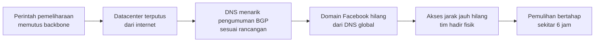

## Tujuan belajar

Setelah pelajaran ini kamu bisa:

- Menjelaskan rantai kejadian 4 Oktober 2021 dari perintah backbone sampai pemulihan bertahap.
- Mengkritisi desain health check yang "menarik diri bila tidak sehat" dan menyebut kapan ia menjadi bencana.
- Menjelaskan kenapa akses cadangan dan rencana menyalakan ulang sistem adalah requirement, bukan opsi.

Catatan: ringkasan ditulis ulang dari postmortem resmi Meta dan analisis publik Cloudflare. Baca sumber untuk detailnya.

## Konteks sistem

Datacenter Facebook di seluruh dunia terhubung lewat backbone, yaitu jaringan global milik sendiri. Ke dunia luar, Facebook mengumumkan alamat IP-nya lewat BGP dari titik-titik peering. BGP adalah protokol yang dipakai jaringan untuk saling memberi tahu rute.

Server DNS authoritative Facebook tersebar di banyak lokasi kecil. Server itu juga berada di alamat yang diumumkan lewat BGP. Untuk menjaga pengguna tidak diarahkan ke lokasi yang tidak sehat, server DNS memantau konektivitasnya ke datacenter. Bila konektivitas hilang, server DNS menarik pengumuman BGP untuk alamatnya sendiri.

## Kronologi 4 Oktober 2021

1. Tim menjalankan pemeliharaan rutin, berupa perintah untuk menilai kapasitas backbone global.
2. Perintah itu secara tak sengaja memutus semua koneksi backbone. Alat audit yang seharusnya mencegahnya mengandung bug.
3. Datacenter terputus satu sama lain dan dari internet.
4. Server DNS tidak bisa mencapai datacenter, lalu menarik pengumuman BGP sesuai rancangan.
5. Dalam hitungan menit, facebook.com, instagram.com, dan whatsapp.com tidak bisa di-resolve di seluruh dunia.
6. Resolver di seluruh dunia mencoba lagi berulang kali. Aplikasi pihak ketiga yang memakai login Facebook ikut terganggu.
7. Alat akses jarak jauh ke perangkat jaringan ikut hilang. Tim harus hadir fisik di datacenter, dengan prosedur keamanan fisik yang ketat.
8. Konfigurasi dipulihkan bertahap untuk menghindari lonjakan daya saat perangkat menyala dan lonjakan trafik saat pengguna kembali.
9. Setelah sekitar enam jam, layanan kembali. Postmortem dipublikasikan keesokan harinya.

## Akar masalah

| Lapisan                 | Apa yang terjadi                                        | Kenapa bisa terjadi                                                                 |
| ----------------------- | ------------------------------------------------------- | ----------------------------------------------------------------------------------- |
| Dampak perintah         | Satu perintah memengaruhi seluruh backbone global       | Tidak ada pembatasan lokasi atau tahap untuk perubahan jaringan                     |
| Pengaman                | Alat audit mengandung bug                               | Hanya ada satu lapisan pengaman, tanpa simulasi, konfirmasi, atau rollback otomatis |
| Desain health check DNS | Semua server DNS menarik diri serentak                  | Mekanisme untuk kegagalan sebagian tidak mempertimbangkan kegagalan total           |
| Akses pemulihan         | Alat akses jarak jauh bergantung pada jaringan produksi | Jalur cadangan tidak benar-benar terpisah                                           |
| Menyalakan ulang        | Menyalakan kembali berisiko lonjakan daya dan trafik    | Rencana ada tetapi lambat, dan jarang dilatih                                       |

## Desain health check: kapan menarik diri menjadi bencana

Pola "node yang tidak sehat keluar dari rotasi" benar untuk kegagalan sebagian. Satu lokasi DNS yang terputus memang tidak boleh menjawab dengan alamat yang tidak bisa dicapai. Masalahnya muncul saat semua node melihat kondisi yang sama. Beberapa pengaman yang lazim:

- Fail-static saat mayoritas gagal. Bila lebih dari sekian persen node ingin menarik diri bersamaan, hentikan penarikan dan pertahankan keadaan terakhir yang diketahui baik. Menjawab DNS dengan alamat yang mungkin tidak bisa dicapai lebih baik daripada menghilang total.
- Jendela waktu dan histeresis. Jangan bereaksi seketika. Kegagalan global biasanya berawal dari satu perubahan yang bisa dibatalkan dalam menit.
- Pisahkan sinyal kesehatan dari jalur yang sama dengan kegagalan. Periksa lebih dari satu sinyal.

Ini sama dengan prinsip static stability di modul karakteristik non-fungsional. Sistem harus bertahan pada keadaan baik terakhir saat sinyal kesehatannya hilang.

## Pola yang bisa dipetik

1. Perubahan jaringan global butuh rollout bertahap dan simulasi, sama seperti kode. Satu lokasi dulu, verifikasi konektivitas, baru lanjut.
2. Tindakan destruktif butuh beberapa lapisan pengaman: audit, simulasi, konfirmasi, dan batas lokasi. Asumsikan satu pengaman akan gagal.
3. Health check harus aman terhadap kegagalan total. Mekanisme keluar dari rotasi perlu batas mayoritas dan fail-static.
4. Akses cadangan harus benar-benar terpisah: jaringan, kredensial, DNS, dan otentikasi sendiri. Uji dengan mematikan jaringan produksi.
5. Rencanakan dan latih menyalakan ulang sistem besar. Daya, cache yang kosong, dan badai pengulangan request adalah risikonya.
6. Pihak ketiga yang bergantung pada login penyedia besar perlu cadangan, dan penyedia besar perlu sadar bahwa kegagalannya menjalar.

## Hubungannya dengan building block

| Building block            | Pelajaran dari insiden                                                                                        |
| ------------------------- | ------------------------------------------------------------------------------------------------------------- |
| DNS                       | TTL dan cache tidak menolong bila server authoritative menarik diri. Health check DNS harus fail-static       |
| Load balancer dan anycast | Penarikan BGP adalah health check di lapisan internet. Perilakunya saat semua gagal harus dirancang           |
| Deployment system         | Perubahan infrastruktur melewati pipeline bertahap dan simulasi seperti kode                                  |
| Monitoring                | Pemantauan dari luar mendeteksi "hilang dari internet" lebih cepat daripada dashboard internal yang ikut mati |

## Pertanyaan yang sering ditanya interviewer

- "Bagaimana memastikan satu perintah tidak memutus seluruh jaringan?" Jawab dengan batas lokasi per perubahan, simulasi, konfirmasi, dan rollback otomatis berbasis konektivitas.
- "Apakah health check kamu bisa menjatuhkan semuanya?" Jawab dengan fail-static saat mayoritas gagal dan histeresis.
- "Kalau jaringan produksi mati, bagaimana kamu masuk?" Jawab dengan jaringan manajemen terpisah, kredensial lokal, dan prosedur fisik yang dilatih.
- "Apa yang berbahaya saat menyalakan kembali sistem besar?" Jawab dengan lonjakan daya, cache kosong, dan badai request, lalu batasi laju dan atur urutannya.

## Ringkasan

1. Pada 4 Oktober 2021, satu perintah memutus backbone, DNS menarik pengumuman BGP sesuai rancangan, dan Facebook hilang dari internet sekitar enam jam.
2. Akar masalahnya berlapis: dampak perintah yang global, pengaman tunggal yang bug, health check yang tidak aman untuk kegagalan total, dan akses pemulihan yang bergantung pada jaringan produksi.
3. Polanya: rollout bertahap untuk infrastruktur, pengaman berlapis, fail-static saat mayoritas gagal, akses cadangan yang diuji, dan rencana menyalakan ulang.
