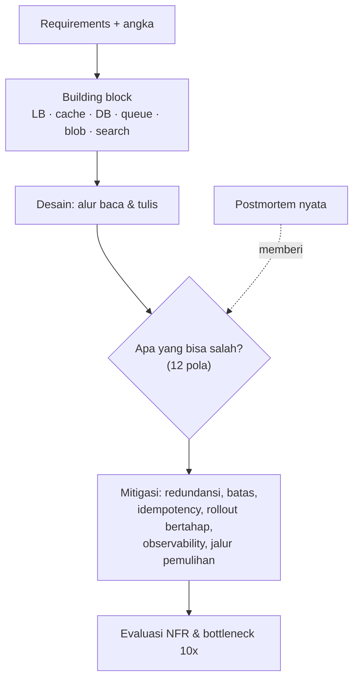

## Tujuan belajar

Setelah pelajaran ini kamu bisa:

- Menyebut dua belas pola yang berulang di seluruh kurikulum dan mengaitkannya ke building block, studi kasus, dan postmortem.
- Memakai checklist "apa yang bisa salah" di tahap evaluasi setiap desain.
- Merencanakan latihan lanjutan setelah kurikulum ini selesai.

## Satu peta untuk semuanya

Semua soal, dari TinyURL sampai bot LLM, berjalan di jalur yang sama. Yang membedakan kandidat kuat adalah langkah **F**: kemampuan menyebut mode kegagalan yang konkret dan mitigasinya tanpa diminta.

## Dua belas pola yang berulang

| #   | Pola                                                                            | Muncul di                                             | Mitigasi                                                                              |
| --- | ------------------------------------------------------------------------------- | ----------------------------------------------------- | ------------------------------------------------------------------------------------- |
| 1   | **Network tidak bisa dipercaya**: timeout ≠ gagal, retry menggandakan           | Abstraksi, queue, payment, AWS 2021                   | Idempotency key, backoff + jitter, retry budget, circuit breaker                      |
| 2   | **Baca ≫ tulis** dan hot key                                                    | Newsfeed, Instagram, Yelp, typeahead, cache           | Cache berlapis, replikasi key, L1, CDN                                                |
| 3   | **Satu baris/partisi panas**                                                    | Sharded counter, Uber, newsfeed selebriti             | Shard key merata, counter terbelah, agregasi, hybrid fan-out                          |
| 4   | **Data turunan boleh basi, sumber kebenaran tidak**                             | Search via CDC, cache, feed, index geospasial, ledger | Pisahkan sumber dan turunan; CDC/outbox; rekonsiliasi                                 |
| 5   | **Pekerjaan lambat keluar dari request path**                                   | Queue, scheduler, media pipeline, transcoding, judge  | Queue durable, worker idempotent, status + push                                       |
| 6   | **Urutan hanya per partisi/pengurut**                                           | Queue, pub-sub, WhatsApp, Google Docs                 | Kunci partisi, server pengurut dengan lease, versi                                    |
| 7   | **State yang berumur pendek di memori, yang berharga di DB**                    | Uber lokasi vs trip, presence, routing koneksi        | Self-healing state dengan TTL; durable untuk uang/kewajiban                           |
| 8   | **Perubahan (kode, config, jaringan) adalah penyebab insiden terbesar**         | Deployment, Cloudflare 2019/2022, Facebook 2021       | Artefak immutable, canary + analisis, rollout bertahap, rollback cepat                |
| 9   | **Batas tersembunyi dan asumsi ketersediaan**                                   | Kinesis 2020, Cloudflare 2023, NFR                    | Ketahui batas, cellularization, game day, DR drill                                    |
| 10  | **Mekanisme untuk kegagalan parsial bisa menjadi bencana saat kegagalan total** | DNS Facebook, health check, failover otomatis         | Fail-static, batas mayoritas, histeresis, static stability                            |
| 11  | **Jalur pemulihan dan observability tidak boleh berbagi nasib**                 | Ketiga postmortem, monitoring, logging                | Out-of-band access, meta-monitoring, status page independen, kill switch yang dilatih |
| 12  | **Kode/model tidak dipercaya harus dibatasi oleh mekanisme, bukan niat**        | Online judge, rate limiter, LLM tool layer            | Sandbox, least privilege, kebijakan deterministik di luar model, audit                |

## Checklist "apa yang bisa salah" untuk tahap evaluasi

Bawa ini ke setiap desain; pilih 2–3 yang paling relevan dan bahas dampak, deteksi, mitigasi:

- Dependency **lambat** (bukan mati): timeout, retry storm, antrian membengkak.
- **Cache hilang** sekaligus: DB tertimpa; warm-up, rate limit, serve-stale.
- **Hot key / hot partition** saat konten atau tenant viral.
- **Replication lag**: user tidak melihat tulisannya sendiri.
- **Duplikat**: pesan diproses dua kali, pembayaran dua kali, fan-out dua kali.
- **Perubahan global seketika**: config/aturan/jaringan tanpa canary.
- **Kehilangan satu zona/region**: apa yang masih berjalan, apa yang degradasi.
- **Health check/failover yang bereaksi serentak**: split brain, menarik diri massal.
- **Observability dan akses pemulihan ikut mati**.
- **Kesalahan operator**: perintah destruktif tanpa guardrail.
- **Batas sumber daya**: thread, koneksi, memori KV, kuota penyedia.
- **Input tidak dipercaya**: kode user, prompt, dokumen eksternal.

## Jawaban tiga kalimat yang selalu bisa dipakai

Saat ditanya "kelemahan desainmu?": sebut satu komponen dengan margin paling tipis dari estimasi, satu mode kegagalan dari checklist dengan dampaknya ke user, dan satu mitigasi beserta harganya. Contoh: "Margin paling tipis ada di cache timeline; kalau cluster-nya hilang, rekonstruksi massal akan menimpa DB; mitigasinya warm-up bertahap dan rate limit ke DB, dengan harga feed sebagian user tertunda beberapa menit."

## Langkah setelah kurikulum ini

1. **Mock interview rutin**: satu soal per minggu dengan timer 45 menit dan rubrik di platform ini; bandingkan dengan studi kasus setelah selesai, bukan sebelum.
2. **Tulis ulang satu studi kasus dari nol** tanpa melihat, lalu bandingkan; perbedaan adalah daftar belajar berikutnya.
3. **Baca satu postmortem publik baru per bulan** (Cloudflare, AWS, GitHub, Google) dan petakan ke dua belas pola; tambahkan pola baru bila ada.
4. **Dalami 2–3 building block** yang paling sering muncul di deep dive untuk target perusahaanmu (biasanya database, cache, queue) sampai bisa menjelaskan internal dan failure mode-nya tanpa catatan.
5. **Latih kalimat pembuka tiap tahap** dari framework 45 menit sampai otomatis.

## Pertanyaan yang sering ditanya interviewer

- "Ceritakan satu outage nyata dan pelajarannya." → Pilih satu dari Bagian 4; sebut rantai kejadian, akar masalah berlapis, dan pola.
- "Bagaimana kamu mendesain agar kesalahan operator tidak fatal?" → Guardrail alat, rollout bertahap, rollback otomatis, two-person rule.
- "Apa yang kamu pantau di hari pertama sistem ini hidup?" → Golden signals per SLO, lag antrian, hit ratio cache, saturasi dependency; alert berbasis gejala.
- "Kalau hanya boleh menambah satu pengaman, apa?" → Jawab berdasarkan margin tertipis dari estimasi; jelaskan alasannya.

## Ringkasan

1. Semua desain melewati jalur yang sama; yang membedakan adalah kemampuan menyebut mode kegagalan konkret dan mitigasinya.
2. Dua belas pola berulang mencakup network, data panas, turunan vs sumber kebenaran, pekerjaan async, urutan, perubahan sebagai risiko, batas tersembunyi, kegagalan total, jalur pemulihan, dan input tidak dipercaya.
3. Lanjutkan dengan mock interview rutin, menulis ulang kasus dari nol, dan memetakan postmortem baru ke pola.
