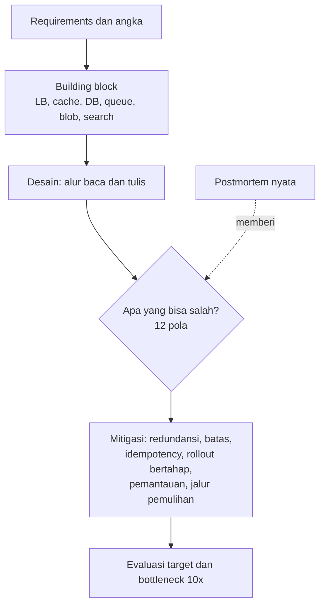

## Tujuan belajar

Setelah pelajaran ini kamu bisa:

- Menyebut dua belas pola yang berulang di seluruh kurikulum dan mengaitkannya ke building block, studi kasus, dan postmortem.
- Memakai checklist "apa yang bisa salah" di tahap evaluasi setiap desain.
- Merencanakan latihan lanjutan setelah kurikulum ini selesai.

## Satu peta untuk semuanya

Semua soal, dari TinyURL sampai bot LLM, berjalan di jalur yang sama. Yang membedakan kandidat kuat adalah langkah F. Mereka bisa menyebut mode kegagalan yang konkret dan mitigasinya tanpa diminta.

## Dua belas pola yang berulang

| Nomor | Pola                                                                                      | Muncul di                                               | Mitigasi                                                                                         |
| ----- | ----------------------------------------------------------------------------------------- | ------------------------------------------------------- | ------------------------------------------------------------------------------------------------ |
| 1     | Jaringan tidak bisa dipercaya. Timeout bukan kegagalan, dan pengulangan menggandakan efek | Abstraksi, queue, payment, AWS 2021                     | Idempotency key, jeda membesar dengan unsur acak, jatah pengulangan, circuit breaker             |
| 2     | Baca jauh lebih banyak dari tulis, dan ada key yang panas                                 | Newsfeed, Instagram, Yelp, typeahead, cache             | Cache berlapis, replikasi key, cache lokal, CDN                                                  |
| 3     | Satu baris atau partisi menjadi panas                                                     | Sharded counter, Uber, newsfeed selebriti               | Shard key yang merata, counter terbelah, agregasi, fan-out campuran                              |
| 4     | Data turunan boleh basi, sumber kebenaran tidak                                           | Search lewat CDC, cache, feed, index geospasial, ledger | Pisahkan sumber dari turunan, pakai CDC atau outbox, rekonsiliasi berkala                        |
| 5     | Pekerjaan lambat keluar dari jalur request                                                | Queue, scheduler, pipeline media, transcoding, judge    | Queue durable, worker idempotent, status dan push                                                |
| 6     | Urutan hanya dijamin per partisi atau per pengurut                                        | Queue, pub-sub, WhatsApp, Google Docs                   | Kunci partisi, server pengurut dengan lease, nomor versi                                         |
| 7     | State berumur pendek di memori, state berharga di DB                                      | Lokasi Uber versus trip, presence, routing koneksi      | State yang memulihkan diri dengan TTL, durable untuk uang dan kewajiban                          |
| 8     | Perubahan adalah penyebab insiden terbesar                                                | Deployment, Cloudflare 2019 dan 2022, Facebook 2021     | Artefak immutable, canary dengan analisis, rollout bertahap, rollback cepat                      |
| 9     | Batas tersembunyi dan asumsi ketersediaan                                                 | Kinesis 2020, Cloudflare 2023, NFR                      | Ketahui batasnya, kelompokkan ke sel, latihan mematikan sesuatu                                  |
| 10    | Mekanisme untuk kegagalan sebagian bisa menjadi bencana saat kegagalan total              | DNS Facebook, health check, failover otomatis           | Fail-static, batas mayoritas, histeresis, static stability                                       |
| 11    | Jalur pemulihan dan pemantauan tidak boleh ikut sakit                                     | Ketiga postmortem, monitoring, logging                  | Akses cadangan, pemantauan untuk pemantauan, halaman status independen, kill switch yang dilatih |
| 12    | Kode atau model yang tidak dipercaya dibatasi oleh mekanisme, bukan niat                  | Online judge, rate limiter, tool layer LLM              | Sandbox, hak akses minimum, kebijakan deterministik di luar model, audit                         |

## Checklist "apa yang bisa salah" untuk tahap evaluasi

Bawa daftar ini ke setiap desain. Pilih dua atau tiga yang paling relevan, lalu bahas dampak, cara mendeteksi, dan mitigasinya.

- Dependency menjadi lambat, bukan mati: timeout, badai pengulangan, antrian membengkak.
- Cache hilang sekaligus: database tertimpa beban. Siapkan pemanasan bertahap, rate limit, dan menyajikan data basi sementara.
- Key atau partisi panas saat konten atau tenant viral.
- Replica tertinggal: pengguna tidak melihat tulisannya sendiri.
- Duplikat: pesan diproses dua kali, pembayaran dua kali, fan-out dua kali.
- Perubahan global seketika: konfigurasi, aturan, atau jaringan tanpa canary.
- Kehilangan satu zona atau region: apa yang masih berjalan, apa yang berkurang.
- Health check atau failover yang bereaksi serentak: split brain, menarik diri massal.
- Pemantauan dan akses pemulihan ikut mati.
- Kesalahan operator: perintah destruktif tanpa pengaman.
- Batas sumber daya: thread, koneksi, memori, kuota penyedia.
- Input yang tidak dipercaya: kode pengguna, prompt, dokumen eksternal.

## Jawaban tiga kalimat yang selalu bisa dipakai

Saat ditanya "apa kelemahan desainmu?", jawab dengan tiga kalimat. Sebut satu komponen dengan margin paling tipis dari estimasi. Sebut satu mode kegagalan dari checklist beserta dampaknya ke pengguna. Lalu sebut satu mitigasi beserta harganya.

Contoh: "Margin paling tipis ada di cache timeline. Kalau cluster-nya hilang, rekonstruksi massal akan menimpa database. Mitigasinya pemanasan bertahap dan rate limit ke database, dengan harga feed sebagian pengguna tertunda beberapa menit."

## Langkah setelah kurikulum ini

1. Lakukan mock interview rutin, satu soal per minggu dengan timer 45 menit dan rubrik di platform ini. Bandingkan dengan studi kasus setelah selesai, bukan sebelum.
2. Tulis ulang satu studi kasus dari nol tanpa melihat, lalu bandingkan. Perbedaannya adalah daftar belajarmu berikutnya.
3. Baca satu postmortem publik baru per bulan, lalu petakan ke dua belas pola. Tambahkan pola baru bila ada.
4. Dalami dua atau tiga building block yang paling sering muncul di deep dive untuk perusahaan targetmu, biasanya database, cache, dan queue.
5. Latih kalimat pembuka tiap tahap dari framework 45 menit sampai otomatis.

## Pertanyaan yang sering ditanya interviewer

- "Ceritakan satu outage nyata dan pelajarannya." Pilih satu dari Bagian 4. Sebut rantai kejadian, akar masalah berlapis, dan polanya.
- "Bagaimana kamu mendesain agar kesalahan operator tidak fatal?" Jawab dengan pengaman pada alat, rollout bertahap, rollback otomatis, dan persetujuan dua orang.
- "Apa yang kamu pantau di hari pertama sistem ini hidup?" Jawab dengan sinyal utama per target, lag antrian, hit ratio cache, dan kejenuhan dependency.
- "Kalau hanya boleh menambah satu pengaman, apa?" Jawab berdasarkan margin tertipis dari estimasi, lalu jelaskan alasannya.

## Ringkasan

1. Semua desain melewati jalur yang sama. Yang membedakan adalah kemampuan menyebut mode kegagalan konkret dan mitigasinya.
2. Dua belas pola berulang mencakup jaringan, data panas, turunan versus sumber kebenaran, pekerjaan asinkron, urutan, perubahan sebagai risiko, batas tersembunyi, kegagalan total, jalur pemulihan, dan input tidak dipercaya.
3. Lanjutkan dengan mock interview rutin, menulis ulang kasus dari nol, dan memetakan postmortem baru ke pola.
